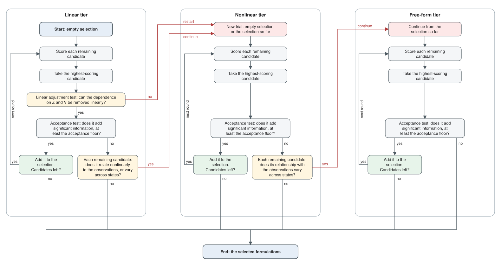
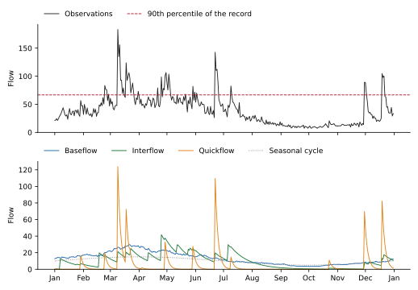

# A framework for hydrologic model selection through conditional independence testing

This document describes the methodology used to select a subset of hydrologic formulations that carry distinct information about observed streamflow from a superset of possible formulations. It is the canonical description; the README summarizes it and docstrings refer to its sections.

## Purpose and scope

### Premise

Traditional statistical evaluation is fundamentally unsuited to establishing the value of different hydrologic model formulations for some practical application, such as reservoir operation or flood prediction. There are two reasons. First, hydrologic models share many attributes: forcing datasets, geospatial datasets, process theory, and calibration methods and data. Models that leverage shared theory and data inevitably carry much of the same information, and can share the same errors (Abramowitz et al., 2019). However, traditional statistical evaluation focuses on each model separately. It cannot effectively distinguish between degrees or aspects of quality that are shared between models or unique to particular models, because they are both aggregated together. Second, most statistical measures of forecast quality, such as the mean squared error and the Nash–Sutcliffe efficiency, are sensitive to bias. Bias can be removed by statistical post-processing (Murphy and Winkler, 1987; Murphy, 1993), so a measure that emphasizes bias can obscure a formulation's "inherent" value.

This pipeline starts from that premise. It is concerned with model selection. It identifies, for one basin, the model formulations whose simulated flow carries information about observed flow that the formulations already selected do not. Conditional independence of a candidate and the observations, given the selected formulations, is the formal statement that the candidate contributes no such information, and is the hypothesis each selection step tests.

### Why model selection?

Evaluating each formulation separately against observations answers "how well does this model reproduce the observations?". Formulations that share forcing, structure and other attributes are closely related, so several can score well while carrying largely the same information. Model selection asks a different question: what information does a candidate formulation contribute about the observations that the selected formulations do not? A formulation whose information is already carried by the selected set adds nothing, however well it scores on its own. Selection avoids retaining formulations that are redundant with one another.

### Why information rather than error?

The forecast evaluation literature separates two aspects of the quality of predictions: systematic errors, which statistical post-processing can remove, and the association between predictions and outcomes, which no recalibration can create (Murphy and Winkler, 1987; Murphy, 1993). The decomposition of the Nash–Sutcliffe efficiency into correlation, bias and variability alludes to this distinction: only the correlation term cannot be repaired by rescaling (Gupta et al., 2009). Information here means statistical dependence between simulated and observed flow, which is invariant to bias that post-processing can correct (Cover and Thomas, 2006). Selection therefore rests on information, that is, association, rather than error.

A systematic error therefore counts only if it changes the ordering of a formulation's flows over the record. In general, the framework is insensitive to errors that simple statistical post-processing removes, given observations over the same record. This includes a seasonal bias in mean flow or any bias that is removed by quantile mapping each simulated flow to the observed flow of the corresponding rank. A mass balance error is an example of a systematic error. Most mass balance errors that differ between formulations, such as too much evapotranspiration, act through the model's storage: they change the timing of water stored and released, and so the ordering of flows, at least in part. The framework is sensitive to errors that change the relative ordering of the observed and simulated flows, whatever their cause, such as a bias that drifts over the record, differs between storms of similar size, or varies with season beyond the mean.

### Why model selection and not model combination?

Model combination and model selection are complementary but answer different questions. Combination is a prediction framework that leverages association and corrects for bias. A combiner is fitted, such as a weighted average, Bayesian model averaging or a learned nonlinear combiner. Each formulation's weight, or its ex-post attribution, then describes how that fitted combiner uses it. Shapley values, widely used to interpret machine-learning models, are one such attribution (Shapley, 1953; Štrumbelj and Kononenko, 2014). Selection here is an evaluation framework built on conditional independence. If a candidate is conditionally independent of the observations given the selected formulations, no predictor that operates on the paired time series can leverage information in the candidate to better predict the observations than the selected formulations already allow, subject to sampling uncertainty. The pipeline tests for conditional independence under progressively weaker assumptions about the form of the relationships, from linear to no functional form, which are relevant to choosing a combiner, but without committing to a combination framework in advance.

### Two pathways

Selection runs in two pathways, which differ in what a sample represents:

- **Pooled pathway.** One sample per time step over the whole record, so a formulation's added information is measured across all flow conditions. Every test conditions on the time of year, so a formulation is not credited with simple climatological information (see [Samples, Seasonality](#seasonality)). Samples are strongly statistically dependent in time. The pooled pathway considers all data, but may be configured with the candidate and the observations censored below a flow threshold, such as a high flow threshold, to place emphasis on flows above that threshold, including both false alarms and misses (see [Samples, Censoring at high flow](#censoring-at-high-flow)).
- **High-flow event pathway.** One sample per high-flow event, identified from the simulations, not the observations (see [Samples, Identifying high-flow events](#identifying-high-flow-events)). Each event is described by a few parameters that summarize the information in its hydrograph (see [Event representation](#event-representation)), rather than by the raw streamflow values within it. Those values describe a single high-flow event, such as a flood, and are pseudo-replicates of it (Hurlbert, 1984): an event provides one sample, however many time steps it spans. Samples are few and much less dependent than time steps.

In both pathways the candidate, the observations and the selected formulations are compared on matched samples: the same time step in the pooled pathway, the same event window with a shared registration in the high-flow event pathway. Better timing of the response, through better representation of routing, storage or channel hydraulics, therefore counts as information: in the pooled pathway as a difference in flow at the time it occurs, in the high-flow event pathway through the shape features that describe timing within the event, if they are retained (see [Samples, Event representation](#event-representation)).

### Relation to existing methods

Three lines of work are closest. Forecast encompassing asks whether one forecast explains the outcome beyond another (Chong and Hendry, 1986; Fair and Shiller, 1990; Harvey et al., 1998). Information-theoretic evaluation measures the information a model carries about the observations rather than its error (in hydrology, for example, Weijs et al., 2010; Nearing and Gupta, 2015). Markov-blanket feature selection uses conditional independence testing to find the minimal set of variables that contains the same information about a target variable (here, the observations) as the full set (Margaritis and Thrun, 2000; Tsamardinos et al., 2003). This framework asks the first question, about the quantity of the second, with the search of the third, for sets of hydrologic formulations that share much of their information, using tests that allow for strong serial dependence and relax the linear form.

## Overview of the procedure

Both pathways follow the same procedure: they test the same hypothesis, select by the same cascade and tests, and report the same results. They differ in how the samples are formed and how dependence between samples is handled. The description is therefore organized by the common elements of both pathways, and the unique characteristics of the samples are identified separately within that structure. The procedure has five steps:

1. **Samples.** Every series is transformed to a common scale, and the samples are formed: one per time step in the pooled pathway, one per high-flow event (described by its features) in the high-flow event pathway (see [Samples](#samples)).

2. **Selection.** Formulations are added one at a time by greedy forward selection. In each round, the formulation not yet selected (a *candidate*) that carries the most information about the observations beyond the selected formulations is added if it meets two conditions. First, the measured information must be statistically significant. Second, it must reach the acceptance floor, an effect-size floor set as a minimum share of the observations' variation that is not yet explained (see [Selection, Acceptance test](#acceptance-test)). Selection stops at the first round whose best candidate does not meet both conditions. A backward pass then eliminates any selected formulation that is rendered uninformative by the formulations selected after it (e.g., the first selected formulation; see [Selection, Backward pass](#backward-pass)). Selection runs through three tiers of tests as a cascade, from the least general and most powerful to the most general and least powerful, moving to a more general tier only when an escalation test finds the simpler tier's assumptions violated (see [Selection](#selection)).

3. **Hypothesis tests.** Each candidate is tested against the null hypothesis that it carries no information about the observations beyond the selected formulations (see [Hypothesis tests](#hypothesis-tests)). No single test is both valid and powerful for every form of dependence, so the three tiers remove the dependence on the selected formulations under different assumptions, and each detects a different range of remaining dependence between the candidate and the observations. The tests account for statistical dependence between samples (see [Dependence between samples](#dependence-between-samples)).

    - **Linear tier.** Assumes the selected formulations act linearly on the candidate and the observations, and detects a linear relationship between the candidate and the observations that the selected formulations do not account for, averaged over states. A relationship that varies across states is detected only through its average, which cancels when the relationship changes direction. Uses linear regression (partial correlation).

    - **Nonlinear tier.** Allows the selected formulations to act nonlinearly, and detects dependence of any shape between the candidate and the observations that the selected formulations do not account for, including dependence that varies with state. It detects effect modification through many transformations of the variables, and misses it only when it cancels exactly across states. A candidate is accepted only if it also explains enough of the observations' variation, through a function of the candidate; information about the spread or shape of the observations alone is not enough (see [Assumptions and limitations](#assumptions-and-limitations)). Uses nonlinear regression.

    - **Free-form tier.** Assumes only that the candidate's distribution changes smoothly with the selected formulations, and detects dependence of any shape within states, including effect modification that cancels across states, to any degree, which the other tiers can miss. Uses conditional mutual information.

4. **Post-selection checks.** The formulation chosen in a round may be one of several that carry the same information, so each selected formulation is compared with the formulations not selected, and the sets of formulations the data support equally are identified. In the high-flow event pathway, the stopping round is also repeated on alternative bases, for contributions in shapes the shared basis does not represent. The checks are reported, but do not affect the selection (see [Post-selection checks](#post-selection-checks)).

5. **Results.** Every result reports the selection, the checks, and the diagnostics of the assumptions behind each decision (see [Results](#results)).

## Notation and terminology

Italic upper-case letters denote random variables, scalar or vector-valued, and bold upper-case letters denote matrices. Lower-case letters denote realizations, counts and constants. Statistics and hypotheses are named by convention. Every symbol used in more than one place is defined here; a symbol that appears in a single formula is defined where it appears.

**Variables**

| Symbol | Meaning |
| --- | --- |
| $O$ | Observed flow (the target) |
| $C$ | The candidate formulation under test |
| $Z$ | The formulations already selected (empty in the first round) |
| $V$ | Conditioning covariates included in every test: the time of year in the pooled pathway, the event's registration parameters in the high-flow event pathway |
| $W$ | A selected formulation, when it is compared with a candidate (see [Interchangeable formulations](#interchangeable-formulations)) |
| $t$ | Index of a sample (a time step or an event) |

**Counts**

| Symbol | Meaning |
| --- | --- |
| $n$ | Number of samples |
| $n_{\mathrm{m}}$ | Number of formulations |
| $d$ | Number of features of each series, the same for $C$ and $O$: one in the pooled pathway (the flow at a time step); in the high-flow event pathway, the number of event features (scores on the shape modes of the event hydrograph; see Event representation) |
| $k$ | Number of conditioning variables, that is, the features of the selected formulations plus the covariates |
| $n_{\mathrm{r}}$ | Number of resamples (null draws) per test |
| $n_{\mathrm{b}}$ | Number of blocks in a sample: its time span divided by the multipliers' bandwidth (or, for high-flow events, the dependence lag); with clusters of events, the number of clusters |
| $k_{\mathrm{nn}}$ | Number of nearest neighbours in the conditional mutual information estimator |

**Hypotheses**

| Symbol | Meaning |
| --- | --- |
| $H_0$, $H_1$ | The null and alternative hypotheses of a selection step |
| α | Significance level |

**Transformations and residuals**

| Symbol | Meaning |
| --- | --- |
| $\phi$, $\psi$ | Transformations of $C$ and of $O$ |
| $R_C$, $R_O$ | Residuals of $C$ and $O$ after their dependence on $Z$ and $V$ is removed |
| $R_\phi$, $R_\psi$ | Residuals of $\phi(C)$ and $\psi(O)$ after their dependence on $Z$ and $V$ is removed |

**Statistics and effect sizes**

| Symbol | Meaning |
| --- | --- |
| $\rho_i$ | Canonical correlations between $R_C$ and $R_O$ |
| Λ, PC | Wilks' lambda, and the partial canonical correlation PC = 1 − Λ |
| PT | Pillai's trace, $\mathrm{PT} = \sum_i \rho_i^2$ |
| RV | The RV coefficient |
| $I$ | Conditional mutual information, in nats |
| $R^2$ | An effect size as a share of variation: the set-correlation $R^2$, or the semipartial $R^2$ of an escalation test |

**Resampling and regression**

| Symbol | Meaning |
| --- | --- |
| $w_t$ | Bootstrap multipliers |
| ℓ | Bandwidth of the multipliers' correlation |
| $h_t$ | Leverage of sample $t$ in a least-squares regression |
| $\kappa$, $\mathbf{K}$ | A kernel function and its kernel matrix |
| $\sigma$ | Kernel bandwidth |
| $\tau$ | Lag, in time steps |
| $\delta$ | Memory parameter of a long-memory process (written $d$ in that literature) |
| $\tau_e$ | E-folding time of an autocorrelation, in time steps |

A *simulated series* is the streamflow simulated by one model formulation for the basin, and the *observed series* is the gauged streamflow; *series* refers to either, and "every series" means all simulated series and the observed series.

A *feature* is one component of $C$ or $O$: the series itself in the pooled pathway, or one event feature in the high-flow event pathway. A *sample* is one element of the data a test uses: a time step in the pooled pathway, a high-flow event in the high-flow event pathway. A *conditioning variable* is one component of $Z$ and $V$. The *dependence lag* is the time separation beyond which samples are treated as approximately independent, estimated from the formulations' autocorrelation (see [Dependence between samples](#dependence-between-samples)).

## Samples

### Pooled pathway

Each sample is one time step; the samples span the whole record. Each series is transformed by its signed square root, $\mathrm{sign}(x)\,|x|^{1/2}$, and standardized. Every test conditions on the time of year (see [Seasonality](#seasonality)).

The transform is the Box–Cox power transform with exponent 1/2 (Box and Cox, 1964), in the signed form of Bickel and Doksum (1981), where zero and negative flows keep their value and sign. It does not change the hypothesis tested because conditional independence is unchanged by an invertible transform of each variable (Cover and Thomas, 2006). It changes what the linear and nonlinear tiers measure. Streamflow is strongly skewed, and the errors in streamflow predictions increase with flow (heteroscedasticity). Thus, on a linear scale, a small number of large flows dominate the analysis. The square root reduces skew and heteroscedasticity, so the statistics are less sensitive to a few large values (McInerney et al., 2017). It also improves the normal approximation under the central limit theorem, which the hypothesis tests rely on. Here, each statistic is built from sums of residual products, whose distribution approaches normality more slowly as the products become more skewed (Hall, 1992), and the products are much less skewed on the square-root scale. The cost is longer dependence: the slow variations of low and moderate flows, which persist far longer than storm responses, carry more of the transformed series' variation, so samples stay dependent over longer lags. The linear tier measures linear association on the square-root scale. A relationship that is linear and additive in flow, such as observations close to a weighted combination of two formulations, is curved on the square-root scale, and the escalation tests can then move selection to a more general tier. The curvature grows with the square of the formulations' relative difference, so it is small when formulations target the same flow (the majority case) and when they agree closely at each time step (less common/more variable), and larger when formulations target different flow contributions (e.g., where some models ignore important flow pathways). High flows are emphasized separately: by censoring, which is applied on the same square-root scale (see [Censoring at high flow](#censoring-at-high-flow)), and by the high-flow event pathway (see [High-flow event pathway](#high-flow-event-pathway)). Standardizing puts every series on a common, unitless scale.

#### Missing values

Every comparison uses only the time steps at which the observations and every formulation have values, so that all formulations are compared on the same time steps. This matters because values are not always missing at random. Simulations are normally complete, so missing values usually come from the observations.

#### Seasonality

In the pooled pathway, every test conditions on the time of year, for two reasons. First, a formulation should not be credited for reproducing the average seasonal cycle. It can be estimated from the observed climatology without any model, and the climatological seasonal cycle is a standard benchmark in hydrologic model evaluation (Garrick et al., 1978; Schaefli and Gupta, 2007). Selection therefore measures information beyond the time of year: departures from the average cycle in particular years, such as an early snowmelt or an unusually wet season, count; the average cycle itself does not. Second, the annual cycle makes the series nonstationary. Conditioning on the time of year allows their joint distribution to change with season, as conditional-independence methods do for nonstationary data (Huang et al., 2020).

The time of year enters every test as the seasonal phase in $V$: the sine and cosine of $2\pi s/365$ for calendar day $s$, so the year has no start or end. The nonlinear and free-form tiers condition on the phase through kernel regressions and nearest neighbours that can represent any function of it, including abrupt seasonal transitions such as the onset of snowmelt. The linear tier conditions on the phase through the sine and cosine only; where the series depend on the phase in other ways, its adequacy tests lead to the nonlinear tier.

The seasonal cycle can be described only when each calendar day recurs over several years. In practice, the tests condition on the time of year only when the median calendar day contains data in three or more years. Shorter series are tested without the seasonal phase, so a formulation can then be credited with reproducing the seasonal cycle. On a shorter record, conditioning on the phase would remove the record's own events, rather than the average seasonal cycle.

#### Censoring at high flow

With censoring at a high flow threshold, the pooled pathway tests information about high flows. The candidate and the observations are each censored at a high quantile of their own record: every value below the quantile is set to the quantile value itself. Each series is censored at its own quantile, rather than an absolute flow value. As such, the evaluation remains insensitive to systematic errors that preserve the ordering of flows (see [Why information rather than error?](#why-information-rather-than-error)): a formulation that simulates too much or too little flow, on average, is censored at its own high flows and not a fixed level that generates differential biases across formulations. Flow itself is censored, so that a high flow is defined unconditionally and not relative to its season. Censoring is applied after the transform, so the censored values lie at the quantile, adjacent to the values above it. Censoring does not change what a rejection means. The censored candidate and the censored observations are functions of the candidate and the observations alone, and the conditioning set is the same with and without censoring. Given the same conditioning set, functions of two variables are conditionally independent whenever the variables themselves are conditionally independent (Dawid, 1979). Conditional independence without censoring therefore implies conditional independence with censoring, so a rejection with censoring is also evidence against conditional independence without it, although the uncensored test need not reject on the same record. The converse does not hold: the censored null is weaker, because it concerns high flows only. The implication requires the conditioning set to stay the same; it would fail if the selected formulations were censored too, because conditional independence given a variable does not imply conditional independence given a function of it. Censoring also selects no samples. Each series' threshold is one number estimated from its own record, as are the transform's mean and standard deviation; a constant adds no dependence between time steps. Above the threshold, association is measured conventionally. At the threshold itself, association is measured on the exceedance of the threshold, i.e., the indicator value of streamflow. Below the threshold, flows count only as not exceeding it. This is analogous to threshold-weighted scoring rules, such as the threshold-weighted CRPS (Gneiting and Ranjan, 2011; Allen et al., 2023), which maintain propriety by censoring flows below the threshold and accounting for them at the threshold itself, rather than ignoring them, which would be statistically improper (i.e., it would ignore false alarms, the forecaster's dilemma; Lerch et al., 2017).

Formally, write $t_C$ for the candidate's threshold, $C^* = \max(C, t_C)$ for the censored candidate and $E_C = 1\{C > t_C\}$ for its exceedance of the threshold, and likewise $t_O$, $O^*$ and $E_O$ for the observations. Each censored series determines its own exceedance indicator ($E_C = 1\{C^* > t_C\}$), so the chain rule of mutual information (Cover and Thomas, 2006) splits the information tested into four parts:

```math
I(C^*; O^* \mid Z) = I(E_C; E_O \mid Z) + I(E_C; O^* \mid E_O, Z) + I(C^*; E_O \mid E_C, Z) + I(C^*; O^* \mid E_C, E_O, Z).
```

The first part is agreement on whether flow is high: hits, misses, false alarms and correct rejections all count. The second is information in the candidate's exceedance about how far the observations exceed, and the third the reverse. The fourth is the continuous association of the two magnitudes, which is nonzero only where both exceed. Flows below a threshold enter only through the indicators: every time step counts, but the ordering of flows below the threshold does not. The decomposition is exact for the conditional mutual information that the free-form tier estimates; the regression tiers detect the same dependence through the censored values.

Censoring is therefore not the same as subsetting. Conventional threshold-based evaluation computes a measure on the subset of time steps at which the observations, the simulations or both exceed a threshold. That measures association only within a subset chosen by the outcome, and discards the agreement on whether flow is high, the first term above. Selecting on the observations ignores false alarms, which is improper (the forecaster's dilemma; Lerch et al., 2017); selecting on both creates dependence between them where none exists (selection bias; Hernán et al., 2004). Censoring selects no time steps, so neither problem arises.

The selected formulations enter the conditioning set uncensored, as in the uncensored pathway: as transformed series, with the seasonal phase. The null hypothesis is that the censored candidate carries no information about the censored observations beyond everything the selected formulations carry, at every flow. Censoring the selected formulations too would condition on less than they carry, and a candidate could then be credited with information about high flows that their lower flows already contain.

The censored series have seasonal cycles because high flows concentrate in some seasons, so the seasonal phase, which is in the conditioning set of every test, ensures that a candidate is not credited for that. Censoring changes how the tiers remove $Z$ and $V$ from each censored series, as described with each tier (see [Linear tier, Censored series](#linear-tier); [Nonlinear tier, Conditional means of the transformations](#nonlinear-tier)). Everything else follows the uncensored pathway: the samples, the dependence lag, which is estimated from the uncensored formulations, and the acceptance floor. Effect sizes are shares of the censored observations' variation, which comes from whether flow exceeds the threshold and by how much.

### High-flow event pathway

Each sample is one high-flow event, described by the features of its hydrograph.

#### Identifying high-flow events

**Data.** High-flow events are defined from the simulations, not the observations. Evaluating predictions on subsets of occasions selected by the observed outcome, such as observed extremes, makes even proper scoring rules improper and rewards strategies that predict extremes too often (the forecaster's dilemma; Lerch et al., 2017). High-flow events are therefore identified from the simulations, directly analogous to the information available at forecast issue time when the models are forced with meteorological forecasts. The events then contain false alarms but not misses (see [Limitations](#limitations), False alarms and misses at high flows). Every series, the observed series included, is then evaluated over the resulting event windows.

Event detection uses each series' own values, so that a formulation's events do not depend on gaps in the observations. An event is included when every formulation has values throughout it and the observations have at least one. Gauges often fail at high flow, so gaps in the observations cluster within high-flow events; observed curves with gaps are therefore scored from their observed points rather than discarded or filled (see [Appendix E](#appendix-e-technical-details-of-high-flow-events)).

**Events per formulation.** Each formulation's own events and peaks are detected on its own flow series by an event detector: wavelet-assessed scale-space persistence (WASP) by default, or peaks over threshold (POT; see Appendix E, Event detection methods). For the consensus, each formulation's flow is converted to percentile ranks of its own record, so formulations with different volume biases are comparable.

**Consensus events.** The formulations' results are combined in four steps, each following the same majority principle:

1. **High-flow time steps.** A time step is high flow when the upper median of the formulations' percentile ranks reaches the high-flow quantile (0.90 by default), that is, when at least half of the formulations agree that flow is high relative to their own record. Simulated high flows that were not observed (false alarms) therefore remain among the samples when at least half of the formulations agree on them, and a single formulation's own false alarms are excluded.
2. **Events.** Contiguous high-flow periods are joined into one event when at least half of the formulations have a single own event spanning both; otherwise they remain separate. Whether two periods belong to one high-flow event is thus left to the formulations' own event detectors; no separation length is used.
3. **Windows.** Each event is widened to the union of the formulations' best-overlapping own events, so no formulation's rising limb or recession is clipped. Where widened windows overlap, they are separated at the minimum of the consensus rank between the two events' peaks, the point where the two events' hydrographs are least intertwined; no two events share a time step.
4. **Peaks.** A window is an event only if at least one formulation's own detector found a peak within it. A window without one, such as a brief excursion above the threshold on the recession of a high-flow event, is removed and its time steps return to any adjoining event.

#### Event representation

The streamflows within a high-flow event are the hydrologic effect of a common cause, such as a tropical cyclone or temperature-induced snowmelt. They are effectively pseudo-replicates of that effect: an event carries far less information than its number of time steps suggests. Each event's hydrograph is therefore represented by a small number of features that describe its salient aspects, such as magnitude, timing and shape, consistent with the information the event actually carries.

The hydrographs of every series in an event are registered to a common time scale, shared by all of them. The features come from functional principal component analysis (Ramsay and Silverman, 2005), which approximates each registered curve $x(u)$, over the event's normalized time $u \in [0, 1]$, as

```math
x(u) \approx \mu(u) + \sum_{j=1}^{d} \xi_j\, \eta_j(u),
```

where $\mu$ is the mean shape, $\eta_j$ are the shape modes, the eigenfunctions of the curves' covariance ranked by the variation they explain, and the scores $\xi_j$ are the $d$ features. Every series is described on the same modes, so each score means the same thing for every formulation and for the observations. The scores are standardized jointly across series.

Two choices keep the features comparable without carrying information about the observations into the selection. The basis includes the observed curves, so that shapes occurring only in the observations are represented; it is fitted without using which observed curve belongs to which event, so it cannot create an association between a candidate and the observations. The shared registration removes only each event's length and placement, which become conditioning covariates (see [Hypothesis testing framework](#hypothesis-testing-framework)), and keeps each series' timing relative to the others. The hypothesis tested in this pathway therefore concerns the features of the events (see [Assumptions](#assumptions), High-flow events defined from the formulations).

The number of features balances two aims: describing the events completely enough, and keeping the number of dimensions consistent with the information that a limited number of events can carry. Only the aspects of an event that the features describe can count toward selection: a formulation that reproduces observed behaviour better in a shape mode that was not retained cannot be credited for it. Each feature adds a dimension to every test, which reduces its power. How to choose the number is described in Appendix A (Choosing the number of event features).

Every retained feature counts as one equal aspect of the event, whatever its share of the event variation: the features are standardized jointly, and no test depends on a feature's scale (see [Hypothesis tests](#hypothesis-tests)). A candidate is selected when it adds information about one or more aspects, without regard to how much of the hydrograph those aspects account for. Weighting the features by explained variance is not possible in every tier, because the free-form tier's measure is unchanged by any rescaling of a feature.

## Selection

Selection applies a sequence of hypothesis tests to the formulations (see [Hypothesis tests](#hypothesis-tests)). Each test asks whether a candidate $C$ carries information about the observations $O$ beyond the selected formulations $Z$ and the conditioning covariates $V$, that is, whether $C$ and $O$ are conditionally independent given $Z$ and $V$ (see [Hypothesis testing framework](#hypothesis-testing-framework)). Finding every set of formulations the data support would mean testing every subset: $2^{n_{\mathrm{m}}} - 1$ sets for $n_{\mathrm{m}}$ formulations, each through the cascade, which is computationally prohibitive beyond a few formulations. Formulations are therefore added one at a time by greedy forward selection, which tests at most $n_{\mathrm{m}}$ candidates in each of at most $n_{\mathrm{m}}$ rounds, within a cascade of the three tiers. A backward pass then removes the selected formulations that no longer add information, given the others.

**Two kinds of error.** A selection step can err in two ways (Neyman and Pearson, 1933). A *false selection* (type I error) accepts a candidate that carries no information about the observations beyond $Z$ and $V$. A *missed selection* (type II error) fails to accept a candidate that does. Both are selection errors, and both are important. However, significance testing controls them unequally (Lehmann and Romano, 2005). The null hypothesis, that the candidate adds no information, specifies the distribution of the test statistic, so where a tier's assumptions hold, each step's false-selection rate is held at a chosen significance level. The alternative specifies no distribution, because it covers contributions of any size and form. The missed-selection rate can therefore be stated only for an assumed contribution, and it is not reported. A non-acceptance is not evidence that a candidate contributes nothing (see [Step outcomes and the meaningful-effect threshold](#step-outcomes-and-the-meaningful-effect-threshold)).

### The cascade

No single test is valid and powerful for every form of dependence (see [Hypothesis testing framework](#hypothesis-testing-framework)), so three tiers of tests make different assumptions. Each tier tests the null hypothesis that the candidate adds no information; only a rejection is conclusive. The linear and nonlinear tiers detect dependence averaged over the states of $Z$ and $V$, and the free-form tier detects dependence within states.

| | Linear tier | Nonlinear tier | Free-form tier |
| --- | --- | --- | --- |
| Detects | Linear dependence, averaged over states of $Z$ and $V$ | Dependence of any shape, averaged over states of $Z$ and $V$ | Dependence of any shape within states of $Z$ and $V$, including dependence that varies across states |
| Valid when | The conditional means of $C$ and $O$ are linear in $Z$ and $V$ (one of the two suffices) | The regressions estimate the conditional means accurately | The distribution of $C$ changes smoothly with $Z$ and $V$ |
| Generality | Lowest | Intermediate | Highest |
| Power | Highest | Intermediate | Lowest |

The tiers are ordered from the least general and most powerful to the most general and least powerful: a non-rejection in one tier does not show that the candidate adds no information, because the dependence may take a form that only a more general tier detects, but moving to that tier costs power. The simpler tier is therefore kept unless an escalation test gives evidence against it. Once the evidence is against the tier's validity, that tier is not used for the selection, regardless of whether the more general tier lacks sufficient power to support a selection. Evidence that the tier may miss a contribution leads to the next tier without discarding the formulations it has selected (see [Escalation tests](#escalation-tests)).

Selection runs as a sequence of trials. A trial is a greedy forward selection in one tier, starting from an empty selection or, after an escalation that concerns power only, from the previous tier's selection: each round tests one formulation – the best remaining candidate – and the trial stops at the first round whose best candidate is not accepted. A trial ends either with a complete selection or when an escalation test leads to the next tier (Figure 1). After a test of the tier's validity, the next tier starts a new trial from an empty selection; after a test that concerns power only, it continues from the selection so far. Two kinds of test make the decisions: the acceptance test decides whether a round's best candidate is selected, and the escalation tests decide whether selection moves to the next tier. Their use is described below in that order; the tests themselves are described in Hypothesis tests.



*Figure 1. Each tier adds formulations one at a time, with the escalation tests that lead to the next tier.*

Every step records the tier whose test made it, every test's outcome, and whether it was used for a decision. Effect sizes are comparable between steps of the same tier; after an escalation that concerns power only, the selection can combine steps of two tiers. Using one fixed tier throughout, without the cascade, is also supported.

### Acceptance test

The round's best candidate is the one with the largest effect size given the current selection, among the candidates whose statistic is significant (among all candidates when none is). It is accepted when two conditions hold. First, its statistic must be significant at level α (5% by default) against the null distribution of the maximum statistic over all remaining candidates. The best candidate is one of several, so comparing it with a single candidate's null distribution would accept too often; each null draw therefore computes every candidate's statistic under the same resampling and keeps the largest. This holds false selections at α whichever candidate is chosen (Westfall and Young, 1993). Second, its effect size must reach the acceptance floor (2% by default): the candidate must account for at least that share of the observations' variation that the selected formulations leave unexplained (see [p-values and effect sizes](#p-values-and-effect-sizes)). A candidate that is not accepted ends the trial, because no other remaining candidate would be accepted either. In the free-form tier the effect size is the statistic less its chance level, so the best candidate is also the one with the largest statistic. In the linear and nonlinear tiers the two are different quantities (see [Linear tier](#linear-tier), [Nonlinear tier](#nonlinear-tier) and [Effect sizes of candidates](#p-values-and-effect-sizes)).

**What the effect size counts.** In the linear and nonlinear tiers, the effect size is a contribution to the conditional mean of the observations: the share of their variation that a function of the candidate explains. In the free-form tier it is information about their whole conditional distribution. A contribution to the conditional mean is hydrologically important in itself. In the pooled pathway, the observations and simulations are on the square-root scale (see [Samples, Pooled pathway](#pooled-pathway)), and every test conditions on the time of year. The conditional mean of the observations is therefore the expected observed flow, on that scale, given the selected formulations and the time of year. Departures from the usual flow for the time of year that persist carry most of the weight: wet and dry seasons and years, and high- and low-flow periods lasting days or more. Short peaks occupy few time steps and contribute less; they are addressed by the high-flow event pathway. In the high-flow event pathway the conditional mean is the expected value of each event feature, such as an event's magnitude, timing or shape. The nonlinear tier's statistic also responds to information about the spread or shape of the observations and/or simulations. A candidate that carries information beyond the conditional mean is accepted only if it also contributes enough to the conditional mean to reach the acceptance floor. Information mainly about spread or shape counts fully only in the free-form tier.

### Escalation tests

An escalation test leads to the next tier when it finds a departure from the current tier's assumption (see [Linear tier, Escalation tests](#linear-tier); [Nonlinear tier, Escalation tests](#nonlinear-tier)).

| | Linear tier | Nonlinear tier |
| --- | --- | --- |
| Leads to the next tier when | The dependence on $Z$ and $V$ cannot be removed linearly (linear adjustment test); or, for a candidate not accepted, it relates to the observations nonlinearly (candidate linearity test) or its relationship with the observations varies across states (candidate effect-modification test) | For a candidate not accepted, its relationship with the observations varies across states (candidate effect-modification test) |

Because the linear adjustment test guards against false selections, it runs before the acceptance test, and a departure leads to the next tier whatever the round's outcome. An acceptance made where the tier's assumption fails may be spurious, so the next tier starts a new trial from an empty selection.

The candidate linearity and effect-modification tests concern power only. Once the dependence on $Z$ and $V$ has been removed adequately, a candidate that adds nothing is unrelated in any form to what remains of the observations' variation. The departures these tests look for therefore cannot cause a false selection; they can only hide a real contribution. The tests lead to the next tier only when the round's best candidate was not accepted; when it was accepted, the tier has already detected its contribution, and the result is recorded for information only. The formulations the tier has accepted remain valid selections, so the next tier continues from them: it conditions on them and tests only the remaining candidates.

**Which assumptions are tested.** A tier's assumption can be tested only against a more general model. The linear tier assumes that a linear regression removes the candidate's and the observations' dependence on $Z$ and $V$, and the linear adjustment test checks this against the nonlinear tier's regression. The nonlinear and free-form tiers have nothing more general to be checked against, so their conditions for validity are assumptions, which no test on the data can confirm (Shah and Peters, 2020). No escalation test concerns the validity of the nonlinear tier. Its validity condition, accurate regressions on $Z$ and $V$ (see [Regression-residual tests, Validity condition](#validity-condition)), is reported through its fit diagnostics instead. Thus, escalation from the nonlinear tier to the free-form tier always concerns power, and continues from the selection so far. The two assumptions have the same form: a false selection needs both the candidate and the observations to be handled poorly in the same place. In the nonlinear tier, this requires both regressions to miss the same dependence on $Z$ and $V$ (Shah and Peters, 2020). In the free-form tier, it requires the candidate and the observations to change abruptly between neighbouring samples (Kim et al., 2022). Such failures are most plausible where a catchment's response changes abruptly, for example when soils become saturated or flow goes out of bank.

Whether to escalate for power is a question of degree. A nonlinear relationship or effect modification reduces the power of the current tier. Moving to the next tier, which can detect it, costs power from the outset, because that tier is more general. Escalation helps only where the first loss exceeds the second. The escalation floor addresses this: a departure leads to the next tier only when its effect size reaches the floor (see below; Assumptions and limitations, Escalation on departures). The linear adjustment test concerns validity, so this question concerns only the two power tests.

When the best candidate was not accepted, these tests are applied to every remaining candidate, not only the best. A candidate whose relationship with the observations does not suit the tier's assumptions shows weak association in that tier and may never be a round's best candidate, although a tier whose assumptions suit it could detect its contribution. The tier's tests of the remaining candidates form one family: each is made at $\alpha/(mk)$, with $m$ the number of remaining candidates and $k$ the number of these tests in the tier (Bonferroni), so that the chance of escalating when no candidate departs is at most $\alpha$. A departure by any candidate leads to the next tier. Candidates are tested in order of the tier's statistic, best first, and testing stops at the first departure.

**Escalation floor.** An escalation test leads to the next tier only when the departure it finds, the part of the relationship that the current tier's assumption cannot represent, is statistically significant and its effect size (see [p-values and effect sizes](#p-values-and-effect-sizes)) reaches the escalation floor. For the candidate linearity and effect-modification tests, which concern power, smaller departures are ignored, because moving to a more general tier costs power. The linear adjustment test concerns validity, and its floor is never larger than the acceptance floor, for the reason given with the test (see [Linear tier, Escalation tests](#linear-tier)). The escalation floor can be set and defaults to 2% ([Appendix A](#appendix-a-defaults-and-configuration)).

### Sample-size requirement

If the first round of a linear-tier trial does not meet the linear tier's sample-size requirement (see [Linear tier](#linear-tier)), the cascade ends with no selection. If a later round does not meet it, selection ends with the formulations already selected: their tests met the requirement, and only the next test cannot be made. In either case the cascade does not escalate, because the more general tiers need more samples per conditioning variable than the linear tier.

### Backward pass

Forward selection is ordered because it tests each formulation given the formulations selected before it. Earlier formulations can become redundant once later formulations are added. For example, an early selection may combine the information of two formulations not yet selected. Once both are selected, the early selection adds nothing and is redundant. After forward selection stops, a backward pass removes such formulations, which is consistent with the shrinking phase of grow-shrink and IAMB (Margaritis and Thrun, 2000; Tsamardinos et al., 2003).

The pass takes the selected formulations once, in the order they were selected. Each is tested given all the other formulations still selected, with the acceptance test of the tier that accepted it, and is immediately removed unless accepted. Later tests condition on the smaller set. A selection of $k$ formulations needs at most $k$ tests. When nothing was removed before it, the last formulation's test is its forward test, and that result is used. Of two formulations that carry the same information, the one selected later is kept, and the comparisons report the other as exchangeable with it (see [Interchangeable formulations](#interchangeable-formulations)).

Before each acceptance test, the tier's validity test, the linear adjustment test, is run for the new conditioning set. A departure moves that formulation's test to the next tier, as in forward selection. The tests that concern power are not repeated: the formulation was already found, and the question is only whether it is still needed. A test that cannot be made, for too few clusters of events, keeps the formulation, and it is reported as not tested in the backward pass. The tests are made at α each, as in forward selection (see [Assumptions and limitations, Greedy search](#limitations)).

Formulations that are not accepted by forward selection are not tested again. To the extent that each test's decision is correct, when the final round of forward selection tests every unselected formulation and selects none, no unselected formulation adds information given the formulations that were selected in earlier rounds. Each formulation removed by the backward pass adds no information given the formulations still selected when it is tested. By the contraction property of conditional independence, which holds for every distribution (Dawid, 1979; Pearl, 1988), it follows that no formulation outside the final set adds information given the final set. By the same property, every retained formulation adds information given all the other retained formulations, although some were tested given a larger set. These implications are exact for information. The tests decide on contributions of at least the acceptance floor, and contributions below the floor can add up, so for the tests' decisions the implications hold only approximately. If the tests decided, without error, whether a formulation adds information, the final set would be the smallest set that carries all of the formulations' information about the observations, provided the joint distribution is faithful, namely that no information is hidden by contributions that cancel exactly (Spirtes et al., 2000; see [Assumptions](#assumptions)). An example of cancellation is when a formulation is informative only together with another that is not selected. Forward selection then selects every formulation in the smallest set, and the backward pass removes every other formulation (Margaritis and Thrun, 2000).

## Hypothesis tests

Each decision described in Selection rests on a test of conditional independence or on a test of one of its assumptions. This section defines the hypothesis and describes each test.

### Hypothesis testing framework

Whenever a candidate is considered for selection, the null hypothesis is that it carries no information about the observations beyond the selected formulations and the conditioning covariates, that is, that $C$ and $O$ are conditionally independent given $Z$ and $V$ (Dawid, 1979),

```math
H_0:\; C \mathrel{⊥} O \mid Z, V,
```

against the alternative that $C$ carries information about $O$ beyond them,

```math
H_1:\; C \mathrel{⊥̸} O \mid Z, V.
```

$V$ holds covariates that every test conditions on, together with the selected formulations, so that the information they carry is not credited to any formulation: the seasonal phase in the pooled pathway (see [Samples, Seasonality](#seasonality)), and the parameters of each event's registration in the high-flow event pathway (see [Samples, Event representation](#event-representation)).

Equivalently, the conditional probability distribution of the observations does not depend on the candidate once the conditioning variables are known:

```math
p(O \mid C, Z, V) = p(O \mid Z, V).
```

Under $H_0$, $C$ can still be associated with $O$. For example, all formulations respond to the same forcing, which is a shared cause of association. Rather, $H_0$ is false only when $C$ and $O$ are related in ways that $Z$ and $V$ do not already account for.

A valid null distribution therefore comes from data in which any dependence of $C$ on $O$ beyond $Z$ and $V$ is removed, while the dependence of $C$ and of $O$ on $Z$ and $V$ is kept. Each test builds its null distribution by resampling. It creates many artificial datasets in which this holds by construction, computes its statistic on each exactly as on the observed data, and compares the observed statistic with these values. Each artificial dataset, with its statistic, is a *null draw*. The p-value is the share of null draws whose statistic is at least as large as the observed one.

For continuous conditioning variables, such as streamflow, there is no general-purpose or assumption-free test of conditional independence (Shah and Peters, 2020; Lundborg et al., 2022). A usable test therefore restricts the null hypothesis by assumptions about how $C$ and $O$ depend on $Z$ and $V$. Three tiers of tests make different assumptions; each states its own, and escalation tests examine them on the data where that is possible (see [The three tiers](#the-three-tiers)).

### The three tiers

What each tier detects and when it is valid are compared in Selection (see [The cascade](#the-cascade)). The table below shows how each accounts for $Z$ and $V$, its statistic and its null distribution.

| | Linear tier | Nonlinear tier | Free-form tier |
| --- | --- | --- | --- |
| How $Z$ and $V$ are accounted for | Least-squares regression | Cross-fitted kernel ridge regression | Local permutation within neighbourhoods of $Z$ and $V$ |
| Statistic | Squared partial correlation, or Pillai's trace of the canonical correlations for high-flow event features | RV coefficient of the residuals of the transformed variables | Conditional mutual information |
| Null distribution | Resampling of the residuals that keeps the dependence between nearby time steps, or within clusters of high-flow events (see [Dependence between samples](#dependence-between-samples)) | Resampling of the residuals that keeps the dependence between nearby time steps, or within clusters of high-flow events (see [Dependence between samples](#dependence-between-samples)) | Local permutation (time-block permutation with nothing to condition on) |

**Why these three tiers?** The hypothesis is composed of two groups of variables: the candidate $C$ and the observations $O$, whose dependence is tested, and the conditioning set $Z$ and $V$, whose effects are removed. Here, $Z$ holds the selected formulations, and $V$ contains any variables that are extraneous to the selection, notably the seasonal phase. No test is valid and powerful for every possible relationship between these components (see [Hypothesis testing framework](#hypothesis-testing-framework)), so each test rests on simplifying assumptions that trade power against generality. These assumptions define the dimensions of the problem: whether the effects of $Z$ and $V$ are linear, whether the relationship between $C$ and $O$ is linear, whether it extends beyond the conditional mean, and whether it varies in size or direction across the states of $Z$ and $V$. The tiers are a simplification of this space: nothing requires three tiers, or these three, specifically. The goal is to capture much of the variation across these dimensions with a handful of established methods and, hence, to address common hydrological situations where formulations can be distinguished with reasonable power. The tiers are placed on the dimensions as follows:

| Dimension | Linear tier | Nonlinear tier | Free-form tier |
| --- | --- | --- | --- |
| Shape of the dependence of $C$ and $O$ on $Z$ and $V$ | Linear | Any smooth shape, estimated by regression | Any smooth shape, by local comparison |
| Shape of the relationship between $C$ and the conditional mean of $O$ | Linear | Any smooth shape | Any shape |
| Dependence beyond the conditional mean, through the spread or shape of the distributions | None | Detected; counted towards acceptance only when the contribution to the conditional mean reaches the floor | Detected and counted |
| Variation in the size of the relationship across the states of $Z$ and $V$ | Detected; the effect size counts the relationship averaged over states | Detected; the effect size counts the variation in part | Detected and counted, within every state |
| Variation in the direction of the relationship across the states of $Z$ and $V$ | Cancels; missed when the linear relationship reverses | Cancels in part; power falls as the cancellation grows | Detected and counted, within every state |

The states are those of $Z$ and $V$. A modifier that none of them represents is averaged over in every tier (see [Limitations](#limitations)). Each escalation relaxes named dimensions, and its escalation tests examine them: the linear adjustment test the first dimension, the candidate linearity test the second, and the candidate effect-modification test the last two, in the conditional mean (see [Escalation tests](#escalation-tests)). The table below relates common hydrological situations to the dimensions and to the tiers whose null hypothesis represents them. The free-form tier represents every situation on these dimensions. However, it lacks power because the estimator for the null distribution relies on independent (exchangeable) samples (see [Subsampling](#dependence-between-samples)). Thus, in many practical cases, the free-form tier will have insufficient power to select formulations and escalation to this tier effectively represents the end of the pipeline, without further selection. Anecdotally, in synthetic basins, a large contribution that reversed between wet and dry states was selected in about a third of simulations from 800 samples, which takes about 20 years of record at a dependence lag of about 200 hours.

| Situation | Dimension | Represented by |
| --- | --- | --- |
| A candidate's departures from the selected formulations track the observed departures in proportion, as with a better representation of baseflow recession | Shape of the relationship | All tiers |
| A threshold response, such as out-of-bank flow or saturation-excess runoff | Shape of the relationship | Nonlinear and free-form tiers |
| An abrupt seasonal transition, such as the onset of snowmelt | Dependence on $Z$ and $V$ | Nonlinear and free-form tiers |
| A contribution that is stronger in some states, such as in the wet season | Variation in size | All tiers; counted fully only by the free-form tier |
| A contribution that reverses between states, such as errors that change sign between wet and dry antecedent conditions | Variation in direction | Free-form tier; nonlinear tier with power that falls as the cancellation grows |
| Information about the variability of flow, such as its flashiness, rather than its level | Dependence beyond the conditional mean | Free-form tier; nonlinear tier only with a contribution to the conditional mean that reaches the floor |
| A modifier that no formulation represents, such as a change in land use over the record | None | No tier | Clearly, more intermediate tiers are possible, and they would relax the dimensions in smaller steps, at the cost of more complexity overall. The intermediate tier is one of several that trade power for generality along these dimensions. Another would use all moments of $C$ but only the first moment of $O$, within every state, which is the projected covariance measure (Lundborg et al., 2024). The nonlinear tier was chosen because established tests exist for it: the generalised Hilbertian covariance measure applied to kernel feature maps (Lundborg et al., 2022; Bergen et al., 2026), with established escalation tests leading to and from it.

### Regression-residual tests

$H_0$ holds exactly when, within the states of $Z$ and $V$, no transformation of $C$ is correlated with any transformation of $O$ (Daudin, 1980; Shah and Peters, 2020). A transformation is any quantity computed from a variable, such as the variable itself, its square, or whether it exceeds a threshold, and it may also depend on $Z$ and $V$. Lack of correlation for one pair of transformations is weaker than independence. However, for every pair it is equivalent, because threshold indicators alone turn the correlations into differences of conditional probabilities. The linear and nonlinear tiers use transformations that do not depend on $Z$ and $V$, and so test a necessary condition for $H_0$: that the dependence, averaged over the states of $Z$ and $V$, is zero (Shah and Peters, 2020; Lundborg et al., 2022). If $C$ and $O$ are conditionally independent given $Z$ and $V$, any transformation of $C$ and any transformation of $O$, each with the dependence on $Z$ and $V$ removed,

```math
R_{\phi} = \phi(C) - \mathbb{E}[\phi(C) \mid Z, V], \qquad R_{\psi} = \psi(O) - \mathbb{E}[\psi(O) \mid Z, V],
```

have zero covariance. What a test detects depends on how the variables are transformed before their covariance is computed. In the linear tier, the covariance is that of $C$ and $O$ themselves, and measures their linear relationship. In the nonlinear tier, a rich set of nonlinear transformations is applied to $C$ and to $O$, alongside the variables themselves; the covariance computed in the transformed space then measures linear and nonlinear relationships between the original variables. Both tiers estimate the covariance averaged over $Z$ and $V$. Under $H_0$ it is zero in every state, so a non-zero average is evidence against $H_0$, and a rejection is valid. The converse does not hold, because covariances of opposite sign in different states can average to zero. This is effect modification, and its degree of cancellation decides what each tier misses. In the linear tier, the statistic cancels whenever the linear relationship changes direction across states. In the nonlinear tier, a change of direction cancels only part of the dependence and reduces power. For example, large departures of the candidate can still coincide with large departures of the observations in every state, whatever their sign. The nonlinear tier's statistic is zero only if the covariance averages to zero for every pair of transformations. Averaged over states, the joint distribution of $C$ and $O$ must then equal the product of their distributions within each state. This requires an exact balance between states, the extreme degree of effect modification. Only transformations that depend on the state as well detect all such dependence (Daudin, 1980; Fukumizu et al., 2008), and the free-form tier's conditional mutual information captures it.

#### Why are transformations of variables residualized rather than residuals transformed?

$H_0$ is a statement about $C$ and $O$, not about their residuals. It does not imply that the residuals are independent, because both can still depend on $Z$ and $V$, for example through their spread. Transformations are therefore applied to $C$ and $O$ before their dependence on $Z$ and $V$ is removed, and the residuals are then examined for covariance. For example, if the spread of both residuals increases with flow, their squares are both large at high flow and small at low flow. The squared residuals are then correlated even when $H_0$ holds, and a test based on them rejects falsely. The same applies to measures of full independence applied to the residuals, such as distance covariance or HSIC (Daudin, 1980; He et al., 2025).

#### Validity condition

The test controls its false-rejection rate only when the errors in the regression estimates of the average of $C$ and of $O$, given $Z$ and $V$, are small compared with the variability of each around that average. Precisely, the product of the two regressions' root-mean-square errors must be small relative to $n^{-1/2}$ (Shah and Peters, 2020; Lundborg et al., 2022). Because the requirement is on the product, an accurate regression of $O$ compensates for a less accurate regression of $C$, and vice versa (Niu et al., 2024). The errors are judged against the variability around the average, which sets the statistic's sampling variability. An error shared by $C$ and $O$ matters most where it is large and the variability around the average is small: there it adds up across samples instead of averaging out. If the regression errors increase where the variability around the average is largest, such as at high flows, their effect is mitigated. However, if the variability around the average is closer to additive with increasing flow than multiplicative, then relatively large regression errors at high flows may lead to false selections, especially where high flows are weighted, as with censoring (see [Samples, Censoring at high flow](#censoring-at-high-flow)). The transform contributes to this, because it compresses high flows: departures of constant size in flow units are smaller there on the transformed scale. Conversely, where the variability around the average is smallest, such as at low flows, even small regression errors may lead to false selections. This is the restriction of the null hypothesis on which these tiers rest (see [Hypothesis testing framework](#hypothesis-testing-framework)), and whether it holds depends on the number of samples, the number of conditioning variables and how strongly $C$ and $O$ depend on them. With tens of samples, several conditioning variables and strong dependence, the conditional mean of a nonlinear feature of $C$ is learned imperfectly, and the error is shared by the corresponding feature of $O$ because both depend on the same selected formulations; the test then rejects too often. The linear tier needs no such approximation when its linearity assumptions hold, because least squares estimates linear conditional means without bias.

#### Fit diagnostics

Every test in these tiers reports the $R^2$ of the regressions of $C$ and of $O$ on $Z$ and $V$, and $n$ relative to the number of conditioning variables. Prediction error contains irreducible noise as well as estimation error, so it bounds the quantity in the validity condition from above but cannot confirm it. In the nonlinear tier, the $R^2$ comes from the cross-fitted predictions, whose bandwidth and penalty are chosen to minimize the same blocked cross-validation error, which is optimistic (Varma and Simon, 2006). This choice does not affect the tests' validity, which depends only on how accurate the regressions are (Shah and Peters, 2020).

### Linear tier

The linear tier measures the squared partial correlation between the candidate and the observations in the pooled pathway, where each is a single series. In the high-flow event pathway, each event is described by several features, and the tier measures the partial canonical correlation (PC), which extends partial correlation to several variables. The linear tier is the most powerful tier when two assumptions hold. First, $Z$ and $V$ act on $C$ and $O$ linearly. Second, the candidate's relationship with the observations, beyond $Z$ and $V$, is linear. Its power is greatest for single series. Each added feature adds degrees of freedom to the test, so an effect of a given size is harder to detect (Cohen, 1988).

**Regression.** Ordinary least squares of each feature of $C$ and $O$ on $Z$ and $V$, with intercept. The in-sample residuals give the exact partial correlation, and the fit diagnostics report in-sample $R^2$. Misspecification of these regressions is tested formally by the linear adjustment test (see the escalation tests below). In the high-flow event pathway, the registration parameters are first removed from every feature of $C$, $O$ and $Z$ by the nonlinear tier's cross-fitted kernel ridge regression (see [Nonlinear tier, Regression](#nonlinear-tier)), and the least-squares regressions of $C$ and $O$ on $Z$ are fitted to the residuals. Here, a partially linear model is adopted (Robinson, 1988). Specifically, the registration parameters, which operate non-linearly on the formulations and observations, are removed using the kernel ridge regression from the non-linear tier, with cross-fitting (Chernozhukov et al., 2018), and the residuals are then modeled linearly. This removes the registration parameters as an artificial source of non-linearity in deciding whether to escalate from the linear tier to the non-linear tier and focuses the decision on the intended relationship between the features of the observations and formulations, which are linearly related in the linear tier. In the pooled pathway, the seasonal phase enters the least-squares regressions through its sine and cosine, like any other conditioning variable (see [Seasonality](#seasonality)).

**Censored series.** A censored series bends at its threshold, so its conditional mean is not linear in $Z$ and $V$, by construction. A linear regression on $Z$ and $V$ would then leave part of that dependence in the residuals of both the candidate and the observations, where it would be mistaken for information the candidate adds. For each censored series, the linear tier therefore adds one regressor to the conditioning set: the expected value of the censored series given $Z$ and $V$. The added regressor removes only what $Z$ and $V$ predict about each censored series. What they do not predict, including whether and by how much flow exceeds the threshold beyond that prediction, remains in the residuals, so the test still concerns information about high flows. The uncensored series is fitted first, assuming it changes with $Z$ and $V$ only in its mean and spread (a location-scale model): its mean by a least-squares regression on $Z$ and $V$, and its spread by a least-squares regression of the log squared residuals. The censoring is applied afterwards: at each time step, the expected value is the average, over the standardized residuals pooled across the record, of the uncensored values that the fitted mean and spread imply, each censored at the threshold. A regression fitted to the censored series directly would smooth across the bend. Least squares then estimates the regressor's coefficient freely, so the location-scale model need only hold up to that rescaling. The added regressor is a generated regressor (Pagan, 1984). It is a function of $Z$ and $V$ only, so the null hypothesis is unchanged. It differs between candidates, so the observations' residuals are computed for each candidate.

**Statistic.** Let $R_C$ and $R_O$ be the residuals of $C$ and $O$ from their least-squares regressions on $Z$ and $V$, and $\rho_1, \dots, \rho_d$ their canonical correlations. The tier's effect size is one minus Wilks' lambda $\Lambda$ (Hotelling, 1936):

```math
\mathrm{PC} = 1 - \Lambda = 1 - \prod_{i=1}^{d} \left(1 - \rho_i^2\right)
```

Its test statistic is Pillai's trace PT (Pillai, 1955), the sum of the squared canonical correlations:

```math
\mathrm{PT} = \sum_{i=1}^{d} \rho_i^2
```

For a single feature the two are the same, the squared partial correlation (Muller et al., 1992). With several features, both average over the canonical correlations (Muller et al., 1992). Pillai's trace was chosen because it is defined for every null draw. A null draw reweights the per-sample residual products (see below), so its cross-product matrix is not a matrix of correlations. Its singular values can exceed one, and $\Lambda$ is then undefined. Pillai's trace is the squared Frobenius norm of the cross-product of the orthonormalized residuals, which is defined for any matrix. It is the statistic of the generalised Hilbertian covariance measure (Lundborg et al., 2022) for these residuals, as in the nonlinear tier. Either is a test of the candidate's coefficients in the least-squares regression of $O$ on $Z$, $V$ and $C$ (Frisch and Waugh, 1933; Lovell, 1963).

**Null distribution.** A wild bootstrap. A permutation of residuals would assume they are exchangeable, and when the residuals' spread varies with $Z$ and $V$, as hydrologic errors commonly vary with flow state (Schoups and Vrugt, 2010), its null is too narrow (Winkler et al., 2014). The wild bootstrap reproduces the variance of the products under such heteroscedasticity (Wu, 1986; Mammen, 1993). Its form depends on the samples.

*The pooled pathway.* A dependent wild bootstrap of the residual products. Under $H_0$, each product of a candidate residual and an observation residual has zero conditional mean, so each null draw multiplies the per-sample products by random weights (multipliers) of mean zero and variance one and recomputes the statistic; neither series is moved. The multipliers have the Bartlett correlation $\max(0, 1 - \lvert t - t' \rvert / \ell)$, where ℓ is the test's bandwidth (the dependent wild bootstrap; Shao, 2010; see [Dependence between samples](#dependence-between-samples)), so samples at least ℓ apart receive independent multipliers. The multipliers are standard normal ([Appendix F](#appendix-f-computational-implementation)). Pillai's trace is a quadratic form in the multipliers, so, as in the nonlinear tier, they are standard normal even where every pair of samples is independent. Each product is divided by $\sqrt{1 - h_t}$, with $h_t$ the sample's leverage in the regression on $Z$ and $V$, because least-squares residuals understate the errors' variance at high-leverage samples by the factor $1 - h_t$ (the HC2 correction; MacKinnon and White, 1985; Davidson and Flachaire, 2008). The bandwidth is chosen for testing, and is a fixed fraction $b = \ell/N$ of the record's $N$ time steps, so the variance that the draws reproduce is itself estimated with error. The null is therefore widened to account for that error (the fixed-b reference; Kiefer and Vogelsang, 2005; see [Dependence between samples](#dependence-between-samples)).

*Independent clusters of high-flow events.* The wild cluster restricted bootstrap (Cameron et al., 2008; Djogbenou et al., 2019). The observations' residuals given $Z$ and $V$ are first scaled by cluster (CR2; Bell and McCaffrey, 2002): each cluster's residuals are multiplied by the inverse square root of $I - H_{gg}$, where $H_{gg}$ is the cluster's block of the matrix that maps the observations to their fitted values in the regression on $Z$ and $V$. This corrects the downward bias of least-squares residuals in high-leverage clusters, as the leverage correction above does for single samples. Each null draw multiplies every cluster's scaled residuals by one random sign (+1 or −1), adds them back to the fitted values, repeats the regression on $Z$ and $V$, orthonormalizes the residuals again and recomputes Pillai's trace, as the observed statistic is computed. Because of the scaling, the draw with every sign +1 is close to the observed statistic but not equal to it. With $G$ clusters there are only $2^G$ sign patterns, so the smallest p-value the test can produce is about $2^{1-G}$. With few clusters, this is above α and the test cannot reject however strong the evidence; such a round is reported as untestable (see [Dependence between samples](#dependence-between-samples)). At α = 0.05 this happens with fewer than 6 clusters. When the events are instead treated as dependent within the dependence lag (the decorrelation length), they receive Bartlett-correlated multipliers over that lag, as in the pooled pathway, without the fixed-b correction.

**Escalation tests.** Three tests examine the linear tier's assumptions; a departure from any of them can lead to the nonlinear tier (see [Selection, Escalation tests](#escalation-tests)).

- *Linear adjustment test: can the dependence on $Z$ and $V$ be removed linearly?* This test addresses false selections. If the selected formulations are related to the candidate and the observations nonlinearly, a linear regression leaves part of that dependence in both residuals, and a candidate resembling the selected formulations can appear to add information it does not. For example, observed flow may depend on a selected formulation's simulated flow nonlinearly as soils become saturated; a straight line cannot remove that, and the remnant could be credited to any candidate sharing that formulation's soil-moisture behaviour. The test is a kernel score test (Liu et al., 2007) of each regression, of $C$ and of $O$ on $Z$ and $V$, feature by feature: whether the least-squares residuals depend on $Z$ and $V$ in any smooth nonlinear way, with a radial basis function kernel on all of them, so that nonlinearity is detected in every direction, including directions in which the linear fit has no slope (tests built on powers of the fitted values, such as RESET, cannot see those). Its null is the wild bootstrap of the null model's residuals described below, and its effect size is the share of the residuals' variation that a kernel ridge regression on $Z$ and $V$ explains, bias-corrected by its null mean. On long records, which occur only in the pooled pathway, it runs on an evenly spaced subsample capped in size for computational tractability; its bootstrap accounts for the dependence between the retained samples (see [Subsampling](#dependence-between-samples)). Linear removal remains valid when either regression is linear (Shah and Bühlmann, 2023). If the candidate's conditional mean is linear in $Z$ and $V$, its residual is uncorrelated with any function of them, including the part of $O$'s dependence that a straight line misses, and vice versa. The test therefore rejects only when a feature of the candidate and a feature of the observations both depart from linearity. Its null hypothesis is that at least one side is linear. A test that rejects only when each side rejects at level α has level α (the intersection–union test; Berger, 1982), so each side is tested at α, divided among that side's features (Bonferroni). A departure must also reach a floor. Under the null, each least-squares residual is the part of its conditional mean that a straight line misses, plus an error, and the two errors are uncorrelated given $Z$ and $V$. The covariance of the two residuals is then the covariance of the two missed parts, and by the Cauchy–Schwarz inequality its square is at most the product of their variances. The spurious squared partial correlation is therefore at most the product of the two sides' nonlinear shares, and so at most the smaller share. When either share is below the acceptance floor, a spurious contribution cannot reach the acceptance floor. The floor of this test is therefore the smaller of the escalation floor and the acceptance floor. With several features the bound holds for each pair of a candidate feature and an observation feature. In the high-flow event pathway, the test concerns the partially linear regressions described above, and has two parts, which share each side's level (Bonferroni). The curvature part asks whether a selected formulation's effect is curved: whether the residuals depend smoothly on the selected formulations' features, with a radial basis function kernel on them. The interaction part asks whether a selected formulation's slope changes with the registration parameters. Its kernel is the product of a linear kernel on the selected formulations and one on the registration parameters, so it tests every product of a formulation feature and a registration parameter together. Kernel score tests for an interaction between two groups of variables, with flexible effects of each group in the null model, follow Maity and Lin (2011). The score statistic weights the parts of its kernel by their size, so one combined kernel would let the larger part mask the other; the two parts are therefore tested separately. A side departs when either part finds a departure in one of its features, and the test rejects when both sides depart, as above.
- *Candidate linearity test: does the candidate relate to the observations nonlinearly?* This test addresses missed selections. For example, a candidate's distinctive snowmelt timing may explain more of the observations' remaining variation at high flows than at low flows; a linear measure understates such a relationship but never invents one. In the pooled pathway, where each candidate is a single series, a RESET test (Ramsey, 1969): the observations' residual is regressed on the candidate's residual and its square and cube. For high-flow events that are represented with several features, a kernel score test against a linear null model (Liu et al., 2007) is used to detect nonlinearity in every direction, which a RESET test cannot detect.
- *Candidate effect-modification test: does the candidate's relationship with the observations vary across states?* This test addresses missed selections. The tier's statistic averages over states, so a relationship whose direction changes across states can cancel it. For example, where a candidate departs from a selected formulation, observed flow may depart in the same direction while that formulation's soils are unsaturated but in the opposite direction once they saturate. The two tests above concern the conditional mean of the residuals and cannot see such a relationship, because averaged over states the mean shows none. The test is the one described for the nonlinear tier (see [Nonlinear tier, Escalation tests](#nonlinear-tier)).

Every escalation test builds its null distribution by a wild bootstrap of its null model's residuals. Each null draw multiplies every residual by a multiplier, as above, and adds it back to the fitted values. This keeps the null model's own structure, including its dependence on $Z$ and $V$, and reproduces heteroscedasticity, as for the tier's own null (Davidson and Flachaire, 2008). Kernel null models have their penalties estimated by restricted maximum likelihood, the estimator of the score tests' mixed-model framework (Liu et al., 2007). It is less sensitive than cross-validation and the Akaike criterion to correlated errors that the model ignores (Krivobokova and Kauermann, 2007). Residuals of least-squares null models receive the same leverage correction. In the kernel candidate linearity test (several features) and the candidate effect-modification test, the penalty is estimated once, on the observed data, and held fixed in the draws, so that the draws condition on the fitted null model (Lin, 1997). The candidate linearity test for single series, an F statistic of a regression, uses Rademacher multipliers where every pair of samples is independent, which Davidson and Flachaire (2008) recommend for the wild bootstrap of regression statistics. The linear adjustment test uses standard normal multipliers throughout, because its statistic, like the nonlinear tier's, is a quadratic form in the multipliers. The candidate effect-modification test uses Rademacher multipliers where every pair of samples is independent (Davidson and Flachaire, 2008).

In the pooled pathway, the multipliers are correlated over a bandwidth, as in the tier's own null (see [Dependence between samples](#dependence-between-samples)). The bandwidth is set from how long the terms summed into each test's statistic stay correlated. For the candidate linearity test of single series, these terms are the null model's residuals multiplied by each added regressor. For the linear adjustment test, the candidate linearity test of several features and the candidate effect-modification test, they are each residual multiplied by a weighted sum of the residuals at samples with similar values of the variables the test examines. The candidate linearity test of single series is an F statistic, a ratio: what the added regressors explain, over an estimate of the residual variance. Each draw recomputes only the first part and keeps the observed residual variance, which is an average over the whole record. Recomputing the variance in each draw would add variation from the multipliers that the observed estimate does not have. This is the score bootstrap (Kline and Santos, 2012).

For clusters of high-flow events, every escalation test uses the wild cluster restricted bootstrap, as the tier's own null does: least-squares residuals are scaled by cluster (CR2), each draw multiplies every cluster's residuals by +1 or −1 at random, and each draw's statistic is recomputed in full, including the residual variance. Recomputing the variance adds no variation of its own here, because multiplying a residual by +1 or −1 leaves its square unchanged. With so few clusters that the test cannot reject at its level, a test that does not reject is recorded as untestable: the tier is kept for lack of a possible test ([Appendix B](#appendix-b-outputs-diagnostics-and-review-flags)).

**Effect size.** PC, an $R^2$-like quantity in [0, 1), less its chance level (see [p-values and effect sizes](#p-values-and-effect-sizes)).

**Sample-size requirement.** Removing $k$ conditioning variables by regression leaves $n - k - 1$ effective samples. PC cannot be estimated unless this exceeds $d$. The requirement is checked before each round's test; it is a condition on the sample size, not a statistical test.

### Nonlinear tier

The nonlinear tier relaxes both linear-tier assumptions: $Z$ and $V$ may act on $C$ and $O$ nonlinearly, and the remaining dependence between $C$ and $O$ may be nonlinear. Like the linear tier, it detects dependence averaged over the states of $Z$ and $V$ (see [Regression-residual tests](#regression-residual-tests)).

**Regression.** Kernel ridge regression, with an unpenalized intercept and a radial basis function kernel on the standardized $Z$ and $V$. The residuals are cross-fitted on blocks of the record, as in double machine learning with dependent data (Semenova et al., 2023). Each block spans one USGS water year, from 1 October to 30 September, or more where that is needed to span the dependence lag. Each block's residuals come from a fit that leaves out the block and its two neighbours, so the gap between them spans the dependence. Under weak dependence the block and the samples used by its fit are then approximately independent (Semenova et al., 2023). For high-flow events in clusters, a cluster's events are never split between a fit and its predictions. Dependence among the samples within a block does not affect cross-fitting; it is accounted for by the null distribution (see [Null distribution](#nonlinear-tier)). On a record shorter than 4 dependence lags, dependence can leak between fitting and prediction, and the test may reject too often.

The bandwidth and penalty are chosen once, by the same blocked cross-validation: the error of each block's predictions from its fit, summed over the blocks in the norm of the feature space of the transformations defined below. Kernel residual tests built on untuned kernel ridge are poorly calibrated (Bergen et al., 2026). Blocks are left out rather than single samples: under positively correlated errors, leaving out one sample favours fits that nearly interpolate, because each sample's neighbours predict it well (Chu and Marron, 1991; Opsomer et al., 2001). Leaving out blocks avoids this (Burman et al., 1994; Racine, 2000; Bergmeir and Benítez, 2012). The bandwidth and penalty are the only part of a fit that sees the samples it predicts. The fit diagnostics report cross-fitted $R^2$.

**Low-rank kernels.** The tier's validity rests on the accuracy of its regressions (see [Validity condition](#validity-condition)), which grows with the number of samples. Each kernel matrix is therefore replaced by a low-rank factor, so that long samples can be used. The factor is a pivoted Cholesky decomposition (Fine and Scheinberg, 2001; Harbrecht et al., 2012). It adds one sample at a time as a basis point, choosing the sample the factor represents worst. It stops when the remaining error falls to the numerical-rank tolerance, or when the rank reaches its cap. Below the cap, the factor equals the kernel to working precision, so nothing is approximated. At the cap, the error is controlled in trace norm, and decays exponentially with the rank when the kernel's eigenvalues do, as for radial basis function kernels (Harbrecht et al., 2012). Its effect on a fit is checked directly. The kernel escalation tests use the same factors and rank cap. The pivots are greedy, so the factor's first half of columns is the factor of half the rank. When a fit's factor reaches the rank cap, the fit is repeated at half the rank, with the same bandwidth, penalty and blocks, to check how much the cap matters. Let $\varepsilon$ be the relative change in the fit's cross-fitted residual sum of squares between half the rank and the cap. Because the factor's error decays exponentially with the rank, each doubling of the rank changes the fit by at most half as much as the doubling before, so the change still to come beyond the cap is at most $\varepsilon$. An effect size is one minus a ratio of two such sums, so the effect size at the cap is within about $2\varepsilon$ of its value without a cap. Kernel ridge regression on the factor is the Nyström method (Williams and Seeger, 2001): ridge regression on the factor's columns. When the columns are sampled at random, a rank that grows with the effective dimension of the problem, rather than with the number of samples, loses no accuracy (Bach, 2013; Rudi et al., 2015). The effective dimension is the trace of the smoother. That result is for random sampling, not the greedy pivoting used here, so it motivates the cap rather than guaranteeing it. The cost is $O(nm^2)$ for rank $m$, instead of $O(n^3)$. The statistic and its null distribution are then computed from the per-sample residual products, without forming $n \times n$ matrices; the result is the same. The rank's cap is given in Appendix A.

**Transformations.** The transformation $\phi(C)$ is the feature map of the kernel $\kappa(c, c') = \tilde{c}^\top \tilde{c}' + \exp(-\lVert \tilde{c} - \tilde{c}' \rVert^2 / 2\sigma^2)$ on the standardized candidate $\tilde{c}$, with the bandwidth $\sigma$ set by the median heuristic (Gretton et al., 2012), the median distance between pairs of distinct values. Tied values add no distance to measure; for a series censored at a high quantile most pairs are tied at the threshold, and the median over all pairs would be zero. The transformation comprises $C$ itself and nonlinear transformations of $C$. $\psi(O)$ is defined likewise. The Gaussian kernel is universal: its transformations can approximate any continuous function of its variable on a bounded range (Steinwart, 2001), so in principle they cover all moments. In finite samples the test is most sensitive to smooth dependence at the scale of the bandwidth.

**Conditional means of the transformations.** The residuals $R_\phi$ need the conditional mean of every transformation of $C$ given $Z$ and $V$. Each transformation could be regressed on $Z$ and $V$ separately, but each regression then has its own error. An error shared by $C$ and $O$ adds up across the many transformations, and the test rejects too often (see [Validity condition](#validity-condition)). The conditional means are instead derived from one estimate of the conditional distribution of $C$. This is a location-scale model, $C = \mu(Z, V) + s(Z, V)\,\varepsilon$, with $\varepsilon$ independent of $Z$ and $V$. The mean $\mu$ is the tier's kernel ridge regression. The spread $s$ is the same regression of the log of the squared residuals (Harvey, 1976). The distribution of $\varepsilon$ is that of the standardized residuals, pooled over the record (Duan, 1983). The conditional mean of a transformation is its expectation over this distribution:

```math
\mathbb{E}[\phi(C) \mid Z, V] = \mathbb{E}_\varepsilon\left[\phi(\mu + s\,\varepsilon)\right].
```

Each transformation is a known function of $C$, so its error comes only from the estimates of $\mu$, $s$ and the pool. Transformations are evaluated at values outside the record by the Nyström extension of the kernel's factor (Williams and Seeger, 2001). The same applies to $O$. This applies to single series, as in the pooled pathway. Variables with several columns cannot use it, because a location-scale model of one column does not give the joint distribution of several. In the high-flow event pathway, every variable, whatever its number of columns, regresses each transformation on $Z$ and $V$ separately, with one shared bandwidth and penalty.

For a censored series, the distribution is that of the uncensored series, and the censoring is applied to its values:

```math
\mathbb{E}[\phi(C^*) \mid Z, V] = \mathbb{E}_\varepsilon\left[\phi(\max(\mu + s\,\varepsilon,\ t_C))\right],
```

with $\mu$, $s$ and the pool fitted to the uncensored series. A regression fitted to the censored series directly smooths across the bend at the threshold. Censoring gives that region the most weight, and the regression's error there is shared by $C$ and $O$. Fitting first and censoring after changes only the estimate of the conditional means, not the hypothesis tested. The Tobit model (Tobin, 1958) computes censored means from a latent distribution in the same way; here the uncensored series is known, so its distribution is fitted directly. The censored observations' residuals in the effect size use the same conditional means. The linear tier computes the expected value of each censored series in the same way, with least-squares fits in place of the kernel ones (see [Linear tier, Censored series](#linear-tier)).

**Statistic.** The squared Hilbert–Schmidt norm of the cross-covariance of the residuals $R_\phi$ and $R_\psi$ of the transformed candidate and observations, as in the generalised Hilbertian covariance measure (Lundborg et al., 2022) and its kernel extension (Bergen et al., 2026), divided by the norms of their own covariances. This is the RV coefficient (Robert and Escoufier, 1976):

```math
\mathrm{RV} = \frac{\| \Sigma_{R_\phi R_\psi} \|_F^2}{\| \Sigma_{R_\phi R_\phi} \|_F \, \| \Sigma_{R_\psi R_\psi} \|_F}.
```

The normalisation makes the statistic independent of the scale of each candidate's transformed variables, so that the maximum over candidates compares like with like. For single series and identity transformations it equals the squared partial correlation.

**Null distribution.** In the pooled pathway, a dependent wild bootstrap of the residual products, as in the linear tier: each null draw multiplies the per-sample products by the multipliers and recomputes the statistic. The statistic is a quadratic form in the multipliers, and ±1 multipliers would fix its diagonal terms, so the multipliers are standard normal even where samples are independent. Under weak dependence, a wild bootstrap with temporally correlated multipliers gives the correct null distribution for quadratic statistics of this kind (Chwialkowski et al., 2014). That result concerns tests on the observed series with bounded kernels; here the residuals are estimated, and their effect rests on the validity condition (see [Validity condition](#validity-condition)). The multipliers' bandwidth is set from the persistence of the statistic's own per-sample terms, and the null is widened for the error in its variance (the fixed-b reference), as in the linear tier. The draws keep the dependence of $C$ on $Z$ and $V$ as observed. Lundborg et al. (2022) approximate the null distribution by a weighted sum of independent chi-squared variables, derived for independent samples; the wild bootstrap is used instead because it accounts for dependence between samples.

For clusters of high-flow events, the tier uses the wild cluster restricted bootstrap, adapted to its kernel regression as follows. Write $L$ for the observations' feature map, $A$ for the cross-fitted kernel ridge residual operator at the bandwidth and penalty chosen for $L$, and $E_O = A L$ for its residuals, which the statistic uses after centring. Each draw builds a feature map under the null in three steps. First, it keeps the fitted part, $L - E_O$, and adds back the residuals with one random sign per cluster: $L^* = (L - E_O) + w \circ E_O$. Second, it removes $Z$ and $V$ from $L^*$ with the same operator, $A L^*$, and centres the result. Third, it recomputes the RV coefficient of these residuals with each candidate's residuals. The draw with every sign +1 reproduces the observed statistic exactly, and this is checked on every run. Cross-fitted kernel ridge does not remove its own fitted part, $A(L - E_O) \neq 0$, so this term is kept in every draw rather than dropped. The bandwidth and penalty are held at the observed fit's values, conditioning on the fitted null model (Lin, 1997). In a regression fitted to all samples, each sample pulls the fitted values towards itself, so its residual (its value minus the fitted value) tends to be smaller than its error (its value minus the true conditional mean); the linear tier's scaling enlarges the residuals to correct this. In the nonlinear tier, each cluster's fitted values come from a regression fitted without that cluster (cross-fitting), so its residuals are used as computed. As in the linear tier, when the number of clusters is insufficient to produce a p-value below α, the round is untestable. This construction is justified as the number of clusters grows (see [Assumptions and limitations](#limitations), Few clusters of high-flow events).

When the events are instead treated as dependent within the dependence lag (the decorrelation length), the per-sample products receive Bartlett-correlated multipliers over that lag, as in the pooled pathway, without the fixed-b correction.

**Escalation tests.** One test examines the nonlinear tier's assumption; a departure can lead to the free-form tier (see [Selection, Escalation tests](#escalation-tests)).

- *Candidate effect-modification test: does the candidate's relationship with the observations vary across states?* Effect modification is a candidate's contribution to the conditional mean of the observations that varies systematically with the values of the selected formulations and the seasonal phase. This test addresses missed selections. The tier's own statistic averages over states. A relationship whose direction changes across states cancels part of it and reduces the tier's power. It cancels the statistic completely only with an exact balance between states (see [Regression-residual tests](#regression-residual-tests)). The test is a kernel score test for an interaction of $C$ with $Z$ and $V$ in $O$, with an additive kernel model of $O$ on $C$, $Z$ and $V$ as the null (Liu et al., 2007; Wu et al., 2011). Unlike the tier's own statistic, it does not average a relationship over states: it asks whether $O$ depends on $C$ jointly with the state of $Z$ and $V$. It detects any interaction in the conditional mean of $O$. The nonlinear tier retains power for effects that vary across states but do not cancel, and loses power as they cancel. Its effect size counts variation of the relationship across states only in part (see Effect size, below). Both losses grow with the degree of effect modification and cannot be known in advance. The test therefore asks whether the relationship varies at all, and the escalation floor limits escalation to variation of practical size. The more general tier is less powerful, but may select a candidate whose contribution the nonlinear tier misses through cancellation, or counts too low through its effect size. After an escalation, the more general tier itself makes that decision, by testing the candidates the nonlinear tier did not accept. Its null distribution is the wild bootstrap of the null model's residuals described for the linear tier's escalation tests, conditional on the null fit: the penalties are estimated once, on the observed data, and held fixed in every draw (Lin, 1997; Wu et al., 2011). A kernel fit uses many degrees of freedom, so its residuals are smaller than the errors. Each residual is therefore divided by its standard deviation under the fit, from the residual covariance of a linear smoother (Buja et al., 1989); for least squares this is the leverage correction.

**Effect size.** With several features, the RV coefficient is not on the common scale of the acceptance floor ([Appendix D](#appendix-d-derivations-of-design-numbers)), so the nonlinear tier's effect size is computed separately. It is the share of the observations' variation left unexplained by $Z$ and $V$ that a function of the candidate and $Z$ and $V$ predicts out of sample. Let $e$ be the observations' cross-fitted residuals given $Z$ and $V$, and $F$ the candidate's own residual columns given $Z$ and $V$ (with censoring, also the residual of its exceedance indicator), each scaled to unit root mean square, followed by its residual transformations $R_\phi$. Let $h$ be the out-of-sample prediction of $e$ from the candidate, $Z$ and $V$. It is fitted by ridge regression of $e$ on the factor of the kernel $(1 + k_Z)\,F F^\top$, with $k_Z$ the tier's radial basis function kernel on $Z$ and $V$. Its functions $b(Z, V)^\top F$ have coefficients that may be constant or vary smoothly with the state (varying-coefficient models; Hastie and Tibshirani, 1993), and through the transformations they may be non-monotone in the candidate. A relationship that varies across states is captured only in part. In particular, effect modification that varies smoothly is captured more effectively than a sharp variation, because coefficients that vary with state are shrunk more by the ridge penalty than constant coefficients. Each block's prediction comes from a fit without it, with the same blocks as the cross-fitting. The effect size is
```math
\max\left(0,\ 1 - \frac{\det\left[(e - h)^\top (e - h)\right]}{\det\left(e^\top e\right)}\right),
```
for one column $1 - \sum_t (e_t - h_t)^2 / \sum_t e_t^2$: the share of $e$'s sum of squares that $h$ predicts. Before the clip at zero, and when the regressions on $Z$ and $V$ are accurate, its expectation is at most the share of $e$'s variation explained by $\mathrm{E}[O \mid Z, V, C]$, because $h$ is fitted without the block it predicts; it is then a lower bound on the candidate's share. The clip raises the estimate's mean but changes no decision, because every clipped value is below the floor. Every regressor is a function of $C$, $Z$ and $V$ only, so under the null the covariance of $h$ with $e$ is a product of the two regressions' errors, as for the test (Shah and Peters, 2020).

The bandwidth and penalty used to predict a block are chosen without that block, by nested cross-validation (Stone, 1974; Varma and Simon, 2006). The blocks are grouped two water years at a time. The bandwidth and penalty for each group are those with the smallest cross-validation error over the other groups, each predicted by a fit that leaves out both groups and one dependence lag on either side of each. Choosing them by the held-out errors of the predicted blocks themselves would report the smallest of many noisy error estimates, which is optimistic. With fewer than 8 blocks, the tuning uses every block's held-out errors. When the kernel factor reaches the rank cap, its rank is checked as for the tier's regressions, by recomputing the effect size at half the rank.

### Free-form tier

The free-form tier measures the conditional mutual information (CMI) between the candidate and the observations, the expected log ratio of the conditional probability distribution of the observations with and without the candidate,

```math
I(C; O \mid Z, V) = \mathbb{E}\left[\log \frac{p(O \mid C, Z, V)}{p(O \mid Z, V)}\right],
```

in nats. It is zero if and only if $H_0$ holds (Cover and Thomas, 2006), and it registers dependence of any functional form, including dependence that changes sign or shape with $Z$ and $V$. The test statistic is its nearest-neighbour estimate (below), which is subject to sampling error and bias. The tier has the least power and needs the most samples per conditioning variable.

**Statistic.** The k-nearest-neighbour estimator of Mesner and Shalizi (2021), in nats. It extends the estimator of Frenzel and Pompe (2007), the conditional extension of Kraskov et al. (2004), to data with tied values, such as a censoring threshold. Counts of samples within each sample's k-th neighbour distance include samples at exactly that distance. Where samples coincide at that distance, the number of coincident samples replaces the number of neighbours. The estimator is consistent on such data (Mesner and Shalizi, 2021). The Kraskov and Frenzel–Pompe estimators are not, and breaking the ties with noise degrades them (Gao et al., 2017). On continuous data it differs from the Frenzel–Pompe estimator only in finite samples. The number of neighbours sets the scale at which it resolves dependence: fewer neighbours resolve finer structure (Kraskov et al., 2004). Samples closer in time than the Theiler window (see [Null distribution](#free-form-tier)) are not counted as each other's neighbours in the estimate, as Theiler (1986) proposed for nearest-neighbour estimates from time series: temporal neighbours lie close in every variable and would otherwise inflate the estimate. Each variable's values, column by column, are then standardized to mean zero and unit variance for the estimate. CMI is unchanged by this, but the estimator's distances, the largest difference over the coordinates, are not: without it, the coordinate with the widest spread would decide which samples are neighbours. A linear rescaling keeps the estimator in the setting of Mesner and Shalizi (2021), who estimate on the values themselves: tied values stay tied and no other ties arise. Runge (2018) replaces the values by their ranks after breaking ties with noise. Without the noise, integer ranks would place distinct samples at exactly equal distances, which the estimator would count as it counts coincident samples. The neighbour search of the null distribution uses the same standardized values, so that the null keeps the candidate's dependence on $Z$ and $V$ in the space in which the estimator measures it. Runge (2018) likewise uses one space, the ranks, for both. The neighbour count is fixed at $k_{\mathrm{nn}} = 5$. A small, fixed count keeps each sample's neighbourhood local, so that the estimate resolves dependence that varies across the states of $Z$ and $V$, and the neighbourhoods shrink as the number of samples grows, so that the estimate's bias falls (Kraskov et al., 2004; Gao et al., 2018). Larger counts reduce the estimate's variance but enlarge the neighbourhoods and bias the estimate towards zero (Runge, 2018; Holmes and Nemenman, 2019). Counts of a few neighbours are typical (Kraskov et al., 2004; Holmes and Nemenman, 2019).

**Null distribution.** Local permutation (Runge, 2018, Algorithm 1): samples are visited in random order, and each receives the candidate value of a member of its neighbourhood in $Z$ and $V$: itself or one of its near neighbours, drawn at random among the members whose value has not yet been used, or repeated when all have been. As in Runge's implementation, a sample may keep its own value. Excluding it would move every value to a different $Z$ and narrow the null. Every sample therefore receives a value of $C$ from samples with similar $Z$ and $V$. In simulations with autocorrelated time series, this test held false positives at the nominal level (Runge et al., 2019). The neighbourhood holds the sample itself and its nearest neighbour in $Z$ and $V$. The local permutation's error is bounded by how much the distributions of $C$ and $O$ change within a neighbourhood (Kim et al., 2022), and the nearest neighbour keeps that change smallest. Smaller neighbourhoods make the null conservative, at a cost in power (Runge, 2018). Neighbourhoods therefore narrow as the number of samples grows, so a given departure from smoothness distorts the null less (Kim et al., 2022). Neighbours closer than the dependence lag in time are excluded (Theiler, 1986); for high-flow events in clusters, events of the same cluster are excluded. With nothing to condition on, which can happen only in the pooled pathway's first round when the seasonal phase is not conditioned on, a time-block permutation is used (see [Dependence between samples](#dependence-between-samples)). Local permutation is valid when the distribution of $C$ changes slowly with $Z$ and $V$, so that a neighbour's value is a fair draw from $C$'s distribution at the sample's own $Z$ and $V$ (Kim et al., 2022; see Assumptions and limitations).

**Effect size.** CMI in nats, compared with the acceptance floor converted to nats (see [p-values and effect sizes](#p-values-and-effect-sizes)).

**Escalation tests.** None; the free-form tier is the end of the cascade.

### p-values and effect sizes

**p-values.** Every acceptance and escalation test compares its statistic with a null distribution built by resampling. Its p-value is the Monte Carlo p-value $(n_{\mathrm{e}} + 1)/(n_{\mathrm{r}} + 1)$, where $n_{\mathrm{e}}$ of the $n_{\mathrm{r}}$ null draws are at least as large as the observed value; it is exactly valid when the resamples are drawn at random and is never zero (Phipson and Smyth, 2010). By default 1,900 resamples are drawn at α = 0.05, which keeps the Monte Carlo error near the threshold within 10% of α ([Appendix D](#appendix-d-derivations-of-design-numbers)). The free-form tier's comparisons of interchangeable formulations instead use sequential p-values, which stop drawing once the decision is settled ([Appendix F](#appendix-f-computational-implementation)).

**Effect sizes of candidates.** A candidate's effect size is the share of the observations' variation that the selected formulations leave unexplained and the candidate accounts for, measured as the proportional reduction in the observations' generalized variance (the determinant of their residual covariance matrix). It decides which candidate is the round's best, and is compared with the acceptance floor (see [Selection, Acceptance test](#acceptance-test)). The linear tier's effect size, $1 - \Lambda$, is exactly this quantity for linear conditional means (Cohen, 1982). The nonlinear tier computes it directly, as the out-of-sample reduction in the generalized variance of the observations' cross-fitted residuals by a direction built from the candidate and the conditioning set (see [Nonlinear tier, Effect size](#nonlinear-tier)). In the free-form tier the floor is set on Linfoot's (1957) informational coefficient of correlation, $r_I^2 = 1 - e^{-2I}$: a measure of dependence defined from the mutual information $I$ for any distribution, which equals the squared correlation for jointly Gaussian variables (Kullback, 1959). A floor of $R^2$ therefore corresponds to $I = -\frac{1}{2}\ln(1 - R^2)$ nats. The in-sample effect sizes of the linear and free-form tiers are biased upward at small $n$, so their chance level is subtracted before the comparison. In the free-form tier it is the mean of the candidate's own null draws. In the linear tier the null draws are not values of $1 - \Lambda$ (see [Linear tier, Statistic](#linear-tier)), so the chance level is the mean of $1 - \Lambda$ for the number of independent samples whose null matches the candidate's own null draws, from Bartlett's (1938) approximation ([Appendix D](#appendix-d-derivations-of-design-numbers)). The nonlinear tier's cross-fitted estimate needs no such correction. The floor therefore has the same meaning in every tier only approximately (see [Assumptions and limitations](#assumptions-and-limitations)).

**Effect sizes of escalation tests.** The effect size of each escalation test is compared with the escalation floor (see [Selection, Escalation tests](#escalation-tests)). It is the share of the remaining variation that the departure accounts for, after the effects of $Z$ and $V$ are removed. For the linear adjustment test, these effects are removed linearly from each tested feature, and the departure is the contribution that a linear removal misses. For the candidate linearity test and the candidate effect-modification test, they are removed from the observations, and the departure is the curvature in the candidate or the effect modification, respectively. These effect sizes are estimated in-sample, so they are bias-corrected in the same way. The departure is estimated by a regularized kernel fit, which shrinks the departure towards zero and captures a smooth departure more fully than a sharp one. The shrinkage is larger when fewer values carry information, as under censoring, where only values above the threshold carry their magnitudes. Where shrinkage leads to the effect size being understated, larger departures are necessary to reach the escalation floor, other factors being equal (anecdotally, in simulations, about one and a half times the floor for sharp departures, and twice or more under censoring).

### Dependence between samples

The null distribution of every hypothesis test accounts for dependence between samples, as described here. Samples close together in time are not independent, and a resampled null that treats them as independent is too narrow, so its p-values are too small. Two quantities protect against this. First, a bandwidth, over which the resampling preserves the dependence among evenly spaced samples in the pooled pathway. Second, a decorrelation lag, the dependence lag, which sets the minimum separation in time for samples to be treated as approximately independent (Politis, 2003). High-flow events are instead grouped, by default, into clusters of dependent events (see [Dependence between high-flow events](#dependence-between-samples)).

**Bandwidth.** In the pooled pathway, where samples are evenly spaced (a full record, or an evenly spaced subsample), the dependent wild bootstrap's multipliers are correlated over a bandwidth ℓ set from the data. It is set from the series whose sum forms the test statistic: the products of the candidate's and the observations' residuals. The products' persistence $a$, their autocovariance-weighted mean lag, is estimated from their autocovariances, fitted by a non-increasing, non-negative sequence (Geyer, 1992; Berg and Song, 2023) over a window of lags. The window ends at the later of two lags. The first is the shorter of the two residual series' decorrelation lags. For two series that are independent of each other at every lag, the autocorrelation of their products is the product of their autocorrelations (Bartlett, 1935; Clifford et al., 1989), so the products cannot stay correlated beyond either factor's dependence, and each factor's autocorrelation is measured far more precisely than the products' weak tail. $H_0$ concerns matched time steps, however, and does not make the two series independent at other lags. Dependence between them at other lags, such as a timing offset, makes the products stay correlated for longer. The second lag is therefore the products' own decorrelation lag, which needs no assumption about the factors ([Appendix C](#appendix-c-technical-details-of-dependence-between-samples)). The bandwidth is then $\ell = \lceil 0.79\sqrt{aN} \rceil$ on a record of $N$ time steps. The bandwidth trades the test's level against its power. A longer bandwidth captures more of the dependence, so the null's variance is underestimated by less, but its estimate is noisier and the test loses power. The multipliers' correlation falls linearly from one at lag zero to zero at the bandwidth (Bartlett weights). For multipliers correlated in this way, the bandwidth that best balances the error in the test's level against its loss of power grows with $\sqrt{N}$ (Sun et al., 2008). The constant 0.79 is that of Lazarus et al. (2018), who count an error in level as nine times costlier than a loss in power; the rule applies it with each test's own persistence $a$. Lazarus et al. fix the persistence at a reference value; estimating it, as here, is an extension. The rule therefore accepts a known shortfall of the null's variance, about $\sqrt{a/N}/0.79$, in exchange for power: for example, about 10% for a record that spans 175 persistence lengths. Each test reports this shortfall and the level it implies ([Appendix C](#appendix-c-technical-details-of-dependence-between-samples)). A bandwidth chosen for testing is shorter than one chosen to estimate the variance precisely, so the variance the null reproduces is itself estimated with error. A test that treated it as known would reject too often and must be corrected, in the same way Student's t corrects for the small sample variance of a normal distribution. Each test therefore widens its null: each null draw is divided by a random factor that varies as the variance estimate would for a bandwidth that is the fraction $b = \ell/N$ of the record (the fixed-b reference; Kiefer and Vogelsang, 2005). The factor is given in Appendix C. With several candidates the longest bandwidth is used, because all share one resampling. High-flow event samples are not evenly spaced, and use their own rule instead (see [Dependence between high-flow events](#dependence-between-samples)). The procedure is given in Appendix C.

**Dependence lag.** The lag beyond which the autocorrelation of a series is statistically indistinguishable from zero (Politis, 2003). It is computed on each formulation's and the observations' full, transformed time series from the pooled pathway (see [Samples, Pooled pathway](#pooled-pathway)), minus a smooth function of the seasonal phase, in the same way the addition of seasonality to the conditioning set removes this effect from the significance tests. With the annual cycle present, the autocorrelation would oscillate rather than decay, and the estimate would end near its first zero crossing ([Appendix C, Limitations of the estimate](#limitations-of-the-estimate)). The function is a kernel ridge regression on the phase ([Appendix A](#dependence-between-samples-defaults)). The largest across these series is used, because a separation meant to make samples independent must span the dependence of every series a test uses, and should be chosen generously (Hegger et al., 1999). The dependence lag sets the shortest sampling interval of the free-form tier's subsamples in the pooled pathway, the minimum length of the cross-fitting blocks (Semenova et al., 2023), the window within which the free-form tier's neighbours are not permutation partners (Theiler, 1986), and, for high-flow event samples when the decorrelation length is chosen, the multiplier bandwidth ([Appendix C](#appendix-c-technical-details-of-dependence-between-samples)). Samples further apart than the dependence lag are treated as approximately independent, and samples closer together as dependent.

**Dependence between high-flow events.** High-flow events are few and irregularly spaced. Which events are treated as dependent is set by one of three rules. Every test uses the rule in the same way, whichever is chosen ([Appendix C](#appendix-c-technical-details-of-dependence-between-samples)).

- *Recession overlap (default).* An event depends on the one before it when it begins before that event has receded: when their widened windows overlap, before they are separated (see [Identifying high-flow events](#identifying-high-flow-events)). Overlapping events are chained into clusters. Events in different clusters are treated as independent. This is the hydrological notion of independent floods: one event's response must have ended before the next begins (Cunnane, 1979). A recession ends where the formulations' own event detectors end their events.
- *Clustering of arrivals.* Events are chained when their peaks are closer than the run length of the automatic declustering of Ferro and Segers (2003), applied to the times between peaks. Their result concerns the times between exceedances of a high threshold. Applied to event peaks, it describes only whether events arrive in bunches.
- *Decorrelation length.* Events closer than the dependence lag are treated as dependent, as in the pooled pathway.

With clusters, the events of a cluster are treated together, and clusters as independent of each other. Every test then builds its null draws by the wild cluster restricted bootstrap (Cameron et al., 2008; Djogbenou et al., 2019). Each null draw keeps the part of the observations that $Z$ and $V$ explain, and adds back each cluster's residuals multiplied by +1 or −1, chosen at random for each cluster. Flipping a whole cluster's residuals together keeps the dependence within the cluster, and the random signs remove any relationship between the residuals and the candidate. The regression on $Z$ and $V$ is then fitted again, and the statistic recomputed, exactly as for the observed data. In the linear tier and the escalation tests, the residuals are first scaled by cluster to correct the downward bias of least-squares residuals in high-leverage clusters (CR2; Bell and McCaffrey, 2002; see [Linear tier, Null distribution](#linear-tier)). The nonlinear tier's version is given under [Nonlinear tier, Null distribution](#nonlinear-tier). Fitting again matters with few clusters: the residuals of one fit to all clusters are slightly dependent across clusters, because every cluster helps estimate the same coefficients, and fitting again reproduces that dependence in every null draw.

The wild cluster bootstrap is justified as the number of clusters grows (Djogbenou et al., 2019). With $G$ clusters, one sign per cluster gives at most $2^G$ distinct null draws, and a sign pattern and its opposite give the same statistic, so the smallest attainable p-value is about $2^{1-G}$. When that is not below α (at α = 0.05, fewer than 6 clusters), no candidate could be accepted whatever the data: the round is untestable, and selection ends with the formulations already selected. The same holds for the comparisons with other candidates and the basis-sensitivity check, where an untestable comparison never finds that a formulation adds information. The limits of the bootstrap with few clusters are given under [Assumptions and limitations](#limitations), Few clusters of high-flow events.

Conditions shared by many events, such as a wet season that raises every event's flow, are accounted for by conditioning. They act on every series through the basin's state, which the formulations simulate, and every test conditions on the selected formulations. This does not hold where the residuals stay on one side across separate events: for example, when no formulation is yet selected, or when every formulation misjudges storage in a wet season. The terms of the statistic are then correlated across clusters, and the null distribution is too narrow. The correlation of the terms between consecutive clusters is therefore estimated at every step and reported ([Appendix B](#appendix-b-outputs-diagnostics-and-review-flags)).

**Validity condition.** The resampled nulls reproduce the variance of each statistic from the dependence of its per-sample terms within blocks. They are valid when that dependence is short: the terms' autocorrelation must be summable, and must decay within a small fraction of the record (Lahiri, 1993; Kiefer and Vogelsang, 2005). Under the null hypothesis the per-sample terms have zero mean. Their variance and autocovariance may change with season. The resampled nulls remain valid for such series: block resampling is consistent for series whose variance and autocovariance vary periodically (Synowiecki, 2007), the dependent wild bootstrap remains valid when they change over the record (Rho and Shao, 2019), and the bootstrap's variance, which has the form of a kernel estimator of the long-run variance, is consistent for such series (de Jong and Davidson, 2000). Change over the record that the conditioning set does not describe is not accounted for (see Assumptions and limitations).

**Subsampling (pooled pathway).** In the pooled pathway each sample is a time step, so records can be long. The nonlinear tier's kernel regressions cost $O(nm^2)$ for rank $m$ (see [Nonlinear tier](#nonlinear-tier)). The linear adjustment and candidate effect-modification tests use the same kernel factors, at the same cost. The free-form tier's cost grows as $O(n^2)$ per resample. These components therefore have sample caps, as a computational limit ([Appendix A](#appendix-a-defaults-and-configuration)). The nonlinear tier and the two kernel escalation tests share one cap, the most that computation allows. The high-flow event pathway has one sample per event, far fewer than the caps, so it always uses every event.

Each subsample is drawn from the full record. It is a systematic sample from a random start (Cochran, 1977): the time steps are spread evenly over the record at a fixed sampling interval, measured in time. The interval is generally a fraction of a time step, so each point is taken at the nearest time step. Successive points are therefore a whole number of time steps apart, rounded down or up from the interval. For the dependence estimates, each point is placed at its exact position in the sequence. This is within half a time step of its actual time, which is far shorter than the dependence lag. Points that fall on missing values are left out, so the subsample keeps the record's gaps. How the interval is chosen depends on how each component's null treats dependence.

- The nonlinear tier, the linear adjustment test and the candidate effect-modification test use the whole record when it is within their shared cap. Otherwise they use exactly the cap, spread evenly over the record. These tests can use dependent samples: their dependent wild bootstrap sets its bandwidth within the sample, so the remaining dependence is accounted for. Discarding dependent samples would lose information (MacEachern and Berliner, 1994). The loss is small where the retained samples are still close together relative to the dependence. The linear tier itself uses the whole record, because least squares is cheap. Its adjustment test uses the shared cap. The test is itself an approximation, sensitive to the departures its kernel represents. In the nonlinear tier, the candidate effect-modification test uses that tier's sample.
- The free-form tier's local permutation cannot use blocks. It assumes its samples are exchangeable (Runge, 2018), which is not met for samples within a dependence lag of each other. The tier therefore uses time steps at least one dependence lag apart, even when the record is within its cap. This typically gives about the record's span divided by the dependence lag. If that is more than the cap, the tier uses exactly the cap, spread evenly over the record. Whether these samples behave as independent is estimated for the observations and every candidate, and recorded. If they do not, the null may be too narrow.

**Information lost by thinning.** Thinning discards information wherever the discarded samples are not duplicates of those kept (MacEachern and Berliner, 1994), so a tier run on a subsample can miss a contribution the whole record would detect. Every step of a tier run on a subsample (the nonlinear tier when the record exceeds its cap, and the free-form tier) therefore records the share of the record's effective samples the subsample keeps (see [Appendix D, Effective sample size](#effective-sample-size)). The share is near one where the kept samples are close together relative to the dependence, and falls towards the share of samples kept where the dependence is short.

## Post-selection checks

Two checks are made after selection stops. These checks are reported, but do not affect the selection.

### Interchangeable formulations

Each round tests whether its best candidate is informative about the observations given the formulations already selected, not whether it is better than the other candidates. When two candidates carry the same information, which of them has the larger statistic can be decided by noise. The selected set is then one of several equally valid sets.

Because forward selection does not test every subset, it finds one of the sets the data support, not all of them. The comparisons below look for others among replacements of the selected formulations, which keeps the search within the same practical limits; sets of other sizes are not searched.

After the backward pass, each selected formulation $W$ is therefore compared with every formulation $C$ not selected, including any the backward pass removed. The comparison asks whether $W$ adds information beyond $C$ and the other selected formulations, $Z$. It uses the acceptance test of the tier of $W$'s backward test, on that tier's sample, at level α.

| $W$ adds beyond $C$ | Relation |
| --- | --- |
| yes | $W$ encompasses $C$: $W$ explains everything $C$ does and more (Mizon and Richard, 1986) |
| no | Not distinguished: neither adds information beyond the other |

The other direction, whether $C$ adds information beyond $Z$ and $W$, asks whether $C$ adds information given the selected set. Selection has already answered no for every formulation not selected (see [Backward pass](#backward-pass)), so it is not tested.

A formulation adds information when it passes the acceptance test: its contribution is significant and at least the acceptance floor. When a comparison has too few clusters of events to produce a p-value below α, it is untestable: it never finds that a formulation adds information.

**Equally supported sets.** Replacing selected formulations by candidates not distinguished from them gives alternative sets of the same size. An alternative set is supported if the selected formulations missing from it, tested jointly, add no information given the alternative set, and each of its members adds information given the set's other members (Statnikov et al., 2013). The data give no reason to prefer the selected set over a supported one; a choice among them can rest on other grounds, such as using the same formulations across pathways or basins. The selected set meets both conditions through the backward pass. Where a single selected formulation $W$ is replaced by $C$, the first condition is the comparison of $W$ with $C$, and that $C$ adds information given $Z$ follows from it by contraction. Each other member is tested, because when formulations are functions of one another, a member can add nothing once $C$ replaces $W$. A set with several replacements is verified by testing every condition.

**Classes.** From the comparisons and the supported sets, every formulation falls into one class:

- *Distinct.* A selected formulation that adds information beyond every formulation compared with it. No other formulation can replace it. The hypothesis that some candidate can replace it is the union of the single comparisons' hypotheses, so the finding is an intersection–union test at level α (Berger, 1982).
- *Exchangeable.* A selected formulation together with the candidates that replace it in a supported set. Any member can stand in for the others, as far as the tests can tell.
- *Redundant.* A formulation that is not selected and not exchangeable with a selected one. It adds no detectable information beyond the selected set: the stopping round tested every formulation not selected and accepted none, which implies the same given the selected set (see [Backward pass](#backward-pass)). A formulation the backward pass removed is classed like any other formulation not selected.
- *Not tested.* A formulation that is not selected, when selection ended before such a test was completed: the last round was untestable for too few clusters of events or could not meet the sample-size requirement, or selection stopped at the cap on the number of selected formulations. The reason is reported.

A selected formulation that is neither distinct nor exchangeable is reported as not shown to be distinct; the candidates it does not add information beyond are listed. Distinct rests on a rejection: the comparisons reject the hypothesis that another formulation can replace the selected one, and the chance of a false finding is held at α. Exchangeable and redundant rest on non-rejections, a weaker basis: the comparisons did not reject, and the chance that they missed a real difference is not controlled (see [Assumptions and limitations, Exchangeable and redundant formulations](#limitations)). The classes are reported only; they do not change the selection. How the comparisons, sets and classes are reported is described in Appendix B.

**Validity.** After an escalation that concerns power only, a selection combines formulations accepted in two tiers. The earlier tier remains valid for the formulations it accepted, so each formulation is compared with the tier of its backward test: the tier that accepted it, unless the linear adjustment test departed for its backward conditioning set. In an alternative set, each member is tested with the tier of the selected formulation it stands in for, and the replaced formulations are tested jointly with the most general of their tiers. The comparisons use each tier's test as it stands. A tier's escalation tests were made for the selection's conditioning sets, not for sets with $C$ in place of $W$, so the comparisons assume that the tier remains valid for those sets (see [Assumptions and limitations, Comparisons with other candidates](#limitations)).

### Basis sensitivity (high-flow event pathway)

The shared basis is fitted to all series' curves together, so a candidate whose distinctive behaviour lies in shapes the shared basis does not represent could be missed. When selection stops because its last winner was not accepted, the stopping round is repeated on alternative bases, one fitted to each remaining candidate's own curves (still observation-free): every series is described on that basis exactly as in the main sample (the same number of components, joint standardization, the same registration parameters in the conditioning set), and the committed tier's joint test of all remaining candidates is applied as the acceptance test. With $q$ alternative bases each is tested at α/$q$ (Bonferroni), so the chance that any basis accepts a candidate when none contributes is at most α. An acceptance shows that the selection may depend on the basis; the observed series' reconstruction $R^2$ under each basis is reported for information. When there are too few clusters of events to produce a p-value below α/$q$, no alternative basis can accept a candidate, and each is listed as untestable.

## Results

Each pathway produces, for the basin:

- the selected formulations, in the order selected, with each round's record: the tier, the statistic, its p-value and effect size, and the outcome of every escalation test;
- the class of every formulation (distinct, exchangeable, redundant, or not tested), and the sets of formulations the data support equally (see [Comparisons with other candidates](#comparisons-with-other-candidates));
- the diagnostics of the assumptions behind each decision, and the conditions that weaken it (see [Diagnostics](#diagnostics)).
- how each formulation scores on its own, as an evaluation that scores formulations one at a time would rank them: its Pearson correlation with the observations. It is computed on the raw flow, over every complete time step in the pooled pathway and over the time steps inside the high-flow events in the high-flow event pathway. In the pooled pathway it is also computed on the series as transformed for selection: the standardized signed square root of flow, at the same time steps. Both are logged beside the selection and recorded in the output, with each formulation's round-1 effect size; selection does not use the correlations. The two correlations differ because raw flow is dominated by the largest flows, which the square root compresses. Neither accounts for the information formulations share (see [Why model selection?](#why-model-selection)).

The outputs and their formats are listed in Appendix B.

### Step outcomes and the meaningful-effect threshold

**Non-acceptances.** A non-acceptance because the test was not significant shows only that no contribution was detected; it is not evidence that none exists. A non-acceptance of a significant contribution smaller than the acceptance floor states that the contribution was detected but its estimated size is below the floor; the estimate is a point estimate, not evidence that the true contribution is smaller than the floor. Low power raises the rate of missed selections and inflates the estimated effect sizes of accepted formulations (see [Assumptions and limitations, Low power and the winner's curse](#limitations)).

**Step outcomes.** Each step's record states what its test shows:

| Outcome | Meaning |
| --- | --- |
| Selected | A contribution was detected, and its estimated size is at least the acceptance floor |
| Detected, below the floor | A contribution was detected, but its estimated size is below the acceptance floor |
| Not detected | No contribution was detected; this is not evidence that none exists |

**When selection does not run.** The high-flow event pathway stops before selection only when the test is undefined: fewer than two usable events remain, or there are so many event features relative to the number of events that no denominator degrees of freedom remain. The result is reported as untestable. A round whose sample has too few clusters of events for any p-value below α is also untestable; selection then ends with the formulations already selected (see [Dependence between high-flow events](#dependence-between-samples)).

**The meaningful-effect threshold** is the smallest contribution that matters for the application, on the same scale as the acceptance floor (see [Appendix A, Setting the meaningful-effect threshold](#setting-the-meaningful-effect-threshold)). When set, it is the escalation floor of the candidate linearity and effect-modification tests.

### Comparisons with other candidates

Each formulation is reported with its class, and each selected formulation with its relation to every formulation compared with it: encompassing or not distinguished (see [Interchangeable formulations](#interchangeable-formulations)). The formulations the backward pass removed are listed with the test that removed them (see [Selection, Backward pass](#backward-pass)). The sets of formulations the data support equally are listed with the selected set. Acceptances on an alternative basis in the high-flow event pathway (see [Post-selection checks](#post-selection-checks)) are also reported. How these results are summarized is described in Appendix B.

### Diagnostics

Every acceptance and escalation test reports the diagnostics of the assumptions it rests on, so that the reliability of each decision can be judged from the output alone. Conditions that weaken a result are reported for review, and never change a decision. The diagnostics, diagnostic plots and review flags are listed in Appendix B.

#### High-flow diagnostics

- **Reconstruction fidelity** of every series under the fitted basis.
- **Ensemble representation.** If the observed events are poorly reconstructed by a basis fitted to the formulations only, the ensemble may not represent observed behaviour, and the result is less reliable. The check uses a separate basis fitted to the formulations, because the basis used for selection includes the observations and reconstructs them better by construction.

The basis-sensitivity check is described in Post-selection checks.

## Assumptions and limitations

### Assumptions

Each decision is valid under the following assumptions. Where possible, they are examined on the data; where one fails, the consequence is stated.

- **Regression accuracy (linear and nonlinear tiers).** Control of false selections requires the regressions on $Z$ and $V$ to estimate the conditional means accurately. In the linear tier, one of the two regressions being linear suffices (see [Linear tier](#linear-tier)). Reported prediction error bounds the relevant error only from above. In the nonlinear tier, no escalation test examines this; the fit diagnostics report it (see [Regression-residual tests, Validity condition](#validity-condition)).
- **Local smoothness (free-form tier).** Both the estimator and the null are local: the estimator treats nearest-neighbour distances as local density estimates, and the local permutation, effectively a nearest-neighbour estimate of $C$'s conditional distribution (He et al., 2025), exchanges candidate values among near neighbours in $Z$ and $V$. Both require the distributions to change slowly on the scale of the neighbourhoods. Neighbourhoods widen as the number of conditioning variables grows relative to $n$; the permuted values then under-represent the dependence of $C$ on $Z$ and $V$, the estimate is biased, and the null is too narrow, so the test rejects too often (Kraskov et al., 2004; Kim et al., 2022). Censoring makes the distribution of a censored candidate change sharply with $Z$ and $V$ where the formulations cross the threshold, so censored samples need finer neighbourhoods, and more data, than uncensored ones. With tens of high-flow events, a single selected formulation already contributes several conditioning variables. How far the false-rejection rate then exceeds α depends on how fast the distributions of $C$ and $O$ change between neighbours, which cannot be estimated without assuming something about them (Kim et al., 2022). Such an assumption cannot be verified from the data in general (Shah and Peters, 2020), so it remains an assumption and not a test (see [Escalation tests](#escalation-tests)). Local permutation also treats the samples as exchangeable, which assumes they are independent. Neighbours closer than the dependence lag are excluded (see [Free-form tier, Null distribution](#free-form-tier)), and for time steps whether the samples are indistinguishable from independent is estimated and recorded (see [Subsampling](#dependence-between-samples)).
- **Bootstrap multipliers.** The multipliers are a device for generating the null distribution and impose no distribution on the data: the bootstrap does not assume Gaussian or homoscedastic errors. It requires that, under $H_0$, the residual products have zero conditional mean, finite moments and summable autocorrelation, and that their scaled sum is approximately normal (Liu, 1988; Shao, 2010). Normality of the sum depends on the number of independent episodes that contribute to it, not on the number of time steps. In the pooled pathway without censoring, these conditions are usually credible. Flow is physically bounded, so every moment of the products of square-root series is finite, which covers the moments the bootstrap requires (Shao, 2010). Where flow occurs in many events, the terms are spread over the record. In an ephemeral or intermittent stream, the terms are large only during flow events, so normality under the central limit theorem depends on the number of independent flow events. With censoring the terms concentrate in high-flow episodes, and where little is conditioned on, the sum can be far from normal (see [Limitations](#limitations), Censoring with little conditioned on). With tens of high-flow events in clusters, the bootstrap's justification is asymptotic in the number of clusters, and with few clusters, especially of unequal size, the level of the test can depart from α (MacKinnon and Webb, 2017; see [Dependence between high-flow events](#dependence-between-samples)).
- **Stationarity of the joint distribution.** Every tier treats the samples as draws from one joint distribution of $C$, $O$, $Z$ and $V$: the regression tiers estimate one conditional mean, and the free-form tier one joint density and one conditional distribution of $C$. Conditioning on $V$ allows the distribution to change with the seasonal phase or the event registration (Huang et al., 2020). Change over the record that $V$ does not describe, such as a trend or a change in land use or gauging, is not accounted for.
- **Short, summable dependence.** The resampled nulls assume that the autocorrelation of each test's per-sample terms is summable and short relative to the record. Under long-range dependence they can be too narrow whatever the bandwidth (Lahiri, 1993; Robinson, 2005). The condition concerns the terms, not the series: products of two long-memory series can still have summable autocorrelation ([Appendix C](#appendix-c-technical-details-of-dependence-between-samples)). A finite record cannot verify either condition, because long-range dependence and slowly decaying short-memory dependence produce similar autocorrelations (Mudelsee, 2007). In short, persistent records, and where the autocorrelation has a weak, long-lived component, false-positive rates can remain above α. Each test's bandwidth, the persistence of its terms and the expected shortfall of its null's variance are reported, and tests whose expected shortfall reaches a set tolerance are reported for review (see [Appendix C](#appendix-c-technical-details-of-dependence-between-samples); the tolerance is given in [Appendix A](#dependence-between-samples-defaults)). The power reported for such records can also be optimistic (see [Limitations](#limitations)).
- **Dependence between high-flow events.** By default, high-flow events are treated as dependent only when one begins before the previous one has receded, as judged by the formulations' own event detectors (see [Dependence between high-flow events](#dependence-between-samples)). What the tests require to be independent is the error part: the candidate's and the observations' residuals after removing the selected formulations. Errors arising from storage, such as a bias in snowpack or soil moisture, can persist across events that do not overlap. Where they do, events in the same wet season share part of their error, the null distribution is too narrow, and the test accepts too often. This is most likely in the first round, when no formulation is yet conditioned on. The correlation of the terms between consecutive clusters is checked for it, but with tens of events this check detects only strong persistence. The recession overlap rests on where the detectors end each event. The gaps between consecutive events in different clusters are reported, so that pairs that nearly touch can be seen.
- **High-flow events defined from the formulations.** The event pathway tests information about the features of high-flow events, and the pooled pathway information about flows, so their selections answer different questions. The events and their registration are computed from every formulation, selected or unselected. When an unselected formulation carries information about the observations, choosing the events with it can make another candidate appear informative within the events through that formulation (selection bias; Hernán et al., 2004). The association can be no stronger than the information that formulation carries. A formulation carrying material information is likely to be selected itself, and once it is, the backward pass removes a candidate selected only through that association.
- **Faithfulness (backward pass).** The backward pass ends at the smallest set of formulations that carries their information about the observations when no information is hidden by contributions that cancel exactly (faithfulness; Spirtes et al., 2000). An example of cancellation is when a formulation is informative only together with another that is not selected. Where this fails, forward selection can miss such formulations (see [Limitations, Greedy search](#limitations)). A relationship that reverses across states of the selected formulations and the season is not such a case: it is detected by the effect-modification test and the free-form tier. The removals and the classes do not rest on faithfulness.
- **Missing values.** In the pooled pathway, time steps lacking a value in any series are excluded for every series. In the high-flow event pathway, an event is excluded unless every formulation has values throughout it and the observations have at least one. Every formulation is therefore judged on the same samples. But whether an observation is missing can itself depend on conditions that matter for judging the candidates, and its effect can then differ between candidates. If observations are missing more often in some conditions, the results describe mainly the conditions that were observed (see [Missing values](#missing-values)). Missingness can also create a false selection. Ice-affected gauges, for example, are missing when flow is high and air temperature is below freezing. Temperature also drives a candidate's snow response, so among the samples that remain, that response and the observations can be associated even when the candidate adds nothing beyond the selected formulations (selection on a collider; Hernán et al., 2004). This cannot happen when missingness depends only on the observed flow and the selected formulations. Basins with seasonally concentrated or flow-dependent missing observations should be interpreted with this in mind.

### Limitations

The following limitations hold even when the assumptions are met.

- **Dependence averaged over states (linear and nonlinear tiers).** The linear tier misses effect modification in which the linear relationship changes direction across the states of $Z$ and $V$. The nonlinear tier's statistic loses power as the relationship changes direction across states. It only misses dependence entirely when it cancels exactly across states (see [Regression-residual tests](#regression-residual-tests)). Its effect size counts variation of the relationship across states only in part (see [Nonlinear tier](#nonlinear-tier), Effect size). In both tiers, the candidate effect-modification test leads such cases on, through the nonlinear tier, to the free-form tier when the round's best candidate is not accepted, but has limited power at small $n$.
- **Candidate linearity test.** In the pooled pathway, the test adds squared and cubed terms of the candidate's residual. It captures smooth curvature well, but a sharp threshold, such as an out-of-bank response, only approximately.
- **Scope of the candidate effect-modification test.** The test detects any interaction of the candidate with $Z$ and $V$ in the conditional mean of the observations. A modifier not represented in $Z$ and $V$, such as antecedent wetness that is missed by all formulations, cannot be detected because its effect is averaged over. The test concerns the conditional mean, so a candidate whose relationship with the spread of the observations varies with $Z$ and $V$ is not detected (see Information beyond the mean, below). This should not be confused with heteroscedasticity, in which the spread of the observations or a candidate varies with their own levels or with $Z$ and $V$; the tests' null distributions allow for that (see [Linear tier, Null distribution](#linear-tier)). The test also responds to a relationship that changes only in size across states, which the current tier still detects, and the square root and censoring of the series can introduce such changes. Tests that separate a relationship whose direction changes across states are established only for discrete subgroups (Gail and Simon, 1985). However, an escalation can only lead to more formulations being accepted, never to selected formulations being removed (but see [Backward pass](#backward-pass)), because it applies only to the formulations not selected when the current tier stopped. In short, an escalation never removes the power of the less general tier to select a formulation under effect modification; it can only allow for the selection of a formulation whose effect modification requires the more general tier.
- **Escalation is all or nothing.** Escalation happens as soon as one round requires it, and every later round then uses the more general tier. This holds even when the departure came from a candidate that was not accepted, and even where the simpler tier's assumptions hold for later rounds. This is simple, but costs power: formulations may not be distinguished that a simpler tier could have separated. The alternative is to apply the escalation checks to each component separately: the removal of $Z$ and $V$ from the observations, their removal from the candidate, and the candidate's relationship with the observations. Each component would then use the simplest form it supports, and a component found to be nonlinear would stay nonlinear in later rounds. The free-form tier cannot be split in this way, because it accounts for $Z$ and $V$ by local permutation rather than regression. The component-wise approach would be more complex, both conceptually and computationally. Candidates in the same round could then be tested in different forms, whose effect sizes are on different scales and would have to be made comparable.
- **Escalation on departures.** The candidate linearity and effect-modification tests detect a departure from the current tier's assumptions, not whether the next tier would accept the candidate, so an escalation for power can cost more power than it gains. A more direct check would apply the next tier's acceptance test to the round's best candidate whenever the current tier does not accept it, and escalate only if that test accepts it. The two tests would then share the level α, for example α/2 each (Bonferroni), which costs power in every round, and the next tier's test would run in every round. The escalation floor is used instead: it limits escalation to departures of practical size.
- **Several features in the linear adjustment test.** The linear adjustment test checks each feature of the candidate and of the observations separately. Its floor ensures that nonlinearity it misses cannot produce a spurious contribution reaching the acceptance floor for any one pair of features. The acceptance test, however, measures the association of all features together, and a weighted combination of features can carry more missed nonlinearity than any single feature. With several features, the guarantee is therefore approximate.
- **Parsimonious escalation.** The simpler tier is kept unless an escalation test rejects it. Escalating costs power, because selection continues in a more general, less powerful tier; after the linear adjustment test it also restarts from an empty selection. For example, a stronger candidate may be selected in the free-form tier, where the power to select is lower, which then unlocks a weaker candidate for selection, but only in the nonlinear tier, where the power to select is higher; selection stays in the free-form tier, so the weaker candidate is missed. Not escalating can lead to false selections. Suppose an accepted formulation relates to the observations nonlinearly and the candidate linearity test misses it. Conditioning on it linearly in later rounds then leaves part of its information in the observations' residuals, and a later candidate that resembles it can share that remainder. The linear adjustment test examines this dependence in every round. Control of false selections in the linear tier therefore rests on that test's power, which is lowest with few samples per conditioning variable, as with tens of high-flow events. The test also keeps the linear tier when only one of the two regressions departs from linearity (see [Linear tier, Escalation tests](#linear-tier)). That rests on a non-rejection. When the observations' regression departs clearly, the linear tier stays valid only if the candidate's regression is close to exact, and a non-rejection does not show that, least of all when its p-value is near the level. The decision can then differ between runs with different seeds. Such steps are identified.
- **Choosing the tier by testing.** The tier that tests a candidate is chosen by the escalation tests, on the same data. The two tests together need not hold the level α: a departure too small for the escalation test to detect reliably can still bias the acceptance test that follows (Leeb and Pötscher, 2005; Guggenberger, 2010). No bound on the combined level is available for these tests. The risk is greatest in two cases: when the linear tier is kept although one of its two regressions departs from linearity (see Parsimonious escalation), and on tens of high-flow events, where the linear adjustment test has little power. A mitigation for the first case is to escalate when either regression departs, testing each at α/2, at a cost in power from more frequent escalation. On a long record where both regressions pass, a bias large enough to matter needs departures in both regressions, which the adjustment test detects with high probability (Shah and Peters, 2020).
- **Greedy search.** Forward selection adds one formulation at a time and can miss formulations informative only jointly. Each round controls false acceptance at α given the selection so far; no adjustment is made across rounds. The selection so far was itself chosen with the same data, so later rounds condition on a data-dependent set; inference that accounts for this sequential selection (for example G'Sell et al., 2016, for sequential stopping rules) is not implemented. The backward pass makes one test per selected formulation at α each, with no adjustment across them, as in forward selection; an adjustment would make true members easier to remove. It removes formulations that add nothing given the others, but cannot add one that forward selection missed. The backward test of a single selected formulation is its first-round test, so the backward pass does not change a selection of one formulation.
- **False selections across the cascade.** After a non-acceptance, an escalation retests the stopping round in the next tier. When the simpler tier's assumption held and the escalation was a false alarm, the round is tested twice, and the chance of a false selection there can exceed α: by at most the probability of a false escalation, and by a factor of about one plus that probability when the escalation and the retest are roughly independent. Splitting α between the tiers (Bonferroni) would remove this excess, at a cost in power in every round; it is not applied.
- **Effect sizes across tiers.** The acceptance floor has the same meaning in every tier only approximately. The nonlinear tier's out-of-sample estimate is noisy with few samples, is biased when the regressions are poor, and measures only improvement in the conditional mean of the observations' own features, not every dependence its test detects. It is a lower bound on the candidate's share, biased downward by the prediction's own estimation error, which is largest with few samples. Its tuning uses fits to about two-thirds to three-quarters of the record, smaller than the fit it tunes, which lowers the estimate further. The free-form tier's floor is on Linfoot's informational scale, which coincides with the other tiers' share of variation only for jointly Gaussian variables; for the pooled pathway's transformed series and the high-flow event features, the two scales differ somewhat. Its nearest-neighbour estimate is also biased at small $n$.
- **Information beyond the mean (nonlinear tier).** Every tier's test treats $C$ and $O$ alike, but the nonlinear tier's effect size does not: it uses all moments of $C$ but only the first moment of $O$, its conditional mean, because $O$ is the variable predicted (see [Acceptance test](#acceptance-test)). A candidate whose information is mainly about the spread or shape of the observations and/or simulations is therefore accepted only if it also contributes enough to the conditional mean. Such information counts fully only in the free-form tier, and no escalation test addresses it, because the candidate effect-modification test addresses the conditional mean. For the nonlinear tier, a standard effect size that averages over states, on the scale of the acceptance floor, could not be identified (see [The three tiers](#the-three-tiers)).
- **Registration parameters in the linear tier (high-flow event pathway).** The linear tier removes the registration parameters by kernel regression before its least-squares regressions (see [Linear tier, Regression](#linear-tier)), so their nonlinear effect on the event features does not lead to escalation by default. This rests on the partially linear model, in which a selected formulation's effect on the features does not change with the registration parameters. The interaction part of the linear adjustment test checks this for slopes that change roughly in proportion to the registration parameters; an interaction of another form may be missed. With few events, every part of the test has little power, and the linear tier can then be kept although its assumption fails. The kernel fit uses degrees of freedom, which the power calculation counts as conditioning variables (see [Appendix D](#appendix-d-derivations-of-design-numbers)). In the pooled pathway, a selected formulation whose relationship with the observations changes with season is tested only by the adjustment test's general kernel on the formulations and the seasonal phase, without a separate interaction part.
- **Regression accuracy at high flows (nonlinear tier).** The tests hold their false-rejection rate only when the errors in the regression estimates of the average of the candidate and of the observations, given $Z$ and $V$, are small compared with the variability of each series around that average (see [Regression-residual tests, Validity condition](#validity-condition)). The regression errors are largest at high flows, where samples are few. When the candidate's and the observations' regressions err in the same direction there, the shared error can be mistaken for information the candidate adds. Censoring makes this more likely, because it gives high flows most of the tests' weight.
- **Location-scale model (nonlinear tier).** The conditional means of the transformations assume that the distribution of each series given the selected formulations changes only in its mean and spread, not in its shape. Where the shape changes with the state, for example where errors are more skewed at high flows, the means of the nonlinear transformations are biased, and the bias can be shared by the candidate and the observations (see [Regression-residual tests, Validity condition](#validity-condition)). Pooling the residuals locally in the state, rather than over the whole record, would relax this.
- **Low power and the winner's curse.** Low power raises the rate of missed selections. It does not by itself raise the rate of false selections: each round's test holds false selections at α wherever its tier's validity condition holds (for the linear tier, linearity; for the nonlinear and free-form tiers, accurate regressions and local neighbourhoods, which few samples and many features can violate; see Regression-residual tests, Validity condition, and Free-form tier). Low power has two further consequences (Button et al., 2013). A non-acceptance is not evidence that a formulation contributes nothing, only that no contribution was detected. And among formulations that are accepted, a smaller share reflect real contributions, and their estimated effect sizes tend to be overestimated, because only unusually large sample estimates pass. The bias correction of the effect size does not remove this: it subtracts the best candidate's own chance level, but not the effect of its selection as the largest of several candidates.
- **Few clusters of high-flow events.** Every test on clustered events rests on the wild cluster restricted bootstrap, which is justified as the number of clusters grows (Djogbenou et al., 2019). It can reject too often when there are few clusters, especially of unequal size (MacKinnon and Webb, 2017). Results for a fixed number of clusters need large, similar clusters and a single restriction (Canay et al., 2021), which event samples do not have. No published result fixes the tests' level with a few clusters of a few events, or, for the kernel tests (the nonlinear tier and the candidate effect-modification test), at any number of clusters. Anecdotally, in local simulations with three features and 10 to 20 clusters, the linear tier rejected up to 10% of true nulls at a nominal 5%. Tests on fewer than 50 clusters, a conventional threshold, and every kernel test on clusters are reported for review ([Appendix B](#appendix-b-outputs-diagnostics-and-review-flags)). With fewer than 6 clusters no test is possible at α = 0.05.
- **Chance level where the null's variance falls short (pooled pathway).** The effective sample size, from which the linear tier's chance level is computed, comes from the same resampled null as the test. Where that null's variance falls short (see [Appendix C, Variance shortfall](#appendix-c-technical-details-of-dependence-between-samples)), it overstates the information in the record, so the chance level subtracted from the effect size is too small, most of all where the record spans few persistence lengths of the tests' terms. The shortfall and implied level reported with each test indicate the size of the error.
- **Censoring with little conditioned on.** With censoring, the residual products are large only in the episodes when the candidate and the observations are high together. When little is conditioned on, as in the pooled pathway's first round, the sum of the products is concentrated in these joint episodes and is strongly skewed. A skewed sum and its estimated variance are correlated: a record with few joint episodes has a negative sum and a small variance together. Multipliers with a symmetric distribution do not reproduce this, and the test rejects more often than α (Hall, 1992). The error is set by the number of independent joint high-flow episodes, not the number of time steps: it is largest where high-flow episodes are long, so that few independent episodes contribute, and it decreases as they become more numerous. The excess rejections are of negative association. Once a selected formulation is conditioned on, the residuals are no longer concentrated in joint episodes. Anecdotally, in synthetic 20-year hourly basins censored at the 0.9 quantile, the linear and nonlinear tiers' first round rejected about 9% of true nulls at a nominal 5%, all of negative association.
- **Small high-flow event samples.** With tens of events and several features, power is limited in every tier, and the validity conditions of the nonlinear and free-form tiers weaken (see [Regression-residual tests, Validity condition](#validity-condition); [Free-form tier, Null distribution](#free-form-tier)); decisions after the first round are then liable to accept too often. Pooling events across basins would increase power and is outside the scope of this framework.
- **False alarms and misses at high flows.** The high-flow event pathway selects its events from the simulations, so its tests examine the formulations where they predict high flow. False alarms – simulated high flows that were not observed – are among its samples. Misses – observed high flows that the formulations did not simulate – are not. Misses count in the pooled pathway, which uses every time step, but are not emphasized there. Two ways of emphasizing misses keep both the hypothesis tested and propriety. The second, censoring, is supported by the pooled pathway; the first is not implemented.

    - *Events selected from the observations, tested separately.* A selection that depends on the observations alone carries no further information about a candidate, so the conditional independence being tested still holds within the selected events. Such events contain every observed high flow, hits and misses alike. On their own they ignore false alarms: a formulation is never judged on high flows that were not observed (the forecaster's dilemma; Lerch et al., 2017). Lerch et al. argue against conditioning on the outcome partly because predictions can discriminate perfectly while being uncalibrated; the tests here measure association, which recalibration does not change. The two kinds of event correspond to the two factorizations of the joint distribution of predictions and observations: conditioning on the predictions, and conditioning on the observations (Murphy and Winkler, 1987). They would be reported side by side, not combined into one selection.
    - *Censored series over all time steps.* Supported by the pooled pathway (see [Samples, Censoring at high flow](#censoring-at-high-flow)). Censoring weights each high-flow period by its time above the threshold, so long events are more important to the selection than short events. Like any comparison at matched time steps (e.g., the threshold-weighted CRPS), it counts a timing error twice, as a false alarm and a miss.

    Events cannot be selected from the simulations and the observations together, for example by adding observed high flow events to the pool of simulated flow consensus events. The selection would then depend on both the candidate and the observations, a common effect of the two. Conditioning on a common effect creates dependence between its causes where none exists (selection bias; Hernán et al., 2004), so the tests would make false selections.

    Censoring and event selection measure different things. Censoring selects no samples, treats false alarms and misses alike and needs few choices. Events weight each event equally and treat timing as one feature of the event, but rest on more choices and, selected from the simulations alone, examine false alarms only. Censoring is therefore the natural primary test of information about high flows, and events the analysis of event shape and timing.

- **Comparisons with other candidates.** Where the tier used for a comparison does not hold for a set with a candidate in place of a selected formulation, a comparison can reach the wrong relation; this is not checked. The selected formulation was chosen for its large statistic, which biases the test of $W$ beyond $C$ towards finding that $W$ adds (post-selection inference; Berk et al., 2013), so "$W$ encompasses $C$" and "distinct" are somewhat optimistic for the selected formulation.
- **Exchangeable and redundant formulations.** A distinct formulation is established by rejecting the hypothesis that another formulation can replace it. The other two classes rest on non-rejections, an absence of evidence, a weaker basis. A formulation found exchangeable with a selected one, or redundant, may still carry information of its own that these data cannot detect. As the record grows, the tests gain power, and exchangeable formulations can be separated. Exchangeable formulations remain usable alternatives: as far as the tests can tell, any of them serves as well as the selected one. A finding of no unique information needs an equivalence test, which reverses the hypotheses: the null is a contribution at least as large as a margin, rejected when a confidence bound on the contribution lies below the margin (Schuirmann, 1987; Wellek, 2010). That needs a confidence bound on the size of a contribution in every tier. One is available for the linear tier (Steiger, 2004) but not for the nonlinear and free-form tiers, so no equivalence test is made.
- **Omitted shape modes.** Selected formulations are described only by their retained features, so selection asks whether a candidate adds information beyond what the selected formulations carry in those features, not beyond everything they carry. Information a selected formulation holds in an omitted mode can therefore be credited to a candidate. For example, if the storms in which the selected formulation peaks late (a timing mode that was not retained) are also the storms with the largest observed peaks, and the candidate's peak magnitude tracks the same storms, the candidate appears to add information about observed magnitude that the selected formulation already carried through its timing. The orthogonality of the modes does not prevent this: it makes one series' scores on different modes uncorrelated across the curves the basis is fitted to, but says nothing about how one formulation's mode relates to another formulation's, or to the observations', different mode. Only retaining more modes reduces it, at a cost in power, because each feature adds a dimension to every test (see [Appendix A, Choosing the number of event features](#choosing-the-number-of-event-features)).
- **Water years.** The cross-fitting blocks and the folds of the seasonal adjustment follow the water year of the United States Geological Survey, 1 October to 30 September. Its start lies in the low-flow season of most basins in the United States. In a regime whose low flows fall at another time of year, a block boundary can fall within the wet season. Each fit still leaves out the neighbouring blocks, which span the dependence, so the tests' validity does not depend on where the boundaries fall.
- **Seasonality.** Only the pooled pathway conditions on the time of year. High-flow events and their features are not adjusted for season, and cycles within a day, such as diurnal melt, are not conditioned on. Conditioning on the phase relies on the tests' regressions to follow the seasonal structure of the series; structure sharper than they can follow, such as an abrupt onset of snowmelt on nearly the same day each year, can remain and be shared between a candidate and the observations.
- **Transform (pooled pathway).** The transform does not change the hypothesis tested, but it changes what the linear and nonlinear tiers measure (see [Pooled pathway](#pooled-pathway)). The linear tier's linearity assumption concerns the square-root scale: a formulation whose flows are a nonlinear increasing function of the observed flows departs from linearity there, and its information is tested in the nonlinear tier. So do observations that combine formulations additively in flow units. Effect sizes are shares of the variation on the square-root scale, which gives high flows less weight than flow units do.
- **Bias that preserves the ordering of flows.** Errors that preserve the ordering of flows do not count in selection, because post-processing given observations can remove them (see [Why information rather than error?](#why-information-rather-than-error)). This assumes that the mapping that removes them stays the same over time; selection does not examine whether it does, nor how well a short record estimates it.
- **Zero and negative flow.** Zero flows are a point mass at one value of the transformed series; negative flows, such as those caused by backwater, keep their sign and order. The free-form tier's estimator is consistent for mixed data such as a point mass at zero (Mesner and Shalizi, 2021); the linear and nonlinear tiers treat it as an ordinary value. In an ephemeral or intermittent stream, the residual products are large only during flow events. As with censoring, where few independent flow events contribute, the sum is skewed and the test can reject more often than α. Anecdotally, in synthetic basins with 20-year hourly flow records where 80% of flows were zero and around 40 flow events occurred each year, every tier rejected 3–8% of true nulls at a nominal 5%, in the first and later rounds.
- **Free-form tier on persistent records.** The free-form tier's local permutation assumes independent samples, so in the pooled pathway it uses time steps at least one dependence lag apart (see [Dependence between samples](#dependence-between-samples)). Where the dependence lag is long relative to the record, the tier has few samples and little power; each step records the share of the record's information its sample keeps. No null distribution that permits dependent samples is available for local permutation.
- **Skewed inputs to the free-form tier.** The free-form tier standardizes each column, so skewed margins keep their sparse tails. Anecdotally, in local simulations it was somewhat less powerful on strongly skewed inputs than the Frenzel–Pompe estimator on ranks (Runge, 2018), and more powerful otherwise, much more so with censored inputs. The pooled pathway's transformed series and the high-flow event features can be skewed.
- **Per-basin selection.** Selection is performed independently for each basin. An operational model set must serve many basins, and the set chosen by aggregating per-basin selections is not in general the best collective choice. Selecting one set across basins requires extending the framework to consider basins jointly, which is outside the scope of this framework; per-basin results support the prior question of why particular formulations are informative in particular basins.
- **Multiplicity across basins.** Each basin is tested separately at level α. In a basin where no remaining formulation adds information, the round in which selection should stop still accepts one with probability up to α. Across many basins these chance selections accumulate: with 500 basins and α = 0.05, about 25 basins can be expected to contain a selection made by chance, even if no formulation adds information anywhere. A summary across basins, such as the share of basins in which a formulation is selected, should therefore be compared with what chance alone would produce, not read at face value; a share close to α is no evidence that the formulation contributes. Claiming formally that a formulation is informative across a region requires a correction across basins, such as control of the false discovery rate (Benjamini and Hochberg, 1995). Neighbouring basins share forcing, so their results are not independent, and a procedure that remains valid under such dependence is then needed (Benjamini and Yekutieli, 2001). No correction across basins is applied.

## Appendix A: Defaults and configuration

Each default is listed with its source or derivation, and with the configuration setting that changes it; where there is no source, the table says so. The settings are grouped by the part of the method they belong to. A dash means the value is fixed or estimated from the data.

### Selection defaults

| Setting | Default | Basis | Configuration |
| --- | --- | --- | --- |
| Tier or cascade | The cascade | See Selection | `SelectionConfig.measure` (`"cascade"` or a single tier) |
| Random seed | A fresh seed per run, recorded with the result | Repeating a run exactly | `SelectionConfig.seed` |
| Significance level α | 0.05 | Convention | `SelectionConfig.alpha` |
| Acceptance floor | $R^2$ = 0.02, the same share of the observations' remaining generalized variance in every tier | Cohen's (1988) "small" effect: a convention from behavioural science, not a hydrologic criterion | `SelectionConfig.effect_size_floor` |
| Resamples per significance test | (1 − α) / (0.01 α) = 1,900 at α = 0.05 | Derived: the Monte Carlo standard error of the p-value at the threshold, $\sqrt{\alpha(1 - \alpha)/n_{\mathrm{r}}}$, is at most 10% of α | `SelectionConfig.n_permutations`, or `monte_carlo_relative_error` |
| Free-form tier: nearest neighbours $k_{\mathrm{nn}}$ | 5 | Fixed and small, to keep the neighbourhoods local and the estimate's bias low (Kraskov et al., 2004; Holmes and Nemenman, 2019) | `SelectionConfig.cmi_k` |
| Free-form tier: permutation neighbourhood | 2, counting the sample itself | The smallest, so that the permutation needs the least smoothness (Kim et al., 2022); conservative (Runge, 2018) | `SelectionConfig.n_neighbors` |
| Free-form tier: Theiler window | The dependence lag; for high-flow events in clusters, the event's own cluster; otherwise in the high-flow event pathway, shorter where the lag would leave an event fewer than four permutation partners (other events) | Theiler (1986); applied in the estimator as well as the local permutation | `SelectionConfig.theiler_window` |
| Backward pass | On (`SelectionConfig.backward_pass`); one pass in selection order, each formulation tested given the others still selected with its tier's acceptance test at level α, after the tier's validity test; removed if not accepted | Grow-shrink and IAMB (Margaritis and Thrun, 2000; Tsamardinos et al., 2003); one pass suffices by contraction (Dawid, 1979) | `SelectionConfig.backward_pass` |
| Comparison of each selected formulation with the formulations not selected | On (`SelectionConfig.equivalence_checks`); given the other selected formulations, whether the selected formulation adds beyond the other, with the acceptance test of the tier of its backward test, level α per comparison; classes distinct, exchangeable, redundant and not tested | Intersection–union test for distinct (Berger, 1982); encompassing (Mizon and Richard, 1986); supported sets verified (Statnikov et al., 2013), with tests implied by contraction not repeated; reported only | `SelectionConfig.equivalence_checks` |
| Free-form tier sample cap (pooled) | 2,000 samples at least one dependence lag apart | Computational; the spacing because local permutation treats samples as exchangeable (Runge, 2018) | `SelectionConfig.cmi_max_n` |
| Kernel sample cap (pooled) | 16,000 | Shared by the nonlinear tier and the two kernel escalation tests (linear adjustment, candidate effect modification): the most that computation allows (O(n m²) for rank m). Longer records are subsampled evenly to the cap, whose dependence the bootstrap accounts for. The cap can be raised where memory and time allow; a larger sample matters most where the dependence is short, because thinning then discards most information (see [Information lost by thinning](#dependence-between-samples)) | `SelectionConfig.nonlinear_max_n` |
| Kernel rank cap | 2,000 | Cap on the rank of the pivoted-Cholesky kernel factors of the nonlinear tier and the kernel escalation tests. Below it the factors equal the kernels to working precision; at it the effect on each fit is checked at half the rank, and flagged when material (see [Nonlinear tier](#nonlinear-tier)) | `SelectionConfig.nonlinear_rank` |
| Cross-fitting blocks | One per USGS water year (1 October to 30 September). A block shorter than one dependence lag takes in the following water years until it spans the lag. A partial water year at either end of the record is a block if it spans the lag, and otherwise joins its neighbour. For high-flow events in clusters, each cluster is in the water year of its first event. On a record too short for 4 such blocks: blocks of equal time span, each at least one dependence lag long, as many as fit up to 20 to bound the computation, and at least 4 | Semenova et al. (2023) recommend at least 10 blocks; on a 20-year record the 20 blocks leave each fit about 85% of the samples, and more folds help most in small samples (Ahrens et al., 2024). Each fit leaves out its block and the two neighbouring blocks. 4 is the fewest that leave every fit some samples. A fit that would keep fewer than 10 samples, or fewer than its number of regressors plus 2, keeps its neighbouring blocks, and the step is flagged ([Appendix B](#appendix-b-outputs-diagnostics-and-review-flags)) | — |
| Parallel workers | Every core | The nonlinear tier's independent eigendecompositions run in parallel threads; results do not depend on the number of workers, apart from rounding | `SelectionConfig.n_jobs` |
| Kernel ridge bandwidth and penalty | 0.25 to 4 times the median pairwise distance; penalty 10⁻⁶ to 10⁶ relative to the kernel's unit diagonal, in half-decades, spanning near-interpolation to a near-constant fit; chosen by blocked cross-validation on the cross-fitting blocks. On more than 8,000 samples, the median pairwise distance is taken over 8,000 evenly spaced samples | Blocked cross-validation for dependent data (Burman et al., 1994; Racine, 2000); median heuristic (Gretton et al., 2012); relative to each regression's data, chosen once per regression; the subsample is computational | — |
| Nonlinear tier: transformation kernel | Linear plus radial basis function kernel of each standardized variable, median-heuristic bandwidth, from at most 8,000 evenly spaced samples; exact kernels | Median heuristic (Gretton et al., 2012); exact computation to working precision; the subsample is computational | — |
| Nonlinear tier: conditional means of the transformations | Pooled pathway: location-scale model of each one-column series given $Z$ and $V$: the tier's kernel ridge mean, and spread by the same regression of the log squared residuals, bounded to 0.2 to 5 times its median; the pooled standardized residuals, reduced to 400 equal-count bins; transformations tabulated on 4,000 points by the Nyström extension | Smearing (Duan, 1983); multiplicative heteroscedasticity (Harvey, 1976). The bins and grid are computational: they change a censored mean by less than 0.002 times the residuals' spread. The bounds on the spread have no source: they guard against a fitted spread near zero, which would put extreme values in the pool; the share of the record at a bound is reported. High-flow event pathway: each transformation regressed on $Z$ and $V$, with one bandwidth and penalty for all of them | — |
| Nonlinear tier: effect size | Held-out ridge direction on the factor of $(1 + k_Z)\,FF^\top$, at the tier's bandwidths and penalties and rank cap; tuning by nested cross-validation with outer folds of two water years, each tuned on the other folds by fits that leave out both folds and one dependence lag on either side of each, with at least 8 blocks, otherwise by all blocks' held-out errors | Varying-coefficient models (Hastie and Tibshirani, 1993); nested cross-validation (Stone, 1974; Varma and Simon, 2006). Outer folds of one water year would cost several times as much at the rank cap; with two, the tuning's fits keep about two-thirds to three-quarters of a 20-year record. 8 blocks leave each fold at least two others, a convention | — |
| Common samples | Time steps at which the observations and every formulation have values; high-flow events in which every formulation is complete and the observations have at least one value; event detection uses each series' own values | The same samples for every comparison (see [Missing values](#missing-values)) | — |

### Dependence-between-samples defaults

| Setting | Default | Basis | Configuration |
| --- | --- | --- | --- |
| Multiplier bandwidth (pooled pathway) | ℓ = ⌈0.79 √(aN)⌉ time steps, at most N/2, for persistence a of each test's per-sample terms (a non-increasing, non-negative fit of their autocovariances over the lags before the later of the shorter factor's decorrelation lag and the products' own, with Bartlett's band) on a record of N time steps; the longest over the candidates | Testing-optimal rate for the Bartlett kernel (Sun et al., 2008); the constant of Lazarus et al. (2018), whose rule 1.3√N is for a first-order autoregression of coefficient 0.7 (a = 2.75), scaled here by each series' own a; their loss weighs errors in the test's level nine times errors in its power. Persistence fit: Geyer (1992); Berg and Song (2023) | — |
| Fixed-b reference | Each null draw divided by an independent draw of the fixed-b variance functional at b = ℓ/N, simulated on the record's own N steps, or on ⌈400/b⌉ steps when fewer | Kiefer and Vogelsang (2005) | — |
| Expected-shortfall tolerance (review flag, pooled) | 12%: the flag is raised when the truncation bias a/ℓ of the Bartlett-weighted variance reaches it | Andrews (1991). The tolerance is a convention | — |
| Implied level (reported, pooled) | 2(1 − Φ(z₁₋α/₂ √(1 − a/ℓ))) for a statistic of one sum, recorded at α = 5% | Andrews (1991); Lazarus et al. (2018) | — |
| Minimum number of blocks or clusters (review flag, events) | 50 | A convention: with few clusters the wild cluster bootstrap can reject too often (MacKinnon and Webb, 2017) | — |
| Fewest clusters for a test (events) | 6 at α = 0.05: the smallest $G$ with $2^{1-G}$ < α | The smallest p-value attainable with one sign per cluster | — |
| Decorrelation-lag run length | 5 consecutive insignificant autocorrelations, c = 2 | Politis and White (2004, Remark 2.3); counted in samples, so not resolution-independent; does not guard against cycles | `SelectionConfig.dependence_run_length` |
| Dependence lag | Largest Politis decorrelation lag across the formulations and the observations, each as analysed (standardized signed square root of flow) minus its fit on the seasonal phase | Politis (2003); generous choice (Hegger et al., 1999) | `SelectionConfig.min_temporal_lag` (overrides the estimate) |
| Minimum permutation partners per high-flow event | The neighbourhood size less one, at most 4 | Every event can fill its neighbourhood | — |

### Escalation-test defaults

| Setting | Default | Basis | Configuration |
| --- | --- | --- | --- |
| Level | 0.05 | Convention | `AdequacyConfig.alpha` |
| Escalation floor | The meaningful-effect threshold when set; otherwise $R^2$ = 0.02. The linear adjustment test uses the smaller of this and the acceptance floor | For the candidate linearity and effect-modification tests, which concern power: a departure smaller than the smallest meaningful contribution is not worth the power an escalation costs; 0.02 is Cohen's (1988) "small" effect, a convention. For the linear adjustment test: with either side's nonlinear share below the acceptance floor, a spurious contribution cannot reach it (the Cauchy–Schwarz inequality; see Linear tier) | `AdequacyConfig.effect_size_floor`; the floor used is recorded as `adequacy_floor` |
| Resamples per escalation test | (1 − α) / (0.01 α) = 1,900 at α = 0.05 | Derived: the Monte Carlo standard error of the p-value at the threshold, $\sqrt{\alpha(1 - \alpha)/n_{\mathrm{r}}}$, is at most 10% of α | `AdequacyConfig.n_permutations`, or `monte_carlo_relative_error` |
| Kernel ridge penalty | Restricted maximum likelihood; in the candidate effect-modification test and the kernel candidate linearity test, estimated once on the observed data and held fixed in the bootstrap draws | Wu et al. (2011); conditioning on the fitted null model (Lin, 1997); less sensitive to ignored correlated errors than cross-validation (Krivobokova and Kauermann, 2007) | `AdequacyConfig.ridge_lambda` |

### Calibration and diagnostics defaults

| Setting | Default | Basis | Configuration |
| --- | --- | --- | --- |
| p-values | $(n_{\mathrm{e}} + 1)/(n_{\mathrm{r}} + 1)$; warning below $10/\alpha$ resamples | Phipson and Smyth (2010) | — |
| Zero-flow flag | 10% of timesteps at or below zero | No specific basis | Constant `ZERO_FLOW_FLAG_THRESHOLD` |
| Meaningful-effect threshold | Not set | An application decision; the escalation floor of the candidate linearity and effect-modification tests (see [Setting the meaningful-effect threshold](#setting-the-meaningful-effect-threshold)) | `SelectionConfig.meaningful_r2` |
| Power for the design figures (Appendix D) | 80% at α | Convention (Cohen, 1988) | — |
| Samples-per-variable flag | 10 samples per variable of each step (features of the candidate and the observations, and conditioning variables) | Heuristic by analogy with events-per-variable guidance in regression (Peduzzi et al., 1996); no derived requirement exists for these tests | `SelectionConfig.min_samples_per_dimension` |

### Pooled-pathway defaults

| Setting | Default | Basis | Configuration |
| --- | --- | --- | --- |
| Conditioning on the time of year | On, when the median calendar day contains data in three or more years (otherwise off, with a review flag): the seasonal phase (sin, cos of the day of year) in every conditioning set | A time or season index in the conditioning set of every test (Huang et al., 2020). The calendar wraps at the year's end and 29 February is pooled with 28 February; the seasonal change in each series' spread is reproduced by the wild bootstrap nulls; the three-year minimum is a convention | `SeasonalConfig.enabled` |
| Seasonal adjustment for the dependence lag | Kernel ridge regression of each formulation's transformed series on the seasonal phase, with the kernel, bandwidth grid and penalty grid of the tests' regressions; bandwidth and penalty chosen by cross-validation leaving out one water year at a time, with its two neighbouring water years left out of each fit; fitted to the whole record | Each cross-validation fit sees the whole seasonal cycle; the final fit is not cross-fitted, because differences between fits to parts of the record would lengthen the lag | — |
| Censoring at high flow | Off. When on, the candidate and the observations are censored at the high-flow quantile of their own record (0.90), and the selected formulations are not censored | Defines high flow relative to each series; the value is a convention | `run_pooled_analysis(censoring=Censoring(quantile))`; `Censoring.at_high_flow(events)` uses `EventConfig.high_flow_quantile` |
| Transform (pooled pathway) | Signed square root, $\mathrm{sign}(x)\,|x|^{1/2}$, standardized over the record | Box–Cox exponent 1/2 (Box and Cox, 1964) in the signed form of Bickel and Doksum (1981), defined for zero and negative flow; exponents between 0.2 and 0.5 suit the errors of daily streamflow models (McInerney et al., 2017), and the larger stretches flows near zero less | `preprocessing.transforms.EXPONENT` |

### High-flow event defaults

| Setting | Default | Basis | Configuration |
| --- | --- | --- | --- |
| Event detection method | WASP | Peaks are kept by their persistence across scales and their size relative to the noise, without a fixed height or separation threshold (see [Appendix E](#appendix-e-technical-details-of-high-flow-events)); POT is available as an alternative | `EventConfig.method` (`"wasp"` or `"pot"`) |
| High-flow quantile | 0.90 of each series' own flow | Definition of high flow, relative to each series; the value is a convention | `EventConfig.high_flow_quantile` |
| Consensus across formulations | Median rank | Majority agreement | `EventConfig.consensus` |
| Consensus event grouping | Adjacent high-flow periods joined when at least half of the formulations have one own event spanning both | The principle of the consensus high-flow definition (at least half of the formulations); event identity is left to the per-series detectors | — |
| Overlapping event windows | Separated at the minimum of the consensus rank series between peaks, the minimum belonging to the earlier event | The rule the POT detector applies to its own overlapping neighbours | — |
| Event peak requirement | A window is an event only if at least one formulation's own detector found a peak in it | Events are defined by the detectors; constructions after detection cannot create one; no parameter | — |
| Dependence between events | Recession overlap: events whose widened windows overlap are chained into clusters | The hydrological notion of independent floods (Cunnane, 1979); the wild cluster bootstrap (Cameron et al., 2008). Alternatives: clustering of arrivals (Ferro and Segers, 2003) or the dependence lag | `EventConfig.dependence` (`"recession"`, `"arrivals"`, `"lag"`) |
| Observed curves with gaps | Scored by conditional expectation given the observed points (PACE), with the probabilistic-PCA noise variance; events need every formulation complete and at least one observed value | Yao et al. (2005); Tipping and Bishop (1999); assumes the gaps carry no information about the scores given the observed part of the curve | — |
| POT independence ratio | Flow between two peaks falls to 2/3 of the smaller peak; no separation-time criterion | Adapted from Cunnane (1979), whose criterion is a trough below 2/3 of the first peak together with a separation of at least three times the average time to peak; the US Water Resources Council (1976) uses a trough below 3/4 of the smaller peak with a separation of 5 days plus the logarithm of the drainage area (both as summarized by Lang et al., 1999). Both were designed to make annual flood peaks independent for frequency analysis, not to delimit event hydrographs | `POTConfig.pot_ratio` |
| POT recession ratio | 0.25 of the tallest peak | No specific basis | `POTConfig.recession_ratio` |
| POT minimum peak separation | One time step: every local maximum is a candidate peak | A noise floor unrelated to the series' timescale; no specific basis | `POTConfig.min_peak_separation` |
| WASP scale ceiling | The series' own autocorrelation e-folding time, as a characteristic response timescale (not a decorrelation length) | Relative to each series. The scale range should span the characteristic size of the features sought (Lindeberg, 1994), and larger scales merge neighbouring peaks (Du et al., 2006); no published rule sets the ceiling for hydrographs, and wavelet-based streamflow event identification fixes it for the application (Towler and McCreight, 2021) | — |
| WASP connectivity tolerance | 0.1 × scale | No specific basis; scale-space theory (Lindeberg, 1994) could derive it from the signal | `WASPConfig.worm_tolerance_alpha` |
| WASP scale step | One time step | Affects the precision and cost of the scale sweep, not what counts as a genuine peak | `WASPConfig.sigma_step` |
| WASP noise threshold | 3 noise standard deviations, for a peak's prominence and an onset's curvature | The signal-to-noise threshold of Du et al. (2006) for wavelet peak detection | — |
| WASP noise model | Standard deviation linear in flow, fitted to ten flow groups of equal size | Hydrologic errors commonly grow with flow (Schoups and Vrugt, 2010); the number of groups is a convention | — |

### Event-representation defaults

| Setting | Default | Basis | Configuration |
| --- | --- | --- | --- |
| Explained-variance target | 0.90 | Convention: Jolliffe (2002, section 6.1.1) gives 70% to 90% as the usual range | `FPCAConfig.variance_threshold`; `FPCAConfig.n_components` fixes the number instead |
| Maximum components | None: the variance target alone sets the number | Whether the resulting number of features is testable can be judged from the design figures (see [Choosing the number of event features](#choosing-the-number-of-event-features)) | `FPCAConfig.max_components` |
| Phase grid | As many points as the longest event has timesteps | No event curve is resampled onto fewer points than it has, so peaks are kept | `FPCAConfig.n_grid` |
| Minimum event length | 2 timesteps | The fewest points a curve can be interpolated from | `FPCAConfig.min_event_length` |
| Basis fitted to | The formulations' and the observations' complete curves | The common space must represent every series; the basis does not use the pairing of curves across events, which the tests concern | `FPCAConfig.basis_fit_source` (`"pooled"` fits the formulations only) |
| Registration parameters | Log window length and consensus peak position, conditioned on in every high-flow test; in the linear tier, removed from every variable by cross-fitted kernel ridge regression before its least-squares regressions | The two parameters of the shared linear warp; phase variation is retained rather than discarded (Marron et al., 2015); partially linear model (Robinson, 1988; Chernozhukov et al., 2018) | — |
| Basis-sensitivity level | α/$q$ for $q$ alternative bases | Bonferroni | — |
| Ensemble-representation flag | Observed reconstruction $R^2$ below 0.5 in more than 20% of events | No specific basis | `FPCAConfig.ensemble_r2_threshold`, `ensemble_fraction_threshold` |
| Roughness penalty of the basis | 0 (none) | A roughness-penalized basis (Silverman, 1996) is available | `FPCAConfig.regularization_lambda` |

### E-folding time defaults (WASP scale ceiling)

| Setting | Default | Basis | Configuration |
| --- | --- | --- | --- |
| Autocorrelation threshold | 1/e | The e-folding time (von Storch and Zwiers, 1999), used as a characteristic response timescale, not a decorrelation length | — |
| Search ceiling; minimum pairs | 365 days; 20 | Ceiling rarely binding | — |

### Output defaults

| Setting | Default | Basis | Configuration |
| --- | --- | --- | --- |
| Output directory | None (no files written) | — | `OutputConfig.output_dir` |
| Assumption plots | On | See Appendix B | `OutputConfig.assumption_plots` |
| Dependence plot | On | See Appendix B | `OutputConfig.dependence_plot` |
| Other plots (diagnostic plot, per-model plots, event gallery) | Off | — | `OutputConfig.diagnostic_plot`, `per_model_plots`, `event_gallery` |

### Setting the meaningful-effect threshold

The meaningful-effect threshold is the smallest association that matters for the application: the share of the variation in the observations as analysed, beyond what the selected formulations already explain, that a candidate must account for to be worth selecting. With a single feature, as in the pooled pathway, it is the fraction by which adding the candidate reduces the unexplained variance, so the root-mean-square error of that feature shrinks by the factor $\sqrt{1 - R^2}$ (Appendix D gives the conversion). With several features, $R^2$ summarizes the association across all of them (one minus the ratio of unexplained generalized variances), so it is larger than the association with any single feature: if each of $d$ independent components of the association accounts for a fraction $p$, $R^2 = 1 - (1 - p)^d$. A threshold intended per feature should be converted accordingly; for example, $p = 0.1$ over three components corresponds to $R^2 \approx 0.27$.

It is not set by default, and it never stops selection. When set, it is the escalation floor of the candidate linearity and effect-modification tests (see [Selection, Escalation tests](#escalation-tests)).

To set it:

1. Start from the decision the selection informs. Ask what improvement in reproducing the observations (in the high-flow event pathway, the magnitude, timing and shape of high-flow events) would justify adding a formulation to an operational set, and express it as a reduction in unexplained variance or root-mean-square error ([Appendix D](#appendix-d-derivations-of-design-numbers)).
2. Compare it with what the data can resolve. For the high-flow event pathway, Appendix D gives the smallest set-correlation $R^2$ detectable with 80% power at α = 0.05 in round 1, by number of events and features. A threshold below the detectable $R^2$ for a basin's number of events and features means that contributions at that level will usually go undetected there. Detecting a contribution of $R^2$ = 0.05 to 0.10 with one feature takes about 75 to 150 independent samples.
3. Do not adopt generic benchmarks. Cohen's small, medium and large values come from behavioural science; his set-correlation values, which imply $R^2$ of 0.45 to 0.88 for a "large" effect as the number of features grows, are described by him as provisional and based on intuition (Cohen, 1988, section 10.2), and later work has found his benchmarks miscalibrated even within psychology (Gignac and Szodorai, 2016).

### Choosing the number of event features

The number of features per series (functional principal components) is the main choice under the analyst's control after the number of events, and it trades the representation of the events against what the tests can resolve.

The observed series' reconstruction $R^2$ under the basis (see [Diagnostics, High-flow diagnostics](#high-flow-diagnostics)) shows how much of the observed event shapes the retained components describe, and the explained-variance target (default 0.90; Jolliffe, 2002, gives 70% to 90% as the usual range of such targets) sets the number of components from representation alone.

Each feature is added to both the candidate and the observations, and every selected formulation adds its features to the conditioning set as conditioning variables. More features cost power in every tier: with 100 events and $d$ features per series, the smallest set-correlation $R^2$ detectable with 80% power at α = 0.05 is

| Features per series | 1 | 2 | 3 | 4 | 5 |
| --- | --- | --- | --- | --- | --- |
| Round 1 (registration parameters only, counted as two variables) | 0.08 | 0.12 | 0.15 | 0.18 | 0.22 |
| Round 2 (one formulation selected) | 0.08 | 0.12 | 0.16 | 0.19 | 0.23 |

More features also weaken the validity conditions of the nonlinear and free-form tiers, which depend on regressions or neighbourhoods in the conditioning set (see [Regression-residual tests, Validity condition](#validity-condition); [Free-form tier, Null distribution](#free-form-tier)): after the first round, every selected formulation adds as many conditioning variables as there are features per series.

To choose the number:

1. Decide which aspects of high-flow events matter for the application (for example peak magnitude, timing within the event, the length of the recession) and retain the components that describe them, checking the observed series' reconstruction $R^2$.
2. When the explained-variance target retains more components than the number of events supports, fix the number of components instead (see Maximum components and Explained-variance target in the table above), and state what the omitted components describe. Fewer features with a clear meaning are preferable to many features that the tests cannot resolve. The selection then answers a narrower question: whether a candidate adds information about the retained aspects of observed events beyond what the selected formulations carry in those aspects.

### Seasonal means

The series are not reduced to anomalies from an estimated seasonal mean before the tests. The estimate's sampling error, a function of the calendar day, would enter every series and correlate between series that share a driver, such as the observations and the formulations that simulate the same quickflow. The tests' regressions on the phase would then have to remove it, and the tests are valid only when those regressions are accurate (Shah and Peters, 2020). A rough estimate, such as a calendar-day mean, leaves errors too rough for the regressions to follow; a smooth one leaves seasonal structure it cannot follow, such as a sharp onset of snowmelt. Either remainder, shared between series, appears as information that a candidate adds about the observations.

## Appendix B: Outputs, diagnostics and review flags

### Diagnostics reported with each test

| Diagnostic | Tiers | What it indicates |
| --- | --- | --- |
| $R^2$ of $C$ on $Z$ and $V$ and of $O$ on $Z$ and $V$ | Linear, nonlinear | How much of each variable the selected set explains |
| $n$ relative to the number of conditioning variables | All | Effective samples per conditioning variable |
| Null mean and null spread | All | Calibration of the p-value and of the bias correction |
| Dependence lag and bandwidth used | All | Strength of the dependence protection; each test's bandwidth, the persistence of its terms, the expected shortfall of its null's variance, the fixed-b degrees of freedom and, for clusters, the number and effective number of clusters and the smallest attainable p-value are recorded with its result, and lag reductions in the pathway notes |

### Diagnostic plots

When an output directory is given, every tested round writes one HTML page per assumption of the tier in use, in cascade and single-tier modes alike. Each page is drawn for the round's best candidate and names the round, tier, pathway, candidate and conditioning set. Its caption states what is shown, how to read it, and the formal test's result for that candidate. The plots are visual aids; the formal tests decide escalation. Plots that fit a kernel regression use at most 2,000 evenly spaced samples, to keep the pages small; the formal tests use the shared kernel sample cap (see [Dependence between samples, Subsampling](#dependence-between-samples)).

Each pathway also writes `{gage}_dependence.html`: the correlogram of every formulation's series as prepared for the dependence lag, its standardized signed square root minus its fit on the seasonal phase (see [Dependence between samples](#dependence-between-samples)), against lag in days on a logarithmic axis, with the significance band that defines the decorrelation lag at the record's length, each formulation's decorrelation lag, and whole years marked. It shows how quickly correlation decays, whether a slow or long-memory component remains, and whether periodic structure remains after the seasonal adjustment. A second panel draws the same for the flows as supplied, before the transform and the seasonal adjustment, so the effect of those transformations on the decorrelation can be seen; it plays no part in the analysis. The observations are drawn for comparison only; they play no part in the lag.

| Tier | Assumption | Plot | Formal test |
| --- | --- | --- | --- |
| Linear | Selected formulations removable linearly | Residual against fitted value of the least-squares regression of each feature of the candidate and of the observations on the selected set | Linear adjustment test |
| Linear | Linear candidate–observation relation | Residualized candidate against residualized observations, with linear fit, binned trend and residuals (first canonical projection and per-feature panels for several features) | Candidate linearity test |
| Linear | No effect modification by the selected formulations | As for the nonlinear tier (below) | Candidate effect-modification test |
| Nonlinear | No effect modification by the selected formulations | Candidate against observations, each with the conditioning set removed by kernel ridge regression, in thirds of the selected formulations' state (percentile rank, or median percentile rank for several). Each third has its own binned trend and straight-line residuals. In round 1 of the pooled pathway the thirds are periods of the year. For several features, each third uses its own first canonical pair, with its weights shown | Candidate effect-modification test |

Plots that need a conditioning set are not drawn when there is none. Every escalation test's plot is drawn whenever the test runs, so a round that leads to escalation keeps its plots: when the cascade escalates to the free-form tier, the effect-modification plot of the rejected nonlinear trial shows the regime dependence that justified the escalation. Without the cascade, the linear and free-form tiers draw the same effect-modification plot for each round. The nonlinear tier has no plot of its regression's fit, as no formal test checks it; its cross-fitted $R^2$ is reported instead. The effect-modification plot's kernel ridge residuals leave out each sample alone, without the one-lag buffer applied in the tests.

### Review flags

A flag never changes a decision or stops selection (the `untestable` case, where no test is possible, is the only condition under which selection does not run). Every result records `review_required` and a list of `review_flags`, each with a code and a message, as the first entries of its JSON output, and each flag is also logged as a warning. The codes are:

| Code | Raised when |
| --- | --- |
| `dependence_not_decaying` | In a step's acceptance or escalation test on evenly spaced samples, the residual products stayed significantly autocorrelated at every lag examined (up to n/4), so the record has no decorrelation lag; the null may be too narrow |
| `few_blocks` | In a step's acceptance or escalation test in the pooled pathway, the expected shortfall of the null's variance, the persistence of the statistic's terms divided by the multipliers' bandwidth, reached 12%, so the test tends to reject too often. For high-flow event samples, the test rested on fewer than 50 clusters, worded as a warning that the wild cluster bootstrap can reject too often with few clusters, or, with the decorrelation length, on fewer than 50 dependence lags across the events' span. The thresholds are conventions (see Appendix C, Limitations of the estimate) |
| `event_terms_correlated` | In a step's acceptance test on high-flow events in clusters, the terms of the statistic (the products of the candidate's and the observations' least-squares residuals on the conditioning set) of consecutive clusters were significantly correlated at α, so dependence persists across events treated as independent, and the null may be too narrow; the correlation is that of the terms' inner products, with standard error $1/\sqrt{m}$ for $m$ clusters (Bartlett, 1946) |
| `adequacy_check_too_few_samples` | In the pooled pathway, an escalation test that did not reject ran on fewer than 50 samples, too few to estimate their dependence (Box and Jenkins, 1976, a convention) and to detect departures of practical size: the tier was kept for lack of evidence against it, not because its assumption was shown to hold. On long pooled records the escalation tests' samples are spaced at the dependence lag, so a long lag leaves few |
| `crossfit_blocks_short` | In a step's nonlinear test, the record spanned fewer than 4 dependence lags, so its 4 cross-fitting blocks were shorter than one lag, or a block's fit kept its neighbouring blocks for lack of samples; dependence can then leak between fitting and prediction, and the test may reject too often |
| `low_rank_material` | In a step's nonlinear test or effect size, a kernel factor reached the rank cap, and the cross-fitted residual sum of squares changed between half the rank and the cap by a fraction $\varepsilon$ with $2\varepsilon$ at least the effect-size floor; the effect size may still move by that much as the rank grows. Raise the rank cap |
| `dependent_samples_permuted` | In a step's free-form test in the pooled pathway, the samples exchanged by the local permutation were autocorrelated (decorrelation lag longer than one sampling step); the null may be too narrow |
| `formulation_missing_values` | A formulation lacks values where the observations have them, removing those time steps, or the high-flow events containing them, from every series (see [Missing values](#missing-values)) |
| `backward_not_tested` | The backward pass could not test a selected formulation, for too few clusters of events, or because the linear adjustment test departed and no more general tier was available, so the formulation was kept without a test (see [Backward pass](#backward-pass)) |
| `zero_flow` | A series has a high fraction of zero flow |
| `seasonal_record_too_short` | The median calendar day contains data in fewer than three years, too few to describe the seasonal cycle, so the tests did not condition on the seasonal phase and a formulation can be credited with reproducing the seasonal cycle (see [Seasonality](#seasonality)) |
| `untestable` | High-flow event pathway: fewer than two usable events, or too many event features for the number of events for the test to be defined; selection was not run |
| `too_few_clusters` | High-flow event pathway: a round could not be tested, because its sample has so few independent clusters of events that no p-value below α is attainable ($2^{1-G}$ for $G$ clusters); selection ended with the formulations already selected |
| `adequacy_check_untestable` | High-flow event pathway: an escalation test that did not reject ran on so few clusters that it could not have rejected at its level; the tier was kept for lack of a possible test, not because its assumption was shown to hold |
| `kernel_null_unsupported` | High-flow event pathway, a warning: a kernel test (the nonlinear tier's, or the candidate effect-modification test) ran on independent clusters of events. Its null is justified as the number of clusters grows; no published result fixes its level at a given number of clusters |
| `cluster_draws_mismatch` | High-flow event pathway: in the nonlinear tier's cluster bootstrap, the draw with every sign +1 did not reproduce the observed statistic, so the draws are not computed as the statistic is and the null is not valid for that test |
| `low_samples_per_dimension` | A selection step had fewer samples per variable (the features of the candidate and the observations, and the conditioning variables, together) than the heuristic threshold: power is low in every tier, and the nonlinear and free-form tiers may accept too often (see [Assumptions and limitations, Small high-flow event samples](#limitations)) |
| `low_ensemble_representation` | High-flow event pathway: observed event shapes are poorly reconstructed by the formulations' basis |
| `wasp_scale_range_too_short` | High-flow event pathway with WASP: a formulation's scale ceiling leaves fewer than two smoothing scales, so WASP cannot resolve its events; that formulation contributes no events or peaks to the consensus events (see [Appendix E, Event detection methods](#event-detection-methods)) |
| `basis_sensitivity` | High-flow event pathway: repeating the stopping round on a basis fitted to a remaining candidate's own curves accepted a candidate (Bonferroni-adjusted across bases) |

The flags on resampling (`dependence_not_decaying`, `few_blocks`, `crossfit_blocks_short` and `dependent_samples_permuted`) are also raised for the test that led from a tier to the next. That test belongs to a round that is not part of the committed selection, and its flags name the tier, the round and the candidate. Each tier tried records this test, with its p-value, its level and its resampling diagnostics.

Results for many basins are summarized by `scripts/summarize_results.py`, which writes one table with every result that requires review listed first.


### Reporting of interchangeable formulations

The result lists every set examined and summarizes the outcome in a few sentences: the selected set; the formulations the backward pass removed; the class of each formulation; which candidates each exchangeable formulation can be exchanged with; and the other sets the data support equally. For example, when each of two selected formulations can be exchanged with a candidate:

> Selected {B, D}. Exchangeable: B with A; D with C. Equally supported sets: {B, C}, {A, D}, {A, C}. Redundant: E, F.

and when no other formulation can replace the one selected:

> Selected {E}. Distinct: E adds information beyond each of F, G, H (p <= 0.005). Redundant: F, G, H.

and when the backward pass removed a formulation selected first:

> Selected {B, C}. Removed by the backward pass: A adds no information given {B, C}. Distinct: B adds information beyond each of A, D (p <= 0.005). Distinct: C adds information beyond each of A, D (p <= 0.005). Redundant: A, D.

`outcome_line` states a basin's outcome in one line: for each pathway, the selected set and the class of each selected formulation, with its exchangeable candidates; with both pathways, the union of their selected sets. For example:

> basin-1: pooled {B, D}: B exchangeable with A; D exchangeable with C | high-flow {E}: E distinct | both pathways: {B, D, E}

The forward selection is recorded under `forward_selected`, the backward pass's tests under `backward`, the comparisons under `equivalence`, the supported sets under `equivalent_sets`, and the classes under `classes` in the result. The wall-clock time of each stage of the analysis is recorded under `timings`.

## Appendix C: Technical details of dependence between samples

This appendix gives the estimation procedure and the technical basis of the treatment of temporal dependence summarized in Dependence between samples.

### Bandwidth and decorrelation lag

**Decorrelation lag.** The lag beyond which the autocorrelation is statistically indistinguishable from zero (Politis, 2003): the first lag that starts a run of consecutive autocorrelations, all inside $\pm c\sqrt{\log_{10} n / n}$, with $c = 2$ and a run of 5 lags (Politis and White, 2004, Remark 2.3). The run length is a setting ([Appendix A](#appendix-a-defaults-and-configuration)). It guards against isolated insignificant values, not against cycles (see the limitations below), and it is counted in samples, so its duration in time depends on the sampling interval. The authors' reference code limits the search to $\sqrt{n} + 5$ lags. That limit is not part of the method's theory and binds on long hydrologic records: it grows only as $\sqrt{n}$, while hydrologic memory is a property of the basin, not of the record length. Autocorrelations are instead examined up to $n/4$ lags, the longest lag at which they are usefully estimated (Box and Jenkins, 1976). When no run of insignificant autocorrelations occurs within $n/4$ lags, the dependence does not decay within the record; the decorrelation lag is then the largest significant lag, as in the reference code, and the result carries the `dependence_not_decaying` review flag. A sample of fewer than 50 values, the number Box and Jenkins (1976) advise for a useful estimate of the autocorrelation function (a convention), is too short for the estimate: its dependence is not estimated, and the resampling uses the caller's dependence lag, as for high-flow events. For a subsample spaced at that lag, this treats its samples as approximately independent, as the spacing intends; escalation tests run on so few samples carry the `adequacy_check_too_few_samples` review flag when they do not reject.

**Bandwidth (pooled pathway).** Each test's statistic is a quadratic form in sums of per-sample terms, products of a candidate's and the observations' residuals (see the table below). The bandwidth is set in three steps.

1. **Window.** The decorrelation lag of each factor, the candidate's residuals and the observations' residuals, is estimated as above (for several columns, the largest over the columns, or from the trace of their autocovariance matrices). Two lags are taken. (i) *From the factors.* When the two factors are independent of each other at every lag given $Z$ and $V$, the products' autocovariance at a lag is the mean product of the factors' conditional autocovariances there (Bartlett, 1935; Clifford et al., 1989). It vanishes wherever either factor's does, provided the conditioning set changes a factor's scale but not the sign of its autocorrelation. This gives the shorter of the two decorrelation lags. (ii) *From the products.* $H_0$ concerns matched time steps only. Dependence between the factors at other lags, such as a timing offset, makes the products stay correlated for longer. The products' own decorrelation lag covers it without an assumption about the factors. It is found by the same rule as the factors' lag, except that the band at lag $k$ is widened by Bartlett's (1946) standard error of an autocorrelation beyond lag $k - 1$, $\sqrt{1 + 2\sum_{j<k} \hat\rho_j^2}$, in place of that of white noise (Box and Jenkins, 1976). The products of two persistent series have autocorrelations far noisier than white noise, and the white-noise band would end their run of insignificant lags late by chance. The window is the lags before the later of (i) and (ii). It is empty, with independent multipliers, only when a factor has no significant autocorrelation and the products have none. Both lags are recorded, with whether (ii) extended the window, and `dependence_not_decaying` is raised when either does not decay.
2. **Persistence.** The products' autocovariances $\gamma(k)$ at lags 1 to $M$ within the window are fitted by the closest non-increasing, non-negative sequence $g(k)$, by isotonic regression (Barlow et al., 1972). Shape-constrained estimates of this kind originate with the initial sequence estimators of Geyer (1992) and Berg and Song (2023), proved for reversible Markov chains; here the shape is an assumption. It holds when both factors have positive, decreasing autocorrelations, since their product then does too. Where the autocovariances are negative or oscillate, the fit replaces them by zero or by local averages, which overstates the persistence, the safe direction. The persistence is $a = G/J$, with $G = 2\sum_k k\,g(k)$ and $J = \gamma(0) + 2\sum_k g(k)$: the autocovariance-weighted mean lag of the terms, in time steps. It is zero only when no autocovariance in the window is positive.
3. **Bandwidth.** $\ell = \lceil 0.79\sqrt{aN}\rceil$ time steps, at least 1 and at most $N/2$, on a record of $N$ time steps. The rate $\sqrt{N}$ is the one that minimizes a weighted sum of the test's size distortion and power loss for the Bartlett kernel (Sun et al., 2008). The constant is that of Lazarus et al. (2018), whose rule $1.3\sqrt{N}$ is for a first-order autoregression of coefficient 0.7 ($a = 2.75$); here it is scaled by each series' own persistence. Their loss weighs errors in the test's level nine times errors in its power. At this bandwidth the expected relative shortfall of the variance is $a/\ell \approx \sqrt{a/N}/0.79$ (Andrews, 1991). For a statistic of one sum at nominal level $\alpha$, the level it implies is $2\left(1 - \Phi\left(z_{1-\alpha/2}\sqrt{1 - a/\ell}\right)\right)$: 6.3% at a shortfall of 10% and $\alpha$ = 5%. For a statistic of several sums the first-order distortion is larger. The estimate of $a$ is biased downward on records that are short relative to the dependence, so the reported shortfall and level are lower bounds.

With several candidates the longest bandwidth is used, because all share one set of multipliers. The decorrelation lags, whether each decays, the persistence, the window and the bandwidth are recorded with each test's result.

**Fixed-b reference.** A bandwidth chosen for testing spans a fixed fraction $b = \ell/N$ of the record. The variance that the multipliers reproduce is then itself uncertain, and on average too small, because the residuals are centred. A test that treated it as known would reject too often. Kiefer and Vogelsang (2005) give the reference distribution for this case: the statistic divided by a random factor $Q(b)$, which describes how a variance estimate with that bandwidth varies from record to record. Each null draw is therefore divided by an independent draw of $Q$. $Q$ is simulated as the variance that a Bartlett-weighted estimate with bandwidth $bm$ gives for the mean of $m$ independent standard normal values, with $m$ the record's number of time steps, or $\lceil 400/b \rceil$ when that is fewer, which is enough for the simulation to match the limit. Its mean is $1 - b + b^2/3$. The chance level of the linear tier's effect size and the effective sample size depend on the null's average size, not on its uncertainty. They therefore use the draws before this division, divided by the mean of $Q$, which corrects only the average shortfall.

| Component | Per-sample terms from which the persistence is estimated | How it is used |
| --- | --- | --- |
| Linear tier null | Candidate residuals × observation residuals, on $Z$ and $V$ | Bandwidth of the multipliers, with fixed-b |
| Nonlinear tier null | The statistic's own per-sample terms, the products of the residuals of the transformed candidate and observations, through the trace of their autocovariance matrices | Bandwidth of the multipliers, with fixed-b |
| Free-form tier null, nothing to condition on | Candidate × observations | Block permutation, in blocks of the window's end: the later of the shorter of the two series' decorrelation lags and the products' own (the longest over candidates) |
| Linear adjustment test | Each series' residuals on $Z$ and $V$ × the kernel smooth of those residuals (the terms of the score) | Bandwidth of the multipliers, with fixed-b |
| Candidate linearity test, single series | Null-model residuals of the observations × each tested regressor (the squared and cubed fitted values, with the null model's regressors removed) | Bandwidth of the multipliers, with fixed-b |
| Candidate linearity test, several features; effect-modification test | Null-model residuals of the observations × the kernel smooth of those residuals (the terms of the score), feature by feature | Bandwidth of the multipliers, with fixed-b |

The block permutation shuffles non-overlapping blocks with a random phase, and every sample is used exactly once. A block length of zero or less means independent samples; a block longer than half the record's span (possible only for the dependence lag of high-flow event samples) is shortened to half the span, so that blocks are always exchanged intact. Blocks of the decorrelation lag keep together the samples whose products are correlated, and samples further apart than the lag are treated as approximately independent. The dependent wild bootstrap with Bartlett-correlated weights reproduces the same Bartlett-weighted variance as block resampling with blocks of the bandwidth's length (Künsch, 1989; Shao, 2010). A bandwidth of 1 means independent multipliers.

### Limitations of the estimate

- **Cycles.** Politis's (2003) rule assumes that any oscillation in the autocorrelation is fast relative to the run length (its frequency at least π divided by the run length), that is, that the run spans at least half the period of the slowest cycle. A cycle's autocorrelation crosses zero and returns; near each crossing it is briefly insignificant, and a run of 5 lags can end the search there, about a quarter period out, although the correlation returns. In hydrologic series the slowest cycle is usually the annual cycle. With the adjustment for the time of year (see [Dependence between samples](#dependence-between-samples)), the default in both pathways, the annual cycle is removed before the estimate and the assumption concerns only the remaining dependence; without it, seasonal series receive a decorrelation lag ending near the first zero crossing of the seasonal autocorrelation. The tests' bandwidths are set from their residuals, after conditioning on the seasonal phase, and the same holds there.
- **Persistence relative to the record.** The sampling variance of an estimated autocorrelation grows with the persistence of the series (Bartlett, 1946). When the memory is long relative to the record, the estimated autocorrelations at long lags are as noisy as the true values are large, the record cannot distinguish them from zero, and the decorrelation lag ends before the true autocorrelation has decayed. This is a limit of the information in the record, not of the significance band: a band sized for the larger noise would end the search sooner. The shortened lag window shortens the window over which the tests' persistence is estimated, and with it the bandwidth, so the null can remain somewhat too narrow.
- **Dependence between the residual series at other lags.** The window allows for it where the products' autocorrelation crosses its band at some lag. A term too weak to cross the band at any single lag, but long-lived, is not seen, nor is a factor's own tail inside its band. Bartlett's standard error is derived for linear processes. Products of skewed, intermittent or censored series, as streamflow residuals are, have additional fourth-order terms (Romano and Thombs, 1996), so the band is approximate for them.
- **Variance shortfall.** The resampled null reproduces the variance of the statistic from the record's dependence within the bandwidth. With few bandwidths across the record, that variance is itself estimated imprecisely, and tests that treat it as known reject too often (Kiefer and Vogelsang, 2005). The fixed-b reference accounts for this, to the extent that the fixed-b limit describes the record. A second error remains: the Bartlett weights leave out the dependence beyond the bandwidth. When the terms' autocovariances $\gamma(\tau)$ and fourth-order cumulants are absolutely summable, the resulting relative bias of the variance is $-G/(\ell\,\Omega)$, for bandwidth $\ell$, long-run variance $\Omega$ and $G = \sum_\tau \lvert\tau\rvert\,\gamma(\tau)$ (Andrews, 1991, Proposition 1), which is $-a/\ell$ for persistence $a$. Every test in the pooled pathway records this expected shortfall, and one that reaches 12% carries the `few_blocks` review flag ([Appendix B](#appendix-b-outputs-diagnostics-and-review-flags)); the tolerance is a convention. With the bandwidth rule, $a/\ell \approx \sqrt{a/N}/0.79$, so the flag is raised when the record spans fewer than about 110 persistence lengths. The shortfall is not confined to short records: an hourly record of 20 years whose terms persist for 1,000 to 2,000 hours spans 90 to 175 persistence lengths. It arises in the linear tier and its escalation tests on a long record whose errors persist for months, as well as when the nonlinear and free-form tiers and the candidate effect-modification test resample a full, evenly spaced record that is short. For high-flow event samples resampled over the dependence lag, the span of the events divided by that lag is recorded instead, and a test resting on fewer than 50 such blocks, or 50 clusters, is flagged; the lag is not an estimate, so the size of the error is not determined by the count.
- **Stationarity.** The method assumes stationary dependence that eventually decays. Trends and other nonstationarity violate it; they typically appear as dependence that does not decay and are flagged.

### Long-range dependence

Each test statistic is built from a sum over samples of per-sample terms: in the linear and nonlinear tiers, products of a candidate residual and an observation residual (see the table above). The resampled nulls reproduce the variance of that sum from the dependence of the terms within blocks, or within the bandwidth of Bartlett-correlated multipliers. Two conditions on the terms' autocovariances $\gamma(\tau)$ make this possible.

1. **Summability.** The sum $\sum_\tau \gamma(\tau)$ over all lags is finite, so that the variance of the sum of $n$ terms is approximately $n \sum_\tau \gamma(\tau)$, and a bandwidth long enough captures all but a negligible part of it. When the sum is infinite (long-range dependence), the Bartlett-weighted variance that block resampling and the dependent wild bootstrap reproduce is not a consistent estimate (Robinson, 2005; Abadir et al., 2009), the moving block bootstrap approximates the distribution of a normalized mean only when that distribution's limit is normal (Lahiri, 1993), and the tests can reject too often whatever bandwidth is used.
2. **Dependence short relative to the record.** In a finite record, the part of $\sum_\tau \gamma(\tau)$ beyond the bandwidth must be negligible, and the record must be long enough relative to the bandwidth for the fixed-b reference to describe the variance's own error (Kiefer and Vogelsang, 2005; see Limitations of the estimate). This can fail under short-memory dependence too, when the terms stay correlated over a large fraction of the record. A finite record cannot distinguish the two cases.

The condition concerns the terms, not the series. For two independent series, the autocorrelation of their products at lag $\tau$ is the product of their autocorrelations, $\rho_C(\tau)\,\rho_O(\tau)$, which sets the variance of their sample correlation (Bartlett, 1935; Clifford et al., 1989). Each series can therefore be long-range dependent while the products are not. For fractionally integrated series, whose autocorrelations decay as $\tau^{2\delta - 1}$ with memory parameter $0 < \delta < 1/2$, the products' autocorrelation decays as $\tau^{2(\delta_C + \delta_O) - 2}$, which is summable only when $\delta_C + \delta_O < 1/2$. This is the condition under which the t-statistic of a regression between two independent fractionally integrated series does not diverge (Tsay and Chung, 2000). Long-range dependence has been reported in long runoff records, with $\delta$ mostly increasing downstream and remaining below 1/2 (Mudelsee, 2007).

The assumption of summable, short dependence enters every component that resamples or separates dependent samples: the nulls of the linear and nonlinear tiers (dependent wild bootstrap) and of the free-form tier with nothing to condition on (block permutation); the three escalation tests (correlated multipliers); the free-form tier's local permutation, which treats its samples as exchangeable; the minimum length of the cross-fitting blocks; the effective sample size, which is matched to the resampled null; and the treatment of samples more than one dependence lag apart, in the free-form tier's pooled subsamples and in high-flow event samples, as approximately independent. Thinning does not remove long-range dependence: if $\rho(\tau)$ is proportional to $\tau^{2\delta - 1}$, the series sampled at interval $u$ has autocorrelation $\rho(u\tau)$, proportional to $u^{2\delta - 1}\tau^{2\delta - 1}$: the same $\delta$ with a smaller amplitude.

Resampling methods valid under both short- and long-range dependence exist: subsampling, or the sampling window method (Hall et al., 1998; Nordman and Lahiri, 2005), and self-normalized block sampling, which needs no estimate of $\delta$ (Bai et al., 2016). Their theory covers the sample mean, not the regression-residual statistics or the maximum over candidates used here, and they are not implemented.

**What is and is not checked.** Whether the terms' autocorrelation is summable is not tested: in a finite record, long-range dependence and short-memory dependence with a long time constant, such as storage over several years, produce similar autocorrelations, and telling them apart requires an estimate of $\delta$ with its uncertainty (Mudelsee, 2007). The second condition is reported for every test: in the pooled pathway, the expected shortfall of its null's variance, with the `few_blocks` review flag; for high-flow events, the number of blocks or clusters; and, in the pooled pathway, the decorrelation lag of its terms, with the `dependence_not_decaying` review flag, and the effective sample size of each step (see [Appendix D, Effective sample size](#effective-sample-size)).

### Uses of the dependence lag

The dependence lag (the decorrelation lag of step 1 above, the largest across the formulations and the observations) sets the components below.

| Component | How the lag is used | Basis |
| --- | --- | --- |
| Subsampling (pooled pathway) | Nonlinear tier and kernel escalation tests: exactly the cap, evenly spaced; free-form tier: at least one lag apart, and at most the cap, evenly spaced | Thinning only as computation requires, because thinning discards information (MacEachern and Berliner, 1994), where the null accounts for dependence; approximately independent samples where it treats them as exchangeable |
| Cross-fitting (nonlinear tier) | Minimum length of the cross-fitting blocks, so that a block's two neighbours, left out of its fit, separate it from the samples the fit uses | Semenova et al. (2023), who leave out neighbouring blocks so that fitting and prediction samples are approximately independent under weak dependence |
| Free-form tier null | Neighbours closer than one lag in time are not permutation partners (Theiler window); in the high-flow event pathway, a shorter window where the lag would leave an event fewer partners than its neighbourhood needs | Theiler (1986); a minimum, because a window set from linear autocorrelation can be too small for nonlinear dependence (Hegger et al., 1999) |
| Resampling of high-flow event samples (decorrelation length only) | Multiplier bandwidth of one lag (linear and nonlinear tiers, escalation tests) | High-flow events closer than one lag are treated as dependent and resampled together; events further apart as approximately independent |

The decorrelation lag shares the estimate's limitations: it is short when memory is long relative to the record, and for seasonal series it ends near the first zero crossing of the seasonal autocorrelation (see [Limitations of the estimate](#limitations-of-the-estimate)). Consensus events are formed without a separation length (see [Samples](#samples)).

### Gaps

Time steps keep their position in time, so a gap is never read as one time step. Blocks, cross-fitting blocks, multiplier bandwidths, the Theiler window and subsampling intervals are measured in time across gaps. Autocorrelations, from which the dependence lag and the tests' bandwidths are estimated, use at each lag the pairs of values that are present that far apart in time (Parzen, 1963); every series shares the same gaps, so every series uses the same pairs. With no gaps this is the standard estimator. The alternatives would treat the values either side of a gap as adjacent, or fill the gap with values that were never observed.

### High-flow event samples

Each event's time position is its peak. Blocks and exclusion windows are measured in time, not array position, so irregular event spacing is handled. With few events, the free-form tier's permutation neighbourhood is reduced to one fewer than the number of events when that is below 10. With the decorrelation length, where the full lag would leave an event with fewer valid permutation partners than its neighbourhood needs (the neighbourhood size less one), the free-form tier's Theiler window is reduced, before selection, to the largest value that leaves every event that many. Only the local permutation uses the reduced window. Every other component keeps the full dependence lag, because each must span the dependence that its own validity rests on: the multiplier bandwidths (Shao, 2010), the minimum length of the cross-fitting blocks (Semenova et al., 2023), and the time-block permutation used when there is nothing to condition on. Events closer than the full lag can then be permutation partners, so their exchangeability is less certain and is assumed.

With clusters of dependent events (see [Dependence between high-flow events](#dependence-between-samples)), every component that would use the dependence lag uses the clusters instead:

| Component | With clusters |
| --- | --- |
| Null distributions (linear and nonlinear tiers, escalation tests) | The wild cluster restricted bootstrap: one random sign (±1) per cluster on the null fit's residuals (scaled by cluster, CR2, except in the nonlinear tier), the fit applied again and the statistic recomputed (see [Dependence between high-flow events](#dependence-between-samples)) |
| Untestable rounds | When the smallest attainable p-value, $2^{1-G}$ for $G$ clusters, is not below α |
| Cross-fitting (nonlinear tier) | Blocks of whole water years, each cluster in the water year of its first event; each fit leaves out its block and the two neighbouring blocks |
| Free-form tier null | Events of the same cluster are not permutation partners |
| Diagnostics | The number of clusters in place of the number of blocks (`few_blocks`); the effective number of clusters (Carter et al., 2017), reported only; the smallest attainable p-value; the correlation of the terms between consecutive clusters (`event_terms_correlated`); for the nonlinear tier, whether the draw with every sign +1 reproduced the statistic (`cluster_draws_mismatch`) and the share of the fitted part in the draws |

The rule that forms the clusters is separate from how they are used, so another rule can be substituted without changing the tests. With the decorrelation length, the paragraph above applies.

## Appendix D: Derivations of design numbers

### Resamples per test

The Monte Carlo standard error of a p-value near the threshold α, estimated from $n_{\mathrm{r}}$ null draws, is $\sqrt{\alpha(1 - \alpha)/n_{\mathrm{r}}}$. Requiring it to be at most 10% of α gives $n_{\mathrm{r}} \geq (1 - \alpha)/(0.01\,\alpha)$, which is 1,900 at α = 0.05. The same number is used for acceptance and escalation tests. No tail extrapolation is used, because no decision depends on p-values below the empirical resolution: with 1,900 resamples, every p-value below 0.006 is already significant at α = 0.05. The free-form tier's single-candidate comparisons use sequential Monte Carlo p-values instead ([Appendix F](#appendix-f-computational-implementation)).

### The RV coefficient and the common effect-size scale

For jointly Gaussian variables with any number of features, the conditional mutual information is $-\frac{1}{2}\sum_i \ln(1 - \rho_i^2) = -\frac{1}{2}\ln\Lambda$ over the partial canonical correlations, which gives the conversion $I = -\frac{1}{2}\ln(1 - R^2)$ of the acceptance floor to nats (Kullback, 1959; Linfoot, 1957, for the bivariate case).

For several features the RV coefficient is not the set-correlation $R^2$ of the linear tier: it weights the residual cross-covariance by the variances of the transformed variables instead of standardizing them, so the same dependence generally gives a different value. For example, $d$ standardized, uncorrelated feature pairs of which one has squared correlation $\rho^2$ give a set-correlation $R^2$ of $\rho^2$ and an RV coefficient of $\rho^2/d$. The RV coefficient is therefore used as the nonlinear tier's test statistic only, and the magnitude compared with the acceptance floor is computed on the common scale (see [p-values and effect sizes](#p-values-and-effect-sizes)).

### Effect size and root-mean-square error

With a single feature, a contribution $R^2$ reduces the unexplained variance by the fraction $R^2$, and the root-mean-square error by the factor $\sqrt{1 - R^2}$:

| $R^2$ | 0.05 | 0.10 | 0.20 | 0.30 | 0.50 |
| --- | --- | --- | --- | --- | --- |
| Reduction in unexplained variance | 5% | 10% | 20% | 30% | 50% |
| Reduction in root-mean-square error | 2.5% | 5% | 11% | 16% | 29% |

### Design figures and effective sample size

The design figures (the smallest detectable contributions in [Choosing the number of event features](#choosing-the-number-of-event-features) and below) are computed from the power of the linear tier's test, the most powerful tier when its assumptions hold, for independent samples. They guide the design of an analysis; no result reports them. The linear tier's effect size is Cohen's partial set correlation $R^2$ (Cohen, 1982). Its power is that of Rao's (1973) F test of it, following Cohen (1988, equations 10.1.6 to 10.1.9, 10.2.2 and 10.3.1), with the noncentral F distribution evaluated exactly (Bradley et al., 1998); Cohen and Nee (1987) validated power calculations for this test by Monte Carlo. The tier's own test uses Pillai's trace (see [Linear tier, Statistic](#linear-tier)). For a single feature the two tests are the same. With several features, the power of Rao's test is used for both; Pillai's trace has its own power approximation (Muller and Peterson, 1984; Muller et al., 1992), which is not used.

#### Effective sample size

Autocorrelated samples carry less information than their number: a record of $n$ time steps whose errors persist with an e-folding time of $\tau_e$ time steps carries roughly the information of $n/\tau_e$ independent values (Matalas and Langbein, 1962; the first-order autoregressive case below). Each selection step therefore computes the number of independent samples, $n_{\mathrm{eff}}$, whose null distribution matches the test's own resampled null, which reproduces the dependence. It sets the chance level of the linear tier's effect size (below) and the share of the record's information kept by thinning (see [Dependence between samples](#dependence-between-samples)). For $n$ independent samples whose observations have normal errors of constant variance, the mean of Pillai's trace under the null is

```math
\mathrm{E}[\mathrm{PT}] = \frac{d^2}{n - 1 - k}.
```

The observations' orthonormalized residuals then span a $d$-dimensional subspace of the $n - 1 - k$ dimensions that the regression leaves, with every orientation equally likely. The squared projection of a unit vector onto a uniformly oriented $d$-dimensional subspace of $m$ dimensions has mean $d/m$ (Dasgupta and Gupta, 2003), and PT is the sum of the squared projections of the candidate's $d$ orthonormal residual directions. The effective sample size is the $n$ at which the mean of PT over the resampled null draws equals $\mathrm{E}[\mathrm{PT}]$, matching the first moment as Satterthwaite (1946) did for variance estimates; it is capped at the number of samples. In the pooled pathway, the draws are corrected for the bandwidth's average underestimate of the variance, but not widened for the uncertainty of that variance: the effective sample size describes the null's average size, and the widening concerns only its uncertainty ([Appendix C](#appendix-c-technical-details-of-dependence-between-samples)).

The draws for the effective sample size are built as the test's null, with the same bandwidth, except that the observations' residuals are the unrestricted ones, given the conditioning set and the candidate together. In the nonlinear and free-form tiers, that test is the linear tier's test of the winner on the step's sample. The restricted residuals, given the conditioning set only, contain the candidate's effect, and resampled they carry part of it into every draw, so a strong effect would widen the null and understate the effective sample size. The unrestricted residuals estimate the errors whether or not the candidate has an effect (Davidson and Flachaire, 2008, compare the two kinds of residuals in the wild bootstrap); under the null they differ from the restricted ones only by the fitted effect's sampling error. The test's p-value keeps the restricted residuals, which impose the null. The chance level of the linear tier's effect size is the mean of $1 - \Lambda$ for $n_{\mathrm{eff}}$ independent samples, with $n_{\mathrm{eff}}$ matched to the candidate's own null draws and not capped. Bartlett's (1938) approximation,

```math
\left(n - 1 - k - \tfrac{2d + 1}{2}\right)(-\ln \Lambda) \sim \chi^2(d^2),
```

gives it approximately as $1 - \exp\left(-d^2 / \left(n_{\mathrm{eff}} - 1 - k - \tfrac{2d + 1}{2}\right)\right)$, in which $k$ cancels, because $n_{\mathrm{eff}} - 1 - k$ is $d^2$ divided by the null mean of PT. In the nonlinear and free-form tiers the linear tier's null is drawn on the step's sample for this purpose. For two independent first-order autoregressive series with e-folding time $\tau_e$, it recovers the known $n(1 - a^2)/(1 + a^2)$, with $a = e^{-1/\tau_e}$, which is about $n/24$ at $\tau_e = 24$. Each step records it.

### Detectable effect by number of events and features

Smallest set-correlation $R^2$ detectable with 80% power (α = 0.05) in round 1, given only the registration parameters counted as two conditioning variables, by number of events and number of event features. The kernel fit that removes them uses more degrees of freedom, so the figures are optimistic:

| Events | 1 | 2 | 3 | 5 | 8 |
| --- | --- | --- | --- | --- | --- |
| 30 | 0.23 | 0.36 | 0.46 | 0.63 | 0.83 |
| 60 | 0.12 | 0.19 | 0.24 | 0.35 | 0.49 |
| 120 | 0.06 | 0.10 | 0.13 | 0.18 | 0.26 |
| 240 | 0.03 | 0.05 | 0.06 | 0.09 | 0.14 |

## Appendix E: Technical details of high-flow events

### Event detection methods

All methods implement a common detector interface and return each sample's event label and the series' peaks by the method's own criterion (used in Identifying high-flow events, Consensus events, step 4): for WASP every genuine peak, whatever its height; for POT each event's tallest peak.

#### Peaks over threshold (POT)

Local maxima whose own flow percentile reaches the high-flow quantile are grouped by a ratio independence criterion adapted from Cunnane (1979): a candidate peak is independent of its group's tallest peak if flow between them recedes to 2/3 of the smaller peak. Cunnane's criterion compares the trough with the first peak and also requires a minimum separation in time, which is not applied (see [Appendix A](#appendix-a-defaults-and-configuration)). Event boundaries are where flow falls to a set fraction of the tallest peak; overlapping neighbours share the minimum between their peaks. Pure minimum-seeking (Sloto and Crouse, 1996) is not used, because an exponential recession never reaches a minimum. Because the boundary rule is relative to the event's own peak, for very tall peaks the boundary can pass a shallow trough.

#### Wavelet-assessed scale-space persistence (WASP)

WASP finds the peaks that persist under smoothing of a series at increasing scales and stand above its noise, and then resolves each event's onset and end. It is assembled from established methods, but the detector as a whole is specific to this framework. Its closest published analogue is the detection of peaks from ridge lines of a continuous wavelet transform (Du et al., 2006), which likewise links maxima across scales and keeps those whose signal is at least three times the noise level; tracking features across Gaussian smoothing scales goes back to Witkin (1983). WASP works in three stages on each series' own flow on a uniform time step (see [Event detection with missing values](#event-detection-with-missing-values)). Peaks and onsets are accepted by one rule: a feature counts only where it is at least three noise standard deviations.

**Noise level.** Hydrologic errors commonly grow with flow (Schoups and Vrugt, 2010), so the noise standard deviation is modelled as linear in flow, $s(Q) = a + bQ$. It is estimated from the pseudo-residuals

```math
r(t) = \frac{x(t-1) - 2x(t) + x(t+1)}{\sqrt{6}},
```

which have the noise's standard deviation and cancel a locally linear signal (Gasser et al., 1986), so a smooth rise or recession is not counted as noise. The time steps are divided by flow into ten groups of equal size. In each group, the standard deviation is estimated robustly as the median absolute pseudo-residual divided by 0.6745 (Donoho and Johnstone, 1994). The line $a + bQ$ is fitted to the ten estimates, with $a$ and $b$ not negative: $b$ by least squares, and $a$ as the median of the estimates less $bQ$. A constant noise level is the case $b = 0$, and noise proportional to flow the case $a = 0$. The noise is never taken below the rounding error of the recorded values, $\Delta/\sqrt{12}$, with $\Delta$ the smallest nonzero change between consecutive values.

**Stage 1: genuine peaks.** The series $x(t)$ is smoothed by Gaussian kernels of increasing width,

```math
x_\sigma(t) = \sum_{u} x(u)\, g_\sigma(t - u), \qquad g_\sigma(u) = \frac{1}{\sqrt{2\pi}\,\sigma} \exp\!\left(-\frac{u^2}{2\sigma^2}\right),
```

at scales $\sigma = \Delta\sigma, 2\Delta\sigma, \dots$ below a ceiling $\sigma_{\max}$, with $\Delta\sigma$ one time step. The local maxima of $x_\sigma$ at every scale are marked in a scale–position grid. They are the points where $\mathrm{d}x_\sigma/\mathrm{d}t = (x * g_\sigma')(t)$ changes sign from positive to negative, that is, zero crossings of the wavelet transform of $x$ with the derivative of a Gaussian as the wavelet (Mallat, 1991). Peaks are therefore assessed by that wavelet transform, computed equivalently from the smoothed series, which gives the method its name. In one dimension, Gaussian smoothing creates no new local maxima as the scale increases, so maxima can only disappear (Babaud et al., 1986). This holds exactly for the continuous Gaussian and for its discrete analogue (Lindeberg, 1990); the sampled Gaussian used here approximates it. A maximum produced by noise disappears at small scales, while one produced by a real rise and recession persists to large scales (Witkin, 1983; Lindeberg, 1994).

Maxima at successive scales are linked into chains by connected-component labelling of the grid. Each maximum at scale $\sigma$ is first widened by $\max(1, \mathrm{round}(0.1\,\sigma))$ time steps on either side, so that a maximum may drift further at coarser scales; maxima that then touch at adjacent scales belong to one chain. Labelling all scales at once, rather than following each maximum from scale to scale, prevents a chain from drifting through a sequence of unrelated noise maxima. A chain's persistence $P$ is the number of scale levels it spans. Its peak is followed from its finest scale down to the unsmoothed flow: it is the time of highest flow between the minima of the series smoothed at that scale on either side of the chain's maxima. Smoothing moves the maximum of a hydrograph with a fast rise and a slow recession onto the recession, so the smoothed maximum alone would place the peak late.

A chain is a genuine peak if it spans at least two scale levels and, at some scale, its prominence is at least three noise standard deviations at the peak's flow, $3\,s(x(t_p))$. The prominence of a maximum is its height above the higher of the two minima that separate it from higher maxima on either side. The threshold follows Du et al. (2006), who compare the largest wavelet coefficient along a ridge with the noise level of the finest-scale coefficients. A maximum at one scale only is not linked across scales and does not count.

The ceiling $\sigma_{\max}$ is the series' own e-folding time, the lag at which the autocorrelation of its flow first falls to $1/e$ (von Storch and Zwiers, 1999), interpolated linearly between lags and searched up to 365 days or until fewer than 20 pairs of values remain. It serves as a characteristic timescale of the series' response, not as a decorrelation length. A genuine peak must span at least two scale levels, so when the ceiling is at most two time steps, no peak can qualify: WASP then reports no peaks for that series, and the result is flagged for review. The scale range should span the characteristic size of the features sought (Lindeberg, 1994), and larger scales merge neighbouring peaks (Du et al., 2006); no published rule sets the ceiling for hydrographs, and wavelet-based streamflow event identification fixes it for the application (Towler and McCreight, 2021).

Genuine peaks whose flow reaches the series' high-flow quantile are the series' event peaks. Every genuine peak, whatever its height, is used to separate events and is reported for the consensus events (see [Forming the consensus events](#forming-the-consensus-events)).

**Stage 2: onsets.** Events are resolved in time order over all genuine peaks. Each peak's onset is sought between the previous event's end and the peak, among the times whose flow does not exceed the peak's. The onset is the sharpest upturn of the rise, the time of largest curvature $x_\sigma''(t) = (x * g_\sigma'')(t)$. Curvature at a fine scale is precise in time but amplifies noise; at a coarse scale it is reliable but blurred. The scale is the finest at which the curvature is reliable, the minimum reliable scale of Elder and Zucker (1998). The scales of Stage 1 are tried from the finest. At each, the noise alone would give the curvature at time $t$ a standard deviation $s(x(t))\,\lVert g_\sigma'' \rVert$, with $\lVert g_\sigma'' \rVert$ the root sum of squares of the sampled kernel. The first scale at which some candidate's curvature reaches three of these standard deviations is used, and the onset is the candidate with the largest ratio of curvature to that threshold. If no scale reaches it, the coarsest scale is used. A noise-free record therefore takes its onsets at the finest scale and a noisy one at coarser scales, with no fixed smoothing setting.

**Stage 3: ends.** An event ends at the first time after its peak when flow returns to its onset flow. If that is not reached before the next genuine peak, the event ends at the minimum between the two peaks. A previous event's end is moved back if it would overlap the next onset. The end rule is a threshold, not a scale-space rule, because an exponential recession has no distinct curvature to detect.

**Limitations.** The noise model treats the noise as independent between time steps. Serially correlated noise has smaller pseudo-residuals than its standard deviation, so its slow wiggles can pass as peaks; streamflow event identification by wavelets can instead test against red noise (Towler and McCreight, 2021). The threshold applies to each chain separately rather than to the record as a whole, so a long record of noise can give occasional false peaks.

### Forming the consensus events

Overlapping widened windows are separated at the minimum of the consensus rank series (the median, across formulations, of each formulation's percentile rank) between the two events' peaks, the minimum belonging to the earlier event; events are never merged at this step. This is the rule the peaks-over-threshold detector applies to its own overlapping neighbours. A window is an event only if at least one formulation's detector found a peak within it: for WASP, a genuine peak, a maximum that persists across scales and stands above the noise, of any height. The consensus threshold, the widening and the separation are constructions after detection; a window they produce without a detected peak is removed, and the remaining windows are separated again without it, repeatedly, until every window contains a peak. One formulation suffices: a detector's peak is evidence of a turning point, and the detectors differ in which of two close high-flow events they resolve. The rule adds no parameter. The per-series events are computed once per run and used by every component, so the windows and the diagnostics describe the same events. The observed series' own events are detected only to report the detector's diagnostics for it; they play no part in the windows or the features.

### Event detection with missing values

Each series' own events and high-flow threshold come from all of that series' values, and the consensus high-flow time steps from the time steps at which every formulation has a value. Detectors need a value at every step, so a series' own gaps are filled by linear interpolation for detection only, and its high-flow threshold is taken among its values present. The numbers of events excluded and of events with observation gaps are reported.

### Event representation

Every series is sliced on the same final windows, and each event curve is resampled onto a common phase grid, so a 20-hour and a 200-hour event become comparable point by point. The grid has as many points as the longest event has timesteps, so no curve is resampled onto fewer points than it has and no peak is lost between grid points; shorter curves are interpolated linearly.

The basis includes the observed curves because it must represent every series adequately: a basis fitted to the formulations alone can miss shapes that occur only in the observations, which then fall into the observations' reconstruction error, where no test can see them. Including them does not leak information about the observations into the selection. The basis is fitted to the curves pooled, without using which observed curve belongs to which event, and the tests concern that pairing: whether a candidate's scores and the observations' scores vary together across events, given the selected formulations. Re-pairing the events leaves the basis unchanged, so it cannot create an association between a candidate and the observations. This differs from defining the events from the observations, which would select the samples on the outcome (see [Identifying high-flow events](#identifying-high-flow-events)). A basis fitted to the formulations only remains available ([Appendix A](#appendix-a-defaults-and-configuration)).

**Registration.** Phase normalization registers the event curves (Ramsay and Silverman, 2005, chapter 7) by a linear warp of the event window onto [0, 1], shared by every series in the event. Each series' timing relative to the others is kept in its registered curve; the warp removes only the window's absolute length and placement. Registration moves this phase variation into the warping functions, which are retained rather than discarded, because otherwise the representation depends systematically on the reference frame (Marron et al., 2015). The shared warp has two parameters, the log of the window length and the position of the consensus peak within the window, both computed from the formulations only. They are properties of the event rather than of any one series, so every test conditions on them, from round 1, together with the selected formulations. Each series' features are a function of its flows and the warp, and the warp is computed from every formulation (see [Assumptions](#assumptions), High-flow events defined from the formulations). A series' event duration is represented by its registered curve and the conditioned window length.

Features are standardized jointly, with one mean and standard deviation per feature computed over the formulations and applied to every series, observations included: per-series standardization would erase the between-series differences being measured, and leaving the observations out of the scaling keeps the features observation-free. Curves are not registered individually (for example by aligning each series' peak), because that would remove the timing differences between formulations and observations that selection should detect.

### Scoring observed curves with gaps

The formulations' curves are complete, and their scores are projections onto the modes. Observed curves may have gaps, and every observed curve is scored by the conditional expectation of its scores given its observed points (principal components analysis through conditional expectation, PACE; Yao et al., 2005), with no gap filled. Under the fitted basis, a curve is the mean shape plus the modes weighted by scores with the modes' variances, plus independent noise whose variance is that of probabilistic principal component analysis (Tipping and Bishop, 1999): the variance the kept modes leave unexplained, per remaining grid dimension. The estimate uses only the observed curve's own points and the formulations' mean shape, modes and variances, never a candidate's values for that event. For a complete curve it is the projection shrunk towards the mean by $\lambda_q / (\lambda_q + \sigma_\varepsilon^2)$ for mode $q$, with $\lambda_q$ the mode's variance and $\sigma_\varepsilon^2$ the noise variance, a negligible change when the modes explain most of the variance; the less of a curve is observed, the more its scores shrink towards the mean, which costs power rather than adding false selections. The estimate assumes that, given the observed part of the curve, the gaps carry no information about the scores. Gauge failures related to flow do not meet this fully, but discarding the events with gaps rests on the stronger assumption that the gaps are unrelated to the events altogether. A grid point is observed only if both timesteps it lies between are observed. Reconstruction fidelity is computed over observed points, and the basis is fitted on complete curves only. A roughness-penalized variant (Silverman, 1996) is available; its penalty is the integrated squared second derivative relative to the integrated square of the curve over phase [0, 1], discretized so that a given penalty weight smooths equally whatever the grid length.

## Appendix F: Computational implementation

This appendix describes how some quantities are computed exactly or efficiently. None of these choices changes a result beyond Monte Carlo error.

- **Shared kernel decompositions.** In the nonlinear tier, for each candidate bandwidth, the kernel matrix of $Z$ and $V$ and its eigendecomposition depend only on $Z$ and $V$, so they are computed once and shared by every variable regressed on them Each block's fit needs one further decomposition per bandwidth, of the factor's columns over the samples the fit uses, and every penalty follows from it; these too are shared by every variable regressed on $Z$ and $V$. Only the choice of bandwidth and penalty depends on the variable. A regression on a conditioning set that recurs, in any column order, is reused rather than refitted, as when a comparison tests a candidate beyond the selected formulation and then the selected formulation beyond the candidate. Effect sizes are computed only for the candidates that can be the round's best: the significant ones when there are any, and every candidate in round 1. The eigendecompositions a round needs, one per trial bandwidth of each regression, one per bandwidth and block, and one per variable's feature kernel, are independent, and are computed in parallel threads, each using one thread of the linear-algebra library. Work inside the comparisons run side by side is shared among every core. The eigendecompositions are submitted together, in groups sized to the number of cores, so that the memory in use grows with the number of cores rather than the number of candidates. They use no random numbers, so the results do not depend on the number of workers, apart from rounding: the linear-algebra library sums in a different order with a different number of threads. The comparisons with other candidates, and the checks of alternative sets, are independent of one another and also run in parallel. Each has its own random stream, split from the run's in a fixed order, so their results depend on the seed but not on the number of workers, apart from rounding.
- **Exact transformations.** The nonlinear tier's statistic is computed with the exact kernels, without approximating the feature maps. Each kernel matrix of the transformed variables is factorised as $\mathbf{K} = \mathbf{L}\mathbf{L}^\top$, keeping the eigenvalues above the numerical-rank tolerance (the largest eigenvalue times $n$ times the machine precision), so the rows of $\mathbf{L}$ reproduce every inner product of the transformed variables to working precision. Kernel ridge regression is linear in its targets, so regressing $\mathbf{L}$ on $Z$ and $V$ gives the residuals of the transformed variables exactly.
- **Correlated multipliers.** The multipliers with Bartlett correlation over a bandwidth $\ell$ are generated as $w_t = (S(t + \ell) - S(t))/\sqrt{\ell}$, where $S$ is a running sum of independent standard normal variables, one per time step. This gives each multiplier unit variance and exactly the Bartlett correlation, and it is evaluated only at the time positions needed. Samples at the same position, the events of one cluster, share one multiplier; on independent clusters the multipliers are Rademacher signs.
- **Fixed-b draws.** Each draw of the fixed-b factor $Q$ is computed from $m$ centred standard normal values as $\frac{1}{Lm}$ times the sum, over every window of $L = bm$ consecutive positions (including those running past either end), of the squared sum of the values in it, which equals $e^\top K e/m$ for the Bartlett matrix $K$. The draws are generated in chunks, so that memory stays bounded for long records.
- **Sequential Monte Carlo p-values.** The single-candidate comparisons of the free-form tier (see [Interchangeable formulations](#interchangeable-formulations)) use sequential Monte Carlo p-values (Besag and Clifford, 1991): null draws stop once so many of them reach the observed value that the candidate can no longer be significant at α. The p-value remains valid, and the decision is the same as with all draws.
- **Number of resamples.** The smallest attainable p-value is $1/(n_{\mathrm{r}} + 1)$, so a warning is issued when $n_{\mathrm{r}}$ is below $10/\alpha$: fewer than 10 null draws would then fall in the rejection region, and decisions near α would rest on a handful of draws.
- **Repeatability.** Resampling is random, so repeated runs differ by Monte Carlo error. Each run's random seed is recorded with the result, and rerunning with it repeats the run exactly ([Appendix A](#appendix-a-defaults-and-configuration)).

## Appendix G: Known-answer tests

Each test builds synthetic basins with a daily flow time step whose minimal set of formulations is known by construction. A replicate is correct when its final set is a minimal set.

**Three flow components.** The observations are a seasonal cycle plus baseflow, interflow and quickflow, with a multiplicative error:

```math
O_t = (Y_t + B_t + T_t + D_t)\,\omega_t,\qquad \omega_t = \exp(\sigma\zeta_t - \sigma^2/2),\quad \zeta_t \sim N(0, 1),
```

where $Y_t$ is a sinusoid of period one year between 5 and 15, $B_t$, $T_t$ and $D_t$ are the baseflow, interflow and quickflow, the $\zeta_t$ are independent, and $\sigma = 0.15$, so the error has mean one. The baseflow is the exponential of a persistent first-order autoregressive series. The quickflow is storm pulses of exponentially distributed size, routed through a linear reservoir with a 3-day recession. The interflow is its own recharge pulses, plus part of the storm pulses, routed with a 20-day recession. A wet season raises the baseflow and the frequency of storms and recharge together, so each component contributes to high flows (Figure 2), and the minimal set is the same with and without censoring at the 90th percentile. There are eight formulations:

1. the baseflow;
2. the quickflow;
3. the interflow;
4. the baseflow plus the quickflow, with an error;
5. the quickflow plus the interflow, with an error;
6. the quickflow with a small error, a near-copy;
7. an independent storm series, routed like the quickflow;
8. the sum of all three components, with an error.

The errors are multiplicative, of the same form as the observations' and independent of them and of each other, with $\sigma = 0.3$ for the composites (4, 5 and 8) and $\sigma = 0.01$ for the near-copy. The minimal set is the three components (1, 2 and 3), with the near-copy (6) in place of the quickflow (2) equally correct.

Outcome, uncensored: in each of many replicates, forward selection accepted one or two composites before the components, and the backward pass removed them; the final set was a minimal set, selected in the nonlinear tier; the near-copy was found exchangeable with the quickflow, and the unrelated series added no information given the final set. Outcome, censored: in each of many replicates, the final set was a minimal set, selected in the nonlinear tier; the near-copy was found exchangeable with the quickflow, and the composites and the unrelated series added no information given the final set.



*Figure 2. One calendar year of a three-component basin: the observations and the 90th percentile of the record (top), and the components and seasonal cycle (bottom).*

**Linear on the square-root scale.** The components are the square roots of those above, and the observations are their sum on that scale:

```math
\sqrt{O_t} = \sqrt{Y_t} + \sqrt{B_t} + \sqrt{T_t} + \sqrt{D_t} + \nu_t,\qquad \nu_t \sim N(0, 0.5^2),
```

with the $\nu_t$ independent. The formulations have the same roles and are formed the same way on that scale: the composites with errors of standard deviation 0.5, and the near-copy with 0.005. The linear tier therefore holds by construction. Selection is made with the linear tier alone, without censoring, because censoring makes the relationships nonlinear. Outcome: in each of many replicates, forward selection accepted two composites before the components, and the backward pass removed them; the final set was a minimal set; the near-copy was found exchangeable with the quickflow, and the unrelated series added no information given the final set.

## References

- Abadir, K. M., Distaso, W. and Giraitis, L. (2009). Two estimators of the long-run variance: beyond short memory. *Journal of Econometrics* 150(1), 56–70.
- Abramowitz, G., Herger, N., Gutmann, E., Hammerling, D., Knutti, R., Leduc, M., Lorenz, R., Pincus, R. and Schmidt, G. A. (2019). ESD Reviews: Model dependence in multi-model climate ensembles: weighting, sub-selection and out-of-sample testing. *Earth System Dynamics* 10, 91–105.
- Ahrens, A., Hansen, C., Schaffer, M. E. and Wiemann, T. (2024). ddml: Double/debiased machine learning in Stata. *The Stata Journal* 24(1), 3–45.
- Allen, S., Ginsbourger, D. and Ziegel, J. (2023). Evaluating forecasts for high-impact events using transformed kernel scores. *SIAM/ASA Journal on Uncertainty Quantification* 11(3), 906–940.
- Andrews, D. W. K. (1991). Heteroskedasticity and autocorrelation consistent covariance matrix estimation. *Econometrica* 59(3), 817–858.
- Babaud, J., Witkin, A. P., Baudin, M. and Duda, R. O. (1986). Uniqueness of the Gaussian kernel for scale-space filtering. *IEEE Transactions on Pattern Analysis and Machine Intelligence* 8(1), 26–33.
- Bach, F. (2013). Sharp analysis of low-rank kernel matrix approximations. *Proceedings of the 26th Annual Conference on Learning Theory*, PMLR 30, 185–209.
- Bai, S., Taqqu, M. S. and Zhang, T. (2016). A unified approach to self-normalized block sampling. *Stochastic Processes and their Applications* 126(8), 2465–2493.
- Barlow, R. E., Bartholomew, D. J., Bremner, J. M. and Brunk, H. D. (1972). *Statistical Inference under Order Restrictions*. Wiley, London.
- Bartlett, M. S. (1935). Some aspects of the time-correlation problem in regard to tests of significance. *Journal of the Royal Statistical Society* 98(3), 536–543.
- Bartlett, M. S. (1938). Further aspects of the theory of multiple regression. *Mathematical Proceedings of the Cambridge Philosophical Society* 34(1), 33–40.
- Bartlett, M. S. (1946). On the theoretical specification and sampling properties of autocorrelated time-series. *Supplement to the Journal of the Royal Statistical Society* 8(1), 27–41.
- Bell, R. M. and McCaffrey, D. F. (2002). Bias reduction in standard errors for linear regression with multi-stage samples. *Survey Methodology* 28(2), 169–181.
- Benjamini, Y. and Hochberg, Y. (1995). Controlling the false discovery rate: a practical and powerful approach to multiple testing. *Journal of the Royal Statistical Society Series B* 57(1), 289–300.
- Benjamini, Y. and Yekutieli, D. (2001). The control of the false discovery rate in multiple testing under dependency. *Annals of Statistics* 29(4), 1165–1188.
- Berg, S. and Song, H. (2023). Efficient shape-constrained inference for the autocovariance sequence from a reversible Markov chain. *Annals of Statistics* 51(6), 2440–2470.
- Berger, R. L. (1982). Multiparameter hypothesis testing and acceptance sampling. *Technometrics* 24(4), 295–300.
- Bergen, L., Sejdinovic, D. and Didelez, V. (2026). [The generalised kernel covariance measure](https://proceedings.mlr.press/v323/bergen26a.html). *Proceedings of the Conference on Causal Learning and Reasoning*, PMLR 323, 1198–1220.
- Bergmeir, C. and Benítez, J. M. (2012). On the use of cross-validation for time series predictor evaluation. *Information Sciences* 191, 192–213.
- Berk, R., Brown, L., Buja, A., Zhang, K. and Zhao, L. (2013). Valid post-selection inference. *Annals of Statistics* 41(2), 802–837.
- Besag, J. and Clifford, P. (1991). Sequential Monte Carlo p-values. *Biometrika* 78(2), 301–304.
- Bickel, P. J. and Doksum, K. A. (1981). An analysis of transformations revisited. *Journal of the American Statistical Association* 76(374), 296–311.
- Box, G. E. P. and Cox, D. R. (1964). An analysis of transformations. *Journal of the Royal Statistical Society, Series B* 26(2), 211–252.
- Box, G. E. P. and Jenkins, G. M. (1976). *Time Series Analysis: Forecasting and Control*, revised edition. Holden-Day.
- Bradley, D. R., Russell, R. L. and Reeve, C. P. (1998). The accuracy of four approximations to noncentral F. *Behavior Research Methods, Instruments, & Computers* 30(3), 478–500.
- Buja, A., Hastie, T. and Tibshirani, R. (1989). Linear smoothers and additive models. *Annals of Statistics* 17(2), 453–510.
- Burman, P., Chow, E. and Nolan, D. (1994). A cross-validatory method for dependent data. *Biometrika* 81(2), 351–358.
- Button, K. S., Ioannidis, J. P. A., Mokrysz, C., Nosek, B. A., Flint, J., Robinson, E. S. J. and Munafò, M. R. (2013). Power failure: why small sample size undermines the reliability of neuroscience. *Nature Reviews Neuroscience* 14(5), 365–376.
- Cameron, A. C., Gelbach, J. B. and Miller, D. L. (2008). Bootstrap-based improvements for inference with clustered errors. *Review of Economics and Statistics* 90(3), 414–427.
- Canay, I. A., Santos, A. and Shaikh, A. M. (2021). The wild bootstrap with a "small" number of "large" clusters. *Review of Economics and Statistics* 103(2), 346–363.
- Carter, A. V., Schnepel, K. T. and Steigerwald, D. G. (2017). Asymptotic behavior of a t-test robust to cluster heterogeneity. *Review of Economics and Statistics* 99(4), 698–709.
- Chernozhukov, V., Chetverikov, D., Demirer, M., Duflo, E., Hansen, C., Newey, W. and Robins, J. (2018). Double/debiased machine learning for treatment and structural parameters. *The Econometrics Journal* 21(1), C1–C68.
- Chong, Y. Y. and Hendry, D. F. (1986). Econometric evaluation of linear macro-economic models. *Review of Economic Studies* 53(4), 671–690.
- Chu, C.-K. and Marron, J. S. (1991). Comparison of two bandwidth selectors with dependent errors. *Annals of Statistics* 19(4), 1906–1918.
- Chwialkowski, K., Sejdinovic, D. and Gretton, A. (2014). A wild bootstrap for degenerate kernel tests. *Advances in Neural Information Processing Systems* 27.
- Clifford, P., Richardson, S. and Hémon, D. (1989). Assessing the significance of the correlation between two spatial processes. *Biometrics* 45(1), 123–134.
- Cochran, W. G. (1977). *Sampling Techniques*, 3rd edn. Wiley, New York.
- Cohen, J. (1982). Set correlation as a general multivariate data-analytic method. *Multivariate Behavioral Research* 17(3), 301–341.
- Cohen, J. (1988). *Statistical Power Analysis for the Behavioral Sciences*, 2nd edition. Lawrence Erlbaum.
- Cohen, J. and Nee, J. C. M. (1987). A comparison of two noncentral F approximations, with applications to power analysis in set correlation. *Multivariate Behavioral Research* 22(4), 483–490.
- Cover, T. M. and Thomas, J. A. (2006). *Elements of Information Theory*, 2nd edition. Wiley.
- Cunnane, C. (1979). A note on the Poisson assumption in partial duration series models. *Water Resources Research* 15(2), 489–494.
- Daudin, J. J. (1980). Partial association measures and an application to qualitative regression. *Biometrika* 67(3), 581–590.
- Dasgupta, S. and Gupta, A. (2003). An elementary proof of a theorem of Johnson and Lindenstrauss. *Random Structures & Algorithms* 22, 60–65.
- Davidson, R. and Flachaire, E. (2008). The wild bootstrap, tamed at last. *Journal of Econometrics* 146(1), 162–169.
- Djogbenou, A. A., MacKinnon, J. G. and Nielsen, M. Ø. (2019). Asymptotic theory and wild bootstrap inference with clustered errors. *Journal of Econometrics* 212(2), 393–412.
- Dawid, A. P. (1979). Conditional independence in statistical theory. *Journal of the Royal Statistical Society Series B* 41(1), 1–31.
- de Jong, R. M. and Davidson, J. (2000). Consistency of kernel estimators of heteroscedastic and autocorrelated covariance matrices. *Econometrica* 68(2), 407–424.
- Donoho, D. L. and Johnstone, I. M. (1994). Ideal spatial adaptation by wavelet shrinkage. *Biometrika* 81(3), 425–455.
- Du, P., Kibbe, W. A. and Lin, S. M. (2006). Improved peak detection in mass spectrum by incorporating continuous wavelet transform-based pattern matching. *Bioinformatics* 22(17), 2059–2065.
- Duan, N. (1983). Smearing estimate: a nonparametric retransformation method. *Journal of the American Statistical Association* 78(383), 605–610.
- Elder, J. H. and Zucker, S. W. (1998). Local scale control for edge detection and blur estimation. *IEEE Transactions on Pattern Analysis and Machine Intelligence* 20(7), 699–716.
- Fair, R. C. and Shiller, R. J. (1990). Comparing information in forecasts from econometric models. *American Economic Review* 80(3), 375–389.
- Ferro, C. A. T. and Segers, J. (2003). Inference for clusters of extreme values. *Journal of the Royal Statistical Society Series B* 65(2), 545–556.
- Fine, S. and Scheinberg, K. (2001). Efficient SVM training using low-rank kernel representations. *Journal of Machine Learning Research* 2, 243–264.
- Frenzel, S. and Pompe, B. (2007). Partial mutual information for coupling analysis of multivariate time series. *Physical Review Letters* 99, 204101.
- Frisch, R. and Waugh, F. V. (1933). Partial time regressions as compared with individual trends. *Econometrica* 1(4), 387–401.
- Fukumizu, K., Gretton, A., Sun, X. and Schölkopf, B. (2008). Kernel measures of conditional dependence. *Advances in Neural Information Processing Systems* 20, 489–496.
- G'Sell, M. G., Wager, S., Chouldechova, A. and Tibshirani, R. (2016). Sequential selection procedures and false discovery rate control. *Journal of the Royal Statistical Society Series B* 78(2), 423–444.
- Gail, M. and Simon, R. (1985). Testing for qualitative interactions between treatment effects and patient subsets. *Biometrics* 41(2), 361–372.
- Gao, W., Oh, S. and Viswanath, P. (2018). Demystifying fixed k-nearest neighbor information estimators. *IEEE Transactions on Information Theory* 64(8), 5629–5661.
- Gao, W., Kannan, S., Oh, S. and Viswanath, P. (2017). Estimating mutual information for discrete-continuous mixtures. *Advances in Neural Information Processing Systems* 30, 5986–5997.
- Garrick, M., Cunnane, C. and Nash, J. E. (1978). A criterion of efficiency for rainfall–runoff models. *Journal of Hydrology* 36(3–4), 375–381.
- Gasser, T., Sroka, L. and Jennen-Steinmetz, C. (1986). Residual variance and residual pattern in nonlinear regression. *Biometrika* 73(3), 625–633.
- Geyer, C. J. (1992). Practical Markov chain Monte Carlo. *Statistical Science* 7(4), 473–483.
- Gignac, G. E. and Szodorai, E. T. (2016). Effect size guidelines for individual differences researchers. *Personality and Individual Differences* 102, 74–78.
- Gneiting, T. and Ranjan, R. (2011). Comparing density forecasts using threshold- and quantile-weighted scoring rules. *Journal of Business & Economic Statistics* 29(3), 411–422.
- Gretton, A., Borgwardt, K. M., Rasch, M. J., Schölkopf, B. and Smola, A. (2012). A kernel two-sample test. *Journal of Machine Learning Research* 13, 723–773.
- Guggenberger, P. (2010). The impact of a Hausman pretest on the size of a hypothesis test. *Econometric Theory* 26(2), 369–382.
- Gupta, H. V., Kling, H., Yilmaz, K. K. and Martinez, G. F. (2009). Decomposition of the mean squared error and NSE performance criteria: implications for improving hydrological modelling. *Journal of Hydrology* 377(1–2), 80–91.
- Hall, P. (1992). *The Bootstrap and Edgeworth Expansion*. Springer, New York.
- Hall, P., Jing, B.-Y. and Lahiri, S. N. (1998). On the sampling window method for long-range dependent data. *Statistica Sinica* 8(4), 1189–1204.
- Harbrecht, H., Peters, M. and Schneider, R. (2012). On the low-rank approximation by the pivoted Cholesky decomposition. *Applied Numerical Mathematics* 62(4), 428–440.
- Harvey, A. C. (1976). Estimating regression models with multiplicative heteroscedasticity. *Econometrica* 44(3), 461–465.
- Harvey, D., Leybourne, S. and Newbold, P. (1998). Tests for forecast encompassing. *Journal of Business & Economic Statistics* 16(2), 254–259.
- Hastie, T. and Tibshirani, R. (1993). Varying-coefficient models. *Journal of the Royal Statistical Society, Series B* 55(4), 757–796.
- He, Z., Pogodin, R., Li, Y., Deka, N., Gretton, A. and Sutherland, D. J. (2025). [On the hardness of conditional independence testing in practice](https://arxiv.org/pdf/2512.14000). *Advances in Neural Information Processing Systems* 38 (NeurIPS 2025).
- Hegger, R., Kantz, H. and Schreiber, T. (1999). [Practical implementation of nonlinear time series methods: the TISEAN package](https://arxiv.org/abs/chao-dyn/9810005). *Chaos* 9(2), 413–435.
- Hernán, M. A., Hernández-Díaz, S. and Robins, J. M. (2004). A structural approach to selection bias. *Epidemiology* 15(5), 615–625.
- Holmes, C. M. and Nemenman, I. (2019). [Estimation of mutual information for real-valued data with error bars and controlled bias](https://link.aps.org/accepted/10.1103/PhysRevE.100.022404). *Physical Review E* 100, 022404.
- Hotelling, H. (1936). Relations between two sets of variates. *Biometrika* 28(3/4), 321–377.
- Huang, B., Zhang, K., Zhang, J., Ramsey, J., Sanchez-Romero, R., Glymour, C. and Schölkopf, B. (2020). Causal discovery from heterogeneous/nonstationary data. *Journal of Machine Learning Research* 21(89), 1–53.
- Hurlbert, S. H. (1984). Pseudoreplication and the design of ecological field experiments. *Ecological Monographs* 54(2), 187–211.
- Jolliffe, I. T. (2002). *Principal Component Analysis*, 2nd edition. Springer.
- Kiefer, N. M. and Vogelsang, T. J. (2005). A new asymptotic theory for heteroskedasticity-autocorrelation robust tests. *Econometric Theory* 21(6), 1130–1164.
- Kim, I., Neykov, M., Balakrishnan, S. and Wasserman, L. (2022). Local permutation tests for conditional independence. *Annals of Statistics* 50(6), 3388–3414.
- Kline, P. and Santos, A. (2012). A score based approach to wild bootstrap inference. *Journal of Econometric Methods* 1(1), 23–41.
- Kraskov, A., Stögbauer, H. and Grassberger, P. (2004). Estimating mutual information. *Physical Review E* 69, 066138.
- Krivobokova, T. and Kauermann, G. (2007). A note on penalized spline smoothing with correlated errors. *Journal of the American Statistical Association* 102(480), 1328–1337. doi:10.1198/016214507000000978.
- Kullback, S. (1959). *Information Theory and Statistics*. Wiley.
- Künsch, H. R. (1989). The jackknife and the bootstrap for general stationary observations. *Annals of Statistics* 17(3), 1217–1241.
- Lahiri, S. N. (1993). On the moving block bootstrap under long range dependence. *Statistics & Probability Letters* 18(5), 405–413.
- Lang, M., Ouarda, T. B. M. J. and Bobée, B. (1999). Towards operational guidelines for over-threshold modeling. *Journal of Hydrology* 225(3–4), 103–117.
- Lazarus, E., Lewis, D. J., Stock, J. H. and Watson, M. W. (2018). HAR inference: recommendations for practice. *Journal of Business & Economic Statistics* 36(4), 541–559.
- Leeb, H. and Pötscher, B. M. (2005). Model selection and inference: facts and fiction. *Econometric Theory* 21(1), 21–59.
- Lehmann, E. L. and Romano, J. P. (2005). *Testing Statistical Hypotheses*, 3rd edition. Springer.
- Lerch, S., Thorarinsdottir, T. L., Ravazzolo, F. and Gneiting, T. (2017). Forecaster's dilemma: extreme events and forecast evaluation. *Statistical Science* 32(1), 106–127.
- Lin, X. (1997). Variance component testing in generalised linear models with random effects. *Biometrika* 84(2), 309–326.
- Lindeberg, T. (1990). Scale-space for discrete signals. *IEEE Transactions on Pattern Analysis and Machine Intelligence* 12(3), 234–254.
- Lindeberg, T. (1994). *Scale-Space Theory in Computer Vision*. Kluwer Academic Publishers.
- Linfoot, E. H. (1957). An informational measure of correlation. *Information and Control* 1(1), 85–89.
- Liu, D., Lin, X. and Ghosh, D. (2007). Semiparametric regression of multidimensional genetic pathway data: least-squares kernel machines and linear mixed models. *Biometrics* 63(4), 1079–1088.
- Liu, R. Y. (1988). Bootstrap procedures under some non-i.i.d. models. *Annals of Statistics* 16(4), 1696–1708.
- Lovell, M. C. (1963). Seasonal adjustment of economic time series and multiple regression analysis. *Journal of the American Statistical Association* 58(304), 993–1010.
- Lundborg, A. R., Kim, I., Shah, R. D. and Samworth, R. J. (2024). The projected covariance measure for assumption-lean variable significance testing. *Annals of Statistics* 52(6), 2851–2878.
- Lundborg, A. R., Shah, R. D. and Peters, J. (2022). [Conditional independence testing in Hilbert spaces with applications to functional data analysis](https://arxiv.org/abs/2101.07108v3). *Journal of the Royal Statistical Society Series B* 84(5), 1821–1850.
- MacEachern, S. N. and Berliner, L. M. (1994). Subsampling the Gibbs sampler. *The American Statistician* 48(3), 188–190.
- MacKinnon, J. G. and Webb, M. D. (2017). Wild bootstrap inference for wildly different cluster sizes. *Journal of Applied Econometrics* 32(2), 233–254.
- MacKinnon, J. G. and White, H. (1985). Some heteroskedasticity-consistent covariance matrix estimators with improved finite sample properties. *Journal of Econometrics* 29(3), 305–325.
- Mallat, S. (1991). Zero-crossings of a wavelet transform. *IEEE Transactions on Information Theory* 37(4), 1019–1033.
- Mammen, E. (1993). Bootstrap and wild bootstrap for high dimensional linear models. *Annals of Statistics* 21(1), 255–285.
- Maity, A. and Lin, X. (2011). Powerful tests for detecting a gene effect in the presence of possible gene–gene interactions using garrote kernel machines. *Biometrics* 67(4), 1271–1284.
- Margaritis, D. and Thrun, S. (2000). Bayesian network induction via local neighborhoods. *Advances in Neural Information Processing Systems* 12, 505–511.
- Marron, J. S., Ramsay, J. O., Sangalli, L. M. and Srivastava, A. (2015). Functional data analysis of amplitude and phase variation. *Statistical Science* 30(4), 468–484.
- Matalas, N. C. and Langbein, W. B. (1962). Information content of the mean. *Journal of Geophysical Research* 67(9), 3441–3448.
- McInerney, D., Thyer, M., Kavetski, D., Lerat, J. and Kuczera, G. (2017). Improving probabilistic prediction of daily streamflow by identifying Pareto optimal approaches for modeling heteroscedastic residual errors. *Water Resources Research* 53(3), 2199–2239.
- Mesner, O. C. and Shalizi, C. R. (2021). Conditional mutual information estimation for mixed, discrete and continuous data. *IEEE Transactions on Information Theory* 67(1), 464–484.
- Mizon, G. E. and Richard, J.-F. (1986). The encompassing principle and its application to testing non-nested hypotheses. *Econometrica* 54(3), 657–678.
- Mudelsee, M. (2007). Long memory of rivers from spatial aggregation. *Water Resources Research* 43, W01202.
- Muller, K. E., LaVange, L. M., Ramey, S. L. and Ramey, C. T. (1992). Power calculations for general linear multivariate models including repeated measures applications. *Journal of the American Statistical Association* 87(420), 1209–1226.
- Muller, K. E. and Peterson, B. L. (1984). Practical methods for computing power in testing the multivariate general linear hypothesis. *Computational Statistics and Data Analysis* 2, 143–158.
- Murphy, A. H. (1993). What is a good forecast? An essay on the nature of goodness in weather forecasting. *Weather and Forecasting* 8(2), 281–293.
- Murphy, A. H. and Winkler, R. L. (1987). A general framework for forecast verification. *Monthly Weather Review* 115(7), 1330–1338.
- Nearing, G. S. and Gupta, H. V. (2015). The quantity and quality of information in hydrologic models. *Water Resources Research* 51(1), 524–538.
- Neyman, J. and Pearson, E. S. (1933). On the problem of the most efficient tests of statistical hypotheses. *Philosophical Transactions of the Royal Society of London, Series A* 231, 289–337.
- Niu, Z., Chakraborty, A., Dukes, O. and Katsevich, E. (2024). [Reconciling model-X and doubly robust approaches to conditional independence testing](https://projecteuclid.org/journals/annals-of-statistics/volume-52/issue-3/Reconciling-model-X-and-doubly-robust-approaches-to-conditional-independence/10.1214/24-AOS2372.short). *Annals of Statistics* 52(3), 895–921.
- Nordman, D. J. and Lahiri, S. N. (2005). Validity of the sampling window method for long-range dependent linear processes. *Econometric Theory* 21(6), 1087–1111.
- Opsomer, J., Wang, Y. and Yang, Y. (2001). Nonparametric regression with correlated errors. *Statistical Science* 16(2), 134–153.
- Pagan, A. (1984). Econometric issues in the analysis of regressions with generated regressors. *International Economic Review* 25(1), 221–247.
- Parzen, E. (1963). On spectral analysis with missing observations and amplitude modulation. *Sankhyā: The Indian Journal of Statistics, Series A* 25(4), 383–392.
- Pearl, J. (1988). *Probabilistic Reasoning in Intelligent Systems: Networks of Plausible Inference*. Morgan Kaufmann, San Mateo, CA.
- Peduzzi, P., Concato, J., Kemper, E., Holford, T. R. and Feinstein, A. R. (1996). A simulation study of the number of events per variable in logistic regression analysis. *Journal of Clinical Epidemiology* 49(12), 1373–1379.
- Phipson, B. and Smyth, G. K. (2010). Permutation p-values should never be zero: calculating exact p-values when permutations are randomly drawn. *Statistical Applications in Genetics and Molecular Biology* 9(1), Article 39.
- Pillai, K. C. S. (1955). Some new test criteria in multivariate analysis. *Annals of Mathematical Statistics* 26(1), 117–121.
- Politis, D. N. (2003). Adaptive bandwidth choice. *Journal of Nonparametric Statistics* 15(4–5), 517–533.
- Politis, D. N. and White, H. (2004). Automatic block-length selection for the dependent bootstrap. *Econometric Reviews* 23(1), 53–70.
- Racine, J. (2000). Consistent cross-validatory model-selection for dependent data: hv-block cross-validation. *Journal of Econometrics* 99(1), 39–61.
- Ramsay, J. O. and Silverman, B. W. (2005). *Functional Data Analysis*, 2nd edition. Springer.
- Ramsey, J. B. (1969). Tests for specification errors in classical linear least-squares regression analysis. *Journal of the Royal Statistical Society Series B* 31(2), 350–371.
- Rao, C. R. (1973). *Linear Statistical Inference and Its Applications*, 2nd edition. Wiley.
- Rho, Y. and Shao, X. (2019). Bootstrap-assisted unit root testing with piecewise locally stationary errors. *Econometric Theory* 35(1), 142–166.
- Robert, P. and Escoufier, Y. (1976). A unifying tool for linear multivariate statistical methods: the RV-coefficient. *Applied Statistics* 25(3), 257–265.
- Robinson, P. M. (1988). Root-N-consistent semiparametric regression. *Econometrica* 56(4), 931–954.
- Robinson, P. M. (2005). Robust covariance matrix estimation: HAC estimates with long memory/antipersistence correction. *Econometric Theory* 21(1), 171–180.
- Rudi, A., Camoriano, R. and Rosasco, L. (2015). Less is more: Nyström computational regularization. *Advances in Neural Information Processing Systems* 28, 1657–1665.
- Romano, J. P. and Thombs, L. A. (1996). Inference for autocorrelations under weak assumptions. *Journal of the American Statistical Association* 91(434), 590–600.
- Runge, J. (2018). Conditional independence testing based on a nearest-neighbor estimator of conditional mutual information. *Proceedings of AISTATS*, PMLR 84, 938–947.
- Runge, J., Nowack, P., Kretschmer, M., Flaxman, S. and Sejdinovic, D. (2019). Detecting and quantifying causal associations in large nonlinear time series datasets. *Science Advances* 5(11), eaau4996.
- Satterthwaite, F. E. (1946). An approximate distribution of estimates of variance components. *Biometrics Bulletin* 2(6), 110–114.
- Schaefli, B. and Gupta, H. V. (2007). Do Nash values have value? *Hydrological Processes* 21(15), 2075–2080.
- Schoups, G. and Vrugt, J. A. (2010). A formal likelihood function for parameter and predictive inference of hydrologic models with correlated, heteroscedastic, and non-Gaussian errors. *Water Resources Research* 46(10), W10531.
- Semenova, V., Goldman, M., Chernozhukov, V. and Taddy, M. (2023). Inference on heterogeneous treatment effects in high-dimensional dynamic panels under weak dependence. *Quantitative Economics* 14, 471–510.
- Schuirmann, D. J. (1987). A comparison of the two one-sided tests procedure and the power approach for assessing the equivalence of average bioavailability. *Journal of Pharmacokinetics and Biopharmaceutics* 15(6), 657–680.
- Shah, R. D. and Bühlmann, P. (2023). Double-estimation-friendly inference for high-dimensional misspecified models. *Statistical Science* 38(1), 68–91.
- Shah, R. D. and Peters, J. (2020). [The hardness of conditional independence testing and the generalised covariance measure](https://arxiv.org/pdf/1804.07203). *Annals of Statistics* 48(3), 1514–1538.
- Shao, X. (2010). The dependent wild bootstrap. *Journal of the American Statistical Association* 105(489), 218–235.
- Shapley, L. S. (1953). A value for n-person games. In Kuhn, H. W. and Tucker, A. W. (eds), *Contributions to the Theory of Games II*, Annals of Mathematics Studies 28, 307–317. Princeton University Press.
- Silverman, B. W. (1996). Smoothed functional principal components analysis by choice of norm. *Annals of Statistics* 24(1), 1–24.
- Sloto, R. A. and Crouse, M. Y. (1996). HYSEP: a computer program for streamflow hydrograph separation and analysis. U.S. Geological Survey Water-Resources Investigations Report 96-4040.
- Spirtes, P., Glymour, C. and Scheines, R. (2000). *Causation, Prediction, and Search*, 2nd edition. MIT Press, Cambridge, MA.
- Statnikov, A., Lytkin, N. I., Lemeire, J. and Aliferis, C. F. (2013). [Algorithms for discovery of multiple Markov boundaries](https://jmlr.org/papers/v14/statnikov13a.html). *Journal of Machine Learning Research* 14, 499–566.
- Steiger, J. H. (2004). Beyond the F test: effect size confidence intervals and tests of close fit in the analysis of variance and contrast analysis. *Psychological Methods* 9(2), 164–182.
- Steinwart, I. (2001). On the influence of the kernel on the consistency of support vector machines. *Journal of Machine Learning Research* 2, 67–93.
- Stone, M. (1974). Cross-validatory choice and assessment of statistical predictions. *Journal of the Royal Statistical Society, Series B* 36(2), 111–147.
- Sun, Y., Phillips, P. C. B. and Jin, S. (2008). Optimal bandwidth selection in heteroskedasticity-autocorrelation robust testing. *Econometrica* 76(1), 175–194.
- Synowiecki, R. (2007). Consistency and application of moving block bootstrap for non-stationary time series with periodic and almost periodic structure. *Bernoulli* 13(4), 1151–1178.
- Tsamardinos, I., Aliferis, C. F. and Statnikov, A. (2003). Algorithms for large scale Markov blanket discovery. *Proceedings of the Sixteenth International FLAIRS Conference*, 376–380.
- Weijs, S. V., Schoups, G. and van de Giesen, N. (2010). Why hydrological predictions should be evaluated using information theory. *Hydrology and Earth System Sciences* 14, 2545–2558.
- Štrumbelj, E. and Kononenko, I. (2014). Explaining prediction models and individual predictions with feature contributions. *Knowledge and Information Systems* 41(3), 647–665.
- Theiler, J. (1986). Spurious dimension from correlation algorithms applied to limited time-series data. *Physical Review A* 34(3), 2427–2432.
- Tipping, M. E. and Bishop, C. M. (1999). Probabilistic principal component analysis. *Journal of the Royal Statistical Society: Series B* 61(3), 611–622.
- Tobin, J. (1958). Estimation of relationships for limited dependent variables. *Econometrica* 26(1), 24–36.
- Towler, E. and McCreight, J. L. (2021). [A wavelet-based approach to streamflow event identification and modeled timing error evaluation](https://hess.copernicus.org/articles/25/2599/2021/). *Hydrology and Earth System Sciences* 25, 2599–2615.
- Tsay, W.-J. and Chung, C.-F. (2000). The spurious regression of fractionally integrated processes. *Journal of Econometrics* 96(1), 155–182.
- Varma, S. and Simon, R. (2006). Bias in error estimation when using cross-validation for model selection. *BMC Bioinformatics* 7, 91.
- von Storch, H. and Zwiers, F. W. (1999). *Statistical Analysis in Climate Research*. Cambridge University Press.
- Wellek, S. (2010). *Testing Statistical Hypotheses of Equivalence and Noninferiority*, 2nd edn. Chapman and Hall/CRC, Boca Raton.
- Westfall, P. H. and Young, S. S. (1993). *Resampling-Based Multiple Testing*. Wiley.
- Williams, C. K. I. and Seeger, M. (2001). Using the Nyström method to speed up kernel machines. *Advances in Neural Information Processing Systems* 13, 682–688.
- Winkler, A. M., Ridgway, G. R., Webster, M. A., Smith, S. M. and Nichols, T. E. (2014). Permutation inference for the general linear model. *NeuroImage* 92, 381–397.
- Witkin, A. P. (1983). Scale-space filtering. *Proceedings of the 8th International Joint Conference on Artificial Intelligence*, Karlsruhe, 1019–1022.
- Wu, C. F. J. (1986). Jackknife, bootstrap and other resampling methods in regression analysis. *Annals of Statistics* 14(4), 1261–1295.
- Wu, M. C., Lee, S., Cai, T., Li, Y., Boehnke, M. and Lin, X. (2011). Rare-variant association testing for sequencing data with the sequence kernel association test. *American Journal of Human Genetics* 89(1), 82–93.
- Yao, F., Müller, H.-G. and Wang, J.-L. (2005). Functional data analysis for sparse longitudinal data. *Journal of the American Statistical Association* 100(470), 577–590.
