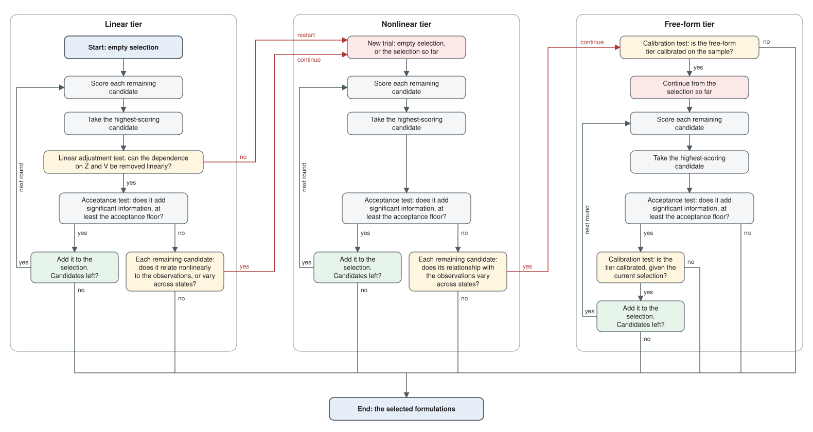

# Methods

This document describes the methodology used to select a subset of hydrologic formulations that carry distinct information about observed streamflow from a superset of possible formulations. It is the canonical description; the README summarizes it and docstrings refer to its sections.

## Purpose and scope

This pipeline is concerned with model selection. It identifies, for one basin, the model formulations whose simulated flow carries information about observed flow that the formulations already selected do not. Conditional independence of a candidate and the observations, given the selected formulations, is the formal statement that the candidate contributes no such information, and is the hypothesis each selection step tests.

### Why model selection?

Evaluating each formulation separately against observations answers "how well does this model reproduce the observations?". Formulations that share forcing, structure and other attributes are closely related, so several can score well while carrying largely the same information. Model selection asks a different question: what information does a candidate formulation contribute about the observations that the selected formulations do not? A formulation whose information is already carried by the selected set adds nothing, however well it scores on its own. Selection avoids retaining formulations that are redundant with one another.

### Why information rather than error?

The forecast evaluation literature separates two aspects of the quality of predictions: systematic errors, which statistical post-processing can remove, and the association between predictions and outcomes, which no recalibration can create (Murphy and Winkler, 1987; Murphy, 1993). The decomposition of the Nash–Sutcliffe efficiency into correlation, bias and variability alludes to this distinction: only the correlation term cannot be repaired by rescaling (Gupta et al., 2009). Information here means statistical dependence between simulated and observed flow, which is invariant to bias that post-processing can correct (Cover and Thomas, 2006). Selection therefore rests on information, that is, association, rather than error.

### Why model selection and not model combination?

Model combination and model selection are complementary but answer different questions. Combination is a prediction framework that leverages association and corrects for bias. A combiner is fitted, such as a weighted average, Bayesian model averaging or a learned nonlinear combiner. Each formulation's weight, or its ex-post attribution, then describes how that fitted combiner uses it. Shapley values, widely used to interpret machine-learning models, are one such attribution (Shapley, 1953; Štrumbelj and Kononenko, 2014). Selection here is an evaluation framework built on conditional independence. If a candidate is conditionally independent of the observations given the selected formulations, no predictor can leverage the information in that candidate to predict the observations better than the selected formulations already allow, subject to sampling uncertainty. The pipeline tests this hypothesis under progressively weaker assumptions about the form of the relationships, from linear to no functional form, which are relevant to choosing a combiner, but without committing to a combination framework in advance.

### Two pathways

Selection runs in two pathways, which differ in what a sample represents:

- **Pooled pathway.** One sample per time step over the whole record, so a formulation's added information is measured across all flow conditions. The average seasonal cycle is removed, to avoid crediting a formulation with simple climatological information and to remove a nonstationarity that is easily controlled (see [Samples, Seasonality](#seasonality)). Samples are strongly statistically dependent in time.
- **High-flow pathway.** One sample per high-flow event, identified from the simulations, not the observations (see [Samples, Identifying high-flow events](#identifying-high-flow-events)). Each event is described by a few parameters that summarize the information in its hydrograph (see [Event representation](#event-representation)), rather than by the raw streamflow values within it. Those values describe a single high-flow event, such as a flood, and are pseudo-replicates of it (Hurlbert, 1984): an event provides one sample, however many time steps it spans. Samples are few and much less dependent than time steps; those close together in time are still treated as dependent (see [Dependence between samples](#dependence-between-samples)).

In both pathways the candidate, the observations and the selected formulations are compared on matched samples: the same time step in the pooled pathway, the same event window with a shared registration in the high-flow pathway. Better timing of the response, through better representation of routing, storage or channel hydraulics, therefore counts as information: in the pooled pathway as a difference in flow at the time it occurs, in the high-flow pathway through the shape features that describe timing within the event, if they are retained (see [Samples, Event representation](#event-representation)).

## Overview of the procedure

Both pathways follow the same procedure: they test the same hypothesis, select by the same cascade and tests, and report the same results. They differ in how the samples are formed and how dependence between samples is handled. The description is therefore organized by the common elements of both pathways, and the unique characteristics of the samples are identified separately within that structure. The procedure has five steps:

1. **Samples.** Every series is transformed to a common scale, and the samples are formed: one per time step in the pooled pathway, one per high-flow event (described by its features) in the high-flow pathway (see [Samples](#samples)).

2. **Selection.** Formulations are added one at a time by greedy forward selection. In each round, the formulation not yet selected (a *candidate*) that carries the most information about the observations beyond the selected formulations is added if it meets two conditions. First, the measured information must be statistically significant. Second, it must reach the acceptance floor, an effect-size floor set as a minimum share of the observations' variation that is not yet explained (see [Selection, Acceptance test](#acceptance-test)). Selection stops at the first round whose best candidate does not meet both conditions. Selection runs through three tiers of tests as a cascade, from the least general and most powerful to the most general and least powerful, moving to a more general tier only when an escalation test finds the simpler tier's assumptions violated (see [Selection](#selection)).

3. **Hypothesis tests.** Each candidate is tested against the null hypothesis that it carries no information about the observations beyond the selected formulations (see [Hypothesis tests](#hypothesis-tests)). No single test is both valid and powerful for every form of dependence, so the three tiers remove the dependence on the selected formulations under different assumptions, and each detects a different range of remaining dependence between the candidate and the observations. The tests account for statistical dependence between samples (see [Dependence between samples](#dependence-between-samples)).

    - **Linear tier.** Assumes the selected formulations act linearly on the candidate and the observations, and detects a linear relationship between the candidate and the observations that the selected formulations do not account for, averaged over states. It does not model effect modification of any type: a relationship that varies across states is detected only through its average, which cancels when the relationship changes direction. Uses linear regression (partial correlation).

    - **Nonlinear tier.** Allows the selected formulations to act nonlinearly, and detects dependence of any shape between the candidate and the observations that the selected formulations do not account for, including dependence that varies with state. It does not model effect modification either, but detects it through many transformations of the variables, so it misses effect modification only when it cancels exactly across states. A candidate is accepted only if it also explains enough of the observations' variation, through a function of the candidate; information about the spread or shape of the observations alone is not enough (see [Assumptions and limitations](#assumptions-and-limitations)). Uses nonlinear regression.

    - **Free-form tier.** Assumes only that the candidate's distribution changes smoothly with the selected formulations, and detects dependence of any shape within states, including effect modification that cancels across states, to any degree, which the other tiers can miss. Uses conditional mutual information.

4. **Post-selection checks.** The formulation chosen in a round may be one of several that carry the same information, so each selected formulation is compared with the other candidates, and the sets of formulations the data support equally are identified. In the high-flow pathway, the stopping round is also repeated on alternative bases, for contributions in shapes the shared basis does not represent. The checks are reported, but do not affect the selection (see [Post-selection checks](#post-selection-checks)).

5. **Results.** Every result reports the selection, the checks, the smallest contribution the data could detect, and the diagnostics of the assumptions behind each decision (see [Results](#results)).

## Notation and terminology

Italic upper-case letters denote random variables, scalar or vector-valued, and bold upper-case letters denote matrices. Lower-case letters denote realizations, counts and constants. Statistics and hypotheses are named by convention. Every symbol used in more than one place is defined here; a symbol that appears in a single formula is defined where it appears.

**Variables**

| Symbol | Meaning |
| --- | --- |
| $O$ | Observed flow (the target) |
| $C$ | The candidate formulation under test |
| $Z$ | The formulations already selected (empty in the first round) |
| $V$ | Conditioning covariates included in every test: the time of year in the pooled pathway, the event's registration parameters in the high-flow pathway |
| $W$ | A selected formulation, when it is compared with a candidate (see [Interchangeable formulations](#interchangeable-formulations)) |
| $t$ | Index of a sample (a time step or an event) |

**Counts**

| Symbol | Meaning |
| --- | --- |
| $n$ | Number of samples |
| $n_{\mathrm{m}}$ | Number of formulations |
| $d$ | Number of features of each series, the same for $C$ and $O$: one in the pooled pathway (the flow at a time step); in the high-flow pathway, the number of event features (scores on the shape modes of the event hydrograph; see Event representation) |
| $k$ | Number of conditioning variables, that is, the features of the selected formulations plus the covariates |
| $n_{\mathrm{r}}$ | Number of resamples (null draws) per test |
| $n_{\mathrm{b}}$ | Number of blocks in a sample: its time span divided by the block length |
| $k_{\mathrm{nn}}$ | Number of nearest neighbours in the conditional mutual information estimator |
| $n_{\mathrm{s}}$ | Number of surrogate candidates in the calibration test |

**Hypotheses**

| Symbol | Meaning |
| --- | --- |
| $H_0$, $H_1$ | The null and alternative hypotheses of a selection step |
| α | Significance level |

**Transformations and residuals**

| Symbol | Meaning |
| --- | --- |
| $\phi$, $\psi$ | Transformations of $C$ and of $O$ |
| $R_C$, $R_O$ | Residuals of $C$ and $O$ after their dependence on $Z$ and $V$ is removed |
| $R_\phi$, $R_\psi$ | Residuals of $\phi(C)$ and $\psi(O)$ after their dependence on $Z$ and $V$ is removed |

**Statistics and effect sizes**

| Symbol | Meaning |
| --- | --- |
| $\rho_i$ | Canonical correlations between $R_C$ and $R_O$ |
| Λ, PC | Wilks' lambda, and the partial canonical correlation PC = 1 − Λ |
| RV | The RV coefficient |
| $I$ | Conditional mutual information, in nats |
| $R^2$ | An effect size as a share of variation: the set-correlation $R^2$, or the semipartial $R^2$ of an escalation test |

**Resampling and regression**

| Symbol | Meaning |
| --- | --- |
| $w_t$ | Bootstrap multipliers |
| ℓ | Bandwidth of the multipliers' correlation |
| $h_t$ | Leverage of sample $t$ in a least-squares regression |
| $\kappa$, $\mathbf{K}$ | A kernel function and its kernel matrix |
| $\sigma$ | Kernel bandwidth |
| $\tau$ | Lag, in time steps |
| $\delta$ | Memory parameter of a long-memory process (written $d$ in that literature) |
| $\tau_e$ | E-folding time of an autocorrelation, in time steps |

A *simulated series* is the streamflow simulated by one model formulation for the basin, and the *observed series* is the gauged streamflow; *series* refers to either, and "every series" means all simulated series and the observed series.

A *feature* is one component of $C$ or $O$: the series itself in the pooled pathway, or one event feature in the high-flow pathway. A *sample* is one element of the data a test uses: a time step in the pooled pathway, a high-flow event in the high-flow pathway. A *conditioning variable* is one component of $Z$ and $V$. The *dependence lag* is the time separation beyond which samples are treated as approximately independent, estimated from the formulations' autocorrelation (see [Dependence between samples](#dependence-between-samples)).

## Samples

### Pooled pathway

Each sample is one time step; the samples span the whole record. Each series is:

- log-transformed;
- reduced to its anomaly from its calendar-day mean (see [Seasonality](#seasonality));
- transformed to normal scores: each value is replaced by the standard normal quantile of its rank (the Gaussian copula transform).

The normal-score transform puts every series on a common, unitless scale without changing its dependence structure, and defines what the linear tier measures: linear association between normal scores. It depends only on the ordering of values, so the log transform matters only through the removal of the calendar-day mean, which describes the largely multiplicative seasonal variation of flow better in log space. Zero flows and other tied values are handled as described in Appendix A.

#### Missing values

Every comparison uses only the time steps at which the observations and every formulation have values, so that all formulations are compared on the same time steps. This matters because values are not always missing at random. Simulations are normally complete, so missing values usually come from the observations.

#### Seasonality

In the pooled pathway, the average seasonal cycle is removed for two reasons. First, a formulation should not be credited for reproducing it. It can be estimated from the observed climatology without any model, and the climatological seasonal cycle is a standard benchmark in hydrologic model evaluation (Garrick, Cunnane and Nash, 1978; Schaefli and Gupta, 2007). Selection therefore measures information beyond the time of year: departures from the average cycle in particular years, such as an early snowmelt or an unusually wet season, count; the average cycle itself does not. Second, the annual cycle makes the series nonstationary, with an autocorrelation that oscillates rather than decays, contrary to the second-order stationarity that the resampling methods assume (see [Dependence between samples](#dependence-between-samples)); it is usually removed before causal analysis of climate time series (Runge et al., 2019). For the same reason, the dependence lag of both pathways is estimated from series with the seasonal cycle removed.

Each series' calendar-day mean $\mu(s)$, its mean over all years for calendar day $s$, is removed in log space, where seasonal variation in flow is largely multiplicative. Every test also conditions on the calendar day, through the seasonal phase in $V$, as conditional-independence methods do for nonstationary data (Huang et al., 2020). $\mu(s)$ pools the calendar days within an 11-day window with triangular weights, as daily climatologies do (Zhang et al., 2005), short enough that abrupt seasonal transitions, such as the onset of snowmelt, stay sharp.

The phase enters every test as two covariates, the sine and cosine of $2\pi s/365$, so the year has no start or end. In the linear tier, removing each series' calendar-day mean is equivalent to conditioning on the calendar day by least squares (Frisch and Waugh, 1933; Lovell, 1963). The nonlinear and free-form tiers condition on the phase directly, through kernel regressions and nearest neighbours that can represent any function of it, including abrupt seasonal transitions. For these tiers, removing the mean does not change the hypothesis, because the mean is itself a function of the calendar day. They need the phase as well as the anomaly, because a response that depends on a series' absolute level, such as a storage threshold or zero flow, depends on both.

The seasonal cycle can be estimated only when each calendar day recurs over several years. In practice, only series whose median calendar day contains data in three or more years are seasonally adjusted and, for shorter series, a warning is added to the results for review.

### High-flow pathway

Each sample is one high-flow event, described by the features of its hydrograph.

#### Identifying high-flow events

**Data.** High-flow events are defined from the simulations, not the observations. Evaluating predictions on subsets of occasions selected by the observed outcome, such as observed extremes, makes even proper scoring rules improper and rewards strategies that predict extremes too often (the forecaster's dilemma; Lerch et al., 2017). High-flow events are therefore identified from the simulations, directly analogous to the information available at forecast issue time when the models are forced with meteorological forecasts. Every series, the observed series included, is then evaluated over the resulting event windows.

Event detection uses each series' own values, so that a formulation's events do not depend on gaps in the observations. An event is included when every formulation has values throughout it and the observations have at least one. Gauges often fail at high flow, so gaps in the observations cluster within high-flow events; observed curves with gaps are therefore scored from their observed points rather than discarded or filled (see [Appendix E](#appendix-e-technical-details-of-high-flow-events)).

**Events per formulation.** Each formulation's own events and peaks are detected on its own flow series by an event detector: wavelet-assessed scale-space persistence (WASP) by default, or peaks over threshold (POT; see Appendix E, Event detection methods). For the consensus, each formulation's flow is converted to percentile ranks of its own record, so formulations with different volume biases are comparable.

**Consensus events.** The formulations' results are combined in four steps, each following the same majority principle:

1. **High-flow time steps.** A time step is high flow when the upper median of the formulations' percentile ranks reaches the high-flow quantile (0.90 by default), that is, when at least half of the formulations agree that flow is high relative to their own record. Simulated high flows that were not observed (false alarms) therefore remain among the samples when at least half of the formulations agree on them, and a single formulation's own false alarms are excluded.
2. **Events.** Contiguous high-flow periods are joined into one event when at least half of the formulations have a single own event spanning both; otherwise they remain separate. Whether two periods belong to one high-flow event is thus left to the formulations' own event detectors; no separation length is used.
3. **Windows.** Each event is widened to the union of the formulations' best-overlapping own events, so no formulation's rising limb or recession is clipped. Where widened windows overlap, they are separated at the minimum of the consensus rank between the two events' peaks, the point where the two events' hydrographs are least intertwined; no two events share a time step.
4. **Peaks.** A window is an event only if at least one formulation's own detector found a peak within it. A window without one, such as a brief excursion above the threshold on the recession of a high-flow event, is removed and its time steps return to any adjoining event.

#### Event representation

The streamflows within a high-flow event are the hydrologic effect of a common cause, such as a tropical cyclone or temperature-induced snowmelt. They are effectively pseudo-replicates of that effect: an event carries far less information than its number of time steps suggests. Each event's hydrograph is therefore represented by a small number of features that describe its salient aspects, such as magnitude, timing and shape, consistent with the information the event actually carries.

The hydrographs of every series in an event are registered to a common time scale, shared by all of them. The features come from functional principal component analysis (Ramsay and Silverman, 2005), which approximates each registered curve $x(u)$, over the event's normalized time $u \in [0, 1]$, as

```math
x(u) \approx \mu(u) + \sum_{j=1}^{d} \xi_j\, \eta_j(u),
```

where $\mu$ is the mean shape, $\eta_j$ are the shape modes, the eigenfunctions of the curves' covariance ranked by the variation they explain, and the scores $\xi_j$ are the $d$ features. Every series is described on the same modes, so each score means the same thing for every formulation and for the observations. The scores are standardized jointly across series.

Two choices keep the features comparable without carrying information about the observations into the selection. The basis includes the observed curves, so that shapes occurring only in the observations are represented; it is fitted without using which observed curve belongs to which event, so it cannot create an association between a candidate and the observations. The shared registration removes only each event's length and placement, which become conditioning covariates (see [Hypothesis testing framework](#hypothesis-testing-framework)), and keeps each series' timing relative to the others. Conditioning on them preserves the hypothesis, because each series' features are a function of its flows and the registration.

The number of features balances two aims: describing the events completely enough, and keeping the number of dimensions consistent with the information that a limited number of events can carry. Only the aspects of an event that the features describe can count toward selection: a formulation that reproduces observed behaviour better in a shape mode that was not retained cannot be credited for it. Each feature adds a dimension to every test, which reduces its power. How to choose the number is described in Appendix A (Choosing the number of event features).

Every retained feature counts as one equal aspect of the event, whatever its share of the event variation: the features are standardized jointly, and no test depends on a feature's scale (see [Hypothesis tests](#hypothesis-tests)). A candidate is selected when it adds information about one or more aspects, without regard to how much of the hydrograph those aspects account for. Weighting the features by explained variance is not possible in every tier, because the free-form tier's measure is unchanged by any rescaling of a feature.

## Selection

Selection applies a sequence of hypothesis tests to the formulations (see [Hypothesis tests](#hypothesis-tests)). Each test asks whether a candidate $C$ carries information about the observations $O$ beyond the selected formulations $Z$ and the conditioning covariates $V$, that is, whether $C$ and $O$ are conditionally independent given $Z$ and $V$ (see [Hypothesis testing framework](#hypothesis-testing-framework)). Finding every set of formulations the data support would mean testing every subset: $2^{n_{\mathrm{m}}} - 1$ sets for $n_{\mathrm{m}}$ formulations, each through the cascade, which is computationally prohibitive beyond a few formulations. Formulations are therefore added one at a time by greedy forward selection, which tests at most $n_{\mathrm{m}}$ candidates in each of at most $n_{\mathrm{m}}$ rounds, within a cascade of the three tiers.

**Two kinds of error.** A selection step can err in two ways (Neyman and Pearson, 1933). A *false selection* (type I error) accepts a candidate that carries no information about the observations beyond $Z$ and $V$. A *missed selection* (type II error) fails to accept a candidate that does. Both are selection errors, and both are important. However, significance testing controls them unequally (Lehmann and Romano, 2005). The null hypothesis, that the candidate adds no information, specifies the distribution of the test statistic, so where a tier's assumptions hold, each step's false-selection rate is held at a chosen significance level. The alternative specifies no distribution, because it covers contributions of any size and form. The missed-selection rate can therefore be stated only for an assumed contribution: each result reports the smallest contribution detectable with a fixed power, not a missed-selection rate (see [Detectable effect and the meaningful-effect threshold](#detectable-effect-and-the-meaningful-effect-threshold)).

### The cascade

No single test is valid and powerful for every form of dependence (see [Hypothesis testing framework](#hypothesis-testing-framework)), so three tiers of tests make different assumptions. Each tier tests the null hypothesis that the candidate adds no information; only a rejection is conclusive. The linear and nonlinear tiers detect dependence averaged over the states of $Z$ and $V$, and the free-form tier detects dependence within states.

| | Linear tier | Nonlinear tier | Free-form tier |
| --- | --- | --- | --- |
| Detects | Linear dependence, averaged over states of $Z$ and $V$ | Dependence of any shape, averaged over states of $Z$ and $V$ | Dependence of any shape within states of $Z$ and $V$, including dependence that varies across states |
| Valid when | The conditional means of $C$ and $O$ are linear in $Z$ and $V$ (one of the two suffices) | The regressions estimate the conditional means accurately | The distribution of $C$ changes smoothly with $Z$ and $V$ |
| Generality | Lowest | Intermediate | Highest |
| Power | Highest | Intermediate | Lowest |

The tiers are ordered from the least general and most powerful to the most general and least powerful: a non-rejection in one tier does not show that the candidate adds no information, because the dependence may take a form that only a more general tier detects, but moving to that tier costs power. The simpler tier is therefore kept unless an escalation test gives evidence against it. Once the evidence is against the tier's validity, that tier is not used for the selection, regardless of whether the more general tier lacks sufficient power to support a selection. Evidence that the tier may miss a contribution leads to the next tier without discarding the formulations it has selected (see [Escalation tests](#escalation-tests)).

Selection runs as a sequence of trials. A trial is a greedy forward selection in one tier, starting from an empty selection or, after an escalation that concerns power only, from the previous tier's selection: each round tests one formulation – the best remaining candidate – and the trial stops at the first round whose best candidate is not accepted. A trial ends either with a complete selection or when an escalation test leads to the next tier (Figure 1). After a test of the tier's validity, the next tier starts a new trial from an empty selection; after a test that concerns power only, it continues from the selection so far. Three kinds of test make the decisions: the acceptance test decides whether a round's best candidate is selected, the escalation tests decide whether selection moves to the next tier, and the calibration test decides whether the free-form tier can be used on the data. Their use is described below in that order; the tests themselves are described in Hypothesis tests.



*Figure 1. Each tier adds formulations one at a time, with the escalation tests that lead to the next tier.*

Every step records the tier whose test made it, every test's outcome, and whether it was used for a decision. Effect sizes are comparable between steps of the same tier; after an escalation that concerns power only, the selection can combine steps of two tiers. Using one fixed tier throughout, without the cascade, is also supported.

### Acceptance test

The round's best candidate is the one with the largest effect size given the current selection, among the candidates whose statistic is significant (among all candidates when none is). It is accepted when two conditions hold. First, its statistic must be significant at level α (5% by default) against the null distribution of the maximum statistic over all remaining candidates. The best candidate is one of several, so comparing it with a single candidate's null distribution would accept too often; each null draw therefore computes every candidate's statistic under the same resampling and keeps the largest. This holds false selections at α whichever candidate is chosen (Westfall and Young, 1993). Second, its effect size must reach the acceptance floor (2% by default): the candidate must account for at least that share of the observations' variation that the selected formulations leave unexplained (see [p-values and effect sizes](#p-values-and-effect-sizes)). A candidate that is not accepted ends the trial, because no other remaining candidate would be accepted either. In the linear and free-form tiers the effect size is the statistic less its chance level, so the best candidate is also the one with the largest statistic. In the nonlinear tier the two are different quantities (see [Nonlinear tier](#nonlinear-tier) and [Effect sizes of candidates](#p-values-and-effect-sizes)).

**What the effect size counts.** In the linear and nonlinear tiers, the effect size is a contribution to the conditional mean of the observations: the share of their variation that a function of the candidate explains. In the free-form tier it is information about their whole conditional distribution. A contribution to the conditional mean is hydrologically important in itself. In the pooled pathway, the observations and simulations are log-flow departures from their own seasonal climatology, as normal scores (see [Samples, Pooled pathway](#pooled-pathway)). The conditional mean of the observations is therefore the expected observed departure: whether flow is above or below its usual level for the time of year, in relative terms. Every time step counts equally, so departures that persist carry most of the weight: wet and dry seasons and years, and high- and low-flow periods lasting days or more. Such departures broadly correspond to departures of volume from climatology. Short peaks occupy few time steps and contribute little; they are addressed by the high-flow pathway. In the high-flow pathway the conditional mean is the expected value of each event feature, such as an event's magnitude, timing or shape. The nonlinear tier's statistic also responds to information about the spread or shape of the observations and/or simulations. A candidate that carries information beyond the conditional mean is accepted only if it also contributes enough to the conditional mean to reach the acceptance floor. Information mainly about spread or shape counts fully only in the free-form tier.

### Escalation tests

An escalation test leads to the next tier when it finds a departure from the current tier's assumption (see [Linear tier, Escalation tests](#linear-tier); [Nonlinear tier, Escalation tests](#nonlinear-tier)).

| | Linear tier | Nonlinear tier |
| --- | --- | --- |
| Leads to the next tier when | The dependence on $Z$ and $V$ cannot be removed linearly (linear adjustment test); or, for a candidate not accepted, it relates to the observations nonlinearly (candidate linearity test) or its relationship with the observations varies across states (candidate effect-modification test) | For a candidate not accepted, its relationship with the observations varies across states (candidate effect-modification test) |

Because the linear adjustment test guards against false selections, it runs before the acceptance test, and a departure leads to the next tier whatever the round's outcome. An acceptance made where the tier's assumption fails may be spurious, so the next tier starts a new trial from an empty selection.

The candidate linearity and effect-modification tests concern power only. Once the dependence on $Z$ and $V$ has been removed adequately, a candidate that adds nothing is unrelated in any form to what remains of the observations' variation. The departures these tests look for therefore cannot cause a false selection; they can only hide a real contribution. The tests lead to the next tier only when the round's best candidate was not accepted; when it was accepted, the tier has already detected its contribution, and the result is recorded for information only. The formulations the tier has accepted remain valid selections, so the next tier continues from them: it conditions on them and tests only the remaining candidates.

No escalation test concerns the validity of the nonlinear tier. Its validity condition, accurate regressions on $Z$ and $V$, cannot be verified from the data (see [Regression-residual tests, Validity condition](#validity-condition)), and is reported through its fit diagnostics instead. Escalation from the nonlinear tier to the free-form tier therefore always concerns power, and continues from the selection so far.

Whether to escalate for power is a question of degree. A nonlinear relationship or effect modification reduces the power of the current tier. Moving to the next tier, which can detect it, costs power from the outset, because that tier is more general. Escalation helps only where the first loss exceeds the second. The candidate linearity and effect-modification tests do not measure this. They detect a departure of any size from the current tier's assumptions, not whether the next tier would accept the candidate. A more direct check is to apply the next tier's acceptance test in the current tier, to the round's best candidate when it is not accepted, and to escalate only if that test accepts it. The two tests then share the level α, for example α/2 each (Bonferroni). This costs a little power in the current tier, and the computational cost of the next tier's test in each round. It is not used here. The question does not arise for the linear adjustment test, which concerns validity.

When the best candidate was not accepted, these tests are applied to every remaining candidate, not only the best. A candidate whose relationship with the observations does not suit the tier's assumptions shows weak association in that tier and may never be a round's best candidate, although a tier whose assumptions suit it could detect its contribution. The tier's tests of the remaining candidates form one family: each is made at $\alpha/(mk)$, with $m$ the number of remaining candidates and $k$ the number of these tests in the tier (Bonferroni), so that the chance of escalating when no candidate departs is at most $\alpha$. A departure by any candidate leads to the next tier. Candidates are tested in order of the tier's statistic, best first, and testing stops at the first departure.

**Escalation floor.** An escalation test leads to the next tier only when the departure it finds is statistically significant and its effect size (see [p-values and effect sizes](#p-values-and-effect-sizes)) reaches the escalation floor. Smaller departures are ignored, because moving to a more general tier costs power. The floor can be set and defaults to 2% ([Appendix A](#appendix-a-defaults-and-configuration)).

### Calibration test

The free-form tier's calibration test (see [Free-form tier, Calibration test](#free-form-tier)) is made at the nonlinear-tier round whose escalation test would lead to the free-form tier, for the candidate whose departure leads there and that round's conditioning set, on the free-form tier's own sample, and before each acceptance in the free-form tier. It is not needed when there is nothing to condition on, because the free-form test then uses a time-block permutation (see [Dependence between samples](#dependence-between-samples)). Escalation to the free-form tier follows a test that concerns power only. If the tier is not calibrated on entry, it is not used, and the nonlinear tier's selection stands, flagged for review because it may be incomplete. If the tier is not calibrated when it would accept a candidate, selection ends with the selection so far, whose acceptances were each made where the tier was calibrated.

### Sample-size requirement

If the first round of a linear-tier trial does not meet the linear tier's sample-size requirement (see [Linear tier](#linear-tier)), the cascade ends with no selection. If a later round does not meet it, selection ends with the formulations already selected: their tests met the requirement, and only the next test cannot be made. In either case the cascade does not escalate, because the more general tiers need more samples per conditioning variable than the linear tier.

## Hypothesis tests

Each decision described in Selection rests on a test of conditional independence or on a test of one of its assumptions. This section defines the hypothesis and describes each test.

### Hypothesis testing framework

Whenever a candidate is considered for selection, the null hypothesis is that it carries no information about the observations beyond the selected formulations and the conditioning covariates, that is, that $C$ and $O$ are conditionally independent given $Z$ and $V$ (Dawid, 1979),

```math
H_0:\; C \mathrel{⊥} O \mid Z, V,
```

against the alternative that $C$ carries information about $O$ beyond them,

```math
H_1:\; C \mathrel{⊥̸} O \mid Z, V.
```

$V$ holds covariates that every test conditions on, together with the selected formulations, so that the information they carry is not credited to any formulation: the seasonal phase in the pooled pathway (see [Samples, Seasonality](#seasonality)), and the parameters of each event's registration in the high-flow pathway (see [Samples, Event representation](#event-representation)).

Equivalently, the conditional probability distribution of the observations does not depend on the candidate once the conditioning variables are known:

```math
p(O \mid C, Z, V) = p(O \mid Z, V).
```

Under $H_0$, $C$ can still be associated with $O$. For example, all formulations respond to the same forcing, which is a shared cause of association. Rather, $H_0$ is false only when $C$ and $O$ are related in ways that $Z$ and $V$ do not already account for.

A valid null distribution therefore comes from data in which any dependence of $C$ on $O$ beyond $Z$ and $V$ is removed, while the dependence of $C$ and of $O$ on $Z$ and $V$ is kept.

For continuous conditioning variables, such as streamflow, there is no general-purpose or assumption-free test of conditional independence (Shah and Peters, 2020; Lundborg et al., 2022). A usable test therefore restricts the null hypothesis by assumptions about how $C$ and $O$ depend on $Z$ and $V$. Three tiers of tests make different assumptions; each states its own, and escalation tests examine them on the data where that is possible (see [The three tiers](#the-three-tiers)).

### The three tiers

What each tier detects and when it is valid are compared in Selection (see [The cascade](#the-cascade)). The table below shows how each accounts for $Z$ and $V$, its statistic and its null distribution.

| | Linear tier | Nonlinear tier | Free-form tier |
| --- | --- | --- | --- |
| How $Z$ and $V$ are accounted for | Least-squares regression | Cross-fitted kernel ridge regression | Local permutation within neighbourhoods of $Z$ and $V$ |
| Statistic | Squared partial correlation, or partial canonical correlation for high-flow event features | RV coefficient of the residuals of the transformed variables | Conditional mutual information |
| Null distribution | Dependent wild bootstrap of the residual products | Dependent wild bootstrap of the residual products | Local permutation (time-block permutation with nothing to condition on) |

**Why these three tiers?** The null hypothesis, $p(O \mid C, Z, V) = p(O \mid Z, V)$, can be stated equivalently in terms of correlation. It holds exactly when, within the states of $Z$ and $V$, no transformation of $C$ is correlated with any transformation of $O$ (Daudin, 1980; Shah and Peters, 2020). A transformation is any quantity computed from a variable, such as the variable itself, its square, or whether it exceeds a threshold, and it may also depend on $Z$ and $V$. Lack of correlation is weaker than independence when judged for only one pair of transformations. Required for every pair, it is equivalent: threshold indicators alone turn the correlations into differences of conditional probabilities. Transformations that do not depend on $Z$ and $V$ give a weaker condition: that the dependence, averaged over the states of $Z$ and $V$, is zero. The linear and nonlinear tiers test this condition (Shah and Peters, 2020; Lundborg et al., 2022). The tiers can therefore be placed on three axes, each running from a restricted to a general form of the null hypothesis:

| Axis | Linear tier | Nonlinear tier | Free-form tier |
| --- | --- | --- | --- |
| Shape of the dependence of $C$ and $O$ on $Z$ and $V$ | Linear | Any smooth shape, estimated by regression | Any smooth shape, by local comparison |
| Moments through which $C$ and $O$ depend on each other | First moments: linear correlation | All moments: the whole joint distribution | All moments: the whole joint distribution |
| Variation of that dependence with the states of $Z$ and $V$ | None: averaged over states, which can cancel | None: averaged over states, which can cancel | Any: within every state |

Each escalation relaxes named axes, and its escalation tests examine them: the linear adjustment test the first axis, the candidate linearity test the second, and the candidate effect-modification test the third, in the conditional mean (see [Escalation tests](#escalation-tests)). Clearly, more intermediate tiers are possible, and they would relax the axes in smaller steps, at the cost of more complexity overall. The intermediate tier is one of several that trade power for generality along these axes. Another would use all moments of $C$ but only the first moment of $O$, within every state, which is the projected covariance measure (Lundborg et al., 2024). The nonlinear tier was chosen because established tests exist for it: the generalised Hilbertian covariance measure applied to kernel feature maps (Lundborg et al., 2022; Bergen et al., 2026), with established escalation tests leading to and from it.

### Regression-residual tests

The linear and nonlinear tiers test a necessary condition for $H_0$ (Daudin, 1980; Shah and Peters, 2020). If $C$ and $O$ are conditionally independent given $Z$ and $V$, any transformation of $C$ and any transformation of $O$, each with the dependence on $Z$ and $V$ removed,

```math
R_{\phi} = \phi(C) - \mathbb{E}[\phi(C) \mid Z, V], \qquad R_{\psi} = \psi(O) - \mathbb{E}[\psi(O) \mid Z, V],
```

have zero covariance. What a test detects depends on how the variables are transformed before their covariance is computed. In the linear tier, no transformation is applied, and the covariance measures the linear relationship between $C$ and $O$. In the nonlinear tier, a rich set of nonlinear transformations is applied to $C$ and to $O$, alongside the variables themselves; the covariance computed in the transformed space then measures linear and nonlinear relationships between the original variables. Both tiers estimate the covariance averaged over $Z$ and $V$. Under $H_0$ it is zero in every state, so a non-zero average is evidence against $H_0$, and a rejection is valid. The converse does not hold, because covariances of opposite sign in different states can average to zero. This is effect modification, and its degree of cancellation decides what each tier misses. In the linear tier, the statistic cancels whenever the linear relationship changes direction across states. In the nonlinear tier, a change of direction cancels only part of the dependence and reduces power. For example, large departures of the candidate can still coincide with large departures of the observations in every state, whatever their sign. The nonlinear tier's statistic is zero only if the covariance averages to zero for every pair of transformations. Averaged over states, the joint distribution of $C$ and $O$ must then equal the product of their distributions within each state. This requires an exact balance between states, the extreme degree of effect modification. Only transformations that depend on the state as well detect all such dependence (Daudin, 1980; Fukumizu et al., 2008), and the free-form tier's conditional mutual information captures it.

#### Why are transformations of variables residualized rather than residuals transformed?

$H_0$ is a statement about $C$ and $O$, not about their residuals. It does not imply that the residuals are independent, because both can still depend on $Z$ and $V$, for example through their spread. Transformations are therefore applied to $C$ and $O$ before their dependence on $Z$ and $V$ is removed, and the residuals are then examined for covariance. For example, if the spread of both residuals increases with flow, their squares are both large at high flow and small at low flow. The squared residuals are then correlated even when $H_0$ holds, and a test based on them rejects falsely. The same applies to measures of full independence applied to the residuals, such as distance covariance or HSIC (Daudin, 1980; He et al., 2025).

#### Validity condition

The conditional means are estimated, so the test controls its false-rejection rate only when the regressions estimate them accurately: the product of the two regressions' root-mean-square errors must be small relative to $n^{-1/2}$ (Shah and Peters, 2020; Lundborg et al., 2022). Because the requirement is on the product, an accurate regression of $O$ compensates for a less accurate regression of $C$, and vice versa (Niu et al., 2024). This is the restriction of the null hypothesis on which these tiers rest (see [Hypothesis testing framework](#hypothesis-testing-framework)), and whether it holds depends on the number of samples, the number of conditioning variables and how strongly $C$ and $O$ depend on them. With tens of samples, several conditioning variables and strong dependence, the conditional mean of a nonlinear feature of $C$ is learned imperfectly, and the error is shared by the corresponding feature of $O$ because both depend on the same selected formulations; the test then rejects too often. The linear tier needs no such approximation when its linearity assumptions hold, because least squares estimates linear conditional means without bias.

#### Fit diagnostics

Every test in these tiers reports the $R^2$ of the regressions of $C$ and of $O$ on $Z$ and $V$, and $n$ relative to the number of conditioning variables. Prediction error contains irreducible noise as well as estimation error, so it bounds the quantity in the validity condition from above but cannot confirm it.

### Linear tier

The linear tier measures the squared partial correlation between the candidate and the observations in the pooled pathway, where each is a single series. In the high-flow pathway, each event is described by several features, and the tier measures the partial canonical correlation (PC), which extends partial correlation to several variables. The linear tier is the most powerful tier when two assumptions hold. First, $Z$ and $V$ act on $C$ and $O$ linearly. Second, the candidate's relationship with the observations, beyond $Z$ and $V$, is linear. Its power is greatest for single series. Each added feature adds degrees of freedom to the test, so an effect of a given size is harder to detect (Cohen, 1988).

**Regression.** Ordinary least squares of each feature of $C$ and $O$ on $Z$ and $V$, with intercept. The in-sample residuals give the exact partial correlation, and the fit diagnostics report in-sample $R^2$. Misspecification of these regressions is tested formally by the linear adjustment test (see the escalation tests below). In the high-flow pathway, the registration parameters are first removed from every feature of $C$, $O$ and $Z$ by the nonlinear tier's cross-fitted kernel ridge regression (see [Nonlinear tier, Regression](#nonlinear-tier)), and the least-squares regressions of $C$ and $O$ on $Z$ are fitted to the residuals. Here, a partially linear model is adopted (Robinson, 1988). Specifically, the registration parameters, which operate non-linearly on the formulations and observations, are removed using the kernel ridge regression from the non-linear tier, with cross-fitting (Chernozhukov et al., 2018), and the residuals are then modeled linearly. This removes the registration parameters as an artificial source of non-linearity in deciding whether to escalate from the linear tier to the non-linear tier and focuses the decision on the intended relationship between the features of the observations and formulations, which are linearly related in the linear tier. In the pooled pathway, the average seasonal cycle is explicitly removed from each series before testing, without the need for a partially linear model.

**Statistic.** Let $R_C$ and $R_O$ be the residuals of $C$ and $O$ from their least-squares regressions on $Z$ and $V$. The statistic is one minus Wilks' lambda $\Lambda$ (Hotelling, 1936), computed from the canonical correlations $\rho_1, \dots, \rho_d$ between $R_C$ and $R_O$:

```math
\mathrm{PC} = 1 - \Lambda = 1 - \prod_{i=1}^{d} \left(1 - \rho_i^2\right)
```

The statistic is equivalent to testing the candidate's coefficients in the least-squares regression of $O$ on $Z$, $V$ and $C$ (Frisch and Waugh, 1933; Lovell, 1963).

**Null distribution.** A dependent wild bootstrap of the residual products. Under $H_0$, each product of a candidate residual and an observation residual has zero conditional mean, so each null draw multiplies the per-sample products by random weights (multipliers) of mean zero and variance one and recomputes the statistic; neither series is moved. A permutation of residuals would assume they are exchangeable, and when the residuals' spread varies with $Z$ and $V$, as hydrologic errors commonly vary with flow state (Schoups and Vrugt, 2010), its null is too narrow (Winkler et al., 2014). The wild bootstrap reproduces the variance of the products under such heteroscedasticity (Wu, 1986; Mammen, 1993). The multipliers have the Bartlett correlation $\max(0, 1 - \lvert t - t' \rvert / \ell)$, where ℓ is the test's block length, or the dependence lag for high-flow event samples (the dependent wild bootstrap; Shao, 2010; see Dependence between samples), so samples at least ℓ apart receive independent multipliers. Correlated multipliers are standard normal ([Appendix F](#appendix-f-computational-implementation)). When every pair of samples is at least ℓ apart, the multipliers are independent and take the values +1 and −1 with equal probability (Rademacher multipliers), which Davidson and Flachaire (2008) recommend for the wild bootstrap of regression statistics. Each product is divided by $1 - h_t$, with $h_t$ the sample's leverage in the regression on $Z$ and $V$, because least-squares residuals understate the errors' variance at high-leverage samples (the HC2 correction; MacKinnon and White, 1985; Davidson and Flachaire, 2008).

**Escalation tests.** Three tests examine the linear tier's assumptions; a departure from any of them can lead to the nonlinear tier (see [Selection, Escalation tests](#escalation-tests)).

- *Linear adjustment test: can the dependence on $Z$ and $V$ be removed linearly?* This test addresses false selections. If the selected formulations are related to the candidate and the observations nonlinearly, a linear regression leaves part of that dependence in both residuals, and a candidate resembling the selected formulations can appear to add information it does not. For example, observed flow may depend on a selected formulation's simulated flow nonlinearly as soils become saturated; a straight line cannot remove that, and the remnant could be credited to any candidate sharing that formulation's soil-moisture behaviour. The test is a kernel score test (Liu, Lin and Ghosh, 2007) of each regression, of $C$ and of $O$ on $Z$ and $V$, feature by feature with a Bonferroni-adjusted level: whether the least-squares residuals depend on $Z$ and $V$ in any smooth nonlinear way, with a radial basis function kernel on all of them, so that nonlinearity is detected in every direction, including directions in which the linear fit has no slope (tests built on powers of the fitted values, such as RESET, cannot see those). Its null is the wild bootstrap of the null model's residuals described below, and its effect size is the share of the residuals' variation that a kernel ridge regression on $Z$ and $V$ explains, bias-corrected by its null mean. On long records, which occur only in the pooled pathway, it runs on an evenly spaced subsample capped in size for computational tractability; its bootstrap accounts for the dependence between the retained samples (see [Subsampling](#dependence-between-samples)). Linear removal remains valid when either regression is linear (Shah and Bühlmann, 2023). If the candidate's conditional mean is linear in $Z$ and $V$, its residual is uncorrelated with any function of them, including the part of $O$'s dependence that a straight line misses, and vice versa. The test therefore rejects only when a feature of the candidate and a feature of the observations both depart from linearity. In the high-flow pathway, the test concerns the partially linear regressions described above, and has two parts, each at level α/2 (Bonferroni). The curvature part asks whether a selected formulation's effect is curved: whether the residuals depend smoothly on the selected formulations' features, with a radial basis function kernel on them. The interaction part asks whether a selected formulation's slope changes with the registration parameters. Its kernel is the product of a linear kernel on the selected formulations and one on the registration parameters, so it tests every product of a formulation feature and a registration parameter together. Kernel score tests for an interaction between two groups of variables, with flexible effects of each group in the null model, follow Maity and Lin (2011). The score statistic weights the parts of its kernel by their size, so one combined kernel would let the larger part mask the other; the two parts are therefore tested separately. A side departs when either part finds a departure in one of its features, and the test rejects when both sides depart, as above.
- *Candidate linearity test: does the candidate relate to the observations nonlinearly?* This test addresses missed selections. For example, a candidate's distinctive snowmelt timing may explain more of the observations' remaining variation at high flows than at low flows; a linear measure understates such a relationship but never invents one. In the pooled pathway, where each candidate is a single series, a RESET test (Ramsey, 1969): the observations' residual is regressed on the candidate's residual and its square and cube. For high-flow events that are represented with several features, a kernel score test against a linear null model (Liu, Lin and Ghosh, 2007) is used to detect nonlinearity in every direction, which a RESET test cannot detect.
- *Candidate effect-modification test: does the candidate's relationship with the observations vary across states?* This test addresses missed selections. The tier's statistic averages over states, so a relationship whose direction changes across states can cancel it. For example, where a candidate departs from a selected formulation, observed flow may depart in the same direction while that formulation's soils are unsaturated but in the opposite direction once they saturate. The two tests above concern the conditional mean of the residuals and cannot see such a relationship, because averaged over states the mean shows none. The test is the one described for the nonlinear tier (see [Nonlinear tier, Escalation tests](#nonlinear-tier)).

Every escalation test builds its null distribution by a wild bootstrap of its null model's residuals. Each null draw multiplies every residual by a multiplier, as above, and adds it back to the fitted values. This keeps the null model's own structure, including its dependence on $Z$ and $V$, and reproduces heteroscedasticity, as for the tier's own null (Davidson and Flachaire, 2008). Kernel null models have their penalties estimated by restricted maximum likelihood, the estimator of the score tests' mixed-model framework (Liu, Lin and Ghosh, 2007). It is less sensitive than cross-validation and the Akaike criterion to correlated errors that the model ignores (Krivobokova and Kauermann, 2007). Residuals of least-squares null models receive the same leverage correction. The candidate linearity test for single series, an F statistic of a regression, uses Rademacher multipliers where every pair of samples is independent, as the linear tier does. The linear adjustment test uses standard normal multipliers throughout, because its statistic, like the nonlinear tier's, is a quadratic form in the multipliers. The candidate effect-modification test uses Rademacher multipliers where every pair of samples is independent (Davidson and Flachaire, 2008).

**Effect size.** PC itself, an $R^2$-like quantity in [0, 1).

**Sample-size requirement.** Removing $k$ conditioning variables by regression leaves $n - k - 1$ effective samples. PC cannot be estimated unless this exceeds $d$. The requirement is checked before each round's test; it is a condition on the sample size, not a statistical test.

### Nonlinear tier

The nonlinear tier relaxes both linear-tier assumptions: $Z$ and $V$ may act on $C$ and $O$ nonlinearly, and the remaining dependence between $C$ and $O$ may be nonlinear. Like the linear tier, it detects dependence averaged over the states of $Z$ and $V$ (see [Regression-residual tests](#regression-residual-tests)).

**Regression.** Kernel ridge regression, with an unpenalized intercept and a radial basis function kernel on the standardized $Z$ and $V$. The residuals are cross-fitted on blocks of the record, as in double machine learning with dependent data (Semenova et al., 2023). The record is divided into 20 contiguous blocks of equal time span. Each block's residuals come from a fit that leaves out the two neighbouring blocks around the block being predicted. Blocks are at least one dependence lag long, so the gap spans the dependence. Under weak dependence the block and the samples its fit uses are then approximately independent (Semenova et al., 2023). Dependence among the samples within a block does not affect cross-fitting; it is accounted for by the null distribution (see [Null distribution](#nonlinear-tier)). Semenova et al. recommend at least 10 blocks; 20 leave each fit at least 85% of the samples, and more folds help most in small samples (Ahrens et al., 2024). On a record too short for 20 such blocks, fewer are used, down to 4, the fewest that leave every fit some samples. A record shorter than 4 dependence lags still uses 4 blocks, and this is flagged for review ([Appendix B](#appendix-b-outputs-diagnostics-and-review-flags)).

The bandwidth and penalty are chosen once, by the same blocked cross-validation: the error of each block's predictions from its fit, summed over the blocks in the norm of the feature space of the transformations defined below. Kernel residual tests built on untuned kernel ridge are poorly calibrated (Bergen et al., 2026). Leave-one-out error is not used. Under positively correlated errors it favours fits that nearly interpolate, because each sample's neighbours predict it well (Chu and Marron, 1991; Opsomer, Wang and Yang, 2001). Leaving out blocks avoids this (Burman, Chow and Nolan, 1994; Racine, 2000; Bergmeir and Benítez, 2012). The bandwidth and penalty are the only part of a fit that sees the samples it predicts. The fit diagnostics report cross-fitted $R^2$.

**Low-rank kernels.** The tier's validity rests on the accuracy of its regressions (see [Validity condition](#validity-condition)), which grows with the number of samples. Each kernel matrix is therefore replaced by a low-rank factor, so that long samples can be used. The factor is a pivoted Cholesky decomposition (Fine and Scheinberg, 2001; Harbrecht, Peters and Schneider, 2012). It adds one sample at a time as a basis point, choosing the sample the factor represents worst. It stops when the remaining error falls to the numerical-rank tolerance, or when the rank reaches its cap. Below the cap, the factor equals the kernel to working precision, so nothing is approximated. At the cap, the error is controlled in trace norm, and decays exponentially with the rank when the kernel's eigenvalues do, as for radial basis function kernels (Harbrecht, Peters and Schneider, 2012). Its effect on a fit is checked directly. The kernel escalation tests use the same factors and rank cap. The pivots are greedy, so the factor's first half of columns is the factor of half the rank. When a fit's chosen bandwidth reaches the cap, the fit is repeated at half the rank, with the same penalty and blocks. Let $\varepsilon$ be the relative change in its cross-fitted residual sum of squares. If the fit's error at least halves when the rank doubles, the change still to come is at most $\varepsilon$. An effect size is one minus a ratio of two such sums, so it may still move by about $2\varepsilon$. The step is flagged when $2\varepsilon$ reaches the effect-size floor ([Appendix B](#appendix-b-outputs-diagnostics-and-review-flags)). Kernel ridge regression on the factor is the Nyström method (Williams and Seeger, 2001): ridge regression on the factor's columns. When the columns are sampled at random, a rank that grows with the effective dimension of the problem, rather than with the number of samples, loses no accuracy (Bach, 2013; Rudi, Camoriano and Rosasco, 2015). The effective dimension is the trace of the smoother. That result is for random sampling, not the greedy pivoting used here, so it motivates the cap rather than guaranteeing it. The cost is $O(nm^2)$ for rank $m$, instead of $O(n^3)$. The statistic and its null distribution are then computed from the per-sample residual products, without forming $n \times n$ matrices; the result is the same. The rank's cap is given in Appendix A.

**Transformations.** The transformation $\phi(C)$ is the feature map of the kernel $\kappa(c, c') = \tilde{c}^\top \tilde{c}' + \exp(-\lVert \tilde{c} - \tilde{c}' \rVert^2 / 2\sigma^2)$ on the standardized candidate $\tilde{c}$, with the bandwidth $\sigma$ set by the median heuristic (Gretton et al., 2012): it comprises $C$ itself and nonlinear transformations of $C$. $\psi(O)$ is defined likewise. The Gaussian kernel is universal: its transformations can approximate any continuous function of its variable on a bounded range (Gretton et al., 2012), so in principle they cover all moments. In finite samples the test is most sensitive to smooth dependence at the scale of the bandwidth.

**Statistic.** The squared Hilbert–Schmidt norm of the cross-covariance of the residuals $R_\phi$ and $R_\psi$ of the transformed candidate and observations, as in the generalised Hilbertian covariance measure (Lundborg et al., 2022) and its kernel extension (Bergen et al., 2026), divided by the norms of their own covariances. This is the RV coefficient (Robert and Escoufier, 1976):

```math
\mathrm{RV} = \frac{\| \Sigma_{R_\phi R_\psi} \|_F^2}{\| \Sigma_{R_\phi R_\phi} \|_F \, \| \Sigma_{R_\psi R_\psi} \|_F}.
```

The normalisation makes the statistic independent of the scale of each candidate's transformed variables, so that the maximum over candidates compares like with like. For single series and identity transformations it equals the squared partial correlation.

**Null distribution.** A dependent wild bootstrap of the residual products, as in the linear tier: each null draw multiplies the per-sample products by the multipliers and recomputes the statistic. The statistic is a quadratic form in the multipliers, and ±1 multipliers would fix its diagonal terms, so the multipliers are standard normal even where samples are independent. The multipliers' bandwidth is the block length of the statistic's per-sample terms, or, for high-flow event samples, the dependence lag (see [Dependence between samples](#dependence-between-samples)). High-flow event samples, which are mostly further apart than the lag, therefore receive nearly independent multipliers. The dependence of $C$ on $Z$ and $V$ is never disturbed. Lundborg et al. (2022) approximate the null distribution by a weighted sum of independent chi-squared variables, derived for independent samples; the wild bootstrap is used instead because it accounts for dependence between samples.

**Escalation tests.** One test examines the nonlinear tier's assumption; a departure can lead to the free-form tier (see [Selection, Escalation tests](#escalation-tests)).

- *Candidate effect-modification test: does the candidate's relationship with the observations vary across states?* This test addresses missed selections. The tier's own statistic averages over states. A relationship whose direction changes across states cancels part of it and reduces the tier's power. It cancels the statistic completely only with an exact balance between states (see [Regression-residual tests](#regression-residual-tests)). The test is a kernel score test for an interaction of $C$ with $Z$ and $V$ in $O$, with an additive kernel model of $O$ on $C$, $Z$ and $V$ as the null (Liu, Lin and Ghosh, 2007; Wu et al., 2011). Unlike the tier's own statistic, it does not average a relationship over states: it asks whether $O$ depends on $C$ jointly with the state of $Z$ and $V$. However, it is not restricted to interactions whose direction changes, and detects any interaction in the conditional mean of $O$ (see [Assumptions and limitations](#assumptions-and-limitations)). Its null distribution is the wild bootstrap of the null model's residuals described for the linear tier's escalation tests, conditional on the null fit: the penalties are estimated once, on the observed data, and held fixed in every draw (Lin, 1997; Wu et al., 2011). A kernel fit uses many degrees of freedom, so its residuals are smaller than the errors. Each residual is therefore divided by its standard deviation under the fit, from the residual covariance of a linear smoother (Buja, Hastie and Tibshirani, 1989); for least squares this is the leverage correction.

**Effect size.** With several features, the RV coefficient is not on the common scale of the acceptance floor ([Appendix D](#appendix-d-derivations-of-design-numbers)), so the nonlinear tier's effect size is computed separately (see [p-values and effect sizes](#p-values-and-effect-sizes)).

### Free-form tier

The free-form tier measures the conditional mutual information (CMI) between the candidate and the observations, the expected log ratio of the conditional probability distribution of the observations with and without the candidate,

```math
I(C; O \mid Z, V) = \mathbb{E}\left[\log \frac{p(O \mid C, Z, V)}{p(O \mid Z, V)}\right],
```

in nats. It is zero if and only if $H_0$ holds (Cover and Thomas, 2006), and it registers dependence of any functional form, including dependence that changes sign or shape with $Z$ and $V$. The test statistic is its nearest-neighbour estimate (below), which is subject to sampling error and bias. The tier has the least power and needs the most samples per conditioning variable.

**Statistic.** The k-nearest-neighbour estimator of Frenzel and Pompe (2007), the conditional extension of Kraskov et al. (2004), in nats. The number of neighbours sets the scale at which it resolves dependence: fewer neighbours resolve finer structure (Kraskov et al., 2004). The estimator assumes that no two samples coincide; tied values in any variable (for example zero flow) are separated by noise of 10⁻¹⁰ standard deviations, as Kraskov et al. (2004) recommend. Samples closer in time than the Theiler window (see [Null distribution](#free-form-tier)) are not counted as each other's neighbours in the estimate, as Theiler (1986) proposed for nearest-neighbour estimates from time series: temporal neighbours lie close in every variable and would otherwise inflate the estimate. Each variable's values, column by column, are then replaced by their ranks, for the estimate and for the neighbour search of the null distribution (Runge, 2018). CMI is unchanged by this, but the estimator's distances, the largest difference over the coordinates, are not: without it, the coordinate with the widest spread would decide which samples are neighbours. The neighbour count scales with the number of samples: $k_{\mathrm{nn}} = 0.1\,n$, rounded, following Runge (2018), who recommends $0.1\,n$ to $0.2\,n$ and reports power increasing with $k_{\mathrm{nn}}$ up to a maximum.

**Null distribution.** Local permutation (Runge, 2018, Algorithm 1): samples are visited in random order, and each receives the candidate value of one of its near neighbours in $Z$ and $V$, drawn at random among the neighbours whose value has not yet been used, or repeated when all have been. Every sample therefore receives a value of $C$ from samples with similar $Z$ and $V$. In simulations with autocorrelated time series, this test held false positives at the nominal level (Runge et al., 2019). The neighbourhood always holds a fixed number of samples (10, by default, within Runge's recommended range of 5 to 10). Neighbourhoods therefore narrow as the number of samples grows, so a given departure from smoothness distorts the null less (Kim et al., 2022). Neighbours closer than the dependence lag in time are excluded (Theiler, 1986). With nothing to condition on, which can happen only in the pooled pathway's first round when the seasonal phase is not conditioned on, a time-block permutation is used (see [Dependence between samples](#dependence-between-samples)). Local permutation is valid when the distribution of $C$ changes slowly with $Z$ and $V$, so that a neighbour's value is a fair draw from $C$'s distribution at the sample's own $Z$ and $V$ (Kim et al., 2022; see Assumptions and limitations).

**Calibration test: can the tier's acceptance test be relied on for this sample?** Local permutation rests on an assumption that cannot be verified from the data directly. The test's false-acceptance rate on the data is therefore measured with surrogate candidates that keep the candidate's dependence on $Z$ and $V$ but, by construction, carry no information about $O$ beyond them. Each surrogate is the fit of $C$ on $Z$ and $V$ by the nonlinear tier's cross-fitted kernel ridge regression, plus the cross-fitted residuals permuted in time blocks of the dependence lag. Each is tested alone, as a candidate would be (see [Selection, Acceptance test](#acceptance-test)), and the tier is calibrated unless the number accepted is significant at level α under a binomial($n_{\mathrm{s}}$, α) null ($n_{\mathrm{s}}$ = 52 at α = 0.05; Appendix D). This follows the conditional randomization and permutation tests (Candès et al., 2018; Berrett et al., 2020), whose validity depends on how well $C$'s conditional distribution is estimated; here that estimate only checks calibration. With nothing to condition on, the null is a time-block permutation, which needs no smoothness assumption, and the test is not made. How its outcome is used is described in Selection, Calibration test.

**Effect size.** CMI in nats, compared with the acceptance floor converted to nats (see [p-values and effect sizes](#p-values-and-effect-sizes)).

**Escalation tests.** None; the free-form tier is the end of the cascade.

### p-values and effect sizes

**p-values.** Every acceptance and escalation test compares its statistic with a null distribution built by resampling. Its p-value is the Monte Carlo p-value $(n_{\mathrm{e}} + 1)/(n_{\mathrm{r}} + 1)$, where $n_{\mathrm{e}}$ of the $n_{\mathrm{r}}$ null draws are at least as large as the observed value; it is exactly valid when the resamples are drawn at random and is never zero (Phipson and Smyth, 2010). By default 1,900 resamples are drawn at α = 0.05, which keeps the Monte Carlo error near the threshold within 10% of α ([Appendix D](#appendix-d-derivations-of-design-numbers)). The calibration test, and the free-form tier's comparisons of interchangeable formulations, instead use sequential p-values, which stop drawing once the decision is settled ([Appendix F](#appendix-f-computational-implementation)).

**Effect sizes of candidates.** A candidate's effect size is the share of the observations' variation that the selected formulations leave unexplained and the candidate accounts for, measured as the proportional reduction in the observations' generalized variance (the determinant of their residual covariance matrix). It decides which candidate is the round's best, and is compared with the acceptance floor (see [Selection, Acceptance test](#acceptance-test)). The linear tier's effect size, $1 - \Lambda$, is exactly this quantity for linear conditional means (Cohen, 1982). The nonlinear tier computes it directly, from the generalized variances of the observations' cross-fitted residuals with and without the candidate. In the free-form tier the floor is converted to nats through $I = -\frac{1}{2}\ln(1 - R^2)$, which is exact for jointly Gaussian variables (Kullback, 1959; Linfoot, 1957). The in-sample effect sizes of the linear and free-form tiers are biased upward at small $n$, so the mean of the candidate's own null draws, its chance level, is subtracted before the comparison; the nonlinear tier's cross-fitted estimate needs no such correction. The floor therefore has the same meaning in every tier only approximately (see [Assumptions and limitations](#assumptions-and-limitations)).

**Effect sizes of escalation tests.** The effect size of an escalation test, compared with the escalation floor (see [Selection, Escalation tests](#escalation-tests)), is the share of the observations' remaining variation that the departure accounts for. However, for the linear adjustment test, it is the share of each tested feature's remaining variation. These effect sizes are estimated in-sample, so they are bias-corrected in the same way.

### Dependence between samples

The null distribution of every hypothesis test accounts for dependence between samples, as described here. Samples close together in time are not independent, and a resampled null that treats them as independent is too narrow, so its p-values are too small. Two quantities protect against this. First, a block length, over which resampling preserves the dependence among evenly spaced samples in the pooled pathway (Politis and White, 2004). Second, a decorrelation lag, the dependence lag, which sets the minimum separation in time for samples to be treated as approximately independent (Politis, 2003).

**Block length.** In the pooled pathway, where samples are evenly spaced (a full record, or an evenly spaced subsample), the resampling preserves dependence over a block length estimated from the data (Politis and White, 2004; Patton, Politis and White, 2009). The estimate is made on the series whose sum forms the test statistic: the products of the candidate's and the observations' residuals. For two independent series, the autocorrelation of their products is the product of their autocorrelations, and it sets the variance of the sum of products (Bayley and Hammersley, 1946; Clifford, Richardson and Hémon, 1989). The block length is used directly by block permutation, and as the bandwidth ℓ of the correlated multipliers of the dependent wild bootstrap, which reproduces the same variance as block resampling with blocks of that length (Künsch, 1989; Shao, 2010). High-flow event samples are not evenly spaced, and use the dependence lag instead (see [Dependence lag](#dependence-between-samples)). The estimation procedure is given in Appendix C.

**Dependence lag.** The lag beyond which the autocorrelation of a formulation's series is statistically indistinguishable from zero (Politis, 2003). It is computed on each formulation's full, transformed time series from the pooled pathway (see [Samples, Pooled pathway](#pooled-pathway)). The largest across formulations is used, because a separation meant to make samples independent should be chosen generously (Hegger et al., 1999). The dependence lag sets the shortest sampling interval of the free-form tier's subsamples in the pooled pathway, the minimum length of the cross-fitting blocks (Semenova et al., 2023), the window within which the free-form tier's neighbours are not permutation partners (Theiler, 1986), and, for high-flow event samples, the multiplier bandwidth and the calibration test's blocks ([Appendix C](#appendix-c-technical-details-of-dependence-between-samples)). In both pathways, samples further apart than the dependence lag are treated as approximately independent, and samples closer together as dependent.

**Validity condition.** The resampled nulls reproduce the variance of each statistic from the dependence of its per-sample terms within blocks. They are valid when that dependence is short: the terms' autocorrelation must be summable, and must decay within a small fraction of the record (Lahiri, 1993; Kiefer and Vogelsang, 2005). The framework therefore assumes a constant mean and an autocovariance of the per-sample terms that depends only on the lag (second-order stationarity; see Assumptions and limitations). This is one reason the average seasonal cycle is removed in the pooled pathway: the annual cycle gives the series a periodic mean, with an autocorrelation that oscillates rather than decays (see [Samples, Seasonality](#seasonality)).

**Subsampling (pooled pathway).** In the pooled pathway each sample is a time step, so records can be long. The nonlinear tier's kernel regressions cost $O(nm^2)$ for rank $m$ (see [Nonlinear tier](#nonlinear-tier)). The linear adjustment and candidate effect-modification tests use the same kernel factors, at the same cost. The free-form tier's cost grows as $O(n^2)$ per resample. These components therefore have sample caps, as a computational limit ([Appendix A](#appendix-a-defaults-and-configuration)). The nonlinear tier and the two kernel escalation tests share one cap, the most that computation allows. The high-flow pathway has one sample per event, far fewer than the caps, so it always uses every event.

Each subsample is drawn from the full record. It is a systematic sample from a random start (Cochran, 1977): the time steps are spread evenly over the record at a fixed sampling interval, measured in time. The interval is generally a fraction of a time step, so each point is taken at the nearest time step. Successive points are therefore a whole number of time steps apart, rounded down or up from the interval. For the dependence estimates, each point is placed at its exact position in the sequence. This is within half a time step of its actual time, which is far shorter than the dependence lag. Points that fall on missing values are left out, so the subsample keeps the record's gaps. How the interval is chosen depends on how each component's null treats dependence.

- The nonlinear tier, the linear adjustment test and the candidate effect-modification test use the whole record when it is within their shared cap. Otherwise they use exactly the cap, spread evenly over the record. These tests do not need independent samples. Their dependent wild bootstrap estimates the block length within the sample, so the remaining dependence is accounted for. Discarding dependent samples would lose information (MacEachern and Berliner, 1994). The loss is small where the retained samples are still close together relative to the dependence. The linear tier itself uses the whole record, because least squares is cheap. Its adjustment test uses the shared cap. The test is itself an approximation, sensitive to the departures its kernel represents. In the nonlinear tier, the candidate effect-modification test uses that tier's sample.
- The free-form tier's local permutation cannot use blocks. It assumes its samples are exchangeable (Runge, 2018), which is not met for samples within a dependence lag of each other. The tier therefore uses time steps at least one dependence lag apart, even when the record is within its cap. This typically gives about the record's span divided by the dependence lag. If that is more than the cap, the tier uses exactly the cap, spread evenly over the record. Whether these samples behave as independent is estimated for the observations and every candidate, and recorded. If they do not, the result is flagged for review.

## Post-selection checks

Two checks are made after selection stops. These checks are reported, but do not affect the selection.

### Interchangeable formulations

Each round tests whether its best candidate is informative about the observations given the formulations already selected, not whether it is better than the other candidates. When two candidates carry the same information, which of them has the larger statistic can be decided by noise. The selected set is then one of several equally valid sets.

Because forward selection does not test every subset, it finds one of the sets the data support, not all of them. The comparisons below look for others among replacements of the selected formulations, which keeps the search within the same practical limits; sets of other sizes are not searched.

After selection, each selected formulation $W$ is therefore compared with every candidate $C$ not selected before it, in both directions, with the acceptance test of the tier that accepted $W$, on that tier's sample, at level α and given the formulations $Z$ selected before $W$: does $C$ add information beyond $Z$ and $W$, and does $W$ add information beyond $Z$ and $C$?

| $C$ adds beyond $W$ | $W$ adds beyond $C$ | Relation |
| --- | --- | --- |
| no | no | Equivalent, if both comparisons could have detected a contribution as large as the margin; otherwise not distinguishable with these data |
| no | yes | $W$ encompasses $C$: $W$ explains everything $C$ does and more (Mizon and Richard, 1986) |
| yes | no | $C$ encompasses $W$: $C$ may be the better choice |
| yes | yes | Distinct: each carries information of its own |

A formulation adds information when it passes the acceptance test: its contribution is significant and at least the acceptance floor.

Two non-rejections are not evidence of no contribution, so they establish equivalence (information equivalence; Statnikov et al., 2013, Definition 8) only when the comparisons had the power to detect a contribution that matters. The margin is the meaningful-effect threshold when set, otherwise the acceptance floor, and a pair is equivalent when both comparisons detect a contribution of that size with 80% power. The power is the one fixed by the design, from the number of samples (the step's effective sample size), the number of features and the number of conditioning variables, not one estimated from the observed effect, which carries no information beyond the p-value (Hoenig and Heisey, 2001). A pair without that power is reported as not distinguishable, with the smallest contribution the comparisons could detect.

**Equally supported sets.** Replacing selected formulations by candidates that are equivalent or not distinguishable gives alternative sets of the same size. Pairwise equivalence is judged one round at a time, given only the formulations selected before that round, so each alternative set is verified as a whole (Statnikov et al., 2013). An alternative set is supported if the selected formulations missing from it, tested jointly, add no information given the alternative set, and each of its members adds information given the set's other members. A supported set is also equivalent to the selected set when all its replacements are equivalent and the joint test had the power to detect the margin. The data give no reason to prefer one set over an equivalent one; a choice among them can rest on other grounds, such as using the same formulations across pathways or basins. When a member of the selected set no longer adds information given the others, this is reported: forward selection tests each formulation only given those selected before it. How the comparisons and sets are reported is described in Appendix B.

**Review flag.** The one outcome that questions the selection, a candidate encompassing a selected formulation, is flagged for review only when its rejection holds at α divided by the number of tests in the round (Bonferroni), so that the flag is spurious with probability at most α in a round where no candidate adds beyond another; the relations themselves are reported at α per comparison, which makes a finding of equivalence harder, not easier.

**Validity.** After an escalation that concerns power only, a selection combines formulations accepted in two tiers. The earlier tier remains valid for the formulations it accepted, so each formulation is compared with the tier that accepted it. In an alternative set, each member is tested with the tier of the selected formulation it stands in for, and the replaced formulations are tested jointly with the most general of their tiers. The comparisons use each tier's test as it stands. A tier's escalation tests, and in the free-form tier its calibration test, were made for the selection's conditioning sets, not for sets with $C$ in place of $W$, so the comparisons assume that the tier remains valid for those sets (see [Assumptions and limitations, Comparisons with other candidates](#limitations)).

### Basis sensitivity (high-flow pathway)

The shared basis is fitted to all series' curves together, so a candidate whose distinctive behaviour lies in shapes the shared basis does not represent could be missed. When selection stops because its last winner was not accepted, the stopping round is repeated on alternative bases, one fitted to each remaining candidate's own curves (still observation-free): every series is described on that basis exactly as in the main sample (the same number of components, joint standardization, the same registration parameters in the conditioning set), and the committed tier's joint test of all remaining candidates is applied as the acceptance test. With $q$ alternative bases each is tested at α/$q$ (Bonferroni), so the chance that any basis accepts a candidate when none contributes is at most α. An acceptance is flagged for review; the observed series' reconstruction $R^2$ under each basis is reported for information.

## Results

Each pathway produces, for the basin:

- the selected formulations, in the order selected, with each round's record: the tier, the statistic, its p-value and effect size, and the outcome of every escalation test;
- the smallest contribution necessary for a further formulation to be detected (see [Detectable effect and the meaningful-effect threshold](#detectable-effect-and-the-meaningful-effect-threshold));
- the formulations interchangeable with each selected formulation, and the sets of formulations the data support equally (see [Comparisons with other candidates](#comparisons-with-other-candidates));
- the diagnostics of the assumptions behind each decision, and review flags for conditions that weaken it (see [Diagnostics](#diagnostics)).
- how each formulation scores on its own, as an evaluation that scores formulations one at a time would rank them: its Pearson correlation with the observations. It is computed on the raw flow, over every complete time step in the pooled pathway and over the time steps inside the high-flow events in the high-flow pathway. In the pooled pathway it is also computed on the series as transformed for selection: the log flow less its calendar-day mean, as normal scores, at the same time steps. Both are logged beside the selection and recorded in the output, with each formulation's round-1 effect size; selection does not use the correlations. The two correlations differ because raw flow is dominated by the average seasonal cycle and the largest flows. Neither accounts for the information formulations share (see [Why model selection?](#why-model-selection)).

The outputs and their formats are listed in Appendix B.

### Detectable effect and the meaningful-effect threshold

**Detectable contribution.** Every result states the smallest contribution necessary for a further formulation to be detected with 80% power at α: a share of the observations' variation that the selected formulations leave unexplained and, for a single feature, the corresponding reduction in root-mean-square error. The high-flow pathway states it before selection, given only the conditioning covariates, and every selection step states it for its own numbers of features and conditioning variables. It is computed for the linear tier's test, the most powerful when its assumptions hold, from the step's effective sample size: the number of independent samples carrying the same information as the dependent ones ([Appendix D](#appendix-d-derivations-of-design-numbers)). The effective sample size depends on how persistent the step's residuals are, so it can change from round to round. When a selected formulation carries a slowly varying signal that the observations share, later rounds have less persistent residuals, more effective samples, and a smaller detectable contribution. It is therefore an optimistic bound: it ignores the comparison with the maximum over candidates and the acceptance floor, and the other tiers have less power. The shares refer to the observations as analysed (normal scores of seasonal anomalies in the pooled pathway, standardized event features in the high-flow pathway), not to flow itself. For example, with 60 high-flow events and three event features, the result states:

> An additional formulation is detected with 80% power only if it accounts for at least 24% of the variation in the observations, as analysed, that the formulations already selected leave unexplained. Smaller contributions may exist but cannot be reliably detected with these data.

**Non-acceptances.** A non-acceptance because the test was not significant states which contributions it cannot exclude. A non-acceptance of a significant contribution smaller than the acceptance floor states that the contribution was detected but its estimated size is below the floor; the estimate is a point estimate, not evidence that the true contribution is smaller than the floor. Low power raises the rate of missed selections and inflates the estimated effect sizes of accepted formulations (see [Assumptions and limitations, Low power and the winner's curse](#limitations)).

**After an escalation.** When the last round was first tested in a tier before an escalation that concerns power only, its result also states that tier's smallest detectable contribution for the round. The escalated tier may use fewer samples, so its own figure can be much larger.

**When selection does not run.** The high-flow pathway stops before selection only when the test is undefined: fewer than two usable events remain, or there are so many event features relative to the number of events that no denominator degrees of freedom remain. The result is flagged as untestable.

**The meaningful-effect threshold** is the smallest contribution that matters for the application, on the same scale as the acceptance floor (see [Appendix A, Setting the meaningful-effect threshold](#setting-the-meaningful-effect-threshold)). When it is set and the detectable contribution is larger, the result is flagged for review: formulations contributing at the meaningful level would usually go unselected with these data.

### Comparisons with other candidates

Each selected formulation is reported with its relation to every candidate compared with it: equivalent, not distinguishable, encompassing, encompassed or distinct (see [Interchangeable formulations](#interchangeable-formulations)). The sets of formulations the data support equally are listed with the selected set. A candidate that encompasses a selected formulation may be the better choice and is flagged for review. Acceptances on an alternative basis in the high-flow pathway (see [Post-selection checks](#post-selection-checks)), and remaining candidates whose departure would have led to a free-form tier that is not calibrated on the sample (see [Selection, Calibration test](#calibration-test)), are also flagged. How these results are summarized is described in Appendix B.

### Diagnostics

Every acceptance and escalation test reports the diagnostics of the assumptions it rests on, so that the reliability of each decision can be judged from the output alone. Conditions that weaken a result are flagged for review; a flag never changes a decision. The diagnostics, the diagnostic plots and the review flags are listed in Appendix B.

#### High-flow diagnostics

- **Reconstruction fidelity** of every series under the fitted basis.
- **Ensemble representation.** If the observed events are poorly reconstructed by a basis fitted to the formulations only, the ensemble may not represent observed behaviour, and the result is flagged as low confidence. The check uses a separate basis fitted to the formulations, because the basis used for selection includes the observations and reconstructs them better by construction.

The basis-sensitivity check is described in Post-selection checks.

## Assumptions and limitations

### Assumptions

Each decision is valid under the following assumptions. Where possible, they are examined on the data; where one fails, the consequence is stated.

- **Regression accuracy (linear and nonlinear tiers).** Control of false selections requires the regressions on $Z$ and $V$ to estimate the conditional means accurately. In the linear tier, one of the two regressions being linear suffices (see [Linear tier](#linear-tier)). Reported prediction error bounds the relevant error only from above. In the nonlinear tier, no escalation test examines this; the fit diagnostics report it (see [Regression-residual tests, Validity condition](#validity-condition)).
- **Local smoothness (free-form tier).** Both the estimator and the null are local: the estimator treats nearest-neighbour distances as local density estimates, and the local permutation, effectively a nearest-neighbour estimate of $C$'s conditional distribution (He et al., 2025), exchanges candidate values among near neighbours in $Z$ and $V$. Both require the distributions to change slowly on the scale of the neighbourhoods. Neighbourhoods widen as the number of conditioning variables grows relative to $n$; the permuted values then under-represent the dependence of $C$ on $Z$ and $V$, the estimate is biased, and the null is too narrow, so the test rejects too often (Kraskov et al., 2004; Kim et al., 2022). With tens of high-flow events, a single selected formulation already contributes several conditioning variables. How far the false-rejection rate then exceeds α depends on how fast $C$'s distribution changes, which cannot be estimated without assuming something about it (Kim et al., 2022). The assumption cannot be verified from the data in general (Shah and Peters, 2020); the calibration test examines it under a stated model of the candidate, and the tier is used only where that test holds. The calibration test examines the estimator and the null together, but rests on the nonlinear tier's regression of $C$ on $Z$ and $V$ describing $C$'s dependence on them. Local permutation also treats the samples as exchangeable, which assumes they are independent. Neighbours closer than the dependence lag are excluded (see [Free-form tier, Null distribution](#free-form-tier)), and for time steps whether the samples are indistinguishable from independent is estimated and recorded (see [Subsampling](#dependence-between-samples)).
- **Bootstrap multipliers.** The multipliers are a device for generating the null distribution and impose no distribution on the data: the bootstrap does not assume Gaussian or homoscedastic errors. It requires that, under $H_0$, the residual products have zero conditional mean, finite moments and summable autocorrelation, and that there are enough samples for their scaled sum to be approximately normal (Liu, 1988; Shao, 2010). In the pooled pathway these conditions are credible: every series is transformed to normal scores, so the moment conditions hold by construction, and samples number in the thousands. With tens of high-flow events, and event features that are not rank-transformed, the normal approximation is weaker, and standard normal multipliers do not correct for skewness in the products, so the level of the test can depart from α (Liu, 1988; Mammen, 1993).
- **Stationarity of the joint distribution.** Every tier treats the samples as draws from one joint distribution of $C$, $O$, $Z$ and $V$: the regression tiers estimate one conditional mean, and the free-form tier one joint density and one conditional distribution of $C$. Conditioning on $V$ allows the distribution to change with the seasonal phase or the event registration (Huang et al., 2020). Change over the record that $V$ does not describe, such as a trend or a change in land use or gauging, is not accounted for.
- **Short, summable dependence.** The resampled nulls assume that the autocorrelation of each test's per-sample terms is summable and short relative to the record. Under long-range dependence they can be too narrow whatever the block length (Lahiri, 1993; Robinson, 2005). The condition concerns the terms, not the series: products of two long-memory series can still have summable autocorrelation ([Appendix C](#appendix-c-technical-details-of-dependence-between-samples)). A finite record cannot verify either condition, because long-range dependence and slowly decaying short-memory dependence produce similar autocorrelations (Mudelsee, 2007). In short, persistent records, and where the autocorrelation has a weak, long-lived component, false-positive rates can remain above α. The number of blocks in each test's sample is reported, and tests resting on fewer than 50 blocks are flagged ([Appendix C](#appendix-c-technical-details-of-dependence-between-samples)).
- **Dependence between high-flow events.** High-flow events closer in time than the dependence lag are treated as dependent, and events further apart as approximately independent. Each is a distinct high-flow event, as judged by a majority of the formulations' own event detectors. The dependence lag is the decorrelation lag of the formulations' flow anomalies, but what the tests require to be independent is the error part, the candidate's and the observations' residuals after removing the selected formulations. Errors arising from storage, such as a bias in snowpack or soil moisture, can persist across events for longer than the flow anomalies do. Where they do, events in the same wet season share part of their error, the null distribution is too narrow, and the test accepts too often.
- **High-flow events defined from the formulations.** The high-flow regime, event windows, dependence lag and default functional basis are built from the formulations' values only; observations enter only as the target. The events therefore depend only on the formulations, all of which are candidates or already selected. When no remaining candidate adds information given the selected set, the event selection is therefore a function of variables that carry no information about the observations beyond that set, and the conditional independence being tested is preserved within the events. When a remaining candidate does carry information about the observations beyond the selected set, the event selection depends on it, and selecting samples on it can create an association within the events between the observations and another candidate that carries no such information (selection bias). That association arises through the informative candidate, so the informative candidate is expected to have the larger statistic and be selected first; once it is selected, the event selection again depends only on selected formulations. This is expected rather than guaranteed: in a given round the uninformative candidate could have the larger statistic, and no test checks for this.
- **Missing values.** In the pooled pathway, time steps lacking a value in any series are excluded for every series. In the high-flow pathway, an event is excluded unless every formulation has values throughout it and the observations have at least one. Every formulation is therefore judged on the same samples. But whether an observation is missing can itself depend on conditions that matter for judging the candidates, and its effect can then differ between candidates. If observations are missing more often in some conditions, the results describe mainly the conditions that were observed (see [Missing values](#missing-values)). Missingness can also create a false selection. Ice-affected gauges, for example, are missing when flow is high and air temperature is below freezing. Temperature also drives a candidate's snow response, so among the samples that remain, that response and the observations can be associated even when the candidate adds nothing beyond the selected formulations (selection on a collider; Hernán, Hernández-Díaz and Robins, 2004). This cannot happen when missingness depends only on the observed flow and the selected formulations. Basins with seasonally concentrated or flow-dependent missing observations should be interpreted with this in mind.

### Limitations

The following limitations hold even when the assumptions are met.

- **Dependence averaged over states (linear and nonlinear tiers).** The linear tier misses effect modification in which the linear relationship changes direction across the states of $Z$ and $V$. The nonlinear tier loses power to such effect modification, and misses dependence entirely only when it cancels exactly across states (see [Regression-residual tests](#regression-residual-tests)). In both tiers, the candidate effect-modification test leads such cases on, through the nonlinear tier, to the free-form tier when the round's best candidate is not accepted, but has limited power at small $n$.
- **Candidate linearity test.** In the pooled pathway, the test adds squared and cubed terms of the candidate's residual. It captures smooth curvature well, but a sharp threshold, such as an out-of-bank response, only approximately.
- **Scope of the candidate effect-modification test.** The test detects any interaction of the candidate with the state in the conditional mean of the observations, although the linear tier can miss entirely only an interaction whose direction changes across states, and the nonlinear tier only one that cancels exactly across states. It can therefore lead to a more general tier where the current one would have sufficed, at a cost in power. Tests for qualitative interactions, whose effect changes sign across subgroups, exist for discrete subgroups (Gail and Simon, 1985); no such test is used here. The test does not detect a change in the spread of the observations across states.
- **Escalation is all or nothing.** Escalation happens as soon as one round requires it, and every later round then uses the more general tier. This holds even when the departure came from a candidate that was not accepted, and even where the simpler tier's assumptions hold for later rounds. This is simple, but costs power: formulations may not be distinguished that a simpler tier could have separated. The alternative is to apply the escalation checks to each component separately: the removal of $Z$ and $V$ from the observations, their removal from the candidate, and the candidate's relationship with the observations. Each component would then use the simplest form it supports, and a component found to be nonlinear would stay nonlinear in later rounds. The free-form tier cannot be split in this way, because it accounts for $Z$ and $V$ by local permutation rather than regression. The component-wise approach would be more complex, both conceptually and computationally. Candidates in the same round could then be tested in different forms, whose effect sizes are on different scales and would have to be made comparable.
- **Parsimonious escalation.** The simpler tier is kept unless an escalation test rejects it. Escalating costs power, because selection continues in a more general, less powerful tier; after the linear adjustment test it also restarts from an empty selection. Not escalating can lead to false selections. Suppose an accepted formulation relates to the observations nonlinearly and the candidate linearity test misses it. Conditioning on it linearly in later rounds then leaves part of its information in the observations' residuals, and a later candidate that resembles it can share that remainder. The linear adjustment test examines this dependence in every round. Control of false selections in the linear tier therefore rests on that test's power, which is lowest with few samples per conditioning variable, as with tens of high-flow events. The test also keeps the linear tier when only one of the two regressions departs from linearity (see [Linear tier, Escalation tests](#linear-tier)). That rests on a non-rejection. When the observations' regression departs clearly, the linear tier stays valid only if the candidate's regression is close to exact, and a non-rejection does not show that, least of all when its p-value is near the level. The decision can then differ between runs with different seeds. Such steps are identified, and every step reports the smallest detectable contribution (see [Detectable effect and the meaningful-effect threshold](#detectable-effect-and-the-meaningful-effect-threshold)).
- **Greedy search.** Forward selection adds one formulation at a time and can miss formulations informative only jointly. Each round controls false acceptance at α given the selection so far; no adjustment is made across rounds. The selection so far was itself chosen with the same data, so later rounds condition on a data-dependent set; inference that accounts for this sequential selection (for example G'Sell et al., 2016, for sequential stopping rules) is not implemented.
- **False selections across the cascade.** After a non-acceptance, an escalation retests the stopping round in the next tier. When the simpler tier's assumption held and the escalation was a false alarm, the round is tested twice, and the chance of a false selection there can exceed α: by at most the probability of a false escalation, and by a factor of about one plus that probability when the escalation and the retest are roughly independent. Splitting α between the tiers (Bonferroni) would remove this excess, at a cost in power in every round; it is not applied.
- **Effect sizes across tiers.** The acceptance floor has the same meaning in every tier only approximately. The nonlinear tier's cross-fitted estimate is noisy with few samples, can be negative, is biased when the regressions are poor, and measures only improvement in the conditional mean of the observations' own features, not every dependence its test detects. The free-form tier's conversion is exact for jointly Gaussian variables. In the pooled pathway, the normal-score transform makes each series Gaussian but not their joint distribution, so the conversion is exact only when their dependence is itself Gaussian; high-flow event features are not transformed. Its nearest-neighbour estimate is also biased at small $n$.
- **Information beyond the mean (nonlinear tier).** Every tier's test treats $C$ and $O$ alike, but the nonlinear tier's effect size does not: it uses all moments of $C$ but only the first moment of $O$, its conditional mean, because $O$ is the variable predicted (see [Acceptance test](#acceptance-test)). A candidate whose information is mainly about the spread or shape of the observations and/or simulations is therefore accepted only if it also contributes enough to the conditional mean. Such information counts fully only in the free-form tier, and no escalation test addresses it, because the candidate effect-modification test addresses the conditional mean. For the nonlinear tier, a standard effect size that averages over states, on the scale of the acceptance floor, could not be identified (see [The three tiers](#the-three-tiers)).
- **Registration parameters in the linear tier (high-flow pathway).** The linear tier removes the registration parameters by kernel regression before its least-squares regressions (see [Linear tier, Regression](#linear-tier)), so their nonlinear effect on the event features does not lead to escalation by default. This rests on the partially linear model, in which a selected formulation's effect on the features does not change with the registration parameters. The interaction part of the linear adjustment test checks this for slopes that change roughly in proportion to the registration parameters; an interaction of another form may be missed. With few events, every part of the test has little power, and the linear tier can then be kept although its assumption fails. The kernel fit uses degrees of freedom, which the power calculation counts as conditioning variables (see [Appendix D](#appendix-d-derivations-of-design-numbers)). In the pooled pathway, a selected formulation whose relationship with the observations changes with season is tested only by the adjustment test's general kernel on the formulations and the seasonal phase, without a separate interaction part.
- **Low power and the winner's curse.** Low power raises the rate of missed selections. It does not by itself raise the rate of false selections: each round's test holds false selections at α wherever its tier's validity condition holds (for the linear tier, linearity; for the nonlinear and free-form tiers, accurate regressions and local neighbourhoods, which few samples and many features can violate; see Regression-residual tests, Validity condition, and Free-form tier). Low power has two further consequences (Button et al., 2013). A non-acceptance is not evidence that a formulation contributes nothing, only that any contribution is below the detectable level. And among formulations that are accepted, a smaller share reflect real contributions, and their estimated effect sizes tend to be overestimated, because only unusually large sample estimates pass. The bias correction of the effect size does not remove this: it subtracts the chance level of the best candidate's own statistic, but not the effect of its selection as the largest of several candidates.
- **Small high-flow event samples.** With tens of events and several features, power is limited in every tier, and the validity conditions of the nonlinear and free-form tiers weaken (see [Regression-residual tests, Validity condition](#validity-condition); [Free-form tier, Null distribution](#free-form-tier)); decisions after the first round are then liable to accept too often. Such steps are flagged, and every result states the smallest detectable contribution (see [Detectable effect and the meaningful-effect threshold](#detectable-effect-and-the-meaningful-effect-threshold)). Pooling events across basins would increase power and is outside the scope of this framework.
- **Comparisons with other candidates.** Where the tier used for a comparison does not hold for a set with a candidate in place of a selected formulation, a comparison can reach the wrong relation; this is not checked. The selected formulation was chosen for its large statistic, which biases the test of $W$ beyond $C$ towards finding that $W$ adds (post-selection inference; Berk et al., 2013), so "$W$ encompasses $C$" is somewhat optimistic for the selected formulation, and equivalence somewhat harder to establish. The power behind an equivalence is that of the linear tier's test, as in every power statement of the framework (see [Detectable effect and the meaningful-effect threshold](#detectable-effect-and-the-meaningful-effect-threshold)); the nonlinear and free-form tiers are less powerful, so in those tiers an equivalence is somewhat optimistic.
- **Omitted shape modes.** Selected formulations are described only by their retained features, so selection asks whether a candidate adds information beyond what the selected formulations carry in those features, not beyond everything they carry. Information a selected formulation holds in an omitted mode can therefore be credited to a candidate. For example, if the storms in which the selected formulation peaks late (a timing mode that was not retained) are also the storms with the largest observed peaks, and the candidate's peak magnitude tracks the same storms, the candidate appears to add information about observed magnitude that the selected formulation already carried through its timing. The orthogonality of the modes does not prevent this: it makes one series' scores on different modes uncorrelated across the curves the basis is fitted to, but says nothing about how one formulation's mode relates to another formulation's, or to the observations', different mode. Only retaining more modes reduces it, at a cost in power, because each feature adds a dimension to every test (see [Appendix A, Choosing the number of event features](#choosing-the-number-of-event-features)).
- **Seasonality.** Only the average seasonal cycle is removed, and only in the pooled pathway. High-flow events and their features are not adjusted for season, and cycles within a day, such as diurnal melt, remain.
- **Normal-score transform (pooled pathway).** The transform does not affect the hypothesis being tested. Conditional independence and conditional mutual information are unchanged by any invertible transform of each variable separately (Cover and Thomas, 2006). Each series' normal-score transform is monotone, and the removal of its calendar-day mean is invertible given the calendar day, on which every test conditions. Apart from the random ordering of tied zero flows (see [Ties at zero flow](#limitations)), the conditional independence tested is therefore the same on normal scores as on flow. What the transform does affect is the statistics, power and effect sizes of the linear and nonlinear tiers. The linear tier measures linear association between normal scores rather than flow, and its linearity assumption concerns normal scores. Effect sizes are shares of the variation in normal scores, which weight every part of the flow distribution equally by rank, whereas errors in flow units are dominated by high flows. A candidate whose advantage lies only at extreme flows therefore counts for less in the pooled pathway than in an error measured in flow units, both in the ranking of candidates and against the acceptance floor. This matches the information a post-processed prediction can use: normal-score transforms are a common first step of hydrologic post-processing (Krzysztofowicz, 1997). Extremes are the subject of the high-flow pathway.
- **Ties at zero flow.** In the pooled pathway, tied zero flows are ordered at random by the rank transform, which imposes an arbitrary order among them; series with many zero values are flagged, and a discrete–continuous mixture estimator is not implemented.
- **Per-basin selection.** Selection is performed independently for each basin. An operational model set must serve many basins, and the set chosen by aggregating per-basin selections is not in general the best collective choice. Selecting one set across basins requires extending the framework to consider basins jointly, which is outside the scope of this framework; per-basin results support the prior question of why particular formulations are informative in particular basins.
- **Multiplicity across basins.** Each basin is tested separately at level α. In a basin where no remaining formulation adds information, the round in which selection should stop still accepts one with probability up to α. Across many basins these chance selections accumulate: with 500 basins and α = 0.05, about 25 basins can be expected to contain a selection made by chance, even if no formulation adds information anywhere. A summary across basins, such as the share of basins in which a formulation is selected, should therefore be compared with what chance alone would produce, not read at face value; a share close to α is no evidence that the formulation contributes. Claiming formally that a formulation is informative across a region requires a correction across basins, such as control of the false discovery rate (Benjamini and Hochberg, 1995). Neighbouring basins share forcing, so their results are not independent, and a procedure that remains valid under such dependence is then needed (Benjamini and Yekutieli, 2001). No correction across basins is applied.

## Appendix A: Defaults and configuration

Each default is listed with its source or derivation, and with the configuration setting that changes it; where there is no source, the table says so. The settings are grouped by the part of the method they belong to. A dash means the value is fixed or estimated from the data.

### Selection defaults

| Setting | Default | Basis | Configuration |
| --- | --- | --- | --- |
| Tier or cascade | The cascade | See Selection | `SelectionConfig.measure` (`"cascade"` or a single tier) |
| Random seed | A fresh seed per run, recorded with the result | Repeating a run exactly | `SelectionConfig.seed` |
| Significance level α | 0.05 | Convention | `SelectionConfig.alpha` |
| Acceptance floor | $R^2$ = 0.02, the same share of the observations' remaining generalized variance in every tier | Cohen's (1988) "small" effect: a convention from behavioural science, not a hydrologic criterion | `SelectionConfig.effect_size_floor` |
| Resamples per significance test | (1 − α) / (0.01 α) = 1,900 at α = 0.05 | Derived: the Monte Carlo standard error of the p-value at the threshold, $\sqrt{\alpha(1 - \alpha)/n_{\mathrm{r}}}$, is at most 10% of α | `SelectionConfig.n_permutations`, or `monte_carlo_relative_error` |
| Free-form tier: nearest neighbours $k_{\mathrm{nn}}$ | $k_{\mathrm{nn}} = 0.1\,n$ | Relative; Runge (2018) recommends 0.1 n to 0.2 n | `SelectionConfig.cmi_k_fraction`, or `cmi_k` |
| Free-form tier: permutation neighbourhood | 10 | Runge (2018) recommends 5 to 10 | `SelectionConfig.n_neighbors` |
| Free-form tier: Theiler window | The dependence lag; in the high-flow pathway, shorter where the lag would leave an event fewer than five permutation partners | Theiler (1986); applied in the estimator as well as the local permutation | `SelectionConfig.theiler_window` |
| Calibration test | On in both pathways; as many surrogates as detect a false-acceptance rate of 3α with 80% power (52 at α = 0.05), each tested with 10/α resamples | The detectable rate is a stated design target; the binomial test is at level α | `SelectionConfig.cmi_calibration`, `cmi_calibration_rate_ratio` |
| Comparison of each selected formulation with the other candidates | On (`SelectionConfig.equivalence_checks`); both directions, the acceptance test of the tier that accepted the selected formulation, level α per comparison; equivalence requires 80% power at the margin (meaningful-effect threshold, else acceptance floor); review flag at α / tests in the round | Information equivalence (Statnikov et al., 2013); encompassing (Mizon and Richard, 1986); design power rather than observed power (Hoenig and Heisey, 2001); reported only | `SelectionConfig.equivalence_checks` |
| Free-form tier sample cap (pooled) | 2,000 samples at least one dependence lag apart | Computational; the spacing because local permutation treats samples as exchangeable (Runge, 2018) | `SelectionConfig.cmi_max_n` |
| Kernel sample cap (pooled) | 16,000 | Shared by the nonlinear tier and the two kernel escalation tests (linear adjustment, candidate effect modification): the most that computation allows (O(n m²) for rank m). Longer records are subsampled evenly to the cap, whose dependence the bootstrap accounts for | `SelectionConfig.nonlinear_max_n` |
| Kernel rank cap | 2,000 | Cap on the rank of the pivoted-Cholesky kernel factors of the nonlinear tier and the kernel escalation tests. Below it the factors equal the kernels to working precision; at it the effect on each fit is checked at half the rank, and flagged when material (see [Nonlinear tier](#nonlinear-tier)) | `SelectionConfig.nonlinear_rank` |
| Cross-fitting blocks | 20, each at least one dependence lag long, and at least 4 | Semenova et al. (2023) recommend at least 10; each fit leaves out its block and the two neighbouring blocks | — |
| Parallel workers | Every core | The nonlinear tier's independent eigendecompositions run in parallel threads; results do not depend on the number of workers, apart from rounding | `SelectionConfig.n_jobs` |
| Kernel ridge bandwidth and penalty | 0.25 to 4 times the median pairwise distance; penalty 10⁻⁶ to 10⁶ relative to the kernel's unit diagonal, in half-decades, spanning near-interpolation to a near-constant fit; chosen by blocked cross-validation on the cross-fitting blocks | Blocked cross-validation for dependent data (Burman, Chow and Nolan, 1994; Racine, 2000); median heuristic (Gretton et al., 2012); relative to each regression's data, chosen once per regression | — |
| Nonlinear tier: transformation kernel | Linear plus radial basis function kernel of each standardized variable, median-heuristic bandwidth; exact kernels | Median heuristic (Gretton et al., 2012); exact computation to working precision | — |
| Common samples | Time steps at which the observations and every formulation have values; high-flow events in which every formulation is complete and the observations have at least one value; event detection uses each series' own values | The same samples for every comparison (see [Missing values](#missing-values)) | — |

### Dependence-between-samples defaults

| Setting | Default | Basis | Configuration |
| --- | --- | --- | --- |
| Block length (pooled pathway) | Politis–White estimate from the residual products of each test; autocorrelations examined to n/4 lags; no cap on the block length | Politis and White (2004); Patton, Politis and White (2009); Box and Jenkins (1976) for n/4. The reference code's caps (√n + 5 lags searched, 3√n block length) are not part of the theory and are not used | — |
| Minimum number of blocks (review flag) | 50 | At the Politis–White block length, the resampled null's variance has a relative root-mean-square error of √(2/B) and an expected shortfall of √(2/(3B)) (Andrews, 1991, Proposition 1; Politis and White, 2004): 20% and 12% at 50 blocks. The threshold is a convention | — |
| Decorrelation-lag run length | 5 consecutive insignificant autocorrelations, c = 2 | Politis and White (2004, Remark 2.3); counted in samples, so not resolution-independent; does not guard against cycles | `SelectionConfig.dependence_run_length` |
| Dependence lag | Largest Politis decorrelation lag across the formulations, prepared as in the pooled pathway (seasonal anomalies by default) | Politis (2003); generous choice (Hegger et al., 1999) | `SelectionConfig.min_temporal_lag` (overrides the estimate) |
| Minimum permutation partners per high-flow event | 5 | Lower end of Runge's (2018) neighbourhood range | — |

### Escalation-test defaults

| Setting | Default | Basis | Configuration |
| --- | --- | --- | --- |
| Level | 0.05 | Convention | `AdequacyConfig.alpha` |
| Escalation floor | The meaningful-effect threshold when set; otherwise $R^2$ = 0.02 | A departure smaller than the smallest meaningful contribution cannot change a meaningful decision; 0.02 is Cohen's (1988) "small" effect, a convention | `AdequacyConfig.effect_size_floor`; the floor used is recorded as `adequacy_floor` |
| Resamples per escalation test | (1 − α) / (0.01 α) = 1,900 at α = 0.05 | Derived: the Monte Carlo standard error of the p-value at the threshold, $\sqrt{\alpha(1 - \alpha)/n_{\mathrm{r}}}$, is at most 10% of α | `AdequacyConfig.n_permutations`, or `monte_carlo_relative_error` |
| Kernel ridge penalty | Restricted maximum likelihood; in the candidate effect-modification test, estimated once on the observed data and held fixed in the bootstrap draws | Wu et al. (2011); conditioning on the fitted null model (Lin, 1997); less sensitive to ignored correlated errors than cross-validation (Krivobokova and Kauermann, 2007) | `AdequacyConfig.ridge_lambda` |

### Calibration and diagnostics defaults

| Setting | Default | Basis | Configuration |
| --- | --- | --- | --- |
| p-values | $(n_{\mathrm{e}} + 1)/(n_{\mathrm{r}} + 1)$; warning below $10/\alpha$ resamples | Phipson and Smyth (2010) | — |
| Zero-flow flag | 10% of timesteps at or below zero | No specific basis | Constant `ZERO_FLOW_FLAG_THRESHOLD` |
| Meaningful-effect threshold | Not set | An application decision; guidance under Detectable effect and the meaningful-effect threshold. Used for flagging only | `SelectionConfig.meaningful_r2` |
| Power for the detectability statement | 80% at α | Convention (Cohen, 1988) | — |
| Samples-per-variable flag | 10 samples per variable of each step (features of the candidate and the observations, and conditioning variables) | Heuristic by analogy with events-per-variable guidance in regression (Peduzzi et al., 1996); no derived requirement exists for these tests | `SelectionConfig.min_samples_per_dimension` |

### Pooled-pathway defaults

| Setting | Default | Basis | Configuration |
| --- | --- | --- | --- |
| Conditioning on the time of year | On, when the median calendar day contains data in three or more years (otherwise off, with a review flag); calendar-day mean of the log series removed (11-day triangular window), and the seasonal phase (sin, cos of the day of year) in every conditioning set | A time or season index in the conditioning set of every test (Huang et al., 2020); least-squares equivalence of mean removal (Frisch and Waugh, 1933; Lovell, 1963); calendar-day windows as in daily climatologies (Zhang et al., 2005); the window width is a judgement balancing sampling noise against abrupt seasonal transitions; with a one-day window the removal equals least-squares conditioning on calendar-day indicators. The calendar wraps at the year's end, 29 February is pooled with 28 February, and the calendar-day means carry sampling error, which enters the anomalies; the phase regressors are nearly redundant in the linear tier after the mean removal but are kept so that every tier has the same conditioning set; the seasonal change in each series' spread is reproduced by the wild bootstrap nulls; the three-year minimum is a convention | `SeasonalConfig.enabled`, `SeasonalConfig.window_days` |
| Log offset | 1% of the series' smallest positive flow, added before the log | Needed only for zero flow; the depth of the logged zeros affects the seasonal standard deviation on calendar days with zero flow. After the calendar-day mean is removed, a zero-flow value is a function of its calendar day, on which every test conditions, so it carries no information beyond it. No specific basis; matters for intermittent rivers, which are flagged | — |
| Ties in the normal-score transform | Ordered at random; ranks become standard normal quantiles of (rank − 0.5)/n | The free-form tier's nearest-neighbour estimator requires that no two values coincide; the order among tied values, such as zero flows, is then arbitrary (Genest and Nešlehová, 2007), so series with much zero flow are flagged | — |

### High-flow event defaults

| Setting | Default | Basis | Configuration |
| --- | --- | --- | --- |
| Event detection method | WASP | Peaks are kept by their persistence across scales and their size relative to the noise, without a fixed height or separation threshold (see [Appendix E](#appendix-e-technical-details-of-high-flow-events)); POT is available as an alternative | `EventConfig.method` (`"wasp"` or `"pot"`) |
| High-flow quantile | 0.90 of each series' own flow | Definition of high flow, relative to each series; the value is a convention | `EventConfig.high_flow_quantile` |
| Consensus across formulations | Median rank | Majority agreement | `EventConfig.consensus` |
| Consensus event grouping | Adjacent high-flow periods joined when at least half of the formulations have one own event spanning both | The principle of the consensus high-flow definition (at least half of the formulations); event identity is left to the per-series detectors | — |
| Overlapping event windows | Separated at the minimum of the consensus rank series between peaks, the minimum belonging to the earlier event | The rule the POT detector applies to its own overlapping neighbours | — |
| Event peak requirement | A window is an event only if at least one formulation's own detector found a peak in it | Events are defined by the detectors; constructions after detection cannot create one; no parameter | — |
| Observed curves with gaps | Scored by conditional expectation given the observed points (PACE), with the probabilistic-PCA noise variance; events need every formulation complete and at least one observed value | Yao, Müller and Wang (2005); Tipping and Bishop (1999); assumes the gaps carry no information about the scores given the observed part of the curve | — |
| POT independence ratio | Flow between two peaks falls to 2/3 of the smaller peak; no separation-time criterion | Adapted from Cunnane (1979), whose criterion is a trough below 2/3 of the first peak together with a separation of at least three times the average time to peak; the US Water Resources Council (1976) uses a trough below 3/4 of the smaller peak with a separation of 5 days plus the logarithm of the drainage area (both as summarized by Lang, Ouarda and Bobée, 1999). Both were designed to make annual flood peaks independent for frequency analysis, not to delimit event hydrographs | `POTConfig.pot_ratio` |
| POT recession ratio | 0.25 of the tallest peak | No specific basis | `POTConfig.recession_ratio` |
| POT minimum peak separation | One time step: every local maximum is a candidate peak | A noise floor unrelated to the series' timescale; no specific basis | `POTConfig.min_peak_separation` |
| WASP scale ceiling | The series' own autocorrelation e-folding time, as a characteristic response timescale (not a decorrelation length) | Relative to each series. The scale range should span the characteristic size of the features sought (Lindeberg, 1994), and larger scales merge neighbouring peaks (Du et al., 2006); no published rule sets the ceiling for hydrographs, and wavelet-based streamflow event identification fixes it for the application (Towler and McCreight, 2021) | — |
| WASP connectivity tolerance | 0.1 × scale | No specific basis; scale-space theory (Lindeberg, 1994) could derive it from the signal | `WASPConfig.worm_tolerance_alpha` |
| WASP scale step | One time step | Affects the precision and cost of the scale sweep, not what counts as a genuine peak | `WASPConfig.sigma_step` |
| WASP noise threshold | 3 noise standard deviations, for a peak's prominence and an onset's curvature | The signal-to-noise threshold of Du et al. (2006) for wavelet peak detection | — |
| WASP noise model | Standard deviation linear in flow, fitted to ten flow groups of equal size | Hydrologic errors commonly grow with flow (Schoups and Vrugt, 2010); the number of groups is a convention | — |

### Event-representation defaults

| Setting | Default | Basis | Configuration |
| --- | --- | --- | --- |
| Explained-variance target | 0.90 | Convention: Jolliffe (2002, section 6.1.1) gives 70% to 90% as the usual range | `FPCAConfig.variance_threshold`; `FPCAConfig.n_components` fixes the number instead |
| Maximum components | None: the variance target alone sets the number | Whether the resulting number of features is testable is assessed by power (see [Detectable effect and the meaningful-effect threshold](#detectable-effect-and-the-meaningful-effect-threshold)) | `FPCAConfig.max_components` |
| Phase grid | As many points as the longest event has timesteps | No event curve is resampled onto fewer points than it has, so peaks are kept | `FPCAConfig.n_grid` |
| Minimum event length | 2 timesteps | The fewest points a curve can be interpolated from | `FPCAConfig.min_event_length` |
| Basis fitted to | The formulations' and the observations' complete curves | The common space must represent every series; the basis does not use the pairing of curves across events, which the tests concern | `FPCAConfig.basis_fit_source` (`"pooled"` fits the formulations only) |
| Registration parameters | Log window length and consensus peak position, conditioned on in every high-flow test; in the linear tier, removed from every variable by cross-fitted kernel ridge regression before its least-squares regressions | The two parameters of the shared linear warp; phase variation is retained rather than discarded (Marron et al., 2015); partially linear model (Robinson, 1988; Chernozhukov et al., 2018) | — |
| Basis-sensitivity level | α/$q$ for $q$ alternative bases | Bonferroni | — |
| Ensemble-representation flag | Observed reconstruction $R^2$ below 0.5 in more than 20% of events | No specific basis | `FPCAConfig.ensemble_r2_threshold`, `ensemble_fraction_threshold` |
| Roughness penalty of the basis | 0 (none) | A roughness-penalized basis (Silverman, 1996) is available | `FPCAConfig.regularization_lambda` |

### E-folding time defaults (WASP scale ceiling)

| Setting | Default | Basis | Configuration |
| --- | --- | --- | --- |
| Autocorrelation threshold | 1/e | The e-folding time (von Storch and Zwiers, 1999), used as a characteristic response timescale, not a decorrelation length | — |
| Search ceiling; minimum pairs | 365 days; 20 | Ceiling rarely binding | — |

### Output defaults

| Setting | Default | Basis | Configuration |
| --- | --- | --- | --- |
| Output directory | None (no files written) | — | `OutputConfig.output_dir` |
| Assumption plots | On | See Appendix B | `OutputConfig.assumption_plots` |
| Dependence plot | On | See Appendix B | `OutputConfig.dependence_plot` |
| Other plots (diagnostic plot, per-model plots, event gallery) | Off | — | `OutputConfig.diagnostic_plot`, `per_model_plots`, `event_gallery` |

### Setting the meaningful-effect threshold

The meaningful-effect threshold is the smallest association that matters for the application: the share of the variation in the observations as analysed, beyond what the selected formulations already explain, that a candidate must account for to be worth selecting. With a single feature, as in the pooled pathway, it is the fraction by which adding the candidate reduces the unexplained variance, so the root-mean-square error of that feature shrinks by the factor $\sqrt{1 - R^2}$ (Appendix D gives the conversion). With several features, $R^2$ summarizes the association across all of them (one minus the ratio of unexplained generalized variances), so it is larger than the association with any single feature: if each of $d$ independent components of the association accounts for a fraction $p$, $R^2 = 1 - (1 - p)^d$. A threshold intended per feature should be converted accordingly; for example, $p = 0.1$ over three components corresponds to $R^2 \approx 0.27$.

It is not set by default, and it never stops selection. When set, it is used in three places: as the escalation floor (see [Selection, Escalation tests](#escalation-tests)), as the margin for equivalence (see [Interchangeable formulations](#interchangeable-formulations)), and as the level against which the detectable contribution is flagged (see [Detectable effect and the meaningful-effect threshold](#detectable-effect-and-the-meaningful-effect-threshold)).

To set it:

1. Start from the decision the selection informs. Ask what improvement in reproducing the observations (in the high-flow pathway, the magnitude, timing and shape of high-flow events) would justify adding a formulation to an operational set, and express it as a reduction in unexplained variance or root-mean-square error ([Appendix D](#appendix-d-derivations-of-design-numbers)).
2. Compare it with what the data can resolve. For the high-flow pathway, Appendix D gives the smallest set-correlation $R^2$ detectable with 80% power at α = 0.05 in round 1, by number of events and features. A threshold below a basin's detectable $R^2$ means that basin cannot resolve contributions at that level; its result is flagged accordingly. Detecting a contribution of $R^2$ = 0.05 to 0.10 with one feature takes about 75 to 150 independent samples.
3. Do not adopt generic benchmarks. Cohen's small, medium and large values come from behavioural science; his set-correlation values, which imply $R^2$ of 0.45 to 0.88 for a "large" effect as the number of features grows, are described by him as provisional and based on intuition (Cohen, 1988, section 10.2), and later work has found his benchmarks miscalibrated even within psychology (Gignac and Szodorai, 2016).

### Choosing the number of event features

The number of features per series (functional principal components) is the main choice under the analyst's control after the number of events, and it trades the representation of the events against what the tests can resolve.

The observed series' reconstruction $R^2$ under the basis (see [Diagnostics, High-flow diagnostics](#high-flow-diagnostics)) shows how much of the observed event shapes the retained components describe, and the explained-variance target (default 0.90; Jolliffe, 2002, gives 70% to 90% as the usual range of such targets) sets the number of components from representation alone.

Each feature is added to both the candidate and the observations, and every selected formulation adds its features to the conditioning set as conditioning variables. More features cost power in every tier: with 100 events and $d$ features per series, the smallest set-correlation $R^2$ detectable with 80% power at α = 0.05 is

| Features per series | 1 | 2 | 3 | 4 | 5 |
| --- | --- | --- | --- | --- | --- |
| Round 1 (registration parameters only, counted as two variables) | 0.08 | 0.12 | 0.15 | 0.18 | 0.22 |
| Round 2 (one formulation selected) | 0.08 | 0.12 | 0.16 | 0.19 | 0.23 |

More features also weaken the validity conditions of the nonlinear and free-form tiers, which depend on regressions or neighbourhoods in the conditioning set (see [Regression-residual tests, Validity condition](#validity-condition); [Free-form tier, Null distribution](#free-form-tier)): after the first round, every selected formulation adds as many conditioning variables as there are features per series.

To choose the number:

1. Decide which aspects of high-flow events matter for the application (for example peak magnitude, timing within the event, the length of the recession) and retain the components that describe them, checking the observed series' reconstruction $R^2$.
2. When the explained-variance target retains more components than the number of events supports, fix the number of components instead (see Maximum components and Explained-variance target in the table above), and state what the omitted components describe. Fewer features with a clear meaning are preferable to many features that the tests cannot resolve. The selection then answers a narrower question: whether a candidate adds information about the retained aspects of observed events beyond what the selected formulations carry in those aspects.
3. Report the detectable contribution for the chosen number of features with every result; it is computed for every step.

## Appendix B: Outputs, diagnostics and review flags

### Diagnostics reported with each test

| Diagnostic | Tiers | What it indicates |
| --- | --- | --- |
| $R^2$ of $C$ on $Z$ and $V$ and of $O$ on $Z$ and $V$ | Linear, nonlinear | How much of each variable the selected set explains |
| $n$ relative to the number of conditioning variables | All | Effective samples per conditioning variable |
| Smallest contribution detectable with 80% power, in plain terms | All | How large an improvement a formulation would need to make to be selected; what a non-acceptance cannot exclude |
| Null mean and null spread | All | Calibration of the p-value and of the bias correction |
| Dependence lag and block length used | All | Strength of the dependence protection; the block length of each test is recorded with its result, and lag reductions in the pathway notes |

### Diagnostic plots

When an output directory is given, every tested round writes one HTML page per assumption of the tier in use, in cascade and single-tier modes alike. Each page is drawn for the round's best candidate and names the round, tier, pathway, candidate and conditioning set. Its caption states what is shown, how to read it, and the formal test's result for that candidate. The plots are visual aids; the formal tests decide escalation. Plots that fit a kernel regression use at most 2,000 evenly spaced samples, to keep the pages small; the formal tests use the shared kernel sample cap (see [Dependence between samples, Subsampling](#dependence-between-samples)).

Each pathway also writes `{gage}_dependence.html`: the correlogram of every formulation's series as prepared for the pooled pathway, the series from which the dependence lag is computed (see [Dependence between samples](#dependence-between-samples)), against lag in days on a logarithmic axis, with the significance band that defines the decorrelation lag at the record's length, each formulation's decorrelation lag, and whole years marked. It shows how quickly correlation decays, whether a slow or long-memory component remains, and whether periodic structure remains after the calendar-day mean is removed. The observations are drawn for comparison only; they play no part in the lag.

| Tier | Assumption | Plot | Formal test |
| --- | --- | --- | --- |
| Linear | Selected formulations removable linearly | Residual against fitted value of the least-squares regression of each feature of the candidate and of the observations on the selected set | Linear adjustment test |
| Linear | Linear candidate–observation relation | Residualized candidate against residualized observations, with linear fit, binned trend and residuals (first canonical projection and per-feature panels for several features) | Candidate linearity test |
| Linear | No effect modification by the selected formulations | As for the nonlinear tier (below) | Candidate effect-modification test |
| Nonlinear | No effect modification by the selected formulations | Candidate against observations, each with the conditioning set removed by kernel ridge regression, in thirds of the selected formulations' state (percentile rank, or median percentile rank for several). Each third has its own binned trend and straight-line residuals. In round 1 of the pooled pathway the thirds are periods of the year. For several features, each third uses its own first canonical pair, with its weights shown | Candidate effect-modification test |

Plots that need a conditioning set are not drawn when there is none. Every escalation test's plot is drawn whenever the test runs, so a round that leads to escalation keeps its plots: when the cascade escalates to the free-form tier, the effect-modification plot of the rejected nonlinear trial shows the regime dependence that justified the escalation. Without the cascade, the linear and free-form tiers draw the same effect-modification plot for each round. The nonlinear tier has no plot of its regression's fit, as no formal test checks it; its cross-fitted $R^2$ is reported instead. The effect-modification plot's kernel ridge residuals leave out each sample alone, without the one-lag buffer applied in the tests.

### Review flags

A flag never changes a decision or stops selection (the `untestable` case, where no test is possible, is the only condition under which selection does not run). Every result records `review_required` and a list of `review_flags`, each with a code and a message, as the first entries of its JSON output, and each flag is also logged as a warning. The codes are:

| Code | Raised when |
| --- | --- |
| `dependence_not_decaying` | In a step's acceptance or escalation test on evenly spaced samples, the residual products stayed significantly autocorrelated at every lag examined (up to n/4), so the record has no decorrelation lag; the null may be too narrow |
| `few_blocks` | In a step's acceptance or escalation test, the block resampling rested on fewer than 50 blocks (for high-flow event samples, the span of the events divided by the dependence lag); at the estimated block length the null's variance is then expected to be at least 12% too small, so the test tends to reject too often (the threshold is a convention; see Appendix C, Limitations of the estimate) |
| `adequacy_check_too_few_samples` | In the pooled pathway, an escalation test that did not reject ran on fewer than 50 samples, too few to estimate their dependence (Box and Jenkins, 1976, a convention) and to detect departures of practical size: the tier was kept for lack of evidence against it, not because its assumption was shown to hold. On long pooled records the escalation tests' samples are spaced at the dependence lag, so a long lag leaves few |
| `crossfit_blocks_short` | In a step's nonlinear test, the record spanned fewer than 4 dependence lags, so its 4 cross-fitting blocks were shorter than one lag, or a block's fit kept its neighbouring blocks for lack of samples; dependence can then leak between fitting and prediction, and the test may reject too often |
| `low_rank_material` | In a step's nonlinear test or effect size, a kernel factor reached the rank cap, and the cross-fitted residual sum of squares changed between half the rank and the cap by a fraction $\varepsilon$ with $2\varepsilon$ at least the effect-size floor; the effect size may still move by that much as the rank grows. Raise the rank cap |
| `dependent_samples_permuted` | In a step's free-form test in the pooled pathway, the samples exchanged by the local permutation were autocorrelated (decorrelation lag longer than one sampling step); the null may be too narrow |
| `formulation_missing_values` | A formulation lacks values where the observations have them, removing those time steps, or the high-flow events containing them, from every series (see [Missing values](#missing-values)) |
| `selected_encompassed` | A candidate adds information beyond a selected formulation, at α divided by the number of tests in the round, and the selected formulation adds no contribution of practical size beyond the candidate (not significant, or below the acceptance floor), given the formulations selected before it: the candidate may be the better choice (see [Interchangeable formulations](#interchangeable-formulations)) |
| `cmi_not_calibrated` | The free-form tier accepted too many surrogate candidates that carry no information beyond the conditioning set, so an acceptance by it was withheld and selection ended with the selection so far (see [Free-form tier, Calibration test](#free-form-tier)) |
| `escalation_unsupported` | A candidate's departure in the nonlinear tier would lead to the free-form tier, which is not calibrated on its sample, so it was not used; the nonlinear tier's selection stands but may be incomplete (see [Calibration test](#calibration-test)) |
| `escalated_tier_undetectable` | The committed tier was reached by escalation, and the round at which it stopped, without accepting its best candidate, could not detect a contribution as large as the margin with 80% power (the meaningful-effect threshold when set, otherwise the acceptance floor; see Interchangeable formulations): the stop reflects too few samples, not an absence of information; formulations discarded by an earlier escalation on validity are listed for information only |
| `cmi_calibration_not_checked` | The free-form tier made the selection, given previously selected formulations, with its calibration test turned off (`SelectionConfig.cmi_calibration=False`); rerun with the test on to confirm the selection |
| `zero_flow` | A series has a high fraction of zero flow |
| `seasonal_record_too_short` | The median calendar day contains data in fewer than three years, too few to estimate the seasonal cycle, so the series were analysed with their seasonal cycles and a formulation can be credited with reproducing the seasonal cycle (see [Seasonality](#seasonality)) |
| `untestable` | High-flow pathway: fewer than two usable events, or too many event features for the number of events for the test to be defined; selection was not run |
| `meaningful_effect_undetectable` | The smallest contribution detectable with 80% power exceeds the meaningful-effect threshold (only when the threshold is set) |
| `low_samples_per_dimension` | A selection step had fewer samples per variable (the features of the candidate and the observations, and the conditioning variables, together) than the heuristic threshold: power is low in every tier, and the nonlinear and free-form tiers may accept too often (see [Assumptions and limitations, Small high-flow event samples](#limitations)) |
| `low_ensemble_representation` | High-flow pathway: observed event shapes are poorly reconstructed by the formulations' basis |
| `wasp_scale_range_too_short` | High-flow pathway with WASP: a formulation's scale ceiling leaves fewer than two smoothing scales, so WASP cannot resolve its events; that formulation contributes no events or peaks to the consensus events (see [Appendix E, Event detection methods](#event-detection-methods)) |
| `basis_sensitivity` | High-flow pathway: repeating the stopping round on a basis fitted to a remaining candidate's own curves accepted a candidate (Bonferroni-adjusted across bases) |

The flags on resampling (`dependence_not_decaying`, `few_blocks`, `crossfit_blocks_short` and `dependent_samples_permuted`) are also raised for the test that led from a tier to the next. That test belongs to a round that is not part of the committed selection, and its flags name the tier, the round and the candidate. Each tier tried records this test, with its p-value, its level and its resampling diagnostics.

Results for many basins are summarized by `scripts/summarize_results.py`, which writes one table with every result that requires review listed first.


### Reporting of interchangeable formulations

The result lists every set examined and summarizes the outcome in a few sentences: the selected set; which selected formulations another could replace, and whether the two are equivalent or merely not distinguishable; which no other formulation can replace, because it adds information beyond each of them; the other sets the data support equally; and the smallest contribution a further formulation could make undetected. For example, when each of two selected formulations can be replaced by an equivalent candidate:

> Selected {B, D}. Replaceable: B by A (equivalent); D by C (equivalent). Equally supported sets: {B, C}, {A, D}, {A, C}. No further formulation adds detectably (contributions below R^2 = 0.013 cannot be excluded).

and when no other formulation can replace the one selected:

> Selected {E}. No other formulation can replace E: it adds information beyond each of F, G, H (p <= 0.005). No further formulation adds detectably (contributions below R^2 = 0.083 cannot be excluded).

`outcome_line` states a basin's outcome in one line: for each pathway, the selected set, whether any selected formulation could be replaced and by which, and the largest further contribution that would go undetected; with both pathways, the union of their selected sets. For example:

> basin-1: pooled {B, D}: replaceable B by A (equivalent); D by C (equivalent); further contributions below R^2 = 0.013 undetectable | high-flow {E}: none replaceable; further contributions below R^2 = 0.083 undetectable | both pathways: {B, D, E}

The comparisons are recorded under `equivalence` and `equivalent_sets` in the result.

## Appendix C: Technical details of dependence between samples

This appendix gives the estimation procedure and the technical basis of the treatment of temporal dependence summarized in Dependence between samples.

### Block length and decorrelation lag

**Block length (pooled pathway).** In the pooled pathway, where samples are evenly spaced (a full record, or an evenly spaced subsample), the resampling preserves dependence over a block length estimated from the data by the method of Politis and White (2004), with the correction of Patton, Politis and White (2009). The estimate has two steps:

1. **Decorrelation lag.** The lag beyond which the autocorrelation is statistically indistinguishable from zero (Politis, 2003): the first lag that starts a run of consecutive autocorrelations, all inside $\pm c\sqrt{\log_{10} n / n}$, with $c = 2$ and a run of 5 lags (Politis and White, 2004, Remark 2.3). The run length is a setting ([Appendix A](#appendix-a-defaults-and-configuration)). It guards against isolated insignificant values, not against cycles (see the limitations below), and it is counted in samples, so its duration in time depends on the sampling interval.
2. **Block length.** The circular-block-bootstrap block length that minimizes the error of the bootstrap variance of a mean, computed from the autocovariances over a lag window of twice the decorrelation lag. It grows with the persistence of the series and with $n^{1/3}$.

Two caps in the authors' reference code are not used, because neither is part of the method's theory and both bind on long hydrologic records: a limit of $\sqrt{n} + 5$ lags on the decorrelation-lag search, and a limit of $3\sqrt{n}$ on the block length. Both grow only as $\sqrt{n}$, while hydrologic memory is a property of the basin, not of the record length. Autocorrelations are examined up to $n/4$ lags, the longest lag at which they are usefully estimated (Box and Jenkins, 1976). A sample of fewer than 50 values, the number Box and Jenkins (1976) advise for a useful estimate of the autocorrelation function (a convention), is too short for the estimate: its dependence is not estimated, and the resampling uses the caller's dependence lag, as for samples not on a grid. For a subsample spaced at that lag, this treats its samples as approximately independent, as the spacing intends; escalation tests run on so few samples carry the `adequacy_check_too_few_samples` review flag when they do not reject. Because the lag window spans at most $n/4$ lags, the block length stays below about $0.45\,n$, so at least two blocks always fit. When no run of insignificant autocorrelations occurs within $n/4$ lags, the dependence does not decay within the record; the decorrelation lag is then the largest significant lag, as in the reference code, and the result carries the `dependence_not_decaying` review flag.

The block length is estimated on the per-sample terms of each test's statistic (see [Dependence between samples](#dependence-between-samples)). Where several product series enter one resampling (several features or candidates), the longest block is used, because all candidates share each resampled dataset; the series' decorrelation lags and whether each decays are recorded with each test's result.

| Component | Series whose block length is estimated | How it is used |
| --- | --- | --- |
| Linear tier null | Candidate residuals × observation residuals, on $Z$ and $V$ | Bandwidth of the multipliers |
| Nonlinear tier null | The statistic's own per-sample terms, the products of the residuals of the transformed candidate and observations, through the trace of their autocovariance matrices | Bandwidth of the dependent wild bootstrap weights |
| Free-form tier null, nothing to condition on | Candidate × observations | Block permutation |
| Linear adjustment test | Each series' residuals on $Z$ and $V$ × the kernel smooth of those residuals (the terms of the score) | Bandwidth of the multipliers |
| Candidate linearity and effect-modification tests | Null-model residuals of the observations × the candidate (from which the tested terms are built) | Bandwidth of the multipliers |

The permutation shuffles non-overlapping blocks with a random phase, and every sample is used exactly once. A block length of zero or less means independent samples; a block longer than half the record's span (possible only for the dependence lag of high-flow event samples) is shortened to half the span, so that blocks are always exchanged intact. The circular-block estimate is used for it because block resampling methods share the same leading bias in the variance they reproduce (Lahiri, 1999), and that bias is what inflates false positives when blocks are too short. The dependent wild bootstrap with Bartlett-correlated weights reproduces the same Bartlett-weighted variance as block resampling with blocks of the bandwidth's length (Künsch, 1989; Shao, 2010), so the same length is used as its bandwidth. A block length of 1 means samples are resampled independently.

### Limitations of the estimate

- **Cycles.** Politis's (2003) rule assumes that any oscillation in the autocorrelation is fast relative to the run length (its frequency at least π divided by the run length), that is, that the run spans at least half the period of the slowest cycle. A cycle's autocorrelation crosses zero and returns; near each crossing it is briefly insignificant, and a run of 5 lags can end the search there, about a quarter period out, although the correlation returns. In hydrologic series the slowest cycle is usually the annual cycle. With the calendar-day mean removed (see [Seasonality](#seasonality)), the default in the pooled pathway, the annual cycle is removed before the estimate and the assumption concerns only the remaining dependence; without it, seasonal series receive a decorrelation lag ending near the first zero crossing of the seasonal autocorrelation. The high-flow pathway's decorrelation lag is estimated on the same prepared series, and the same holds there.
- **Persistence relative to the record.** The sampling variance of an estimated autocorrelation grows with the persistence of the series (Bartlett, 1946). When the memory is long relative to the record, the estimated autocorrelations at long lags are as noisy as the true values are large, the record cannot distinguish them from zero, and the decorrelation lag ends before the true autocorrelation has decayed. This is a limit of the information in the record, not of the significance band: a band sized for the larger noise would end the search sooner. The shortened lag window shortens the block length in turn, so the null can remain somewhat too narrow.
- **Short records.** The resampled null reproduces the variance of the statistic from the record's blocks. With few blocks, that variance is itself estimated imprecisely, and tests that treat it as known reject too often (Kiefer and Vogelsang, 2005). This biases the test toward false positives, separately from the loss of power that correlated samples bring. No choice of block length removes it: shorter blocks cut the dependence that the null must reproduce, which narrows the null and also biases the test toward false positives (the bias that Politis and White trade against the variance), while longer blocks leave fewer of them. It arises wherever the record spans few blocks of its dependence: in the linear tier and its escalation tests on a long record whose errors persist for months, as well as when the nonlinear and free-form tiers and the candidate effect-modification test resample a full, evenly spaced record that is short. Every resampled test records the number of blocks in its sample, its span divided by the block length or multiplier bandwidth: for high-flow event samples, whose block length is the dependence lag rather than an estimate, the span of the events divided by that lag. A test resting on fewer than 50 blocks carries the `few_blocks` review flag ([Appendix B](#appendix-b-outputs-diagnostics-and-review-flags)). The size of the error follows from the block count. When the terms' autocovariances $\gamma(\tau)$ and fourth-order cumulants are absolutely summable, the Bartlett-weighted variance that the resampling reproduces has a relative bias of $-G/(b\,\Omega)$ and a relative variance of $(4/3)\,b/n$, for block length or bandwidth $b$, long-run variance $\Omega$ and $G = \sum_\tau \lvert\tau\rvert\,\gamma(\tau)$ (Andrews, 1991, Proposition 1). At the Politis–White block length, $b^3 = 2G^2 n / D$ with $D = (4/3)\,\Omega^2$, these become $-\sqrt{2/(3n_{\mathrm{b}})}$ and $4/(3n_{\mathrm{b}})$ for $n_{\mathrm{b}} = n/b$ blocks: a relative root-mean-square error of $\sqrt{2/n_{\mathrm{b}}}$, of which a shortfall of $\sqrt{2/(3n_{\mathrm{b}})}$ makes the null too narrow. At 50 blocks the error is 20% and the expected shortfall 12%; at 10 blocks, 45% and 26%. The flag's threshold of 50 is a convention. The relation holds for estimated block lengths; for high-flow event samples, whose block length is the dependence lag, the error is not determined by the block count.
- **Stationarity.** The method assumes stationary dependence that eventually decays. Trends and other nonstationarity violate it; they typically appear as dependence that does not decay and are flagged.

### Long-range dependence

Each test statistic is built from a sum over samples of per-sample terms: in the linear and nonlinear tiers, products of a candidate residual and an observation residual (see the table above). The resampled nulls reproduce the variance of that sum from the dependence of the terms within blocks, or within the bandwidth of Bartlett-correlated multipliers. Two conditions on the terms' autocovariances $\gamma(\tau)$ make this possible.

1. **Summability.** The sum $\sum_\tau \gamma(\tau)$ over all lags is finite, so that the variance of the sum of $n$ terms is approximately $n \sum_\tau \gamma(\tau)$, and blocks long enough capture all but a negligible part of it. When the sum is infinite (long-range dependence), the Bartlett-weighted variance that block resampling and the dependent wild bootstrap reproduce is not a consistent estimate (Robinson, 2005; Abadir, Distaso and Giraitis, 2009), the moving block bootstrap approximates the distribution of a normalized mean only when that distribution's limit is normal (Lahiri, 1993), and the tests can reject too often whatever block length is used.
2. **Dependence short relative to the record.** In a finite record, the part of $\sum_\tau \gamma(\tau)$ beyond the block length must be negligible, and the record must contain enough blocks for the variance to be estimated precisely (Kiefer and Vogelsang, 2005; see Limitations of the estimate). This can fail under short-memory dependence too, when the terms stay correlated over a large fraction of the record. A finite record cannot distinguish the two cases.

The condition concerns the terms, not the series. For two independent series, the autocorrelation of their products at lag $\tau$ is the product of their autocorrelations, $\rho_C(\tau)\,\rho_O(\tau)$, which sets the variance of their sample correlation (Bayley and Hammersley, 1946; Clifford, Richardson and Hémon, 1989). Each series can therefore be long-range dependent while the products are not. For fractionally integrated series, whose autocorrelations decay as $\tau^{2\delta - 1}$ with memory parameter $0 < \delta < 1/2$, the products' autocorrelation decays as $\tau^{2(\delta_C + \delta_O) - 2}$, which is summable only when $\delta_C + \delta_O < 1/2$. This is the condition under which the t-statistic of a regression between two independent fractionally integrated series does not diverge (Tsay and Chung, 2000). Long-range dependence has been reported in long runoff records, with $\delta$ mostly increasing downstream and remaining below 1/2 (Mudelsee, 2007).

The assumption of summable, short dependence enters every component that resamples or separates dependent samples: the nulls of the linear and nonlinear tiers (dependent wild bootstrap) and of the free-form tier with nothing to condition on (block permutation); the three escalation tests (correlated multipliers); the surrogate candidates of the calibration test (residuals permuted in blocks); the free-form tier's local permutation, which treats its samples as exchangeable; the minimum length of the cross-fitting blocks; the effective sample size, which is matched to the resampled null; and the treatment of samples more than one dependence lag apart, in the free-form tier's pooled subsamples and in high-flow event samples, as approximately independent. Thinning does not remove long-range dependence: if $\rho(\tau)$ is proportional to $\tau^{2\delta - 1}$, the series sampled at interval $u$ has autocorrelation $\rho(u\tau)$, proportional to $u^{2\delta - 1}\tau^{2\delta - 1}$: the same $\delta$ with a smaller amplitude.

Resampling methods valid under both short- and long-range dependence exist: subsampling, or the sampling window method (Hall, Jing and Lahiri, 1998; Nordman and Lahiri, 2005), and self-normalized block sampling, which needs no estimate of $\delta$ (Bai, Taqqu and Zhang, 2016). Their theory covers the sample mean, not the regression-residual statistics or the maximum over candidates used here, and they are not implemented.

**What is and is not checked.** Whether the terms' autocorrelation is summable is not tested: in a finite record, long-range dependence and short-memory dependence with a long time constant, such as storage over several years, produce similar autocorrelations, and telling them apart requires an estimate of $\delta$ with its uncertainty (Mudelsee, 2007). The second condition is reported for every test: the number of blocks in its sample, with the `few_blocks` review flag, and, on samples on a regular time grid, the decorrelation lag of its terms, with the `dependence_not_decaying` review flag, and the effective sample size of each step (see [Detectable effect and the meaningful-effect threshold](#detectable-effect-and-the-meaningful-effect-threshold)).

### Uses of the dependence lag

The dependence lag (the decorrelation lag of step 1 above, the largest across formulations) sets the components below.

| Component | How the lag is used | Basis |
| --- | --- | --- |
| Subsampling (pooled pathway) | Nonlinear tier and kernel escalation tests: exactly the cap, evenly spaced; free-form tier: at least one lag apart, and at most the cap, evenly spaced | Thinning only as computation requires, because thinning discards information (MacEachern and Berliner, 1994), where the null accounts for dependence; approximately independent samples where it treats them as exchangeable |
| Cross-fitting (nonlinear tier) | Minimum length of the cross-fitting blocks, so that a block's two neighbours, left out of its fit, separate it from the samples the fit uses | Semenova et al. (2023), who leave out neighbouring blocks so that fitting and prediction samples are approximately independent under weak dependence |
| Free-form tier null | Neighbours closer than one lag in time are not permutation partners (Theiler window); in the high-flow pathway, a shorter window where the lag would leave an event fewer than five partners | Theiler (1986); a minimum, because a window set from linear autocorrelation can be too small for nonlinear dependence (Hegger et al., 1999) |
| Resampling of high-flow event samples | Multiplier bandwidth of one lag (linear and nonlinear tiers, escalation tests); blocks of one lag for the calibration test's surrogate residuals | High-flow events closer than one lag are treated as dependent and resampled together; events further apart as approximately independent |

The decorrelation lag shares the estimate's limitations: it is short when memory is long relative to the record, and for seasonal series it ends near the first zero crossing of the seasonal autocorrelation (see [Limitations of the estimate](#limitations-of-the-estimate)). Consensus events are formed without a separation length (see [Samples](#samples)).

### Gaps

Time steps keep their position on the time grid, so a gap is never read as one time step. Blocks, cross-fitting blocks, multiplier bandwidths, the Theiler window and subsampling intervals are measured in time across gaps. Autocorrelations, from which the dependence lag and block lengths are estimated, use at each lag the pairs of values that are present that far apart in time (Parzen, 1963); every series shares the same gaps, so every series uses the same pairs. With no gaps this is the standard estimator. The alternatives would treat the values either side of a gap as adjacent, or fill the gap with values that were never observed.

### High-flow event samples

Each event's time position is its peak. Blocks and exclusion windows are measured in time, not array position, so irregular event spacing is handled. With few events, the free-form tier's permutation neighbourhood is reduced to one fewer than the number of events when that is below 10. Where the full lag would leave an event with fewer than five valid permutation partners (or fewer than the neighbourhood size, if smaller), the free-form tier's Theiler window is reduced, before selection, to the largest value that leaves every event that many. Only the local permutation uses the reduced window. Every other component keeps the full dependence lag, because each must span the dependence that its own validity rests on: the multiplier bandwidths (Shao, 2010), the minimum length of the cross-fitting blocks (Semenova et al., 2023), the calibration test's blocks, and the time-block permutation used when there is nothing to condition on. Events closer than the full lag can then be permutation partners, so their exchangeability is less certain; the calibration test checks whether the free-form tier remains calibrated on the sample.

## Appendix D: Derivations of design numbers

### Resamples per test

The Monte Carlo standard error of a p-value near the threshold α, estimated from $n_{\mathrm{r}}$ null draws, is $\sqrt{\alpha(1 - \alpha)/n_{\mathrm{r}}}$. Requiring it to be at most 10% of α gives $n_{\mathrm{r}} \geq (1 - \alpha)/(0.01\,\alpha)$, which is 1,900 at α = 0.05. The same number is used for acceptance and escalation tests. No tail extrapolation is used, because no decision depends on p-values below the empirical resolution: with 1,900 resamples, every p-value below 0.006 is already significant at α = 0.05. The surrogate candidates of the calibration test use sequential Monte Carlo p-values instead ([Appendix F](#appendix-f-computational-implementation)).

### Number of surrogate candidates in the calibration test

The free-form tier is judged not calibrated when the number of surrogates it accepts is significant at level α under a binomial($n_{\mathrm{s}}$, α) null. The number of surrogates $n_{\mathrm{s}}$ is the smallest for which that test detects a false-acceptance rate of three times α with 80% power. At α = 0.05 this is $n_{\mathrm{s}} = 52$: the test rejects when 6 or more surrogates are accepted, and a false-acceptance rate of 0.15 reaches that count with probability 0.81. The rate of three times α and the power of 80% are stated design targets.

### The RV coefficient and the common effect-size scale

For jointly Gaussian variables with any number of features, the conditional mutual information is $-\frac{1}{2}\sum_i \ln(1 - \rho_i^2) = -\frac{1}{2}\ln\Lambda$ over the partial canonical correlations, which gives the conversion $I = -\frac{1}{2}\ln(1 - R^2)$ of the acceptance floor to nats (Kullback, 1959; Linfoot, 1957, for the bivariate case).

For several features the RV coefficient is not the set-correlation $R^2$ of the linear tier: it weights the residual cross-covariance by the variances of the transformed variables instead of standardizing them, so the same dependence generally gives a different value. For example, $d$ standardized, uncorrelated feature pairs of which one has squared correlation $\rho^2$ give a set-correlation $R^2$ of $\rho^2$ and an RV coefficient of $\rho^2/d$. The RV coefficient is therefore used as the nonlinear tier's test statistic only, and the magnitude compared with the acceptance floor is computed on the common scale (see [p-values and effect sizes](#p-values-and-effect-sizes)).

### Effect size and root-mean-square error

With a single feature, a contribution $R^2$ reduces the unexplained variance by the fraction $R^2$, and the root-mean-square error by the factor $\sqrt{1 - R^2}$:

| $R^2$ | 0.05 | 0.10 | 0.20 | 0.30 | 0.50 |
| --- | --- | --- | --- | --- | --- |
| Reduction in unexplained variance | 5% | 10% | 20% | 30% | 50% |
| Reduction in root-mean-square error | 2.5% | 5% | 11% | 16% | 29% |

### Detectable contribution and effective sample size

The detectable contribution is computed from the power of the linear tier's test, the most powerful tier when its assumptions hold. Before selection it is computed for round 1, when nothing is yet selected (given only the conditioning covariates: the seasonal phase in the pooled pathway, the registration parameters in the high-flow pathway), where the conditioning variables are fewest. The linear tier's statistic is Cohen's partial set correlation $R^2$ (Cohen, 1982), tested by Rao's (1973) F approximation, and its power follows Cohen (1988, equations 10.1.6 to 10.1.9, 10.2.2 and 10.3.1), with the noncentral F distribution evaluated exactly (Bradley et al., 1998); Cohen and Nee (1987) validated power calculations for this test by Monte Carlo. Every selection step computes it for its own numbers of features and conditioning variables. In the high-flow pathway, the registration parameters count as the effective degrees of freedom of the kernel fit that removes them, the trace of its smoother matrix (Buja, Hastie and Tibshirani, 1989), rather than as two variables.

**Effective sample size.** The power calculation assumes independent samples. Autocorrelated samples carry less information than their number: a record of $n$ time steps whose errors persist with an e-folding time of $\tau_e$ time steps carries roughly the information of $n/\tau_e$ independent values (Matalas and Langbein, 1962; the first-order autoregressive case below). Each selection step therefore uses the number of independent samples, $n_{\mathrm{eff}}$, whose null distribution matches the test's own resampled null, which reproduces the dependence. Under independence, Bartlett's (1938) approximation gives

```math
\left(n - 1 - k - \tfrac{2d + 1}{2}\right)(-\ln \Lambda) \sim \chi^2(d^2).
```

The effective sample size is the $n$ at which the mean of $-\ln\Lambda$ over the resampled null draws equals $d^2 / \left(n - 1 - k - \tfrac{2d + 1}{2}\right)$, matching the first moment as Satterthwaite (1946) did for variance estimates; it is capped at the number of samples. In the nonlinear and free-form tiers the linear tier's null is drawn on the step's sample for this purpose. For two independent first-order autoregressive series with e-folding time $\tau_e$, it recovers the known $n(1 - a^2)/(1 + a^2)$, with $a = e^{-1/\tau_e}$, which is about $n/24$ at $\tau_e = 24$. Each step records it. The high-flow pathway's statement before selection is made before any null is drawn, so it uses the number of high-flow events, which overstates the effective sample size when events closer than the dependence lag are dependent.

### Detectable effect by number of events and features

Smallest set-correlation $R^2$ detectable with 80% power (α = 0.05) in round 1, given only the registration parameters counted as two conditioning variables, by number of events and number of event features. The kernel fit that removes them uses more degrees of freedom, which each selection step counts:

| Events | 1 | 2 | 3 | 5 | 8 |
| --- | --- | --- | --- | --- | --- |
| 30 | 0.23 | 0.36 | 0.46 | 0.63 | 0.83 |
| 60 | 0.12 | 0.19 | 0.24 | 0.35 | 0.49 |
| 120 | 0.06 | 0.10 | 0.13 | 0.18 | 0.26 |
| 240 | 0.03 | 0.05 | 0.06 | 0.09 | 0.14 |

## Appendix E: Technical details of high-flow events

### Event detection methods

All methods implement a common detector interface and return each sample's event label and the series' peaks by the method's own criterion (used in Identifying high-flow events, Consensus events, step 4): for WASP every genuine peak, whatever its height; for POT each event's tallest peak.

#### Peaks over threshold (POT)

Local maxima whose own flow percentile reaches the high-flow quantile are grouped by a ratio independence criterion adapted from Cunnane (1979): a candidate peak is independent of its group's tallest peak if flow between them recedes to 2/3 of the smaller peak. Cunnane's criterion compares the trough with the first peak and also requires a minimum separation in time, which is not applied (see [Appendix A](#appendix-a-defaults-and-configuration)). Event boundaries are where flow falls to a set fraction of the tallest peak; overlapping neighbours share the minimum between their peaks. Pure minimum-seeking (Sloto and Crouse, 1996) is not used, because an exponential recession never reaches a minimum. Because the boundary rule is relative to the event's own peak, for very tall peaks the boundary can pass a shallow trough.

#### Wavelet-assessed scale-space persistence (WASP)

WASP finds the peaks that persist as a series is smoothed at increasing scales and stand above its noise, and then resolves each event's onset and end. It is assembled from established methods, but the detector as a whole is specific to this framework. Its closest published analogue is the detection of peaks from ridge lines of a continuous wavelet transform (Du et al., 2006), which likewise links maxima across scales and keeps those whose signal is at least three times the noise level; tracking features across Gaussian smoothing scales goes back to Witkin (1983). WASP works in three stages on each series' own flow on a uniform time step (see [Event detection with missing values](#event-detection-with-missing-values)). Peaks and onsets are accepted by one rule: a feature counts only where it is at least three noise standard deviations.

**Noise level.** Hydrologic errors commonly grow with flow (Schoups and Vrugt, 2010), so the noise standard deviation is modelled as linear in flow, $s(Q) = a + bQ$. It is estimated from the pseudo-residuals

```math
r(t) = \frac{x(t-1) - 2x(t) + x(t+1)}{\sqrt{6}},
```

which have the noise's standard deviation and cancel a locally linear signal (Gasser et al., 1986), so a smooth rise or recession is not counted as noise. The time steps are divided by flow into ten groups of equal size. In each group, the standard deviation is estimated robustly as the median absolute pseudo-residual divided by 0.6745 (Donoho and Johnstone, 1994). The line $a + bQ$ is fitted to the ten estimates, with $a$ and $b$ not negative: $b$ by least squares, and $a$ as the median of the estimates less $bQ$. A constant noise level is the case $b = 0$, and noise proportional to flow the case $a = 0$. The noise is never taken below the rounding error of the recorded values, $\Delta/\sqrt{12}$, with $\Delta$ the smallest nonzero change between consecutive values.

**Stage 1: genuine peaks.** The series $x(t)$ is smoothed by Gaussian kernels of increasing width,

```math
x_\sigma(t) = \sum_{u} x(u)\, g_\sigma(t - u), \qquad g_\sigma(u) = \frac{1}{\sqrt{2\pi}\,\sigma} \exp\!\left(-\frac{u^2}{2\sigma^2}\right),
```

at scales $\sigma = \Delta\sigma, 2\Delta\sigma, \dots$ below a ceiling $\sigma_{\max}$, with $\Delta\sigma$ one time step. The local maxima of $x_\sigma$ at every scale are marked in a scale–position grid. They are the points where $\mathrm{d}x_\sigma/\mathrm{d}t = (x * g_\sigma')(t)$ changes sign from positive to negative, that is, zero crossings of the wavelet transform of $x$ with the derivative of a Gaussian as the wavelet (Mallat, 1991). Peaks are therefore assessed by that wavelet transform, computed equivalently from the smoothed series, which gives the method its name. In one dimension, Gaussian smoothing creates no new local maxima as the scale increases, so maxima can only disappear (Babaud et al., 1986). This holds exactly for the continuous Gaussian and for its discrete analogue (Lindeberg, 1990); the sampled Gaussian used here approximates it. A maximum produced by noise disappears at small scales, while one produced by a real rise and recession persists to large scales (Witkin, 1983; Lindeberg, 1994).

Maxima at successive scales are linked into chains by connected-component labelling of the grid. Each maximum at scale $\sigma$ is first widened by $\max(1, \mathrm{round}(0.1\,\sigma))$ time steps on either side, so that a maximum may drift further at coarser scales; maxima that then touch at adjacent scales belong to one chain. Labelling all scales at once, rather than following each maximum from scale to scale, prevents a chain from drifting through a sequence of unrelated noise maxima. A chain's persistence $P$ is the number of scale levels it spans. Its peak is followed from its finest scale down to the unsmoothed flow: it is the time of highest flow between the minima of the series smoothed at that scale on either side of the chain's maxima. Smoothing moves the maximum of a hydrograph with a fast rise and a slow recession onto the recession, so the smoothed maximum alone would place the peak late.

A chain is a genuine peak if it spans at least two scale levels and, at some scale, its prominence is at least three noise standard deviations at the peak's flow, $3\,s(x(t_p))$. The prominence of a maximum is its height above the higher of the two minima that separate it from higher maxima on either side. The threshold follows Du et al. (2006), who compare the largest wavelet coefficient along a ridge with the noise level of the finest-scale coefficients. A maximum at one scale only is not linked across scales and does not count.

The ceiling $\sigma_{\max}$ is the series' own e-folding time, the lag at which the autocorrelation of its flow first falls to $1/e$ (von Storch and Zwiers, 1999), interpolated linearly between lags and searched up to 365 days or until fewer than 20 pairs of values remain. It serves as a characteristic timescale of the series' response, not as a decorrelation length. A genuine peak must span at least two scale levels, so when the ceiling is at most two time steps, no peak can qualify: WASP then reports no peaks for that series, and the result is flagged for review. The scale range should span the characteristic size of the features sought (Lindeberg, 1994), and larger scales merge neighbouring peaks (Du et al., 2006); no published rule sets the ceiling for hydrographs, and wavelet-based streamflow event identification fixes it for the application (Towler and McCreight, 2021).

Genuine peaks whose flow reaches the series' high-flow quantile are the series' event peaks. Every genuine peak, whatever its height, is used to separate events and is reported for the consensus events (see [Forming the consensus events](#forming-the-consensus-events)).

**Stage 2: onsets.** Events are resolved in time order over all genuine peaks. Each peak's onset is sought between the previous event's end and the peak, among the times whose flow does not exceed the peak's. The onset is the sharpest upturn of the rise, the time of largest curvature $x_\sigma''(t) = (x * g_\sigma'')(t)$. Curvature at a fine scale is precise in time but amplifies noise; at a coarse scale it is reliable but blurred. The scale is the finest at which the curvature is reliable, the minimum reliable scale of Elder and Zucker (1998). The scales of Stage 1 are tried from the finest. At each, the noise alone would give the curvature at time $t$ a standard deviation $s(x(t))\,\lVert g_\sigma'' \rVert$, with $\lVert g_\sigma'' \rVert$ the root sum of squares of the sampled kernel. The first scale at which some candidate's curvature reaches three of these standard deviations is used, and the onset is the candidate with the largest ratio of curvature to that threshold. If no scale reaches it, the coarsest scale is used. A noise-free record therefore takes its onsets at the finest scale and a noisy one at coarser scales, with no fixed smoothing setting.

**Stage 3: ends.** An event ends at the first time after its peak when flow returns to its onset flow. If that is not reached before the next genuine peak, the event ends at the minimum between the two peaks. A previous event's end is moved back if it would overlap the next onset. The end rule is a threshold, not a scale-space rule, because an exponential recession has no distinct curvature to detect.

**Limitations.** The noise model treats the noise as independent between time steps. Serially correlated noise has smaller pseudo-residuals than its standard deviation, so its slow wiggles can pass as peaks; streamflow event identification by wavelets can instead test against red noise (Towler and McCreight, 2021). The threshold applies to each chain separately rather than to the record as a whole, so a long record of noise can give occasional false peaks.

### Forming the consensus events

Overlapping widened windows are separated at the minimum of the consensus rank series (the median, across formulations, of each formulation's percentile rank) between the two events' peaks, the minimum belonging to the earlier event; events are never merged at this step. This is the rule the peaks-over-threshold detector applies to its own overlapping neighbours. A window is an event only if at least one formulation's detector found a peak within it: for WASP, a genuine peak, a maximum that persists across scales and stands above the noise, of any height. The consensus threshold, the widening and the separation are constructions after detection; a window they produce without a detected peak is removed, and the remaining windows are separated again without it, repeatedly, until every window contains a peak. One formulation suffices: a detector's peak is evidence of a turning point, and the detectors differ in which of two close high-flow events they resolve. The rule adds no parameter. The per-series events are computed once per run and used by every component, so the windows and the diagnostics describe the same events. The observed series' own events are detected only to report the detector's diagnostics for it; they play no part in the windows or the features.

### Event detection with missing values

Each series' own events and high-flow threshold come from all of that series' values, and the consensus high-flow time steps from the time steps at which every formulation has a value. Detectors need a value at every step, so a series' own gaps are filled by linear interpolation for detection only, and its high-flow threshold is taken among its values present. The numbers of events excluded and of events with observation gaps are reported.

### Event representation

Every series is sliced on the same final windows, and each event curve is resampled onto a common phase grid, so a 20-hour and a 200-hour event become comparable point by point. The grid has as many points as the longest event has timesteps, so no curve is resampled onto fewer points than it has and no peak is lost between grid points; shorter curves are interpolated linearly.

The basis includes the observed curves because it must represent every series adequately: a basis fitted to the formulations alone can miss shapes that occur only in the observations, which then fall into the observations' reconstruction error, where no test can see them. Including them does not leak information about the observations into the selection. The basis is fitted to the curves pooled, without using which observed curve belongs to which event, and the tests concern that pairing: whether a candidate's scores and the observations' scores vary together across events, given the selected formulations. Re-pairing the events leaves the basis unchanged, so it cannot create an association between a candidate and the observations. This differs from defining the events from the observations, which would select the samples on the outcome (see [Identifying high-flow events](#identifying-high-flow-events)). A basis fitted to the formulations only remains available ([Appendix A](#appendix-a-defaults-and-configuration)).

**Registration.** Phase normalization registers the event curves (Ramsay and Silverman, 2005, chapter 7) by a linear warp of the event window onto [0, 1], shared by every series in the event. Each series' timing relative to the others is kept in its registered curve; the warp removes only the window's absolute length and placement. Registration moves this phase variation into the warping functions, which are retained rather than discarded, because otherwise the representation depends systematically on the reference frame (Marron et al., 2015). The shared warp has two parameters, the log of the window length and the position of the consensus peak within the window, both computed from the formulations only. They are properties of the event rather than of any one series, so every test conditions on them, from round 1, together with the selected formulations: each series' features are a function of its flows and the warp, so a candidate that adds no information about the observed flows adds none about their features given the selected formulations and the warp. A series' event duration is represented by its registered curve and the conditioned window length.

Features are standardized jointly, with one mean and standard deviation per feature computed over the formulations and applied to every series, observations included: per-series standardization would erase the between-series differences being measured, and leaving the observations out of the scaling keeps the features observation-free. Curves are not registered individually (for example by aligning each series' peak), because that would remove the timing differences between formulations and observations that selection should detect.

### Scoring observed curves with gaps

The formulations' curves are complete, and their scores are projections onto the modes. Observed curves may have gaps, and every observed curve is scored by the conditional expectation of its scores given its observed points (principal components analysis through conditional expectation, PACE; Yao, Müller and Wang, 2005), with no gap filled. Under the fitted basis, a curve is the mean shape plus the modes weighted by scores with the modes' variances, plus independent noise whose variance is that of probabilistic principal component analysis (Tipping and Bishop, 1999): the variance the kept modes leave unexplained, per remaining grid dimension. The estimate uses only the observed curve's own points and the formulations' mean shape, modes and variances, never a candidate's values for that event. For a complete curve it is the projection shrunk towards the mean by $\lambda_q / (\lambda_q + \sigma_\varepsilon^2)$ for mode $q$, with $\lambda_q$ the mode's variance and $\sigma_\varepsilon^2$ the noise variance, a negligible change when the modes explain most of the variance; the less of a curve is observed, the more its scores shrink towards the mean, which costs power rather than adding false selections. The estimate assumes that, given the observed part of the curve, the gaps carry no information about the scores. Gauge failures related to flow do not meet this fully, but discarding the events with gaps rests on the stronger assumption that the gaps are unrelated to the events altogether. A grid point is observed only if both timesteps it lies between are observed. Reconstruction fidelity is computed over observed points, and the basis is fitted on complete curves only. A roughness-penalized variant (Silverman, 1996) is available; its penalty is the integrated squared second derivative relative to the integrated square of the curve over phase [0, 1], discretized so that a given penalty weight smooths equally whatever the grid length.

## Appendix F: Computational implementation

This appendix describes how some quantities are computed exactly or efficiently. None of these choices changes a result beyond Monte Carlo error.

- **Shared kernel decompositions.** In the nonlinear tier, for each candidate bandwidth, the kernel matrix of $Z$ and $V$ and its eigendecomposition depend only on $Z$ and $V$, so they are computed once and shared by every variable regressed on them Each block's fit needs one further decomposition per bandwidth, of the factor's columns over the samples the fit uses, and every penalty follows from it; these too are shared by every variable regressed on $Z$ and $V$. Only the choice of bandwidth and penalty depends on the variable. A regression on a conditioning set that recurs, in any column order, is reused rather than refitted, as when a comparison tests a candidate beyond the selected formulation and then the selected formulation beyond the candidate. Effect sizes are computed only for the candidates that can be the round's best: the significant ones when there are any, and every candidate in round 1. The eigendecompositions a round needs, one per trial bandwidth of each regression, one per bandwidth and block, and one per variable's feature kernel, are independent, and are computed in parallel threads, each using one thread of the linear-algebra library. Work inside the comparisons run side by side is shared among every core. The eigendecompositions are submitted together, in groups sized to the number of cores, so that the memory in use grows with the number of cores rather than the number of candidates. They use no random numbers, so the results do not depend on the number of workers, apart from rounding: the linear-algebra library sums in a different order with a different number of threads. The comparisons with other candidates, and the checks of alternative sets, are independent of one another and also run in parallel. Each has its own random stream, split from the run's in a fixed order, so their results depend on the seed but not on the number of workers, apart from rounding.
- **Exact transformations.** The nonlinear tier's statistic is computed with the exact kernels, without approximating the feature maps. Each kernel matrix of the transformed variables is factorised as $\mathbf{K} = \mathbf{L}\mathbf{L}^\top$, keeping the eigenvalues above the numerical-rank tolerance (the largest eigenvalue times $n$ times the machine precision), so the rows of $\mathbf{L}$ reproduce every inner product of the transformed variables to working precision. Kernel ridge regression is linear in its targets, so regressing $\mathbf{L}$ on $Z$ and $V$ gives the residuals of the transformed variables exactly.
- **Correlated multipliers.** The multipliers with Bartlett correlation over a bandwidth $\ell$ are generated as $w_t = (S(t + \ell) - S(t))/\sqrt{\ell}$, where $S$ is a running sum of independent standard normal variables, one per time step. This gives each multiplier unit variance and exactly the Bartlett correlation, and it is evaluated only at the time positions needed.
- **Sequential Monte Carlo p-values.** The surrogate candidates of the calibration test, and the single-candidate comparisons of the free-form tier (see [Interchangeable formulations](#interchangeable-formulations)), use sequential Monte Carlo p-values (Besag and Clifford, 1991): null draws stop once so many of them reach the observed value that the candidate can no longer be significant at α (10 of at most 200 draws for the calibration surrogates at α = 0.05). The p-value remains valid, and the decision is the same as with all draws.
- **Number of resamples.** The smallest attainable p-value is $1/(n_{\mathrm{r}} + 1)$, so a warning is issued when $n_{\mathrm{r}}$ is below $10/\alpha$: fewer than 10 null draws would then fall in the rejection region, and decisions near α would rest on a handful of draws.
- **Repeatability.** Resampling is random, so repeated runs differ by Monte Carlo error. Each run's random seed is recorded with the result, and rerunning with it repeats the run exactly ([Appendix A](#appendix-a-defaults-and-configuration)).

## References

- Abadir, K. M., Distaso, W. and Giraitis, L. (2009). Two estimators of the long-run variance: beyond short memory. *Journal of Econometrics* 150(1), 56–70.
- Ahrens, A., Hansen, C., Schaffer, M. E. and Wiemann, T. (2024). ddml: Double/debiased machine learning in Stata. *The Stata Journal* 24(1), 3–45.
- Andrews, D. W. K. (1991). Heteroskedasticity and autocorrelation consistent covariance matrix estimation. *Econometrica* 59(3), 817–858.
- Babaud, J., Witkin, A. P., Baudin, M. and Duda, R. O. (1986). Uniqueness of the Gaussian kernel for scale-space filtering. *IEEE Transactions on Pattern Analysis and Machine Intelligence* 8(1), 26–33.
- Bach, F. (2013). Sharp analysis of low-rank kernel matrix approximations. *Proceedings of the 26th Annual Conference on Learning Theory*, PMLR 30, 185–209.
- Bai, S., Taqqu, M. S. and Zhang, T. (2016). A unified approach to self-normalized block sampling. *Stochastic Processes and their Applications* 126(8), 2465–2493.
- Bartlett, M. S. (1938). Further aspects of the theory of multiple regression. *Mathematical Proceedings of the Cambridge Philosophical Society* 34(1), 33–40.
- Bartlett, M. S. (1946). On the theoretical specification and sampling properties of autocorrelated time-series. *Supplement to the Journal of the Royal Statistical Society* 8(1), 27–41.
- Bayley, G. V. and Hammersley, J. M. (1946). The "effective" number of independent observations in an autocorrelated time series. *Supplement to the Journal of the Royal Statistical Society* 8(2), 184–197.
- Benjamini, Y. and Hochberg, Y. (1995). Controlling the false discovery rate: a practical and powerful approach to multiple testing. *Journal of the Royal Statistical Society Series B* 57(1), 289–300.
- Benjamini, Y. and Yekutieli, D. (2001). The control of the false discovery rate in multiple testing under dependency. *Annals of Statistics* 29(4), 1165–1188.
- Bergen, L., Sejdinovic, D. and Didelez, V. (2026). [The generalised kernel covariance measure](https://proceedings.mlr.press/v323/bergen26a.html). *Proceedings of the Conference on Causal Learning and Reasoning*, PMLR 323, 1198–1220.
- Bergmeir, C. and Benítez, J. M. (2012). On the use of cross-validation for time series predictor evaluation. *Information Sciences* 191, 192–213.
- Berk, R., Brown, L., Buja, A., Zhang, K. and Zhao, L. (2013). Valid post-selection inference. *Annals of Statistics* 41(2), 802–837.
- Berrett, T. B., Wang, Y., Barber, R. F. and Samworth, R. J. (2020). The conditional permutation test for independence while controlling for confounders. *Journal of the Royal Statistical Society Series B* 82(1), 175–197.
- Besag, J. and Clifford, P. (1991). Sequential Monte Carlo p-values. *Biometrika* 78(2), 301–304.
- Box, G. E. P. and Jenkins, G. M. (1976). *Time Series Analysis: Forecasting and Control*, revised edition. Holden-Day.
- Bradley, D. R., Russell, R. L. and Reeve, C. P. (1998). The accuracy of four approximations to noncentral F. *Behavior Research Methods, Instruments, & Computers* 30(3), 478–500.
- Buja, A., Hastie, T. and Tibshirani, R. (1989). Linear smoothers and additive models. *Annals of Statistics* 17(2), 453–510.
- Burman, P., Chow, E. and Nolan, D. (1994). A cross-validatory method for dependent data. *Biometrika* 81(2), 351–358.
- Button, K. S., Ioannidis, J. P. A., Mokrysz, C., Nosek, B. A., Flint, J., Robinson, E. S. J. and Munafò, M. R. (2013). Power failure: why small sample size undermines the reliability of neuroscience. *Nature Reviews Neuroscience* 14(5), 365–376.
- Candès, E., Fan, Y., Janson, L. and Lv, J. (2018). Panning for gold: 'model-X' knockoffs for high dimensional controlled variable selection. *Journal of the Royal Statistical Society Series B* 80(3), 551–577.
- Chernozhukov, V., Chetverikov, D., Demirer, M., Duflo, E., Hansen, C., Newey, W. and Robins, J. (2018). Double/debiased machine learning for treatment and structural parameters. *The Econometrics Journal* 21(1), C1–C68.
- Chu, C.-K. and Marron, J. S. (1991). Comparison of two bandwidth selectors with dependent errors. *Annals of Statistics* 19(4), 1906–1918.
- Clifford, P., Richardson, S. and Hémon, D. (1989). Assessing the significance of the correlation between two spatial processes. *Biometrics* 45(1), 123–134.
- Cochran, W. G. (1977). *Sampling Techniques*, 3rd edn. Wiley, New York.
- Cohen, J. (1982). Set correlation as a general multivariate data-analytic method. *Multivariate Behavioral Research* 17(3), 301–341.
- Cohen, J. (1988). *Statistical Power Analysis for the Behavioral Sciences*, 2nd edition. Lawrence Erlbaum.
- Cohen, J. and Nee, J. C. M. (1987). A comparison of two noncentral F approximations, with applications to power analysis in set correlation. *Multivariate Behavioral Research* 22(4), 483–490.
- Cover, T. M. and Thomas, J. A. (2006). *Elements of Information Theory*, 2nd edition. Wiley.
- Cunnane, C. (1979). A note on the Poisson assumption in partial duration series models. *Water Resources Research* 15(2), 489–494.
- Daudin, J. J. (1980). Partial association measures and an application to qualitative regression. *Biometrika* 67(3), 581–590.
- Davidson, R. and Flachaire, E. (2008). The wild bootstrap, tamed at last. *Journal of Econometrics* 146(1), 162–169.
- Dawid, A. P. (1979). Conditional independence in statistical theory. *Journal of the Royal Statistical Society Series B* 41(1), 1–31.
- Donoho, D. L. and Johnstone, I. M. (1994). Ideal spatial adaptation by wavelet shrinkage. *Biometrika* 81(3), 425–455.
- Du, P., Kibbe, W. A. and Lin, S. M. (2006). Improved peak detection in mass spectrum by incorporating continuous wavelet transform-based pattern matching. *Bioinformatics* 22(17), 2059–2065.
- Elder, J. H. and Zucker, S. W. (1998). Local scale control for edge detection and blur estimation. *IEEE Transactions on Pattern Analysis and Machine Intelligence* 20(7), 699–716.
- Fine, S. and Scheinberg, K. (2001). Efficient SVM training using low-rank kernel representations. *Journal of Machine Learning Research* 2, 243–264.
- Frenzel, S. and Pompe, B. (2007). Partial mutual information for coupling analysis of multivariate time series. *Physical Review Letters* 99, 204101.
- Frisch, R. and Waugh, F. V. (1933). Partial time regressions as compared with individual trends. *Econometrica* 1(4), 387–401.
- Fukumizu, K., Gretton, A., Sun, X. and Schölkopf, B. (2008). Kernel measures of conditional dependence. *Advances in Neural Information Processing Systems* 20, 489–496.
- G'Sell, M. G., Wager, S., Chouldechova, A. and Tibshirani, R. (2016). Sequential selection procedures and false discovery rate control. *Journal of the Royal Statistical Society Series B* 78(2), 423–444.
- Gail, M. and Simon, R. (1985). Testing for qualitative interactions between treatment effects and patient subsets. *Biometrics* 41(2), 361–372.
- Garrick, M., Cunnane, C. and Nash, J. E. (1978). A criterion of efficiency for rainfall–runoff models. *Journal of Hydrology* 38, 375–381.
- Gasser, T., Sroka, L. and Jennen-Steinmetz, C. (1986). Residual variance and residual pattern in nonlinear regression. *Biometrika* 73(3), 625–633.
- Genest, C. and Nešlehová, J. (2007). A primer on copulas for count data. *ASTIN Bulletin* 37(2), 475–515.
- Gignac, G. E. and Szodorai, E. T. (2016). Effect size guidelines for individual differences researchers. *Personality and Individual Differences* 102, 74–78.
- Gretton, A., Borgwardt, K. M., Rasch, M. J., Schölkopf, B. and Smola, A. (2012). A kernel two-sample test. *Journal of Machine Learning Research* 13, 723–773.
- Gupta, H. V., Kling, H., Yilmaz, K. K. and Martinez, G. F. (2009). Decomposition of the mean squared error and NSE performance criteria: implications for improving hydrological modelling. *Journal of Hydrology* 377(1–2), 80–91.
- Hall, P., Jing, B.-Y. and Lahiri, S. N. (1998). On the sampling window method for long-range dependent data. *Statistica Sinica* 8(4), 1189–1204.
- Harbrecht, H., Peters, M. and Schneider, R. (2012). On the low-rank approximation by the pivoted Cholesky decomposition. *Applied Numerical Mathematics* 62(4), 428–440.
- He, Z., Pogodin, R., Li, Y., Deka, N., Gretton, A. and Sutherland, D. J. (2025). [On the hardness of conditional independence testing in practice](https://arxiv.org/pdf/2512.14000). *Advances in Neural Information Processing Systems* 38 (NeurIPS 2025).
- Hegger, R., Kantz, H. and Schreiber, T. (1999). [Practical implementation of nonlinear time series methods: the TISEAN package](https://arxiv.org/abs/chao-dyn/9810005). *Chaos* 9(2), 413–435.
- Hernán, M. A., Hernández-Díaz, S. and Robins, J. M. (2004). A structural approach to selection bias. *Epidemiology* 15(5), 615–625.
- Hoenig, J. M. and Heisey, D. M. (2001). The abuse of power: the pervasive fallacy of power calculations for data analysis. *The American Statistician* 55(1), 19–24.
- Hotelling, H. (1936). Relations between two sets of variates. *Biometrika* 28(3/4), 321–377.
- Huang, B., Zhang, K., Zhang, J., Ramsey, J., Sanchez-Romero, R., Glymour, C. and Schölkopf, B. (2020). Causal discovery from heterogeneous/nonstationary data. *Journal of Machine Learning Research* 21(89), 1–53.
- Hurlbert, S. H. (1984). Pseudoreplication and the design of ecological field experiments. *Ecological Monographs* 54(2), 187–211.
- Jolliffe, I. T. (2002). *Principal Component Analysis*, 2nd edition. Springer.
- Kiefer, N. M. and Vogelsang, T. J. (2005). A new asymptotic theory for heteroskedasticity-autocorrelation robust tests. *Econometric Theory* 21(6), 1130–1164.
- Kim, I., Neykov, M., Balakrishnan, S. and Wasserman, L. (2022). Local permutation tests for conditional independence. *Annals of Statistics* 50(6), 3388–3414.
- Kraskov, A., Stögbauer, H. and Grassberger, P. (2004). Estimating mutual information. *Physical Review E* 69, 066138.
- Krivobokova, T. and Kauermann, G. (2007). A note on penalized spline smoothing with correlated errors. *Journal of the American Statistical Association* 102(480), 1328–1337. doi:10.1198/016214507000000978.
- Krzysztofowicz, R. (1997). Transformation and normalization of variates with specified distributions. *Journal of Hydrology* 197, 286–292.
- Kullback, S. (1959). *Information Theory and Statistics*. Wiley.
- Künsch, H. R. (1989). The jackknife and the bootstrap for general stationary observations. *Annals of Statistics* 17(3), 1217–1241.
- Lahiri, S. N. (1993). On the moving block bootstrap under long range dependence. *Statistics & Probability Letters* 18(5), 405–413.
- Lahiri, S. N. (1999). Theoretical comparisons of block bootstrap methods. *Annals of Statistics* 27(1), 386–404.
- Lang, M., Ouarda, T. B. M. J. and Bobée, B. (1999). Towards operational guidelines for over-threshold modeling. *Journal of Hydrology* 225(3–4), 103–117.
- Lehmann, E. L. and Romano, J. P. (2005). *Testing Statistical Hypotheses*, 3rd edition. Springer.
- Lerch, S., Thorarinsdottir, T. L., Ravazzolo, F. and Gneiting, T. (2017). Forecaster's dilemma: extreme events and forecast evaluation. *Statistical Science* 32(1), 106–127.
- Lin, X. (1997). Variance component testing in generalised linear models with random effects. *Biometrika* 84(2), 309–326.
- Lindeberg, T. (1990). Scale-space for discrete signals. *IEEE Transactions on Pattern Analysis and Machine Intelligence* 12(3), 234–254.
- Lindeberg, T. (1994). *Scale-Space Theory in Computer Vision*. Kluwer Academic Publishers.
- Linfoot, E. H. (1957). An informational measure of correlation. *Information and Control* 1(1), 85–89.
- Liu, D., Lin, X. and Ghosh, D. (2007). Semiparametric regression of multidimensional genetic pathway data: least-squares kernel machines and linear mixed models. *Biometrics* 63(4), 1079–1088.
- Liu, R. Y. (1988). Bootstrap procedures under some non-i.i.d. models. *Annals of Statistics* 16(4), 1696–1708.
- Lovell, M. C. (1963). Seasonal adjustment of economic time series and multiple regression analysis. *Journal of the American Statistical Association* 58(304), 993–1010.
- Lundborg, A. R., Kim, I., Shah, R. D. and Samworth, R. J. (2024). The projected covariance measure for assumption-lean variable significance testing. *Annals of Statistics* 52(6), 2851–2878.
- Lundborg, A. R., Shah, R. D. and Peters, J. (2022). [Conditional independence testing in Hilbert spaces with applications to functional data analysis](https://arxiv.org/abs/2101.07108v3). *Journal of the Royal Statistical Society Series B* 84(5), 1821–1850.
- MacEachern, S. N. and Berliner, L. M. (1994). Subsampling the Gibbs sampler. *The American Statistician* 48(3), 188–190.
- MacKinnon, J. G. and White, H. (1985). Some heteroskedasticity-consistent covariance matrix estimators with improved finite sample properties. *Journal of Econometrics* 29(3), 305–325.
- Mallat, S. (1991). Zero-crossings of a wavelet transform. *IEEE Transactions on Information Theory* 37(4), 1019–1033.
- Mammen, E. (1993). Bootstrap and wild bootstrap for high dimensional linear models. *Annals of Statistics* 21(1), 255–285.
- Maity, A. and Lin, X. (2011). Powerful tests for detecting a gene effect in the presence of possible gene–gene interactions using garrote kernel machines. *Biometrics* 67(4), 1271–1284.
- Marron, J. S., Ramsay, J. O., Sangalli, L. M. and Srivastava, A. (2015). Functional data analysis of amplitude and phase variation. *Statistical Science* 30(4), 468–484.
- Matalas, N. C. and Langbein, W. B. (1962). Information content of the mean. *Journal of Geophysical Research* 67(9), 3441–3448.
- Mizon, G. E. and Richard, J.-F. (1986). The encompassing principle and its application to testing non-nested hypotheses. *Econometrica* 54(3), 657–678.
- Mudelsee, M. (2007). Long memory of rivers from spatial aggregation. *Water Resources Research* 43, W01202.
- Murphy, A. H. (1993). What is a good forecast? An essay on the nature of goodness in weather forecasting. *Weather and Forecasting* 8(2), 281–293.
- Murphy, A. H. and Winkler, R. L. (1987). A general framework for forecast verification. *Monthly Weather Review* 115(7), 1330–1338.
- Neyman, J. and Pearson, E. S. (1933). On the problem of the most efficient tests of statistical hypotheses. *Philosophical Transactions of the Royal Society of London, Series A* 231, 289–337.
- Niu, Z., Chakraborty, A., Dukes, O. and Katsevich, E. (2024). [Reconciling model-X and doubly robust approaches to conditional independence testing](https://projecteuclid.org/journals/annals-of-statistics/volume-52/issue-3/Reconciling-model-X-and-doubly-robust-approaches-to-conditional-independence/10.1214/24-AOS2372.short). *Annals of Statistics* 52(3), 895–921.
- Nordman, D. J. and Lahiri, S. N. (2005). Validity of the sampling window method for long-range dependent linear processes. *Econometric Theory* 21(6), 1087–1111.
- Opsomer, J., Wang, Y. and Yang, Y. (2001). Nonparametric regression with correlated errors. *Statistical Science* 16(2), 134–153.
- Parzen, E. (1963). On spectral analysis with missing observations and amplitude modulation. *Sankhyā: The Indian Journal of Statistics, Series A* 25(4), 383–392.
- Patton, A., Politis, D. N. and White, H. (2009). Correction to "Automatic block-length selection for the dependent bootstrap" by D. Politis and H. White. *Econometric Reviews* 28(4), 372–375.
- Peduzzi, P., Concato, J., Kemper, E., Holford, T. R. and Feinstein, A. R. (1996). A simulation study of the number of events per variable in logistic regression analysis. *Journal of Clinical Epidemiology* 49(12), 1373–1379.
- Phipson, B. and Smyth, G. K. (2010). Permutation p-values should never be zero: calculating exact p-values when permutations are randomly drawn. *Statistical Applications in Genetics and Molecular Biology* 9(1), Article 39.
- Politis, D. N. (2003). Adaptive bandwidth choice. *Journal of Nonparametric Statistics* 15(4–5), 517–533.
- Politis, D. N. and White, H. (2004). Automatic block-length selection for the dependent bootstrap. *Econometric Reviews* 23(1), 53–70.
- Racine, J. (2000). Consistent cross-validatory model-selection for dependent data: hv-block cross-validation. *Journal of Econometrics* 99(1), 39–61.
- Ramsay, J. O. and Silverman, B. W. (2005). *Functional Data Analysis*, 2nd edition. Springer.
- Ramsey, J. B. (1969). Tests for specification errors in classical linear least-squares regression analysis. *Journal of the Royal Statistical Society Series B* 31(2), 350–371.
- Rao, C. R. (1973). *Linear Statistical Inference and Its Applications*, 2nd edition. Wiley.
- Robert, P. and Escoufier, Y. (1976). A unifying tool for linear multivariate statistical methods: the RV-coefficient. *Applied Statistics* 25(3), 257–265.
- Robinson, P. M. (1988). Root-N-consistent semiparametric regression. *Econometrica* 56(4), 931–954.
- Robinson, P. M. (2005). Robust covariance matrix estimation: HAC estimates with long memory/antipersistence correction. *Econometric Theory* 21(1), 171–180.
- Rudi, A., Camoriano, R. and Rosasco, L. (2015). Less is more: Nyström computational regularization. *Advances in Neural Information Processing Systems* 28, 1657–1665.
- Runge, J. (2018). Conditional independence testing based on a nearest-neighbor estimator of conditional mutual information. *Proceedings of AISTATS*, PMLR 84, 938–947.
- Runge, J., Nowack, P., Kretschmer, M., Flaxman, S. and Sejdinovic, D. (2019). Detecting and quantifying causal associations in large nonlinear time series datasets. *Science Advances* 5(11), eaau4996.
- Satterthwaite, F. E. (1946). An approximate distribution of estimates of variance components. *Biometrics Bulletin* 2(6), 110–114.
- Schaefli, B. and Gupta, H. V. (2007). Do Nash values have value? *Hydrological Processes* 21(15), 2075–2080.
- Schoups, G. and Vrugt, J. A. (2010). A formal likelihood function for parameter and predictive inference of hydrologic models with correlated, heteroscedastic, and non-Gaussian errors. *Water Resources Research* 46(10), W10531.
- Semenova, V., Goldman, M., Chernozhukov, V. and Taddy, M. (2023). Inference on heterogeneous treatment effects in high-dimensional dynamic panels under weak dependence. *Quantitative Economics* 14, 471–510.
- Shah, R. D. and Bühlmann, P. (2023). Double-estimation-friendly inference for high-dimensional misspecified models. *Statistical Science* 38(1), 68–91.
- Shah, R. D. and Peters, J. (2020). [The hardness of conditional independence testing and the generalised covariance measure](https://arxiv.org/pdf/1804.07203). *Annals of Statistics* 48(3), 1514–1538.
- Shao, X. (2010). The dependent wild bootstrap. *Journal of the American Statistical Association* 105(489), 218–235.
- Shapley, L. S. (1953). A value for n-person games. In Kuhn, H. W. and Tucker, A. W. (eds), *Contributions to the Theory of Games II*, Annals of Mathematics Studies 28, 307–317. Princeton University Press.
- Silverman, B. W. (1996). Smoothed functional principal components analysis by choice of norm. *Annals of Statistics* 24(1), 1–24.
- Sloto, R. A. and Crouse, M. Y. (1996). HYSEP: a computer program for streamflow hydrograph separation and analysis. U.S. Geological Survey Water-Resources Investigations Report 96-4040.
- Statnikov, A., Lytkin, N. I., Lemeire, J. and Aliferis, C. F. (2013). [Algorithms for discovery of multiple Markov boundaries](https://jmlr.org/papers/v14/statnikov13a.html). *Journal of Machine Learning Research* 14, 499–566.
- Štrumbelj, E. and Kononenko, I. (2014). Explaining prediction models and individual predictions with feature contributions. *Knowledge and Information Systems* 41(3), 647–665.
- Theiler, J. (1986). Spurious dimension from correlation algorithms applied to limited time-series data. *Physical Review A* 34(3), 2427–2432.
- Tipping, M. E. and Bishop, C. M. (1999). Probabilistic principal component analysis. *Journal of the Royal Statistical Society: Series B* 61(3), 611–622.
- Towler, E. and McCreight, J. L. (2021). [A wavelet-based approach to streamflow event identification and modeled timing error evaluation](https://hess.copernicus.org/articles/25/2599/2021/). *Hydrology and Earth System Sciences* 25, 2599–2615.
- Tsay, W.-J. and Chung, C.-F. (2000). The spurious regression of fractionally integrated processes. *Journal of Econometrics* 96(1), 155–182.
- von Storch, H. and Zwiers, F. W. (1999). *Statistical Analysis in Climate Research*. Cambridge University Press.
- Westfall, P. H. and Young, S. S. (1993). *Resampling-Based Multiple Testing*. Wiley.
- Williams, C. K. I. and Seeger, M. (2001). Using the Nyström method to speed up kernel machines. *Advances in Neural Information Processing Systems* 13, 682–688.
- Winkler, A. M., Ridgway, G. R., Webster, M. A., Smith, S. M. and Nichols, T. E. (2014). Permutation inference for the general linear model. *NeuroImage* 92, 381–397.
- Witkin, A. P. (1983). Scale-space filtering. *Proceedings of the 8th International Joint Conference on Artificial Intelligence*, Karlsruhe, 1019–1022.
- Wu, C. F. J. (1986). Jackknife, bootstrap and other resampling methods in regression analysis. *Annals of Statistics* 14(4), 1261–1295.
- Wu, M. C., Lee, S., Cai, T., Li, Y., Boehnke, M. and Lin, X. (2011). Rare-variant association testing for sequencing data with the sequence kernel association test. *American Journal of Human Genetics* 89(1), 82–93.
- Yao, F., Müller, H.-G. and Wang, J.-L. (2005). Functional data analysis for sparse longitudinal data. *Journal of the American Statistical Association* 100(470), 577–590.
- Zhang, X., Hegerl, G., Zwiers, F. W. and Kenyon, J. (2005). Avoiding inhomogeneity in percentile-based indices of temperature extremes. *Journal of Climate* 18(11), 1641–1651.
